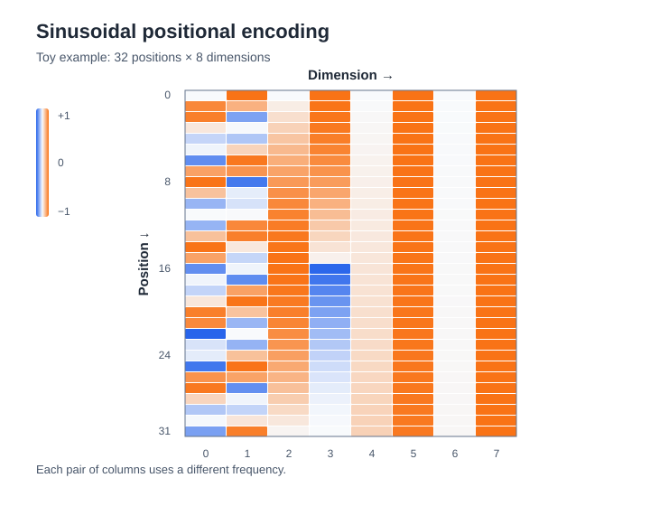

<!--
LLM-LAB-PAGE-MAP v1
id: "en/sinusoidal-positional-encoding"
summary: "Derives the original Transformer's sinusoidal encoding, interprets its frequencies and geometry, and examines its properties and limitations."
scope: "Deepens only the fixed, absolute sinusoidal encoding from Vaswani et al.: frequency schedule, wavelengths, paired representation, linear-shift property, positional similarity, implementation, and extrapolation limits. Does not repeat the general introduction to positional information or the RoPE derivation."
purpose: "Readers should be able to reconstruct the formula, explain multi-scale frequencies, derive the transformation associated with a fixed offset, implement the signal, and distinguish mathematical extrapolation from model generalization."
domain: "architectures-mechanisms"
suggested_route:
  previous: null
  next: null
hierarchy:
  parents: ["en/positional-encoding"]
  children: []
related: ["en/rope", "en/queries-keys-values", "en/scaled-dot-product-attention"]
tags: ["type:deep-dive", "destination:deepen", "topic:sinusoidal-positional-encoding", "level:advanced", "language:en", "status:published"]
-->

::: {.chapter-lead}
Sinusoidal encoding maps a position index to a deterministic vector made of sinusoids at multiple frequencies. This page reconstructs the 2017 Transformer formula, explains why frequencies are spaced logarithmically, and derives the property that makes a fixed offset accessible to a linear transformation. It also examines what that property does not guarantee.
:::

::: {.callout-tip title="The central idea"}
Each pair of dimensions traces a circle at a different speed. Fast dimensions change substantially from one token to the next; slow dimensions evolve gradually. Together they form a multi-scale positional signature. The signal can be computed for any index, but this does not guarantee that a model can generalize to longer contexts.
:::

## 1. From an index to a vector

In the original Transformer, the position is an integer \(p\) (conventionally zero-indexed), and the positional vector has the same dimension \(d_{\text{model}}\) as the token embedding. Each coordinate pair uses a sine and a cosine:

\[
\begin{aligned}
PE(p,2i) &= \sin\left(\frac{p}{10000^{2i/d_{\text{model}}}}\right),\\
PE(p,2i+1) &= \cos\left(\frac{p}{10000^{2i/d_{\text{model}}}}\right).
\end{aligned}
\]

Let the angular frequency be \(\omega_i = 10000^{-2i/d_{\text{model}}}\). A pair can then be written as:

\[
PE_i(p)=
\begin{bmatrix}
\sin(\omega_i p)\\
\cos(\omega_i p)
\end{bmatrix}.
\]

The full vector concatenates \(d_{\text{model}}/2\) pairs. The formula therefore assumes an even model dimension. The sine and cosine arguments are measured in radians.

### Why a sine-cosine pair?

A sine value alone does not uniquely determine a phase across an entire cycle: several angles have the same sine. The pair \((\sin\theta,\cos\theta)\) gives a point on the unit circle, since \(\sin^2\theta+\cos^2\theta=1\). As the position increases, this point rotates around the circle.

At \(p=0\), every pair is \([0,1]^\top\). As \(p\) increases, each pair rotates at angular speed \(\omega_i\).

## 2. Why use multiple frequencies?

The original Transformer chooses geometrically spaced frequencies:

\[
\omega_i = 10000^{-2i/d_{\text{model}}}.
\]

The index \(i\) increases by two coordinates at a time. Frequency therefore decreases by a constant factor between successive pairs:

\[
\frac{\omega_{i+1}}{\omega_i}=10000^{-2/d_{\text{model}}}.
\]

The wavelength—the number of positions required for one full cycle—is:

\[
\lambda_i=\frac{2\pi}{\omega_i}
=2\pi\,10000^{2i/d_{\text{model}}}.
\]

Wavelengths are geometrically spaced as well. The shortest is \(2\pi\) positions. The longest is \(2\pi\,10000^{1-2/d_{\text{model}}}\), which approaches \(2\pi\cdot10000\) for large dimensions. The paper describes this range approximately.

### Numerical example: \(d_{\text{model}}=8\)

There are four pairs, hence four timescales. The values below follow directly from the formula.

| Pair \(i\) | Frequency \(\omega_i\) | Wavelength \(\lambda_i\) |
|---:|---:|---:|
| 0 | 1 | 6.28 positions |
| 1 | 0.1 | 62.83 positions |
| 2 | 0.01 | 628.32 positions |
| 3 | 0.001 | 6,283.19 positions |

{fig-alt="Heatmap of sinusoidal positional-encoding values for 32 positions and 8 dimensions. Patterns vary with the frequencies of the four coordinate pairs." width=100%}

The first pairs change rapidly and are sensitive to short shifts. The last pairs change slowly and provide a reference that evolves over a wider range. These are not separately learned “near word” and “far word” slots: they are periodic components whose combinations the model may learn to use.

::: {.callout-note title="Why logarithmic spacing?"}
A linear frequency spacing would devote many dimensions to one part of the range and few to others. A geometric progression distributes frequencies regularly on a logarithmic scale: each pair multiplies the wavelength by the same factor.
:::

## 3. A fixed offset becomes a linear transformation

For one pair, write:

\[
v_i(p)=
\begin{bmatrix}
\sin(\omega_i p)\\
\cos(\omega_i p)
\end{bmatrix}.
\]

For an offset \(k\), the angle-addition identities give:

\[
\begin{aligned}
\sin(\omega_i(p+k))
&=\sin(\omega_i p)\cos(\omega_i k)
 +\cos(\omega_i p)\sin(\omega_i k),\\
\cos(\omega_i(p+k))
&=\cos(\omega_i p)\cos(\omega_i k)
 -\sin(\omega_i p)\sin(\omega_i k).
\end{aligned}
\]

Grouping the two coordinates:

\[
v_i(p+k)=
\begin{bmatrix}
\cos(\omega_i k) & \sin(\omega_i k)\\
-\sin(\omega_i k) & \cos(\omega_i k)
\end{bmatrix}
v_i(p)
=R_i(k)v_i(p).
\]

**For a fixed offset \(k\), the matrix \(R_i(k)\) does not depend on the starting position \(p\).** It depends only on the offset and the pair's frequency.

For the full vector, assemble these matrices into a block-diagonal matrix:

\[
PE(p+k)=R(k)\,PE(p).
\]

This identity explains the motivation given by Vaswani et al.: a fixed offset can be represented by a linear transformation of the positional vector. The model is therefore given a mathematical structure it can use to relate relative positions.

### Be careful with the interpretation

This does not mean that the Transformer explicitly computes the distance between every pair of tokens, or that an attention head automatically learns “look three positions back”. It means that a shared linear transformation exists for each fixed offset. The learned weights must still make use of this structure in the actual computation.

## 4. Another view: similarity depends on the offset

For one pair:

\[
\begin{aligned}
v_i(p)^\top v_i(q)
&=\sin(\omega_i p)\sin(\omega_i q)
 +\cos(\omega_i p)\cos(\omega_i q)\\
&=\cos(\omega_i(p-q)).
\end{aligned}
\]

Summing over pairs:

\[
PE(p)^\top PE(q)
=\sum_i \cos(\omega_i(p-q)).
\]

The dot product therefore depends on the offset \(p-q\), not on the absolute positions separately. Each frequency contributes its own periodicity; together they produce a multi-scale similarity function.

This quantity is the dot product of the **positional vectors alone**. It is not directly a Transformer's \(QK^\top\) attention score: token embeddings are added to the positional signal, then representations are projected and transformed by the network layers.

## 5. How does the signal enter the Transformer?

In the original Transformer, the positional vector is added to the token embedding at the input of both encoder and decoder:

\[
X_0 = E[\text{token IDs}] + PE.
\]

Both vectors have the same dimension, so they can be added. The positional signal is not a second token sequence and does not replace lexical content: it modifies the input representation by adding information about location.

This is an **absolute encoding added at the input**. It differs from [RoPE](rope.qmd), which applies rotations to queries and keys after their projections and before attention scores are computed.

## 6. Implement and verify

Here is a direct NumPy implementation. Positions are non-negative integers and the model dimension is even.

\`\`\`python
import numpy as np

def sinusoidal_encoding(max_len: int, d_model: int) -> np.ndarray:
    if d_model <= 0 or d_model % 2:
        raise ValueError("d_model must be a positive even integer")

    positions = np.arange(max_len, dtype=np.float64)[:, None]
    pair_indices = np.arange(0, d_model, 2, dtype=np.float64)
    frequencies = np.exp(-np.log(10_000.0) * pair_indices / d_model)

    angles = positions * frequencies[None, :]
    pe = np.empty((max_len, d_model), dtype=np.float64)
    pe[:, 0::2] = np.sin(angles)
    pe[:, 1::2] = np.cos(angles)
    return pe
\`\`\`

PyTorch version: the signal is registered as a buffer, so it is part of the module state but is not a learned parameter updated by the optimizer.

\`\`\`python
import math
import torch
from torch import nn

class SinusoidalPositionalEncoding(nn.Module):
    def __init__(self, d_model: int, max_len: int = 5000):
        super().__init__()
        if d_model <= 0 or d_model % 2:
            raise ValueError("d_model must be a positive even integer")

        position = torch.arange(max_len, dtype=torch.float32).unsqueeze(1)
        pair_index = torch.arange(0, d_model, 2, dtype=torch.float32)
        frequencies = torch.exp(-math.log(10_000.0) * pair_index / d_model)

        angles = position * frequencies.unsqueeze(0)
        pe = torch.zeros(max_len, d_model)
        pe[:, 0::2] = torch.sin(angles)
        pe[:, 1::2] = torch.cos(angles)
        self.register_buffer("pe", pe.unsqueeze(0))

    def forward(self, x):
        # x: [batch, sequence_length, d_model]
        length = x.size(1)
        if length > self.pe.size(1):
            raise ValueError("sequence exceeds the precomputed max_len")
        return x + self.pe[:, :length].to(dtype=x.dtype)
\`\`\`

This version precomputes a maximum number of positions. The mathematical formula can produce larger positions, but this particular module deliberately raises an error beyond \`max_len\`: the buffer would need to be extended or the signal computed on demand. The cast preserves the dtype of \`x\`, including reduced precision.

### Test the shift property

\`\`\`python
def check_shift_property(d_model=16, p=7, k=5):
    pe = sinusoidal_encoding(p + k + 1, d_model)
    for i in range(d_model // 2):
        omega = 10_000 ** (-2 * i / d_model)
        angle = omega * k
        rotation = np.array([
            [np.cos(angle),  np.sin(angle)],
            [-np.sin(angle), np.cos(angle)],
        ])
        start = pe[p, 2*i:2*i+2]
        shifted = pe[p+k, 2*i:2*i+2]
        np.testing.assert_allclose(rotation @ start, shifted, atol=1e-12)
\`\`\`

Other useful properties to test: unit norm for every pair, values between -1 and 1, frequency 1 for the first pair, determinism, and absence of learned parameters. These tests verify a mathematical identity, not whether a trained model can exploit it.

## 7. What the encoding guarantees—and what it does not

| Property | What can be claimed | What does not follow |
|---|---|---|
| Deterministic and fixed | The signal is computed from a formula, with no learned positional parameters. | That the model has no other position-related parameters. |
| Dimension-compatible | It can be added to an embedding of the same dimension. | That addition is the only way to inject position into Transformers. |
| Multi-scale | Pairs cover different frequencies and wavelengths. | That each pair corresponds to a precise linguistic distance. |
| Linear shift | A fixed offset corresponds to a fixed linear matrix per pair. | That the network automatically learns a relative-distance rule. |
| Computable at any position | The formula is defined beyond positions seen during training. | That model performance remains good beyond its training length. |

### Extrapolation: three levels not to conflate

1. **Formula extrapolation:** sine and cosine can be evaluated at an arbitrarily large index.
2. **Representation extrapolation:** the resulting vectors remain structured, but their phases continue to evolve and some combinations may become difficult to use.
3. **Model generalization:** the learned layers and weights must actually handle longer sequences correctly. The formula alone does not guarantee this.

Training length, data distributions, attention mechanisms, numerical precision, and learned weights all influence long-sequence performance. The ability to compute a vector must never be presented as proof that a model can reason over a longer context.

## 8. Check your understanding

::: {.callout-tip title="Your turn"}
1. If \(d_{\text{model}}\) doubles, how many frequency pairs are used?
2. As pair index \(i\) increases, does wavelength increase or decrease?
3. Why does the transformation associated with offset \(k\) not depend on the starting position \(p\)?
4. What is the difference between “computing the signal at position 20,000” and “successfully performing a task with a 20,000-token context”?
5. Is \(PE(p)^\top PE(q)\) a learned attention score?
:::

::: {.callout-note collapse="true" title="Answer sketch"}
1. The number of pairs changes from \(d_{\text{model}}/2\) to \(d_{\text{model}}\).
2. It increases: \(\lambda_i=2\pi\,10000^{2i/d_{\text{model}}}\).
3. Addition identities express the sine and cosine at \(p+k\) as a linear combination of those at \(p\), with coefficients depending only on \(k\) and \(\omega_i\).
4. The first is a property of the formula; the second depends on the model's learned behaviour and must be evaluated empirically.
5. No. It is a similarity between fixed positional vectors; an attention score depends on learned projections of representations.
:::

## References and learning resources

- [Vaswani et al. (2017), *Attention Is All You Need*, section 3.5](https://arxiv.org/abs/1706.03762) — primary source for the formula, wavelength progression, and relative-offset motivation.
- [Jay Alammar, *The Illustrated Transformer*](https://jalammar.github.io/illustrated-transformer/) — pedagogical visualization of positional signals in the original Transformer. The author notes that the initial visualization concatenated the signals; the paper's formula interleaves them across even and odd dimensions.
- [Harvard NLP, *The Annotated Transformer*](https://nlp.seas.harvard.edu/annotated-transformer/) — connects the formula to a PyTorch implementation and to adding the signal to embeddings.
- [Stanford, *Transformers for Signal Prediction*, lecture notes](https://web.stanford.edu/class/ee269/Lecture_Transformers.pdf) — presents logarithmic frequencies and wavelengths from a signal-oriented perspective.
- [Su et al. (2021), *RoFormer: Enhanced Transformer with Rotary Position Embedding*](https://arxiv.org/abs/2104.09864) — useful for comparing absolute sinusoidal encoding at the input with rotations used inside attention.

**Back to the concept:** [Positional encoding](positional-encoding.qmd) · **Another mechanism:** [RoPE](rope.qmd).

::: {.language-switch}
**Language:** [Français](../fr/sinusoidal-positional-encoding.qmd) · [English](sinusoidal-positional-encoding.qmd)
:::
