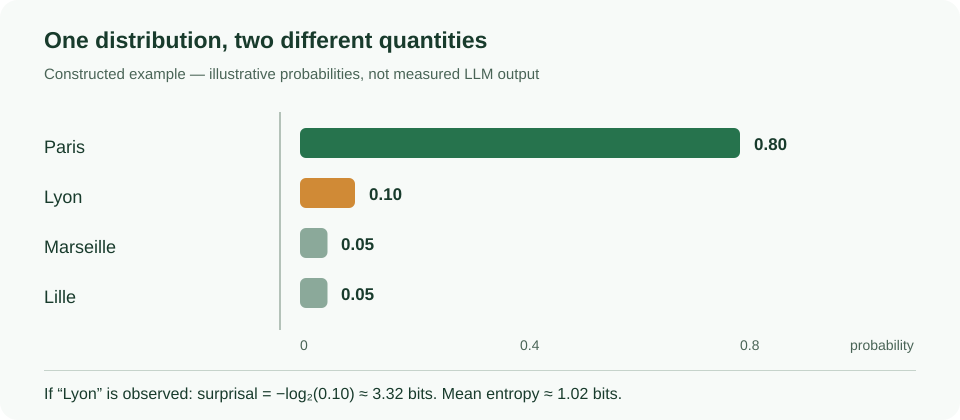

<!--
LLM-LAB-PAGE-MAP v1
id: "en/surprisal-information-content"
summary: "Explains surprisal through a worked toy predictive distribution, then connects it to entropy, conditional probabilities, and sequence scoring."
scope: "Defines I(x)=-log p(x), explains additivity for independent events and the chain rule for dependent sequences, then distinguishes observed surprisal from predictive entropy."
purpose: "Calculate the surprisal of an observed token, distinguish it from predictive entropy, and decompose a sequence score."
domain: "probabilistic-foundations-training"
suggested_route:
  previous: null
  next: null
hierarchy:
  parents: ["en/deepen"]
  children: []
related: ["en/entropy", "en/likelihood", "en/cross-entropy", "en/language-modeling-math", "en/experience-information-theory"]
tags: ["type:deep-dive", "destination:deepen", "topic:surprisal-information-content", "level:overview", "language:en", "status:published"]
-->

<!--
Editorial model: docs/advent-calendar-pilots/first-three-days-pedagogical-models.md#porte-02--combien-de-bits-contient-la-surprise-dun-evenement
Tracking issue: https://github.com/JM-Brun/llm-lab/issues/1666
This is authoring metadata; it is intentionally not rendered to readers.
-->

*LLM Lab Advent Calendar 2026 · Door 2 · about 15 minutes*

## Surprise is not an emotion

A model completes the prefix “The capital of France is…” by assigning probabilities to possible continuations. Suppose it assigns the following values. They are **constructed for explanation**, not measured outputs from a real model. In this toy vocabulary, each label represents exactly one token; a real tokenizer may segment these strings differently.

| Candidate token | Predicted probability |
|---|---:|
| `Paris` | $0.80$ |
| `Lyon` | $0.10$ |
| `Marseille` | $0.05$ |
| `Lille` | $0.05$ |

{#fig-surprisal-distribution width=95%}

Suppose the observed text nevertheless continues with `Lyon`. The model assigned this token probability $0.10$. Its surprisal is:

$$
I(\text{Lyon}\mid c)=-\log_2(0.10)\approx 3.32\text{ bits}.
$$

This number describes **the outcome that occurred**. It does not, by itself, describe the distribution's average uncertainty before the outcome was known. That second question is about entropy, which we will calculate below.

Information theory measures neither an emotion, nor the truth of a sentence, nor its semantic richness. It quantifies a probabilistic property relative to an explicitly chosen distribution.

## Measuring the self-information of an event

For an event $x$ with probability $p(x)>0$, its self-information is defined as:

$$
I(x)=-\log_b p(x).
$$

The base $b$ determines the unit:

- $b=2$: bits;
- $b=e$: nats;
- $b=10$: hartleys.

With base-2 logarithms:

| Event probability | Self-information |
|---:|---:|
| $1$ | $0$ bits |
| $1/2$ | $1$ bit |
| $1/4$ | $2$ bits |
| $1/8$ | $3$ bits |
| $1/16$ | $4$ bits |
| $1/100$ | about $6.64$ bits |

A certain event contributes zero bits under this definition: it does not reduce uncertainty about what will happen. An event with probability zero has infinite surprisal in the idealized model; in practice, this often signals that a model assigns zero probability to an observation it must nevertheless account for.

## Why use a negative logarithm?

The definition has three useful properties.

1. **Inverse monotonicity:** as probability decreases, self-information increases.
2. **Non-negativity:** for $p(x)\in(0,1]$, $I(x)\geq 0$.
3. **Additivity for independent events:** if $X$ and $Y$ are independent,

$$
\begin{aligned}
I(x,y)
&=-\log_2 p(x,y)\\
&=-\log_2\bigl(p(x)p(y)\bigr)\\
&=I(x)+I(y).
\end{aligned}
$$

This additivity is a central reason for the logarithm: probabilities multiply for independent events, while their self-information adds.

Caution: the simple additive relation above assumes independence. For dependent events, conditional probabilities are required.

## From events to sequences: the chain rule

For any two events:

$$
p(x,y)=p(x)\,p(y\mid x).
$$

Their joint self-information is therefore:

$$
I(x,y)=I(x)+I(y\mid x),
$$

where $I(y\mid x)=-\log_2 p(y\mid x)$ is the information contributed by $y$ once $x$ is known.

The same relation extends to a sequence:

$$
p(x_1,\ldots,x_T)
=\prod_{t=1}^{T}p(x_t\mid x_{<t}),
$$

and taking the negative logarithm gives:

$$
I(x_1,\ldots,x_T)
=\sum_{t=1}^{T}-\log_2 p(x_t\mid x_{<t}).
$$

A sequence's self-information is therefore the sum of its elements' conditional surprisals. Do not replace these conditional probabilities with marginal probabilities: the context changes the prediction.

### Example: three observed tokens

Suppose a model assigns the following conditional probabilities to the tokens that were actually observed:

| Position | Probability of observed token | Surprisal |
|---:|---:|---:|
| 1 | $1/2$ | $1$ bit |
| 2 | $1/4$ | $2$ bits |
| 3 | $1/8$ | $3$ bits |

The probability of the observed sequence is:

$$
p(x_1,x_2,x_3)=\frac12\times\frac14\times\frac18=\frac1{64}.
$$

Its total surprisal is therefore:

$$
-\log_2(1/64)=6\text{ bits}=1+2+3.
$$

The six bits describe this sequence's score under the model being considered. They are not the entropy of the model's distribution.

## The same event can have different surprisal in different contexts

Surprisal is not a property attached to a token alone. It depends on the probability the model assigns to it **in a particular context**.

Consider the token `Paris` in two fictional contexts. The values below are chosen for explanation; they are not outputs from a real model.

| Context | Predicted probability of `Paris` | Surprisal |
|---|---:|---:|
| “The capital of France is…” | $0.80$ | $-\log_2(0.80)\approx0.32$ bits |
| “The capital of Japan is…” | $0.01$ | $-\log_2(0.01)\approx6.64$ bits |

The token is the same, but its information content differs sharply because the conditional distributions differ. We therefore cannot assign `Paris` one unique surprisal independently of context.

This also explains why global frequency is insufficient to predict local surprisal. A word that is common in a corpus may be unexpected after a particular prefix; a globally rare form may be strongly expected in a specialized construction.

### Calculate the entropy of our toy distribution

We can now calculate the entropy of the distribution from the opening example. Multiply each outcome's surprisal by its probability, then add the contributions:

| Token | Probability | Surprisal | Contribution $p(x)I(x)$ |
|---|---:|---:|---:|
| `Paris` | $0.80$ | $0.32$ bits | $0.26$ bits |
| `Lyon` | $0.10$ | $3.32$ bits | $0.33$ bits |
| `Marseille` | $0.05$ | $4.32$ bits | $0.22$ bits |
| `Lille` | $0.05$ | $4.32$ bits | $0.22$ bits |

Therefore,

$$
H(X\mid c)\approx0.26+0.33+0.22+0.22
\approx1.02\text{ bits}.
$$

Entropy is lower than the surprisal of the observed outcome `Lyon` (about 3.32 bits). There is no contradiction: entropy is the probability-weighted average over all possible outcomes, whereas Lyon's surprisal concerns one particular outcome. Rare events can contribute substantially, but their contributions are weighted by their low probabilities.

## Observed surprisal and predictive entropy: two different questions

Fix a context $c$. A language model produces a distribution over possible tokens:

$$
p_\theta(v\mid c),\qquad v\in\mathcal V.
$$

Two quantities must be distinguished.

- **Surprisal of the observed token:** if the actual target is $y$, then $-\log p_\theta(y\mid c)$ scores that particular event.
- **Predictive entropy:** $H(p_\theta(\cdot\mid c))$ averages surprisal over all possible tokens according to the predicted distribution.

$$
H_b(X\mid c)
=-\sum_{v\in\mathcal V}p_\theta(v\mid c)
\log_b p_\theta(v\mid c).
$$

Surprisal is a value associated with an observed outcome. Entropy is an expectation before we know which outcome will be observed. A very unlikely target can have high surprisal even when the full distribution has low entropy.

For this distinction, see the [Entropy: uncertainty over the next token](entropy.qmd) lesson. [Likelihood](likelihood.qmd) formalizes the score of an observed sequence, while [cross-entropy](cross-entropy.qmd) connects a target distribution to a predicted distribution.

## From logits to surprisal: the calculation inside an LLM

In an autoregressive Transformer, the context is first transformed into internal representations. The final position produces a vector of **logits**: unnormalized real-valued scores, one per vocabulary token. Softmax turns them into probabilities:

$$
p_\theta(v\mid c)=\frac{\exp(z_v)}{\sum_{u\in\mathcal V}\exp(z_u)}.
$$

The surprisal of the observed target $y$ is then computed from its probability:

$$
I_\theta(y\mid c)=-\log_2 p_\theta(y\mid c).
$$

The conceptual path is therefore:

$$
\text{context}\rightarrow\text{logits}\rightarrow\text{softmax}\rightarrow
\text{target probability}\rightarrow\text{surprisal}.
$$

Logits are not probabilities: they may be negative, positive, or shifted by a constant without changing the softmax distribution. Surprisal depends on the normalized probability, not on the raw logit value in isolation. For the mechanics of score computation, see [Logits: from scores to a distribution](logits.qmd).

## Comparing sequences: sum, average, and tokenization unit

The sum of conditional surprisals gives the total surprisal of a sequence and corresponds, up to sign, to its log-likelihood. But a longer sequence generally accumulates more contributions. To compare sequences of different lengths, one sometimes examines average surprisal per token:

$$
\overline I(x_{1:T})=\frac{1}{T}\sum_{t=1}^{T}-\log_2 p_\theta(x_t\mid x_{<t}).
$$

This average facilitates some comparisons, but it does not solve everything. Different tokenizers may split the same text into different numbers and units; average surprisal “per token” is then not directly comparable. The tokenizer, normalization, evaluated positions, and, where relevant, character- or byte-normalized measures must be specified.

We must also distinguish sequence surprisal, average cross-entropy over a dataset, and perplexity. These quantities are related, but answer questions at different levels. The [Cross-entropy](cross-entropy.qmd) page covers average model evaluation over examples; here, we have studied the information cost of one observation under a conditional distribution.

## What surprisal does — and does not — tell us about an LLM

In an autoregressive model, the conditional surprisal of an observed token is one local contribution to the sequence's negative log-likelihood, using the chosen logarithm base. Adding these contributions gives the sequence score, subject to the conventions used for the evaluated positions.

This perspective helps explain:

- why a token that is frequent in a given context often receives lower surprisal;
- why a continuation that is unexpected under the model receives higher surprisal;
- how local scores add up along a sequence;
- why tokenization matters: text is split into different units by different tokenizers, so “surprisal per token” is not directly comparable unless the unit is specified.

But surprisal is not a direct measure of answer quality. A false statement that is common under the model may have low surprisal; a true but rare formulation may have high surprisal. It measures probabilistic fit to an observation, not truth.

## Experiment

To manipulate distributions and distinguish observed surprisal, entropy, and related metrics, use the [dedicated experiment](experience-information-theory.qmd#surprisal-experiments).

## Takeaways

- An event's self-information is $I(x)=-\log p(x)$.
- A lower probability corresponds to higher surprisal.
- The logarithm base determines the unit: bits in base 2, nats in base $e$.
- Sequence surprisal decomposes into a sum of conditional surprisals.
- Observed surprisal is not predictive entropy.
- For an LLM, these quantities depend on context, model, and tokenization unit.

## Sources and further reading

- [Shannon (1948), *A Mathematical Theory of Communication*](https://doi.org/10.1002/j.1538-7305.1948.tb01338.x) — foundations of entropy, uncertainty, and the statistical structure of information sources; [PDF version](https://people.math.harvard.edu/~ctm/home/text/others/shannon/entropy/entropy.pdf).
- [Shannon (1948), Part II](https://doi.org/10.1002/j.1538-7305.1948.tb00917.x) — continuation of the mathematical framework of information theory.

::: {.language-switch}
**Language:** [Français](../fr/surprisal-information-content.qmd) · [English](surprisal-information-content.qmd)
:::
