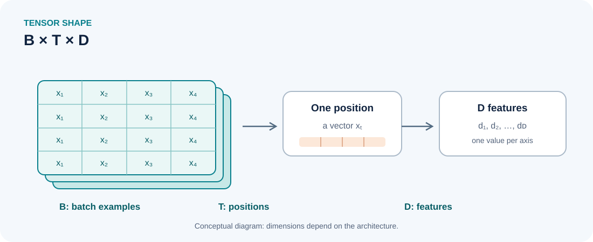

::: {.chapter-lead}
In a Transformer, tensors carry token representations, logits, masks, and gradients. Reading their axes correctly is essential: an operation can run without an error while acting on the wrong axis.
:::

{fig-alt="Tensor of shape B × T × D: B indexes examples, T indexes positions in each sequence, and D indexes features at each position." width=100%}

For a batch of texts, each sequence position is represented by a vector. The activation tensor is therefore often organized along batch, position, and feature axes.

## Common shapes in an LLM

These conventions are common:

- \(B\): batch size;
- \(T\): sequence length;
- \(D\): hidden dimension;
- \(V\): vocabulary size;
- \(H\): number of attention heads;
- \(d_h\): dimension per head, often with \(D=H d_h\).

Hidden activations often have shape \((B,T,D)\), logits \((B,T,V)\), and multi-head attention representations may have shape \((B,H,T,d_h)\). These conventions are common but not universal: read function contracts and verify actual shapes.

| Model object | Typical shape | Interpretation |
|---|---|---|
| Scalar mean loss | `()` | one aggregated objective |
| Token embedding | `(D,)` | one feature vector |
| Sequence hidden states | `(T,D)` | one vector per position |
| Batch hidden states | `(B,T,D)` | examples, positions, features |

## Reading projection dimensions

Suppose \(X\) has shape \((B,T,D)\) and projection matrix \(W\) has shape \((D,D')\), where \(D'\) is the output feature dimension. The projection applies the same transformation at every position:

\[
Y=XW,\qquad \operatorname{shape}(Y)=(B,T,D').
\]

The batch and position axes are preserved; the final axis changes from \(D\) to \(D'\). This notation avoids confusing the output dimension with \(H\), which denotes the number of attention heads below. Shape checks catch some errors but do not guarantee that axes have the intended meaning.

## Axes carry meaning

A shape gives axis sizes, not semantics. Two tensors with shape \((B,T,D)\) can represent different objects.

- **Linear projection:** typically transforms the final feature axis, for example \((B,T,D)\to(B,T,V)\) to produce logits.
- **Softmax:** for a distribution over the vocabulary, normalization must operate on axis \(V\), not axis \(T\).
- **Attention:** scores relate query and key positions; the causal mask must prevent access to future positions.
- **Loss:** logits and labels must align on positions and the expected target token.
- **Reduction:** a mean over valid tokens is not equivalent to a mean over the batch or all positions including padding.

## Reading dimensions in an example

For \(B=2\), \(T=4\), and \(D=8\), hidden states have shape \((2,4,8)\). A projection to a vocabulary of \(V=1000\) tokens produces logits of shape \((2,4,1000)\). The final axis corresponds to candidate tokens; each batch-position pair therefore has a distribution after softmax over that axis.

Shape compatibility does not guarantee that the projection, mask, causal shift, or reduction is correct. Axis meaning and target semantics must also be checked.

## A terminology caveat: array rank and mathematical tensors

In deep-learning libraries, “tensor” commonly means a multidimensional numerical array. In mathematics and physics, a tensor is a more structured object whose components obey specific transformation rules. The uses are related but not identical. Here, **array rank** means the number of axes: a scalar has rank 0, a vector rank 1, and a matrix rank 2. This is different from matrix rank in linear algebra.

## Common pitfalls

- **Indexing:** selecting one example or sequence position can remove an axis; check whether a later operation expects that dimension to remain.
- **Axis permutation:** changing axis order changes how subsequent operations interpret the data.
- **Broadcasting:** a size-one dimension may be expanded implicitly and hide an alignment bug.
- **Reshape:** changing shape does not automatically give values a new meaning.
- **Masks:** a mask broadcast over attention scores may have a compatible shape while allowing the wrong positions.
- **Numeric dtype:** float32, bfloat16, and other types have different precision, memory, and performance trade-offs.
- **Gradients:** a variable must be connected to the computation graph to receive the expected automatic gradient.

## Misconceptions to avoid

- **“A tensor must be a cube.”** No: a scalar, vector, matrix, or higher-dimensional array can be called a tensor by common deep-learning APIs.
- **“The same shape means the same meaning.”** No: axes of equal size may represent different quantities, and shape alone does not encode their semantics.
- **“Compatible dimensions prove the operation is correct.”** No: an operation may run while using the wrong axis, target alignment, or mask.

## Further reading

- [Queries, keys, and values](queries-keys-values.qmd).
- [Scaled dot-product attention](scaled-dot-product-attention.qmd).
- [Embedding space (French page; English translation pending)](../fr/embedding-space.qmd).
- [Loss](loss.qmd) and [Gradients](gradients.qmd).
- [Mathematical foundations](mathematical-foundations.qmd) — the logits-to-loss-to-gradients chain.

## References

- [PyTorch — Tensors](https://docs.pytorch.org/tutorials/beginner/introyt/tensors_deeper_tutorial.html).
- [PyTorch — Tensor documentation](https://docs.pytorch.org/docs/stable/tensors.html).
- [NumPy — N-dimensional array](https://numpy.org/doc/stable/reference/arrays.ndarray.html).
- [Sebastian Raschka — LLMs from Scratch](https://github.com/rasbt/LLMs-from-scratch) — a complementary implementation-oriented reference.
- [Visualization of tensors, part 1](https://www.youtube.com/watch?v=YxXyN2ifK8A) — a mathematical/physical perspective on tensor terminology; distinguish it from the simpler array usage common in deep-learning libraries.

:::: {.language-switch}
[Français](../fr/tensors.qmd) · [English](tensors.qmd)
::::
