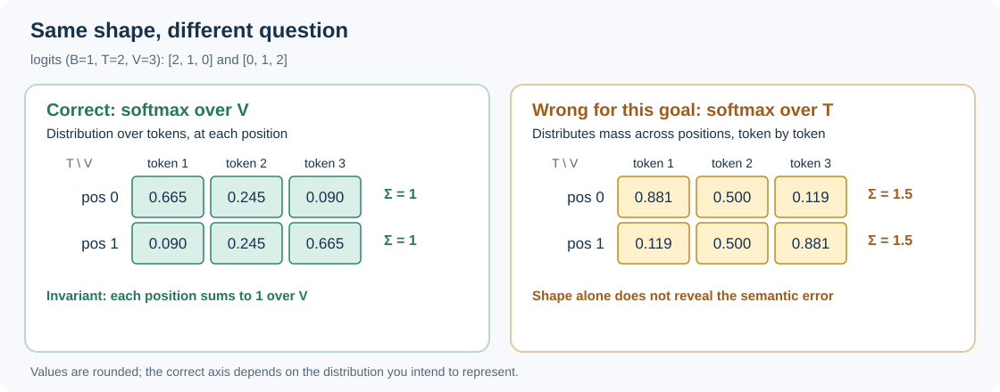

::: {.chapter-lead}
In a Transformer, tensors carry token representations, logits, masks, and gradients. Reading their axes correctly is essential: an operation can run without an error while acting on the wrong axis.
:::

{fig-alt="Tensor of shape B × T × D: B indexes examples, T indexes positions in each sequence, and D indexes features at each position." width=100%}

For a batch of texts, each sequence position is represented by a vector. The activation tensor is therefore often organized along batch, position, and feature axes.

A tensor's shape describes how representations are organised numerically, not what they mean. For the conceptual level, see [embedding space](embedding-space.qmd), then the [Representation geometry and interpretability](embedding-space.qmd) path on proximity metrics and representation hypotheses.

## Common shapes in an LLM

These conventions are common:

- \(B\): batch size;
- \(T\): sequence length;
- \(D\): hidden dimension;
- \(V\): vocabulary size;
- \(H\): number of attention heads;
- \(d_h\): dimension per head, often with \(D=H d_h\).

Hidden activations often have shape \((B,T,D)\), logits \((B,T,V)\), and multi-head attention representations may have shape \((B,H,T,d_h)\). These conventions are common but not universal: read function contracts and verify actual shapes.

| Model object | Typical shape | Interpretation |
|---|---|---|
| Scalar mean loss | `()` | one aggregated objective |
| Token embedding | `(D,)` | one feature vector |
| Sequence hidden states | `(T,D)` | one vector per position |
| Batch hidden states | `(B,T,D)` | examples, positions, features |

## Reading projection dimensions

Suppose \(X\) has shape \((B,T,D)\) and projection matrix \(W\) has shape \((D,D')\), where \(D'\) is the output feature dimension. The projection applies the same transformation at every position:

\[
Y=XW,\qquad \operatorname{shape}(Y)=(B,T,D').
\]

The batch and position axes are preserved; the final axis changes from \(D\) to \(D'\). This notation avoids confusing the output dimension with \(H\), which denotes the number of attention heads below. Shape checks catch some errors but do not guarantee that axes have the intended meaning.

## Axes carry meaning

A shape gives axis sizes, not semantics. Two tensors with shape \((B,T,D)\) can represent different objects.

- **Linear projection:** typically transforms the final feature axis, for example \((B,T,D)\to(B,T,V)\) to produce logits.
- **Softmax:** for a distribution over the vocabulary, normalization must operate on axis \(V\), not axis \(T\).
- **Attention:** scores relate query and key positions; the causal mask must prevent access to future positions.
- **Loss:** logits and labels must align on positions and the expected target token.
- **Reduction:** a mean over valid tokens is not equivalent to a mean over the batch or all positions including padding.


## Counterexample: softmax over the wrong axis

Consider logits for one example, two positions, and three candidate tokens:

```text
position 0 : [2, 1, 0]
position 1 : [0, 1, 2]
shape       : (B=1, T=2, V=3)
```

At each position, we want a distribution over **candidate tokens**. Softmax must therefore operate on axis \(V\), the final axis in this convention:

```python
probs = logits.softmax(dim=-1)  # normalize the 3 tokens at each position
```

The probabilities sum to 1 over \(V\) at each position. For these logits, the rows are approximately `[0.665, 0.245, 0.090]` and `[0.090, 0.245, 0.665]`.

By contrast:

```python
wrong = logits.softmax(dim=1)  # normalize the 2 positions, separately for each token
```

For this example, the rows become approximately `[0.881, 0.500, 0.119]` and `[0.119, 0.500, 0.881]`; each sums to 1.5, not 1. This operation is mathematically valid and shape-compatible, but answers a different question: for each candidate token, it distributes mass across positions. The rows are generally no longer distributions over the vocabulary.

**Debugging invariant:** if the output is intended to represent \(p(\text{token}\mid\text{context at this position})\), check that probabilities sum to 1 over the vocabulary axis for every batch-position pair. Correct shape is not enough; the invariant depends on the intended interpretation.

{fig-alt="The left matrix normalized over V has each row sum to one. The right matrix normalized over T has row sums of 1.5, showing a shape-compatible but semantically incorrect operation for next-token probabilities." width=100%}

*Figure — The same logits produce different meanings depending on the normalized axis.*

## Implementation: verify axis semantics with PyTorch

The following minimal example is executable with PyTorch. It checks both the output shape and the invariant that each position's probabilities sum to one over the vocabulary axis. It also confirms that normalizing over the sequence axis answers a different question.

```python
import torch

# Shape: (batch=1, positions=2, vocabulary=3)
logits = torch.tensor([[[2.0, 1.0, 0.0], [0.0, 1.0, 2.0]]])

probs = torch.softmax(logits, dim=-1)  # distribution over vocabulary at each position
wrong = torch.softmax(logits, dim=1)   # distribution over positions for each token

assert probs.shape == (1, 2, 3)
torch.testing.assert_close(probs.sum(dim=-1), torch.ones((1, 2)))
torch.testing.assert_close(wrong.sum(dim=1), torch.ones((1, 3)))
assert not torch.allclose(wrong.sum(dim=-1), torch.ones((1, 2)))

print(probs[0])  # approximately [[0.665, 0.245, 0.090], [0.090, 0.245, 0.665]]
print(wrong[0].sum(dim=-1))  # approximately [1.5, 1.5], not a vocabulary distribution
```

The assertions make the intended semantics explicit. They are a compact teaching check, not a substitute for tests of a model's masking, target alignment, padding policy, or generation path. In production code, keep reusable operations in the project package and test them independently.


## Reading dimensions in an example

For \(B=2\), \(T=4\), and \(D=8\), hidden states have shape \((2,4,8)\). A projection to a vocabulary of \(V=1000\) tokens produces logits of shape \((2,4,1000)\). The final axis corresponds to candidate tokens; each batch-position pair therefore has a distribution after softmax over that axis.

Shape compatibility does not guarantee that the projection, mask, causal shift, or reduction is correct. Axis meaning and target semantics must also be checked.


## General foundations

This page applies tensors to Transformers. For reusable concepts beyond LLMs—shapes, axes, indexing, reductions, broadcasting, and the distinction between software arrays and mathematical tensors—see the canonical [Wiki Knowledge page on tensors and multidimensional arrays](https://github.com/JM-Brun/wiki-knowledge/blob/main/wiki/concepts/tenseurs-et-tableaux-multidimensionnels.md). This chapter keeps the (B,T,D,V,H) conventions, language-model-specific shapes, and common mistakes in that context.

## Connections to other fields

Axes are not just indices: they define the question being asked of the data. The same idea appears elsewhere, with important differences.

- **Signal processing:** an array of shape \((T,C)\) may represent time and sensor channels. Reducing over \(T\) computes a temporal statistic; reducing over \(C\) combines channels. Same operation, different meaning. [NumPy — array creation and dimensions](https://numpy.org/doc/stable/user/basics.creation.html) introduces the underlying array model.
- **Databases and tabular analysis:** rows and columns have a semantic schema. Swapping columns without updating their interpretation can preserve a valid table while corrupting the analysis. Tensor dimensions play a similar role, although numeric axes can also be reordered and implicitly broadcast.
- **Physics and geometry:** a mathematical tensor in the strict sense has components that follow transformation laws under a change of coordinates. A high-rank PyTorch array is not automatically such a tensor. The distinction matters when studying vectors, bases, coordinate changes, and invariance.
- **Probability and information theory:** softmax defines a distribution only relative to a specific set of categories. In an LLM, that set is often the vocabulary; normalizing over positions produces a different quantity, not a token distribution.

These connections are optional reading paths, not prerequisites. They could become standalone pages in a broader knowledge base; the LLM Lab learning path should remain understandable without those deeper dives.

## A terminology caveat: array rank and mathematical tensors

In deep-learning libraries, “tensor” commonly means a multidimensional numerical array. In mathematics and physics, a tensor is a more structured object whose components obey specific transformation rules. The uses are related but not identical. Here, **array rank** means the number of axes: a scalar has rank 0, a vector rank 1, and a matrix rank 2. This is different from matrix rank in linear algebra.

## Common pitfalls

- **Indexing:** selecting one example or sequence position can remove an axis; check whether a later operation expects that dimension to remain.
- **Axis permutation:** changing axis order changes how subsequent operations interpret the data.
- **Broadcasting:** a size-one dimension may be expanded implicitly and hide an alignment bug.
- **Reshape:** changing shape does not automatically give values a new meaning.
- **Masks:** a mask broadcast over attention scores may have a compatible shape while allowing the wrong positions.
- **Numeric dtype:** float32, bfloat16, and other types have different precision, memory, and performance trade-offs.
- **Gradients:** a variable must be connected to the computation graph to receive the expected automatic gradient.

## Misconceptions to avoid

- **“A tensor must be a cube.”** No: a scalar, vector, matrix, or higher-dimensional array can be called a tensor by common deep-learning APIs.
- **“The same shape means the same meaning.”** No: axes of equal size may represent different quantities, and shape alone does not encode their semantics.
- **“Compatible dimensions prove the operation is correct.”** No: an operation may run while using the wrong axis, target alignment, or mask.

## Further reading

- [Queries, keys, and values](queries-keys-values.qmd).
- [Scaled dot-product attention](scaled-dot-product-attention.qmd).
- [Embedding space](embedding-space.qmd).
- [Loss](loss.qmd) and [Gradients](gradients.qmd).
- [Mathematical foundations](mathematical-foundations.qmd) — the logits-to-loss-to-gradients chain.

## References

- [PyTorch — Tensors](https://docs.pytorch.org/tutorials/beginner/introyt/tensors_deeper_tutorial.html).
- [PyTorch — Tensor documentation](https://docs.pytorch.org/docs/stable/tensors.html).
- [NumPy — N-dimensional array](https://numpy.org/doc/stable/reference/arrays.ndarray.html).
- [Sebastian Raschka — LLMs from Scratch](https://github.com/rasbt/LLMs-from-scratch) — a complementary implementation-oriented reference.
- [Visualization of tensors, part 1](https://www.youtube.com/watch?v=YxXyN2ifK8A) — a mathematical/physical perspective on tensor terminology; distinguish it from the simpler array usage common in deep-learning libraries.

:::: {.language-switch}
[Français](../fr/tensors.qmd) · [English](tensors.qmd)
::::
