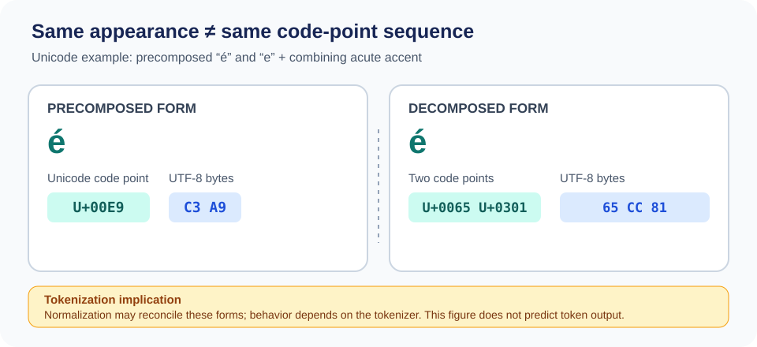
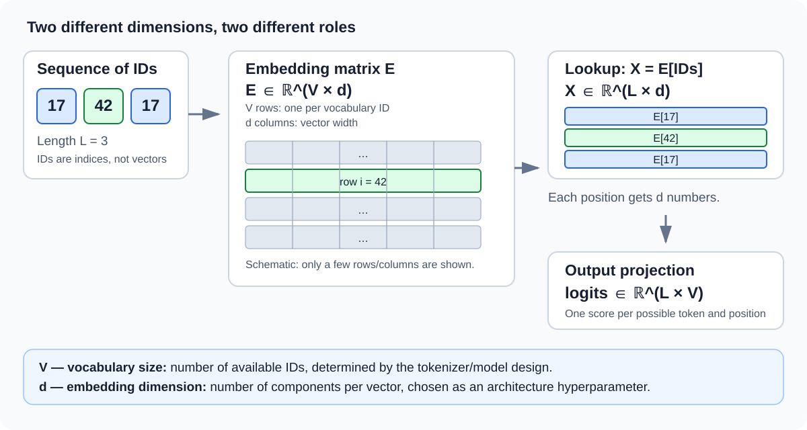
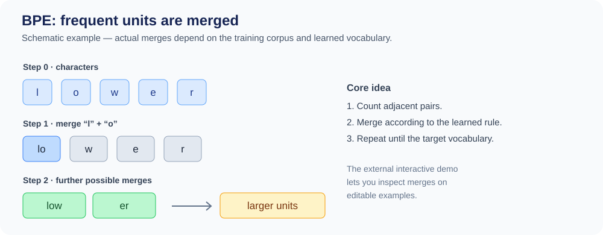

::: {.chapter-lead}
A language model receives a sequence of numerical IDs, not raw text. Tokenization defines how text becomes IDs and how IDs are decoded. It is separate from the neural network, but affects vocabulary, sequence length, compute cost, and some observable behaviours.
:::

::: {.callout-tip}
**The key chain:** Unicode text → tokens → IDs → embedding vectors → contextual representations. Each arrow is a distinct transformation; in particular, do not confuse **vocabulary size** ($V$) with **embedding dimension** ($d$).
:::

## Learning objectives

- Distinguish Unicode text, bytes, tokens, token IDs, and embeddings.
- Explain why whitespace splitting is insufficient.
- Describe BPE intuition and separate tokenizer training from encoding at inference time.
- Select complementary resources: visual intuition, educational code, and technical documentation.
- Identify what tokenization does not establish about a model's meaning representations or capabilities.

## 1. From text to numerical input

A Python string represents Unicode text. UTF-8 encoding produces bytes. A tokenizer then applies splitting rules and a vocabulary to produce tokens and integer IDs.

The complete pipeline is detailed in the “From a string to an embedding” diagram below, which distinguishes pre-tokenization, vocabulary, tokens, IDs, embedding lookup, and contextual representations.

This pipeline is conceptual: tokenizers differ in normalization, base units, pre-tokenization, vocabulary, and special-token handling.

The string `"ChatGPT is learning."` may be split into words, subwords, characters, or byte fragments depending on the tokenizer. There is no unique segmentation that is the linguistically “correct” one. Token IDs are discrete labels: ID 314 is not inherently closer in meaning to ID 315. An ID is not an embedding; the model learns a vector associated with each embedding-table entry.

### Four objects to keep distinct

- **Unicode** defines a character repertoire and related properties; it does not determine token segmentation.
- **UTF-8** encodes Unicode code points as bytes; one character can occupy multiple bytes.
- **Tokenization** maps text to units from a chosen vocabulary.
- An **embedding** is a learned vector associated with an ID, not another representation of the ID itself.


### Unicode and UTF-8: an invisible difference that matters

{fig-alt="Comparison of precomposed é (U+00E9, bytes C3 A9) and e followed by a combining acute accent (U+0065 U+0301, bytes 65 CC 81). Normalization may reconcile them before tokenization." width=100%}

This original LLM Lab figure is based on the encoding rules in [UTF-8 (RFC 3629)](https://www.rfc-editor.org/rfc/rfc3629) and the normalization forms described in [Unicode Standard Annex #15](https://www.unicode.org/reports/tr15/). It illustrates encoding, not the output of a particular tokenizer.

```python
import unicodedata

composed = "é"
decomposed = "e\u0301"

print([f"U+{ord(char):04X}" for char in composed])
# ['U+00E9']
print(composed.encode("utf-8"))
# b'\xc3\xa9'

print([f"U+{ord(char):04X}" for char in decomposed])
# ['U+0065', 'U+0301']
print(decomposed.encode("utf-8"))
# b'e\xcc\x81'

print(unicodedata.normalize("NFC", composed) == unicodedata.normalize("NFC", decomposed))
# True
```

The two strings can look identical while their Unicode sequences and UTF-8 bytes differ before normalization. A tokenizer may apply normalization, but its exact policy depends on the implementation. **Do not infer tokens or IDs from this figure**: inspect the actual tokenizer and version.

### Same text, potentially different segmentations

The same string can produce different fragments and IDs with different tokenizers. This table is schematic; it does not claim to reproduce any real encoder's output.

| Stage | Tokenizer A | Tokenizer B |
|---|---|---|
| Fragments | `[fragment 1]`, `[fragment 2]`, `[fragment 3]` | `[fragment 1]`, `[fragment 2]` |
| IDs | Depend on vocabulary A | Depend on vocabulary B |
| Compatible model | Weights trained with A | Weights trained with B |

This comparison only illustrates that segmentation and sequence length can change. It does not show that one tokenizer is better or that its fragments correspond to units of meaning.


### From a string to an embedding: the transformations

```{mermaid}
flowchart TD
    A["Unicode text"] --> B["Optional normalization"]
    B --> C["Pre-tokenization"]
    C --> D["Algorithm + learned vocabulary"]
    D --> E["Tokens: text or byte fragments"]
    E --> F["Integer IDs: vocabulary indices"]
    F --> G["Lookup in matrix E"]
    G --> H["Vectors: E[id]"]
    H --> I["Neural network: contextual representations"]
```

### Vocabulary size ≠ embedding dimension

Here, **vocabulary** means the finite set of tokens the tokenizer can emit, not a list of linguistic words. Its size, denoted $V$, is the number of vocabulary entries/IDs. A token may be a word, subword, byte fragment, punctuation mark, or special token.

The **embedding dimension**, denoted $d$, is the number of components in the vector associated with each ID. It is chosen when designing the model architecture; it is **not computed from $V$**. In many GPT-style models it matches the Transformer's hidden width, but that is an architectural convention rather than a universal law.

{fig-alt="IDs select rows in E with shape V by d. A sequence of length L becomes a matrix L by d; the output projection produces logits of shape L by V." width=100%}

::: {.callout-note}
**Dimensions to remember**

- **$V$**: number of vocabulary tokens/IDs — tied to tokenizer design.
- **$d$**: number of components per embedding — an architecture hyperparameter.
- **$L$**: number of tokens in a given sequence.
- **$B$**: number of sequences in a batch.
:::

For a sequence of IDs $[i_1,\ldots,i_L]$, the embedding matrix is $E\in\mathbb{R}^{V\times d}$ and lookup selects the corresponding rows:

$
X = E_{[i_1,\ldots,i_L]}\in\mathbb{R}^{L\times d}.
$

For a batch, the shape is typically $[B,L,d]$. **Lookup does not yet compute meaning in context**: it selects learned vectors; Transformer blocks subsequently produce contextual representations.

### How are these dimensions chosen?

- **$V$ is determined by the tokenizer**: corpus and preprocessing, algorithm (for example BPE or unigram), rules and target vocabulary size, plus special-token handling. The exact size is a design choice and may differ from a requested target depending on the implementation.
- **$d$ is determined by the architecture**: it is a hyperparameter chosen alongside depth, number of attention heads, compute budget, and training goals. There is no universal formula that derives $d$ from $V$.
- **Parameter count depends on both**: the embedding table contains $Vd$ parameters. If the output projection has its own weight matrix, it typically adds about $dV$ parameters (plus a possible bias). Some models share input and output weights (*weight tying*), so do not automatically count both matrices without checking the architecture. The $V$ used by the matrix must match the IDs actually supported by the model, including the special tokens it recognizes.

::: {.callout-warning}
**Changing the tokenizer is not a drop-in replacement.** IDs do not retain the same meaning across vocabularies. The embedding-table and output-projection weights were learned for specific IDs; changing $V$ or the ID assignment requires an explicit adaptation or retraining strategy.
:::

Logits have one component per possible token; the [cross-entropy page](cross-entropy.qmd) explains how these scores are compared with the target during training. For tensor shapes and batch operations, see [the tensors page](tensors.qmd). To distinguish initial token embeddings from post-attention representations, see [embedding space](embedding-space.qmd); the rest of the pipeline is covered in [the Transformer page](transformer.qmd).

### Four complementary visual perspectives

The diagram above gives the overall pipeline. These external resources illuminate different aspects without copying their figures into this repository:

- **Algorithm, step by step —** [BPE Explainer by Philip Müller and Peter Steinbach](https://philipmueller.dev/bpe-visualization/): an interactive view of candidate pairs, merges, and vocabulary growth. It is the most useful complement for understanding BPE mechanics; keep the demo's conventions distinct from those of a production tokenizer.
- **End-to-end pipeline —** [Raschka, *Build a Large Language Model (From Scratch)*, Chapter 2](https://livebook.manning.com/book/build-a-large-language-model-from-scratch/chapter-2): look in particular at Figure 2.4 on text processing. It provides the broader LLM context, while the local diagram above makes normalization, pre-tokenization, and embedding-table lookup more explicit.
- **Multilingual consequences —** [Ahia et al. (2023), PDF, Figure 1](https://aclanthology.org/2023.emnlp-main.614.pdf) ([paper page](https://aclanthology.org/2023.emnlp-main.614/)): places English and Greek examples side by side and connects tokenization to usage cost. It adds a socio-technical perspective that the pipeline alone cannot show; the figure illustrates a problem but does not summarize the paper's full analysis.
- **Unicode and normalization —** the [official Unicode normalization charts](https://www.unicode.org/charts/normalization/) are a technical reference for exploring normalized forms, complementing the original “é” figure above.

For a narrated, code-oriented walkthrough, [Karpathy's *Let's build the GPT Tokenizer*](https://www.youtube.com/watch?v=zduSFxRajkE) covers Unicode/UTF-8, BPE, pre-tokenization, and special tokens.

### Images embedded in the site

The two illustrations below are SVG files versioned in this repository. They render directly in the page, without an external document viewer. They are original, schematic illustrations; reference sources are linked separately.

#### BPE: inspect the merges

{fig-alt="Schematic BPE merge steps from individual characters to longer units." width=100%}

To experiment with editable examples in an interactive tool, open the [BPE Explainer by Philip Müller and Peter Steinbach](https://philipmueller.dev/bpe-visualization/). That demo is external; the illustration above is stored in this repository.

#### Tokenization cost across languages

{fig-alt="Conceptual comparison of token sequences of different lengths representing equivalent content." width=100%}

This is an original conceptual illustration. For scientific results, read [Ahia et al. (2023), *Do All Languages Cost the Same?*](https://aclanthology.org/2023.emnlp-main.614/); [the original PDF](https://aclanthology.org/2023.emnlp-main.614.pdf) is linked separately. Figure 1 from the paper is not copied into this repository.

#### GPT tokenizer: video thumbnail

[](https://www.youtube.com/watch?v=zduSFxRajkE)

The thumbnail above is displayed as an image and links to [the original YouTube video](https://www.youtube.com/watch?v=zduSFxRajkE).


**Rights and provenance:** external figures are cited and linked, but are not copied into the repository without established permission. The SVGs above are original, schematic LLM Lab illustrations; they do not claim to reproduce a publication's results.

Token IDs are row indices, not semantic coordinates: the numerical difference between two IDs has no intrinsic meaning. The positional step depends on the architecture; [positional encoding and RoPE](positional-encoding.qmd) explains the main distinction.

## 2. Why whitespace splitting is not enough

It handles punctuation, contractions, languages without spaces between words, spelling variants, rare names, and technical strings poorly. A vocabulary containing every possible word would be huge and still fragile for novel forms.

Subword methods reuse frequent units while retaining a way to represent less frequent forms. But this segmentation is an engineering decision, not a perfect morphological analysis.

## 3. The intuition behind Byte Pair Encoding (BPE)

In a simplified educational version, BPE starts from base units, counts adjacent pairs, merges a selected pair according to a defined rule, and repeats until a stopping criterion is met.

To inspect merges and vocabulary growth step by step, use the [original interactive BPE Explainer by Müller and Steinbach](https://philipmueller.dev/bpe-visualization/). It visualizes frequent pairs, merges, and the growing vocabulary.

The pipeline is still simplified: real tokenizers may use regex-based pre-tokenization, operate at the byte level, and reserve special tokens. Two tokenizers called BPE are therefore not necessarily compatible.

Distinguish:

1. **Tokenizer training** learns the vocabulary, merge order, and rules from a corpus.
2. **Encoding** applies the already learned tokenizer; it does not relearn the vocabulary for every request.

A byte-level BPE tokenizer can represent arbitrary text inputs using byte-level base units. Not every BPE tokenizer is byte-level, and segmentation also depends on pre-tokenization and the learned vocabulary.

```{mermaid}
flowchart LR
    subgraph Train["Tokenizer training"]
        A["Corpus"] --> B["Pre-tokenization and base units"]
        B --> C["Pair counts and merges"]
        C --> D["Vocabulary + merge order"]
        D --> E["Saved tokenizer"]
    end
    subgraph Use["Encoding new text"]
        F["New text"] --> G["Previously learned rules"]
        E -. "reused" .-> G
        G --> H["Tokens then IDs"]
        H --> I["Compatible model"]
    end
```

This diagram separates **tokenizer training** from **encoding**. It does not depict neural-network training, which is a distinct stage: the model learns its parameters from ID sequences and its training objectives.


### Worked example: BPE merges on a tiny corpus

Educational convention: words start as characters plus an end-of-word marker `</w>`. The corpus contains one occurrence each of `low`, `lower`, and `lowest`.

| Word | Initial units |
|---|---|
| `low` | `l · o · w · </w>` |
| `lower` | `l · o · w · e · r · </w>` |
| `lowest` | `l · o · w · e · s · t · </w>` |

At each iteration, BPE counts adjacent pairs and merges a pair according to its selection rule. Suppose tie-breaking selects `l + o → lo` first, then `lo + w → low`.

| Step | `low` | `lower` | `lowest` |
|---|---|---|---|
| 0 | `l · o · w · </w>` | `l · o · w · e · r · </w>` | `l · o · w · e · s · t · </w>` |
| 1: merge `l + o` | `lo · w · </w>` | `lo · w · e · r · </w>` | `lo · w · e · s · t · </w>` |
| 2: merge `lo + w` | `low · </w>` | `low · e · r · </w>` | `low · e · s · t · </w>` |

**For a step-by-step visual trace of merges**, see the [BPE Explainer by Müller and Steinbach](https://philipmueller.dev/bpe-visualization/). The table above remains the local, reproducible textual trace used in this guide; the external interactive visualization adds a richer view without repeating a third flowchart here.

This traces merges; it is not a universal output. Frequencies, pre-tokenization, end-of-word handling, and tie-breaking affect the actual order. Later merges might create `er` or `est`, but that is not guaranteed. During encoding, the tokenizer applies learned rules; it does not recount frequencies from the input. An ID is assigned in the final vocabulary; it is not the merge operation itself.

## 4. Consequences for the model

- **Context length:** the same text can become a different number of tokens with different tokenizers.
- **Compute cost:** for a fixed architecture, longer sequences generally increase attention cost and memory requirements.
- **Output vocabulary:** vocabulary size determines, among other things, the dimension of the logits distribution.
- **Robustness:** multilingual text, code, numbers, and unusual characters may be segmented differently.
- **Compatibility:** IDs are interpretable only with the corresponding vocabulary and rules. Changing tokenizers without adapting model weights is not a neutral substitution.

Tokenization guarantees neither semantic understanding, truth, nor calibration. It defines the discrete representation on which the model learns.

## 5. Beyond compression: language equity and evaluation

Token count is a useful measure of **representation cost**, not a sufficient measure of quality. A tokenizer may compress a corpus efficiently overall while representing some languages, scripts, morphological forms, or text types less efficiently. Conversely, reducing token count does not by itself guarantee better downstream performance.

Trade-offs should be evaluated along several axes without assuming a simple causal relationship:

- **Intrinsic measurements**: fertility, token length, compression, and coverage.
- **System cost**: context consumed, memory, latency, and throughput.
- **Downstream results**: quality by language and task under comparable budgets.

Compare tokenizers on controlled text, versions, normalization rules, and budgets, followed by evaluation on relevant downstream tasks.

Research resources for this complementary perspective:

- [Ahia et al. (2023) — *Do All Languages Cost the Same?*](https://aclanthology.org/2023.emnlp-main.614/): studies tokenization cost differences across 22 languages and their implications for APIs.
- [Ali et al. (2024) — *Tokenizer Choice For LLM Training: Negligible or Crucial?*](https://aclanthology.org/2024.findings-naacl.247/): shows why tokenizer choice can affect cost and downstream performance, while noting that intrinsic metrics do not always predict downstream results.
- [Wegmann et al. (2025) — *Tokenization is Sensitive to Language Variation*](https://aclanthology.org/2025.findings-acl.572/): a complementary perspective on linguistic variation and the role of the pre-tokenizer.
- [Arnett et al. (2025) — *Explaining and Mitigating Crosslingual Tokenizer Inequities*](https://proceedings.neurips.cc/paper_files/paper/2025/hash/5b91cefbfa52340af2f16f249572dc76-Abstract-Conference.html): analyzes cross-language cost differences and design factors such as vocabulary size and pre-tokenization.
- [TokLens (ACL 2026 SRW)](https://aclanthology.org/2026.acl-srw.18/): a recent toolkit for multilingual comparisons. Treat it as a tool and study to inspect, not as evidence that a single intrinsic metric is sufficient.

**Critical-reading question:** if tokenizer A uses 20% fewer tokens than B on one text, what has been demonstrated? Only a sequence-length difference for that text and those versions. A quality claim requires additional measurements and appropriate evaluations.

## 6. A curated resource library

The resources are complementary. A useful progression is to build intuition, read an implementation, and then verify details in technical documentation.

### Intuition, visualizations, and courses

- [Andrej Karpathy — *Let's build the GPT Tokenizer*](https://www.youtube.com/watch?v=zduSFxRajkE): a long illustrated walkthrough from Unicode/UTF-8 to BPE merges, special tokens, and practical pitfalls.
- [Sebastian Raschka — *Build an LLM from Scratch*](https://www.sebastianraschka.com/llms-from-scratch/): Chapter 2 places tokens in the pipeline from text data to embeddings and input-target examples.
- [Hugging Face — Tokenizers course](https://huggingface.co/learn/llm-course/chapter6/1): structured explanations of algorithms and trade-offs; check the current course version.

### Interactive visualizations and comparisons

- [Philip Müller & Peter Steinbach — BPE Explainer](https://philipmueller.dev/bpe-visualization/) : step-by-step interactive visualization for observing pair merges and vocabulary growth. Treat it as an educational demonstration, then compare its conventions with a production tokenizer.
- [Cornell CS4782 — Interactive Tokenization Visualizer](https://www.cs.cornell.edu/courses/cs4782/2026sp/demos/bytepair/) : interactive comparison of BPE and WordPiece. Useful for isolating algorithm-family differences, although its teaching examples do not cover every production variant. **UI caveat (checked 2026-10-29):** the selected-merge panel displayed “Frequency: undefined” while the candidate-pair list showed counts; treat that selected value as unreliable unless the page has since been fixed.
- [Hugging Face — BPE, French course](https://huggingface.co/learn/llm-course/fr/chapter6/5?fw=tf) : structured explanation of BPE training that complements the visual intuition with a more systematic account.
- [Saurav Prateek — visualizing BPE encoding with Hugging Face](https://huggingface.co/blog/SauravP97/bpe-tokenizer-visualize) : example of visualizing a text's merge path. This is a community article; check current code and dependency compatibility before running it.

### Educational code

- [OpenAI `tiktoken` — educational module](https://github.com/openai/tiktoken/blob/main/tiktoken/_educational.py): simplified BPE code that makes merges inspectable; do not treat it as the optimized production path.
- [Andrej Karpathy — `minbpe`](https://github.com/karpathy/minbpe): compact code for tracing training and encoding; compare conventions before assuming compatibility.
- [Sebastian Raschka — BPE from scratch](https://sebastianraschka.com/blog/2025/bpe-from-scratch.html): an explanatory notebook.
- [Raschka — repository, Chapter 2](https://github.com/rasbt/LLMs-from-scratch/tree/main/ch02): code for tokenization and text-data preparation.

### Technical references and alternatives

- [OpenAI — `tiktoken`](https://github.com/openai/tiktoken): fast BPE library for supported OpenAI model encodings.
- [Google — SentencePiece](https://github.com/google/sentencepiece): can train directly from raw text and supports BPE and the unigram language model. It is not merely another name for tiktoken.
- [Hugging Face — Tokenizers](https://github.com/huggingface/tokenizers): performant implementations of several algorithms.
- [Gage (1994), *A New Algorithm for Data Compression*](https://dl.acm.org/doi/10.5555/177910.177914): historical reference for byte-pair compression. Modern LLM tokenizers add conventions; the historical paper alone does not specify every detail of GPT BPE.

### Suggested reading order

1. Watch Karpathy to build intuition about bytes, merges, and special tokens.
2. Read `minbpe` or `tiktoken/_educational.py` to trace the algorithm.
3. Compare the tiktoken, SentencePiece, and Hugging Face documentation.
4. Return to Raschka's Chapter 2 to see how IDs feed into the rest of the pipeline.
5. Test multilingual text, code, numbers, whitespace, and unusual Unicode characters.

This page links to resources rather than copying their illustrations. Repositories evolve; availability does not automatically validate every claim.

## 7. Mini-lab: compare tokenizers

Use the visualizers above with the same strings and record the differences. Do not compare raw IDs across vocabularies as if they shared a meaning.

| Input to test | Learning question | What to inspect |
|---|---|---|
| `Hello world` and ` Hello world` | Does a leading space matter? | Pre-tokenization rules and tokens that include a space |
| `ChatGPT`, `chatgpt`, `CHATGPT` | Does casing change segmentation? | Segmentation and any normalization |
| `2026-10-28` and `123456789` | Are digits always one token? | Number segmentation varies by tokenizer and string |
| `café` and `cafe\u0301` | Are visually similar strings identical? | Composed/decomposed Unicode and possible normalization |
| A sentence in French, English, and a language that does not typically separate words with spaces | Is token cost uniform? | Sequence length and language dependence |
| A code snippet | Are names and symbols segmented intuitively? | Partial tokens, punctuation, and effects on sequence length |

**Minimal lab record:** for each string, record tokenizer/version, visible tokens, token count, and one interpretation limit. Token count alone measures neither linguistic nor model quality.

## 8. Counterexamples and common misconceptions

- **“A token is a word.”** False: it may be a subword, punctuation, a fragment with a space, bytes, or a special token.
- **“BPE identifies roots and suffixes.”** Not necessarily: it merges statistically and does not guarantee morphological analysis.
- **“Two BPE tokenizers produce the same IDs.”** Generally false: vocabularies, pre-tokenization, and rules may differ.
- **“The ID contains meaning.”** Not by itself: it is a discrete label; vectors are learned.
- **“An unknown string cannot be encoded.”** Not necessarily: byte-level tokenizers have base units that cover bytes, subject to their encoding rules.
- **“The tokenizer is a Transformer layer.”** It is a separate stage, although the tokenizer and model must be compatible.

## Go deeper: tokenization strategies

The guide [Tokenization strategies: granularity, algorithms, and trade-offs](tokenization-strategies.qmd) compares word, character, byte, subword, BPE, WordPiece, and unigram approaches.

## Continue learning

- [GPT and Transformers: architecture and data flow](transformer.qmd)
- [Tensors](tensors.qmd)
- [Embedding space](embedding-space.qmd)
- [Mathematical foundations](mathematical-foundations.qmd)
- [Full curriculum and source-coverage plan](https://github.com/JM-Brun/llm-lab/blob/main/docs/full-curriculum-plan.md)

:::: {.language-switch}
**Language:** [Français](../fr/text-data.qmd) · [English](text-data.qmd)
::::
