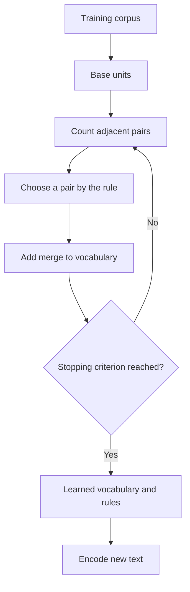

::: {.chapter-lead}
A language model receives a sequence of numerical IDs, not raw text. Tokenization defines how text becomes IDs and how IDs are decoded. It is separate from the neural network, but affects vocabulary, sequence length, compute cost, and some observable behaviours.
:::

## Learning objectives

- Distinguish Unicode text, bytes, tokens, token IDs, and embeddings.
- Explain why whitespace splitting is insufficient.
- Describe BPE intuition and separate tokenizer training from encoding at inference time.
- Select complementary resources: visual intuition, educational code, and technical documentation.
- Identify what tokenization does not establish about a model's meaning representations or capabilities.

## 1. From text to numerical input

A Python string represents Unicode text. UTF-8 encoding produces bytes. A tokenizer then applies splitting rules and a vocabulary to produce tokens and integer IDs.

This pipeline is conceptual: tokenizers differ in normalization, base units, pre-tokenization, vocabulary, and special-token handling.

The string `"ChatGPT is learning."` may be split into words, subwords, characters, or byte fragments depending on the tokenizer. There is no unique segmentation that is the linguistically “correct” one. Token IDs are discrete labels: ID 314 is not inherently closer in meaning to ID 315. An ID is not an embedding; the model learns a vector associated with each embedding-table entry.

### Four objects to keep distinct

- **Unicode** defines a character repertoire and related properties; it does not determine token segmentation.
- **UTF-8** encodes Unicode code points as bytes; one character can occupy multiple bytes.
- **Tokenization** maps text to units from a chosen vocabulary.
- An **embedding** is a learned vector associated with an ID, not another representation of the ID itself.

## 2. Why whitespace splitting is not enough

It handles punctuation, contractions, languages without spaces between words, spelling variants, rare names, and technical strings poorly. A vocabulary containing every possible word would be huge and still fragile for novel forms.

Subword methods reuse frequent units while retaining a way to represent less frequent forms. But this segmentation is an engineering decision, not a perfect morphological analysis.

## 3. The intuition behind Byte Pair Encoding (BPE)

In a simplified educational version, BPE starts from base units, counts adjacent pairs, merges a selected pair according to a defined rule, and repeats until a stopping criterion is met.

This diagram is simplified: real tokenizers may use regex-based pre-tokenization, operate at the byte level, and reserve special tokens. Two tokenizers called BPE are therefore not necessarily compatible.

Distinguish:

1. **Tokenizer training** learns the vocabulary, merge order, and rules from a corpus.
2. **Encoding** applies the already learned tokenizer; it does not relearn the vocabulary for every request.

A byte-level BPE tokenizer can represent arbitrary text inputs using byte-level base units. Not every BPE tokenizer is byte-level, and segmentation also depends on pre-tokenization and the learned vocabulary.

## 4. Consequences for the model

- **Context length:** the same text can become a different number of tokens with different tokenizers.
- **Compute cost:** for a fixed architecture, longer sequences generally increase attention cost and memory requirements.
- **Output vocabulary:** vocabulary size determines, among other things, the dimension of the logits distribution.
- **Robustness:** multilingual text, code, numbers, and unusual characters may be segmented differently.
- **Compatibility:** IDs are interpretable only with the corresponding vocabulary and rules. Changing tokenizers without adapting model weights is not a neutral substitution.

Tokenization guarantees neither semantic understanding, truth, nor calibration. It defines the discrete representation on which the model learns.

## 5. A curated resource library

The resources are complementary. A useful progression is to build intuition, read an implementation, and then verify details in technical documentation.

### Intuition, visualizations, and courses

- [Andrej Karpathy — *Let's build the GPT Tokenizer*](https://www.youtube.com/watch?v=zduSFxRajkE): a long illustrated walkthrough from Unicode/UTF-8 to BPE merges, special tokens, and practical pitfalls.
- [Sebastian Raschka — *Build an LLM from Scratch*](https://www.sebastianraschka.com/llms-from-scratch/): Chapter 2 places tokens in the pipeline from text data to embeddings and input-target examples.
- [Hugging Face — Tokenizers course](https://huggingface.co/learn/llm-course/chapter6/1): structured explanations of algorithms and trade-offs; check the current course version.

### Educational code

- [OpenAI `tiktoken` — educational module](https://github.com/openai/tiktoken/blob/main/tiktoken/_educational.py): simplified BPE code that makes merges inspectable; do not treat it as the optimized production path.
- [Andrej Karpathy — `minbpe`](https://github.com/karpathy/minbpe): compact code for tracing training and encoding; compare conventions before assuming compatibility.
- [Sebastian Raschka — BPE from scratch](https://sebastianraschka.com/blog/2025/bpe-from-scratch.html): an explanatory notebook.
- [Raschka — repository, Chapter 2](https://github.com/rasbt/LLMs-from-scratch/tree/main/ch02): code for tokenization and text-data preparation.

### Technical references and alternatives

- [OpenAI — `tiktoken`](https://github.com/openai/tiktoken): fast BPE library for supported OpenAI model encodings.
- [Google — SentencePiece](https://github.com/google/sentencepiece): can train directly from raw text and supports BPE and the unigram language model. It is not merely another name for tiktoken.
- [Hugging Face — Tokenizers](https://github.com/huggingface/tokenizers): performant implementations of several algorithms.
- [Gage (1994), *A New Algorithm for Data Compression*](https://dl.acm.org/doi/10.5555/177910.177914): historical reference for byte-pair compression. Modern LLM tokenizers add conventions; the historical paper alone does not specify every detail of GPT BPE.

### Suggested reading order

1. Watch Karpathy to build intuition about bytes, merges, and special tokens.
2. Read `minbpe` or `tiktoken/_educational.py` to trace the algorithm.
3. Compare the tiktoken, SentencePiece, and Hugging Face documentation.
4. Return to Raschka's Chapter 2 to see how IDs feed into the rest of the pipeline.
5. Test multilingual text, code, numbers, whitespace, and unusual Unicode characters.

This page links to resources rather than copying their illustrations. Repositories evolve; availability does not automatically validate every claim.

## 6. Counterexamples and common misconceptions

- **“A token is a word.”** False: it may be a subword, punctuation, a fragment with a space, bytes, or a special token.
- **“BPE identifies roots and suffixes.”** Not necessarily: it merges statistically and does not guarantee morphological analysis.
- **“Two BPE tokenizers produce the same IDs.”** Generally false: vocabularies, pre-tokenization, and rules may differ.
- **“The ID contains meaning.”** Not by itself: it is a discrete label; vectors are learned.
- **“An unknown string cannot be encoded.”** Not necessarily: byte-level tokenizers have base units that cover bytes, subject to their encoding rules.
- **“The tokenizer is a Transformer layer.”** It is a separate stage, although the tokenizer and model must be compatible.

## Continue learning

- [GPT and Transformers: architecture and data flow](transformer.qmd)
- [Tensors](tensors.qmd)
- [Embedding space](embedding-space.qmd)
- [Mathematical foundations](mathematical-foundations.qmd)
- [Full curriculum and source-coverage plan](https://github.com/JM-Brun/llm-lab/blob/main/docs/full-curriculum-plan.md)

:::: {.language-switch}
**Language:** [Français](../fr/text-data.qmd) · [English](text-data.qmd)
::::
