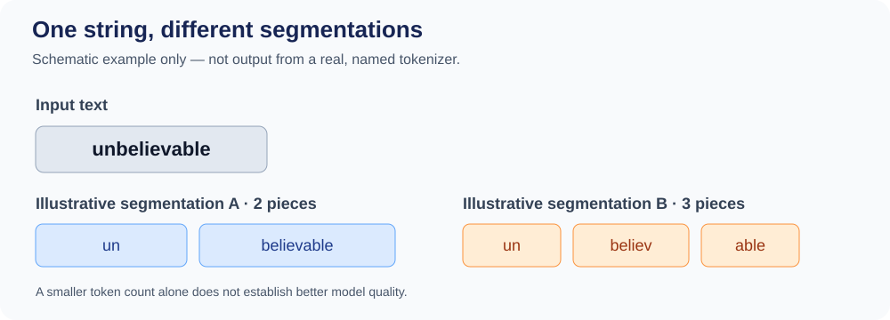

::: {.chapter-lead}
A language model receives a sequence of numerical IDs, not raw text. Tokenization defines how text becomes IDs and how IDs are decoded. It is separate from the neural network, but affects vocabulary, sequence length, compute cost, and some observable behaviours.
:::

::: {.callout-tip}
**The key chain:** Unicode text → tokens → IDs → embedding vectors → contextual representations. Each arrow is a distinct transformation; in particular, do not confuse **vocabulary size** ($V$) with **embedding dimension** ($d$).
:::

## Learning objectives

- Distinguish Unicode text, bytes, tokens, token IDs, and embeddings.
- Explain why whitespace splitting is insufficient.
- Describe how segmentation affects sequence length, cost, and compatibility.
- Identify the dedicated pages for technical deep dives.
- Identify what tokenization does not establish about a model's meaning representations or capabilities.

## 1. The path from text to model

At this stage, the useful perspective is the **pipeline**: what transformations does text go through before the neural network processes it?

```{mermaid}
flowchart LR
    A["Source text"] --> B["Optional preprocessing"]
    B --> C["Tokenizer"]
    C --> D["Tokens"]
    D --> E["Integer IDs"]
    E --> F["Embedding-table lookup"]
    F --> G["Token embeddings"]
    G --> H["Transformer with positional mechanism"]
    H --> I["Contextual representations"]
```

The final box deliberately groups positional handling with Transformer processing. Architectures do not all inject position in the same way: learned absolute position vectors may be added to token embeddings, whereas RoPE rotates query and key vectors inside attention. Position is therefore not a universal extra vector added at the lookup step; see [positional encoding and RoPE](positional-encoding.qmd).

- **Source text:** a string that may contain punctuation, whitespace, numbers, code, or multiple languages.
- **Preprocessing:** some inputs are normalized or pre-split; these operations depend on the tokenizer.
- **Tokenizer:** applies rules and a learned vocabulary to convert text into units called *tokens*.
- **IDs:** each token maps to an integer used as an index in the vocabulary. The integer is a label, not a measure of meaning.
- **Embeddings:** IDs select learned vectors. The Transformer then turns them into context-dependent representations.

This is a conceptual diagram. Real tokenizers differ in base units, normalization, pre-tokenization, vocabulary, and special tokens.

### Essential vocabulary

| Term | Role in the pipeline |
|---|---|
| **Text** | Human-readable input. |
| **Token** | A discrete unit defined by a tokenizer: a word, subword, punctuation, byte fragment, or special token. |
| **ID** | An integer identifying a token within a particular vocabulary. |
| **Embedding** | A vector associated with an ID and used as an initial numerical representation. |
| **Contextual representation** | A vector after neural-network processing, influenced by the other tokens in the sequence. |

Low-level details are not required to follow this pipeline. To understand why visually identical strings can be encoded differently, see the [deep dive on Unicode, UTF-8, and normalization](unicode-text.qmd). For segmentation algorithms and their trade-offs, see [tokenization strategies](tokenization-strategies.qmd). Matrix dimensions and the precise role of embeddings are covered in [embedding space](embedding-space.qmd) and [tensors](tensors.qmd).

### The same text, different segmentations

The same text can be split into different numbers of tokens by different tokenizers. Exact fragments and IDs depend on the vocabulary and configuration; there is no universal segmentation that can be inferred from the text alone.

Remember: tokens are representation units, not necessarily words or units of meaning. The figure below gives a schematic segmentation example; it does not claim to reproduce a real tokenizer's output. A real comparison must identify the tokenizer and its version, then measure the resulting sequence.

## 2. Why tokenization matters

Whitespace splitting is insufficient: punctuation, contractions, rare names, code, and writing systems that do not consistently separate words pose different challenges. Tokenizers therefore segment text into reusable units according to rules and a vocabulary associated with a model.

This representation choice has several consequences:

- **Coverage:** can the base units represent the expected inputs?
- **Sequence length:** how many tokens are needed to encode the same text?
- **Cost:** sequence length affects memory and compute, but token count alone is not enough to compare the total cost of two systems.
- **Linguistic behaviour:** segmentation may vary with language, spelling, numbers, and domain.
- **Compatibility:** IDs only make sense within their associated vocabulary; tokenizer and model weights must match.

Segmentation is neither perfect linguistic analysis nor a measure of meaning. A shorter segmentation does not, by itself, imply a better model.

{fig-alt="The English word unbelievable is shown as two pieces in one illustrative segmentation and three pieces in another. These are not outputs from a named real tokenizer." fig-cap="A string can have multiple possible segmentations. This figure is illustrative: it does not reproduce a real tokenizer output or an experimental measurement." width=100%}

The figure illustrates that segmentation depends on a tokenizer’s rules and vocabulary; it does not show that one segmentation is better. For an empirical comparison, use the same texts, record tokenizer and version, and report measurements by language and text type. See [Ahia et al. (2023)](https://aclanthology.org/2023.emnlp-main.614/) for a study of tokenization costs across languages.

### Evaluate trade-offs beyond token count

Token count is a measure of sequence length, not an overall quality score. A rigorous evaluation distinguishes representation efficiency, downstream task performance, differences across languages, and protocol reproducibility. Results depend on the corpus, task, model, and budgets being compared.

For the definitions and research behind these dimensions, see **[Evaluating a tokenizer: metrics, downstream performance, and multilingual equity](tokenization-strategies.qmd#tokenizer-evaluation)**.

### Where to explore the mechanisms

This overview stays focused on the pipeline. Technical details live on dedicated pages:

- [Tokenization strategies](tokenization-strategies.qmd): pre-tokenization, BPE, WordPiece, unigram, examples, comparisons, and limitations.
- [Unicode, UTF-8, and normalization](unicode-text.qmd): code points, bytes, and visually identical strings.
- [Embedding space](embedding-space.qmd) and [tensors](tensors.qmd): dimensions, weight tables, and representation shapes.

## 3. Mini-lab: compare tokenizers

Compare the same strings with at least two tokenizers, using the examples and tools introduced in the [tokenization strategies page](tokenization-strategies.qmd). Record differences; do not compare raw IDs across vocabularies as if they shared a meaning.

| Input to test | Learning question | What to inspect |
|---|---|---|
| `Hello world` and ` Hello world` | Does a leading space matter? | Pre-tokenization rules and tokens that include a space |
| `ChatGPT`, `chatgpt`, `CHATGPT` | Does casing change segmentation? | Segmentation and any normalization |
| `2026-10-28` and `123456789` | Are digits always one token? | Number segmentation varies by tokenizer and string |
| `café` and `cafe\u0301` | Are visually similar strings identical? | Composed/decomposed Unicode and possible normalization |
| A sentence in French, English, and a language that does not typically separate words with spaces | Is token cost uniform? | Sequence length and language dependence |
| A code snippet | Are names and symbols segmented intuitively? | Partial tokens, punctuation, and effects on sequence length |

**Minimal lab record:** for each string, record tokenizer/version, visible tokens, token count, and one interpretation limit. Token count alone measures neither linguistic nor model quality.

## 4. Counterexamples and common misconceptions

- **“A token is a word.”** False: it may be a subword, punctuation, a fragment with a space, bytes, or a special token.
- **“BPE identifies roots and suffixes.”** Not necessarily: it merges statistically and does not guarantee morphological analysis.
- **“Two BPE tokenizers produce the same IDs.”** Generally false: vocabularies, pre-tokenization, and rules may differ.
- **“The ID contains meaning.”** Not by itself: it is a discrete label; vectors are learned.
- **“An unknown string cannot be encoded.”** Not necessarily: byte-level tokenizers have base units that cover bytes, subject to their encoding rules.
- **“The tokenizer is a Transformer layer.”** It is a separate stage, although the tokenizer and model must be compatible.

## Go deeper: tokenization strategies

The guide [Tokenization strategies: granularity, algorithms, and trade-offs](tokenization-strategies.qmd) compares word, character, byte, subword, BPE, WordPiece, and unigram approaches.

## Next step

Continue with [embedding space](embedding-space.qmd) to see how token IDs select rows from an embedding matrix, how tensor shapes change, and how later network layers produce contextualized representations.

For the mathematical language used throughout the model, see [tensors](tensors.qmd) and [mathematical foundations](mathematical-foundations.qmd). The [full curriculum and source-coverage plan](https://github.com/JM-Brun/llm-lab/blob/main/docs/full-curriculum-plan.md) gives the wider learning path.

:::: {.language-switch}
**Language:** [Français](../fr/text-data.qmd) · [English](text-data.qmd)
::::
