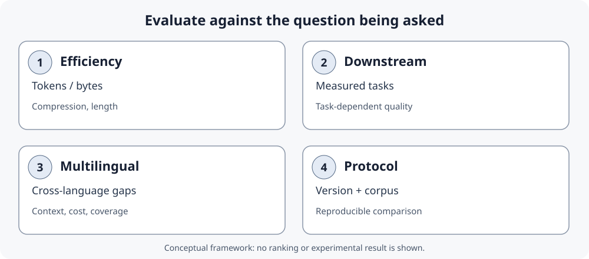

::: {.chapter-lead}
A tokenizer is a representation and engineering choice. It must cover expected inputs while managing vocabulary size and sequence cost. No segmentation—word, character, byte, or subword—is optimal for every corpus and task.
:::

## Key takeaways

- **Granularity**: word, character, byte, or learned fragment.
- **Algorithm**: BPE, WordPiece, unigram, and variants are not interchangeable.
- **Pipeline**: normalization, pre-tokenization, vocabulary, and special-token handling affect outputs.
- **Compatibility**: IDs have operational meaning only with the associated tokenizer and model weights.
- **Evaluation**: fewer tokens may reduce cost, but do not prove better downstream quality.

## 1. Concept map

The full pipeline—from Unicode text through IDs to embedding lookup—is illustrated on the [overview page](text-data.qmd). This page focuses on segmentation choices and their trade-offs rather than repeating the same diagram.

To inspect BPE merges directly, open the [original interactive BPE Explainer by Müller and Steinbach](https://philipmueller.dev/bpe-visualization/). It shows the corpus as it is segmented, candidate pairs, and vocabulary growth. The resource is linked rather than copied because the reuse terms for its figures have not been established here.

A token is the discrete unit produced by the system, not necessarily a linguistic unit. Initial boundaries, whitespace, normalization, and special-token rules can change outputs as much as the algorithm's name.

## 2. Compare granularity

| Approach | Strengths | Limitations / risks | Typical use |
|---|---|---|---|
| **Words** | Readable; short sequences if vocabulary covers the corpus | Very large vocabulary; unknown words; inflections and rare names | Teaching baselines, closed corpora |
| **Characters** | Small vocabulary; unseen words can be composed | Long sequences; code points, code units, and graphemes differ | Specialized models, orthography-sensitive tasks |
| **Bytes** | General byte-level coverage; no word-level OOV | Multiple bytes per character; long sequences; patterns can be harder to learn | Byte-level approaches, heterogeneous inputs |
| **Learned subwords** | Trade-off between vocabulary and length; rare forms remain decomposable if base units cover them | Sometimes arbitrary boundaries; language/script-dependent cost; no guaranteed morphology | Many modern LLMs |

These are idealized categories. Real systems may combine pre-tokenization, subwords, and byte-level representation. “Character” must be defined precisely: Unicode code points, code units, and grapheme clusters are not interchangeable.

### Vocabulary size is also an architecture and budget choice

A larger subword vocabulary can represent some texts with fewer tokens, but it changes more than sequence length. With hidden dimension \\(d\\) and vocabulary size \\(V\\), an input embedding table has \\(Vd\\) parameters. A separate output projection over the vocabulary commonly has another \\(Vd\\) parameters; this second count does not apply in the same way when input and output weights are tied. A larger \\(V\\) can therefore increase parameter and memory costs even as it shortens sequences.

The training budget also changes what a comparison means:

- **Fixed token budget:** models process the same number of token positions, but not necessarily the same number of passes over the same raw corpus.
- **Fixed data passes (epochs):** models see the same corpus passes, but a tokenizer that produces longer sequences creates more training tokens and may require more computation.

Takase et al. studied SentencePiece unigram vocabularies from 5k to 500k on English and Japanese, under both a fixed-token and a fixed-epoch setup. Larger vocabularies performed better in those experiments; with a fixed epoch, the smaller vocabularies produced substantially more training tokens, especially for Japanese. This is evidence about those models, languages, datasets, and training protocols—not a universal rule that the largest vocabulary is always best. See [Takase et al. (Findings of ACL 2025)](https://aclanthology.org/2025.findings-acl.57/).

**Practical rule:** choose vocabulary size jointly with model architecture, language mix, data distribution, and compute budget. Compare both model quality and total system cost; token count alone is not enough.

## 3. Components of a tokenizer pipeline

A production tokenizer is not just a segmentation algorithm. Libraries can expose several components whose effects should be distinguished. The [Hugging Face Tokenizers component documentation](https://huggingface.co/docs/tokenizers/python/latest/components.html) describes these stages; [SentencePiece](https://github.com/google/sentencepiece) provides another example of tokenizer models and conventions.

| Component | Role | Check |
|---|---|---|
| **Normalization** | May transform text before segmentation (for example, casing or Unicode normalization rules) | Are visually similar strings normalized in the same way? |
| **Pre-tokenization** | Splits text into candidate segments before the subword algorithm | Do whitespace, punctuation, or numbers create boundaries? |
| **Tokenization model** | Applies the vocabulary and BPE, WordPiece, or unigram rules | Which base units, vocabulary, and rules are used? |
| **Post-processing** | May add special tokens or prepare sequences for the model | Are BOS, EOS, separators, or task tokens added? |
| **Decoder** | Converts tokens/IDs back to text according to implementation conventions | Are whitespace, bytes, and characters reconstructed as expected? |

Not every tokenizer exposes or uses these stages in the same way. An algorithm name alone is therefore insufficient to reproduce a segmentation: the configuration and versions also matter.

### Example of a whitespace marker

Some SentencePiece outputs display a marker such as `▁` to represent a whitespace boundary under that tokenizer's convention. It is not a universal symbol used by all tokenizers, nor does it mean that a literal space is always stored in this form. Interpret output using the documentation for the exact model.

## 4. BPE, WordPiece, and unigram

| Family | Core idea | Limitation to remember |
|---|---|---|
| **BPE** | Iteratively merge adjacent pairs according to a frequency/priority rule | Variants differ in base units, pre-tokenization, markers, and conventions |
| **WordPiece** | Select units using a likelihood-related criterion, then encode with implementation-specific rules | Not simply BPE under another name; some systems mark continuations with `##` |
| **Unigram** | Probabilistic model over candidate subwords, often reduced by pruning | Output depends on model, candidates, and conventions |

**SentencePiece** is a library that can train BPE or unigram models from raw text; it is not one algorithm. **Hugging Face Tokenizers** is a library of models and pipeline components. **tiktoken** is a BPE implementation with specific encodings. These names therefore do not all belong at the same comparison level.


### Worked example: BPE merges on a tiny corpus

This schematic example preserves an explicit trace of the merges. Teaching convention: each word starts as characters followed by an end-of-word marker `</w>`. The tiny corpus contains one occurrence each of `low`, `lower`, and `lowest`.

| Word | Initial units |
|---|---|
| `low` | `l · o · w · </w>` |
| `lower` | `l · o · w · e · r · </w>` |
| `lowest` | `l · o · w · e · s · t · </w>` |

Count every adjacent pair across the corpus. Each word occurs once here, so the pair counts are:

| Pair | Count | Pair | Count |
|---|---:|---|---:|
| `l + o` | 3 | `w + e` | 2 |
| `o + w` | 3 | `w + </w>` | 1 |
| `e + r` | 1 | `r + </w>` | 1 |
| `e + s` | 1 | `s + t` | 1 |
| `t + </w>` | 1 | | |

The most frequent pair is tied: `l + o` and `o + w` both occur three times. Assume the deterministic tie-breaker chooses `l + o → lo`. Replace non-overlapping occurrences, then recount. The pair `lo + w` now occurs three times and can be merged next.

| Step | `low` | `lower` | `lowest` |
|---|---|---|---|
| 0 | `l · o · w · </w>` | `l · o · w · e · r · </w>` | `l · o · w · e · s · t · </w>` |
| 1: merge `l + o` | `lo · w · </w>` | `lo · w · e · r · </w>` | `lo · w · e · s · t · </w>` |
| 2: merge `lo + w` | `low · </w>` | `low · e · r · </w>` | `low · e · s · t · </w>` |

The frequency table makes the greedy choice visible; it does not mean BPE discovers linguistic morphemes or an optimal vocabulary. This is a word-level teaching convention with an end-of-word marker, not a complete byte-level production tokenizer. Real outputs also depend on pre-tokenization, base units, corpus frequencies, special-token handling, and implementation-specific tie-breaking. To manipulate candidate pairs, use the [BPE Explainer by Müller and Steinbach](https://philipmueller.dev/bpe-visualization/).

### Tokenizer training versus encoding at inference

Two processes must be distinguished:

1. **Tokenizer training**: builds a vocabulary and, depending on the algorithm, rules or a merge order from a corpus.
2. **Encoding new text**: applies the already learned rules to produce tokens and IDs; it does not recount frequencies or relearn the vocabulary for every request.

```{mermaid}
flowchart LR
    A["Training corpus"] --> B["Pre-tokenization and base units"]
    B --> C["Learn merges / vocabulary"]
    C --> D["Saved tokenizer"]
    E["New text"] --> F["Previously learned rules"]
    D -. "reused" .-> F
    F --> G["Tokens then IDs"]
    G --> H["Compatible model"]
```

This diagram does not describe neural-network training, which is distinct and learns model parameters from sequences of token IDs. A byte-level tokenizer can cover arbitrary text input at the byte level, but not every BPE tokenizer is byte-level.


## 5. Examples that expose trade-offs

The [overview page](text-data.qmd) illustrates Unicode normalization with precomposed `é` and decomposed `e\u0301`: they may look identical while having different code-point sequences. A tokenizer may normalize them before segmentation; inspect its configuration rather than assuming the outputs match.


| Input | Question to ask | Naive-approach risk |
|---|---|---|
| `unbelievable`, `unbelievably` | Do fragments reuse frequent substrings? | Boundaries do not guarantee morphological analysis |
| `café` and `cafe\u0301` | Which Unicode normalization is applied? | Same appearance, different code-point sequences |
| `2026-10-29`, `123456789` | How are digits and separators split? | One token need not be a whole number |
| `你好` | Does the system depend on spaces between words? | Whitespace splitting may yield no useful boundaries |
| `def predict_next(x): return x + 1` | How are whitespace, identifiers, and operators handled? | Segmentation can look arbitrary |
| Emoji and rare symbols | What coverage and sequence length result? | Coverage does not mean uniform efficiency |

This table poses questions to test, not exact outputs. To report a result, record tokenizer/version, input string, visible tokens, and token count.

## 6. Reproducible comparison

1. Fix the texts, encoding, cleaning, and document handling.
2. Record the exact tokenizer, package version, encoding identifier, and parameters.
3. Compare visible tokens and sequence lengths; do not compare IDs across vocabularies as common semantic values.
4. Report distributions by language, script, and text type, not only a global average.
5. Check vocabulary size, special tokens, coverage, and truncation.
6. Evaluate downstream quality separately from latency, memory, throughput, and cost.
7. Report limitations: corpus, versions, normalization, covered languages, and uncertainty.

### A reproducible Python probe

The example below inspects a specific Hugging Face tokenizer. The first load may require network access; for a reproducible experiment, record library versions and pin a model revision rather than relying on a moving default branch.

```python
from importlib.metadata import version
from transformers import AutoTokenizer

model_id = "gpt2"
revision = "YOUR_COMMIT_SHA"  # Replace with the exact model commit SHA
tokenizer = AutoTokenizer.from_pretrained(model_id, revision=revision)
text = " Hello world — café"

ids = tokenizer.encode(text, add_special_tokens=False)
tokens = tokenizer.convert_ids_to_tokens(ids)

print("transformers:", version("transformers"))
print("tokenizer:", model_id)
print("tokens:", tokens)
print("IDs:", ids)
print("count:", len(ids))
print("decoded:", tokenizer.decode(ids))
```

The displayed IDs and fragments belong to the loaded tokenizer. To compare two tokenizers, run the same protocol on the same text, record their revision/version identifiers, and compare fragments and token counts—not numeric ID values across vocabularies. Decoding can also depend on cleanup conventions and special tokens.

### Measuring a tokenizer without reducing quality to token count

Research on multilingual tokenization costs does not always use the same metrics or denominators. Read each metric's operational definition before comparing results. See [Ahia et al. (2023)](https://aclanthology.org/2023.emnlp-main.614/) and the multilingual measurement work [TokLens (ACL 2026 SRW)](https://aclanthology.org/2026.acl-srw.18/).

| Metric | Interpretation | Limitation |
|---|---|---|
| **Token count** | Sequence length produced for a given text | Depends on text, tokenizer, version, and normalization |
| **Fertility** | Often, the average number of subword tokens per reference word | “Word” boundaries and punctuation handling can vary; state the denominator |
| **Characters or bytes per token** | Ratio between source-text length and token count | Unicode characters, code points, and UTF-8 bytes are different units |
| **Vocabulary coverage** | Ability to represent input units without an unknown token, depending on the system | Complete coverage does not imply efficient segmentation or downstream quality |
| **Downstream quality** | Result on a defined task, by language and text type | Requires comparable budgets and evaluation conditions; cannot be inferred from an intrinsic metric |

For fair comparison, report metrics by language and text type, and keep **representation cost**, **system cost**, and **task quality** separate. A shorter sequence is a real result, but it does not by itself demonstrate an overall improvement.

## Evaluating a tokenizer: metrics, downstream performance, and multilingual equity {#tokenizer-evaluation}

Comparing algorithms is not enough to establish whether a tokenizer is suitable for a use case. Several empirical questions must be separated; they do not collapse into one score.

{fig-alt="Four distinct dimensions: compression and sequence length; downstream task results; variation across languages and text types; and a reproducible protocol identifying tokenizer, version, and corpus." fig-cap="A reading framework, not an experimental result: these dimensions answer different questions and do not necessarily collapse into one ranking." width=100%}

### Four dimensions to keep separate

- **Representation efficiency**: how many tokens, characters, or bytes represent the same content? State the denominator explicitly: Unicode characters, code points, grapheme clusters, and UTF-8 bytes are not interchangeable.
- **Downstream performance**: segmentation choices can affect learning and task results. Measure these under comparable conditions rather than inferring them from token count.
- **Multilingual equity**: comparable content can produce different sequence lengths across languages and tokenizers. This may affect context budgets and training or inference costs; by itself, it does not prove a difference in generation quality.
- **Reproducibility**: record the exact tokenizer and revision, preprocessing, corpus, languages, metrics, task, budgets, and software versions.


#### External research figure: tokenizer fertility varies by language

{fig-alt="Six small-multiple bar charts show tokenizer fertility across English, French, German, Italian, Polish, and Spanish; the red bar marks the author's tokenizer and grey bars show alternatives." width=100%}

*Source: Catherine Arnett, [“wHy DoNt YoU jUsT uSe ThE lLaMa ToKeNiZeR??”](https://huggingface.co/blog/catherinearnett/dangers-of-tokenizer-recycling), 2024. This is a study-specific comparison, not a universal ranking: fertility depends on the text sample, word definition, and tokenizer set. The image is embedded from the author's hosted article and is not modified or redistributed in this repository.*

### What the studies show — and what they do not

The following papers are complementary: they do not all measure the same object and should not be read as a direct tokenizer ranking.

| Study | Research question | Contribution to evaluation | Interpretive limitation |
|---|---|---|---|
| **Goldman et al. (2024)**, [*Unpacking Tokenization: Evaluating Text Compression and its Correlation with Model Performance*](https://aclanthology.org/2024.findings-acl.134/) | Is compression associated with model performance? | Empirically analyses the relationship between text compression and downstream results in the studied settings. | An experimental correlation does not establish a universal causal selection rule. |
| **Schmidt et al. (2024)**, [*Tokenization Is More Than Compression*](https://aclanthology.org/2024.emnlp-main.40/) | Can a tokenizer be selected by minimizing length alone? | Highlights the limits of an objective reduced to compression and motivates other relevant properties. | This does not make length irrelevant: it answers a specific representation and cost question. |
| **Arnett et al. (2025)**, [*Explaining and Mitigating Crosslingual Tokenizer Inequities*](https://proceedings.neurips.cc/paper_files/paper/2025/hash/5b91cefbfa52340af2f16f249572dc76-Abstract-Conference.html) | Why do tokenization costs differ across languages? | Studies cross-lingual disparities and design factors that may mitigate them. | Findings depend on the languages, corpora, tokenizers, and protocols considered. |
| **Chiu (ACL 2026)**, [*TokLens: A Multilingual Lens on Tokenizer Quality for LLMs*](https://aclanthology.org/2026.acl-srw.18/) | How can tokenizers be compared across languages and dimensions? | Proposes six intrinsic metrics and evaluates 24 tokenizers across 15 languages. The study finds no intrinsic metric predicts English benchmark results after controlling for model size; some metrics, especially single-token retention rate, are associated with per-language results on a multilingual benchmark. | A set of intrinsic metrics does not replace evaluation on the target tasks and deployment constraints. |

Goldman et al. and Schmidt et al. should not be reduced to a simplistic contradiction. The former studies empirical associations between compression and downstream results; the latter reminds us that compression does not summarize every relevant property. TokLens adds a complementary finding: observed relationships differ between English and multilingual benchmarks and remain correlational, with possible confounders such as pretraining-data composition. The methodological conclusion is to **measure separately the dimensions that correspond to the decision being made**.


#### External research figure: representation length and execution time

{fig-alt="Scatter plot of tokenization length against RoBERTa execution time for languages in FLORES-200, with points colored by script family." width=80%}

*Source: Petrov, La Malfa, Torr, and Bibi, [“Language Model Tokenizers Introduce Unfairness Between Languages”](https://www.adelbibi.com/publication/langugage_unfairness_tokenizers/), NeurIPS 2023. The plot illustrates an association in the studied setup, not a universal causal law or a direct measure of generation quality. The author's page identifies the work as CC BY-NC-ND 4.0; the figure is embedded unchanged and linked to its source.*

### Building an interpretable comparison protocol

To compare two tokenizers:

1. Fix a corpus and document its provenance, languages, domains, and cleaning rules.
2. Pin the exact tokenizers: name, revision, vocabulary, configuration, library versions, and special tokens.
3. Report multiple intrinsic measures with definitions: tokens per text, characters or bytes per token, fertility if “word” is defined, coverage, and truncation.
4. Break results down by language, script, and text type; a global average can hide substantial disparities.
5. Evaluate downstream tasks separately, using the same data, compute/context budgets, and training or inference protocols where the comparison permits.
6. Report relevant system costs: latency, throughput, memory, and financial cost. A shorter sequence does not mechanically imply a faster system.
7. Publish uncertainty, limitations, and cases where results are not comparable.

**Reading rule:** token count measures length under a given tokenizer; it does not directly measure linguistic quality, model quality, or total system cost.

### Related work and resources

- [Ahia et al. (2023), *Do All Languages Cost the Same?*](https://aclanthology.org/2023.emnlp-main.614/) — earlier study of tokenization costs across languages.
- [Wegmann et al. (2025), *Tokenization is Sensitive to Language Variation*](https://aclanthology.org/2025.findings-acl.572/) — linguistic variation and the role of the pre-tokenizer.
- [TokLens — paper and resources](https://aclanthology.org/2026.acl-srw.18/) — inspect as a tool/method, checking its metrics and protocol.

### Recommended visual resources

1. [Philip Müller & Peter Steinbach — BPE Explainer](https://philipmueller.dev/bpe-visualization/): interactive merge manipulation; best first intuition.
2. [Hugging Face — Byte-Pair Encoding tokenization](https://huggingface.co/learn/llm-course/en/chapter6/5): English-language explanation of BPE training, paired with the French course linked from the French page.
3. [Cornell CS4782 — Tokenization Visualizer](https://www.cs.cornell.edu/courses/cs4782/2026sp/demos/bytepair/): educational BPE/WordPiece comparison. **UI caveat (checked 2026-10-29):** the selected-merge panel displayed “Frequency: undefined” while the candidate-pair list showed counts. Treat that selected value as unreliable unless the page has since been fixed.
4. [Andrej Karpathy — Let's build the GPT Tokenizer](https://www.youtube.com/watch?v=zduSFxRajkE): Unicode, UTF-8, BPE, whitespace, and special tokens.
5. [Hugging Face — visualizing BPE encoding](https://huggingface.co/blog/SauravP97/bpe-tokenizer-visualize): complementary visualization; verify community code before execution.

These are external links rather than copied figures whose licences have not been checked. For the overall pipeline, the original diagram above is this page's reference figure.


### Suggested reading order

1. Watch Karpathy's video to build intuition about bytes, merges, and special tokens.
2. Use the [BPE Explainer](https://philipmueller.dev/bpe-visualization/) to follow merges on a small example.
3. Read `minbpe` or the [educational tiktoken module](https://github.com/openai/tiktoken/blob/main/tiktoken/_educational.py) to inspect the code.
4. Compare with tiktoken, SentencePiece, and Hugging Face documentation to distinguish implementation conventions.
5. Return to [Raschka's Chapter 2](https://github.com/rasbt/LLMs-from-scratch/tree/main/ch02) to connect IDs to embeddings and input-target examples.
6. Test multilingual text, code, numbers, leading spaces, and unusual Unicode forms.

### An external illustration of the tokenizer pipeline

{fig-alt="Tokenization pipeline: normalization, pre-tokenization, tokenization model, and post-processing." width=100%}

This published illustration comes from the [Hugging Face course, “Building a tokenizer, block by block”](https://huggingface.co/docs/course/chapter6/8). It complements the conceptual diagram on the [overview page](text-data.qmd) with the components of a tokenizer. The image is served from the course's public documentation assets rather than copied locally; citation does not itself grant redistribution rights.

### Additional research references

- [Ali et al. (2024), *Tokenizer Choice For LLM Training: Negligible or Crucial?*](https://aclanthology.org/2024.findings-naacl.247/): examines tokenizer choice effects on cost and performance, noting that intrinsic metrics do not always predict downstream results.
- [Wegmann et al. (2025), *Tokenization is Sensitive to Language Variation*](https://aclanthology.org/2025.findings-acl.572/): analyses linguistic variation and the role of the pre-tokenizer.
- [Arnett et al. (2025), *Explaining and Mitigating Crosslingual Tokenizer Inequities*](https://proceedings.neurips.cc/paper_files/paper/2025/hash/5b91cefbfa52340af2f16f249572dc76-Abstract-Conference.html): studies cross-language cost differences and design factors such as vocabulary size and pre-tokenization.
- [Ahia et al. (2023), *Do All Languages Cost the Same?*](https://aclanthology.org/2023.emnlp-main.614/): compares tokenization cost across 22 languages and discusses API implications.
- [TokLens (ACL 2026 SRW)](https://aclanthology.org/2026.acl-srw.18/): a multilingual measurement toolkit to inspect as a method and software, not as evidence that one intrinsic metric is sufficient.

### Educational code and historical reference

- [Sebastian Raschka — *Build a Large Language Model (From Scratch)*, Chapter 2](https://livebook.manning.com/book/build-a-large-language-model-from-scratch/chapter-2): guided reading on text processing in the LLM pipeline.
- [Hugging Face — tokenizer course](https://huggingface.co/learn/llm-course/chapter6/1): introduction to the tokenizer chapter; course URLs and content may evolve.


- [OpenAI `tiktoken` — educational module](https://github.com/openai/tiktoken/blob/main/tiktoken/_educational.py): simplified BPE code for inspecting merges; it is not the optimized production path.
- [Andrej Karpathy — `minbpe`](https://github.com/karpathy/minbpe): compact code for tracing training and encoding; compare conventions before assuming compatibility.
- [Sebastian Raschka — BPE from scratch](https://sebastianraschka.com/blog/2025/bpe-from-scratch.html): an explanatory notebook.
- [Raschka — repository, Chapter 2](https://github.com/rasbt/LLMs-from-scratch/tree/main/ch02): implementations and text-data preparation.
- [Gage (1994), *A New Algorithm for Data Compression*](https://dl.acm.org/doi/10.5555/177910.177914): historical reference for byte-pair compression. Modern LLM tokenizers add conventions not fully specified by that paper alone.


## 7. Counterexamples

- **Fewer tokens = a better model.** No: it first demonstrates a length difference, not quality.
- **BPE discovers morphemes.** No: linguistic analysis is not guaranteed.
- **The vocabulary is the tokenizer.** No: pre-tokenization, merge rules, normalization, and special tokens also matter.
- **SentencePiece = unigram.** No: it can train multiple families, including BPE.
- **IDs transfer between models.** Generally not: the same ID can denote different fragments.
- **Byte-level = language-independent.** No: coverage guarantees neither uniform cost nor uniform quality.

## Continue learning

- [Overview and BPE example](text-data.qmd)
- [Training examples, windows, and shifted targets](training-examples.qmd)
- [Embedding space](embedding-space.qmd)
- [Hugging Face Tokenizers](https://huggingface.co/docs/tokenizers/index)
- [SentencePiece](https://github.com/google/sentencepiece)
- [tiktoken](https://github.com/openai/tiktoken)

::: {.language-switch}
**Language:** [Français](../fr/tokenization-strategies.qmd) · [English](tokenization-strategies.qmd)
:::
