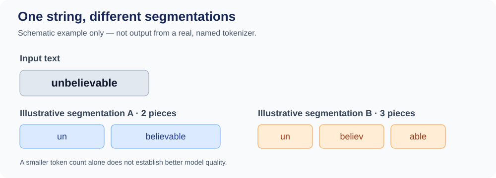

<!--
LLM-LAB-PAGE-MAP v1
id: "en/tokenizer-design-evaluation"
scope: "Evaluates the trade-off between representation length, vocabulary size, training and inference costs, and downstream quality; compares budgets and metrics with their denominators, then builds a constrained comparison protocol and decision. Detailed multilingual empirical findings remain in the dedicated deep dive."
purpose: "Evaluate vocabulary and sequence trade-offs, build a reproducible comparison, and make a constrained design decision without conflating representation cost, system cost, and downstream quality."
domain: "text-tokenization"
suggested_route:
  previous: null
  next: null
hierarchy:
  parents: ["en/tokenization-and-tokenizers"]
  children: ["en/tokenizer-multilingual-evaluation"]
related: ["en/tokenization-strategies", "en/text-data", "en/unicode-text", "en/exercises-text-data"]
tags: ["type:deep-dive", "destination:deepen", "topic:tokenizer-design-evaluation", "level:advanced", "language:en", "status:published"]
-->


<!--
Editorial model: docs/advent-calendar-pilots/first-three-days-pedagogical-models.md#porte-03--le-tokenizer-ingenieur-de-compression
Tracking issue: https://github.com/JM-Brun/llm-lab/issues/1667
This is authoring metadata; it is intentionally not rendered to readers.
-->

::: {.callout-note title="A decision that seems obvious — until we look at the whole system"}
Imagine two teams preparing a language model from the same corpus. They compare two tokenizers: the first turns the texts into shorter sequences. At first glance, the choice seems obvious: fewer tokens mean fewer positions to process and more text fitting into a context window of fixed size.

But the second tokenizer may have a smaller vocabulary. Vocabulary size also affects embedding parameters and, depending on the architecture, the output projection. A global average may also hide that one language or text type is represented much less efficiently than another.

**So which tokenizer should they choose?** They must compare the same texts, define what “shorter” means, measure model costs, and evaluate performance on the intended tasks. Compression is a useful signal, not a verdict.

This page follows that problem: understand the mechanisms that produce segmentations, measure their effects, and build a comparison whose conclusions stay within the limits of its protocol.
:::

::: {.chapter-lead}
A tokenizer splits text into units the model can process. Longer units often reduce the number of positions, but they enlarge the vocabulary and can increase other costs. The best choice is therefore not the one that produces the fewest tokens at any price: it is the one that balances representation, compute resources, and quality for the intended use.
:::

*LLM Lab Advent Calendar 2026 · Door 3 · about 15 minutes*

::: {.callout-note .learning-outcomes collapse="true" title="Learning outcomes"}
By the end of this page, you will be able to:
- explain how vocabulary size interacts with model parameters and training budgets;
- build a reproducible comparison protocol;
- distinguish representation length, system cost, and downstream quality;
- interpret metrics and studies of multilingual disparities with appropriate caution.
:::

## One text, three segmentations

Take two occurrences of the same word: **unbelievable unbelievable**. To isolate the effect of segmentation, compare three schematic segmentations. They are constructed for explanation; they do not claim to reproduce any production tokenizer.

| Segmentation | Sequence for the two occurrences | Token positions | Distinct units in this toy vocabulary |
|---|---|---:|---:|
| Characters | `u n b e l i e v a b l e` × 2 | 24 | 8 |
| Subwords A | `un · believable` × 2 | 4 | 2 |
| Subwords B | `un · believ · able` × 2 | 6 | 3 |

{fig-alt="The text unbelievable is segmented as un plus believable in segmentation A, and as un plus believ plus able in segmentation B." fig-cap="For the same source text, the number of positions depends on the vocabulary and segmentation strategy." width=95%}

Character-level segmentation uses few distinct entries but produces a long sequence. Subwords shorten the sequence by adding vocabulary units. This example measures neither bit-level compression nor model quality: it makes a representation trade-off visible.

In a Transformer, fewer positions can reduce sequence-processing cost, including attention cost. A larger vocabulary, however, increases the size of the embedding tables and, depending on the architecture, the output projection. **Reducing the token count therefore does not automatically make the whole system cheaper.**

The design question is: which segmentation gives a good trade-off for the target languages, texts, architecture, and budget? Answering it requires understanding how segments are produced and measuring their effects beyond token count alone.

## 1. Vocabulary size: architecture and budget

A larger subword vocabulary can represent some texts with fewer tokens, but it changes more than sequence length. With hidden dimension $d$ and vocabulary size $V$, an input embedding table has $Vd$ parameters. A separate output projection over the vocabulary can add another $Vd$ parameters; tying input and output weights removes this duplicate parameter storage. The vocabulary projection still has to be computed. A larger $V$ can therefore increase parameter and memory costs even as it shortens sequences.

The training budget also changes what a comparison means:

- **Fixed token budget:** models process the same number of token positions, but not necessarily the same number of passes over the same raw corpus.
- **Fixed data passes (epochs):** models see the same corpus passes, but a tokenizer that produces longer sequences creates more training tokens and may require more computation.

Takase et al. studied SentencePiece unigram vocabularies from 5k to 500k on English and Japanese, under both a fixed-token and a fixed-epoch setup. Larger vocabularies performed better in those experiments; with a fixed epoch, the smaller vocabularies produced substantially more training tokens, especially for Japanese. This is evidence about those models, languages, datasets, and training protocols—not a universal rule that the largest vocabulary is always best. See [Takase et al. (Findings of ACL 2025)](https://aclanthology.org/2025.findings-acl.57/).

**Practical rule:** choose vocabulary size jointly with model architecture, language mix, data distribution, and compute budget. Compare both model quality and total system cost; token count alone is not enough.

## 2. System cost: sequences, vocabulary, and compute

Imagine an assistant that processes documents in several languages, with a limited context window and a latency constraint. The tokenizer that produces the fewest tokens on average is not necessarily the best choice: we need to know which cost decreases, which cost increases, and for which users.

The trade-off becomes concrete when sequence length is considered alongside vocabulary-dependent cost. Consider two fictional tokenizers applied to the same text collection and paired with the same hidden dimension $d$:

### Worked example: fewer positions, larger vocabulary

| | Tokenizer A | Tokenizer B |
|---|---:|---:|
| Vocabulary size | $V$ | $4V$ |
| Average sequence length | 120 positions | 80 positions |
| Input embedding-table parameters | $Vd$ | $4Vd$ |
| Output-projection computation (logits, per training sequence) | $\propto 120Vd$ | $\propto 80 \times 4Vd = 320Vd$ |
| Position pairs scored by dense attention (per head and layer) | $120^2$ | $80^2$ |

These values are a **constructed example**, not benchmark results. They isolate several terms. B reduces average sequence length by one third. For standard dense attention, the number of position pairs falls from $120^2$ to $80^2$, a ratio of $4/9$; this ratio concerns position pairs, not the total cost of the Transformer. But B's embedding table has four times as many parameters.

Output-logit computation introduces another trade-off. In standard causal training, the output projection is applied at every position to produce a distribution over the vocabulary. At fixed hidden dimension, its cost is proportional to $T V d$: $120Vd$ for A versus $80 \times 4Vd = 320Vd$ for B, or $8/3$ times as much. This computation remains necessary when input and output weights are tied: tying avoids storing two separate matrices, but it does not eliminate the vocabulary projection. During generation, logits are usually computed only for the final position; the cost of that projection per generated token remains proportional to $Vd$.

We therefore cannot conclude that B is cheaper overall. Total cost also depends on hidden dimension, layers, weight tying, attention implementation, hardware throughput, and the number of tokens processed during training. The table identifies which terms change; it does not add unlike costs into one score.

#### Which budget is held fixed?

The comparison changes with the experimental constraint:

- With an **equal number of training tokens**, both models process the same number of positions, but not necessarily the same number of passes over the raw corpus.
- With an **equal number of epochs**, both process the same corpus passes, but B may produce fewer positions to process.
- With an **equal compute budget**, the number of optimization steps, tokens seen, and amount of raw text consumed may differ.

A study that merely says “same data” therefore does not establish a fair comparison. It must specify what is held fixed: raw text, tokens, optimization steps, FLOPs, elapsed time, or financial budget.

## 3. Quality: what the metrics can establish

A shorter representation is a useful intrinsic measure, but it does not by itself tell us whether the model performs better on the task. Segmentation metrics, system costs, and downstream quality must be kept distinct.

### Measuring representation without conflating length and quality

Research on multilingual tokenization costs does not always use the same metrics or denominators. Read each metric's operational definition before comparing results. See [Ahia et al. (2023)](https://aclanthology.org/2023.emnlp-main.614/) and the multilingual measurement work [TokLens (ACL 2026 SRW)](https://aclanthology.org/2026.acl-srw.18/).

| Metric | Interpretation | Limitation |
|---|---|---|
| **Token count** | Sequence length produced for a given text | Depends on text, tokenizer, version, and normalization |
| **Fertility** | Often, the average number of subword tokens per reference word | “Word” boundaries and punctuation handling can vary; state the denominator |
| **Characters or bytes per token** | Ratio between source-text length and token count | Unicode characters, code points, and UTF-8 bytes are different units |
| **Vocabulary coverage** | Ability to represent input units without an unknown token, depending on the system | Complete coverage does not imply efficient segmentation or downstream quality |
| **Downstream quality** | Result on a defined task, by language and text type | Requires comparable budgets and evaluation conditions; cannot be inferred from an intrinsic metric |

For fair comparison, report metrics by language and text type, and keep **representation cost**, **system cost**, and **task quality** separate. A shorter sequence is a real result, but it does not by itself demonstrate an overall improvement.

## 4. Comparing and deciding under constraints

A defensible comparison starts by fixing what must remain identical and making the experiment reproducible:

1. Fix the texts, encoding, cleaning, and document handling.
2. Record the exact tokenizer, package version, encoding identifier, and parameters.
3. Compare visible tokens and sequence lengths; do not compare IDs across vocabularies as common semantic values.
4. Report distributions by language, script, and text type, not only a global average.
5. Check vocabulary size, special tokens, coverage, and truncation.
6. Evaluate downstream quality separately from latency, memory, throughput, and cost.
7. Report limitations: corpus, versions, normalization, covered languages, and uncertainty.

### Reproduce an inspection with a real tokenizer

To run the Python trace, pin the tokenizer revision and record library versions. The full code is in the practice page [Text data exercises](exercises-text-data.qmd#tokenizer-huggingface-probe).

### Build a defensible decision

A tokenizer choice should state the priority constraints and accepted trade-offs:

| Dominant constraint | Measures to prioritize | Essential check |
|---|---|---|
| Limited context window | Tokens per document and language | Does useful content fit after preprocessing? |
| Model memory | Vocabulary size, embeddings, output head | Are input and output weights tied? |
| Latency and throughput | Sequence length, tokenizer time, model time | Measure on the target hardware and batch |
| Multilingual service | Metrics by language and text type | Do not let a global average hide disparities |
| Task quality | Downstream scores by task and language | Compare under comparable budgets and protocols |

The right decision is not “choose the tokenizer that compresses best,” but **choose the tokenizer whose trade-offs match the intended system and use cases**, then test empirically whether those trade-offs hold.

## Deep dive: mechanisms and evaluation

The detailed WordPiece and Unigram training and encoding mechanisms are covered in [the tokenization strategies page](tokenization-strategies.qmd#wordpiece-unigram-mechanisms). Empirical findings, figures, and research resources are collected in [the multilingual tokenizer evaluation deep dive](tokenizer-multilingual-evaluation.qmd).

## Practise

The reproducible inspection of a real tokenizer and the exercises for the text → tokens → IDs pipeline are collected in the dedicated [Text data exercises](exercises-text-data.qmd#tokenizer-huggingface-probe). The practice collection can grow without making this story longer.

## Go further

- [Multilingual tokenizer evaluation](tokenizer-multilingual-evaluation.qmd).
- [Tokenization strategies](tokenization-strategies.qmd) for segmentation mechanisms.
- [Text data](text-data.qmd) for the upstream pipeline.

::: {.language-switch}
**Language:** [Français](../fr/tokenizer-design-evaluation.qmd) · [English](tokenizer-design-evaluation.qmd)
:::
