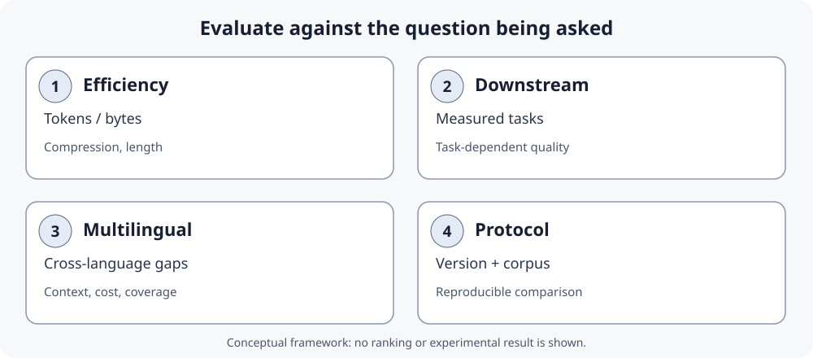

<!--
LLM-LAB-PAGE-MAP v1
id: "en/tokenizer-design-evaluation"
scope: "Explores the mechanisms of BPE, WordPiece, and Unigram families, then tokenizer design choices and empirical evaluation: vocabulary size, budgets, reproducibility, metrics, downstream results, and multilingual disparities."
purpose: "Explain training and encoding differences between BPE, WordPiece, and Unigram; build an interpretable comparison protocol; and distinguish representation cost, system cost, and downstream quality without generalizing beyond the studied data and protocols."
suggested_route:
  previous: null
  next: null
hierarchy:
  parents: []
  children: []
related: ["en/tokenization-strategies", "en/text-data", "en/unicode-text", "en/embedding-space", "en/scaling-laws"]
tags: ["type:deep-dive", "destination:deepen", "topic:tokenization", "level:advanced", "language:en", "status:published"]
-->

::: {.chapter-lead}
Understanding how a tokenizer segments text is not enough to select one or compare systems. Vocabulary size affects both sequence length and some model costs; compression metrics do not summarize downstream quality or differences across languages. This page brings together the design and evaluation questions that require a more advanced level of analysis.
:::

::: {.callout-note .learning-outcomes collapse="true" title="Learning outcomes"}
By the end of this page, you will be able to:
- explain how vocabulary size interacts with model parameters and training budgets;
- build a reproducible comparison protocol;
- distinguish representation length, system cost, and downstream quality;
- interpret metrics and studies of multilingual disparities with appropriate caution.
:::

## WordPiece and Unigram: detailed mechanisms

The [Tokenization strategies](tokenization-strategies.qmd) page already introduces the essential conceptual differences between BPE, WordPiece, and Unigram. This section revisits them only to examine training and encoding procedures in more depth, including implementation caveats.

### How WordPiece differs from BPE

In the common WordPiece training explanation, candidate adjacent units are ranked with a score related to how strongly they co-occur relative to the frequencies of their individual parts. A simplified form is:

\\[\\operatorname{score}(a,b)=\\frac{f(ab)}{f(a)\\,f(b)}\\]

where frequencies are estimated from the training corpus. This favours a pair whose joint frequency is high relative to the frequencies of its parts; it is not simply the most frequent pair, as in basic BPE. **Caveat:** Google's original WordPiece training procedure is not fully specified in a public reference implementation. Hugging Face presents its account as a reconstruction, so this formula is explanatory rather than a guarantee that every WordPiece trainer uses exactly this procedure.

At encoding time, common WordPiece implementations use greedy **longest-match-first** search over the vocabulary. In BERT-style tokenizers, continuation pieces are conventionally prefixed with `##`. If the complete input word cannot be segmented under the configured rules, a tokenizer such as BERT may emit one `[UNK]` for the whole word rather than retain a partial segmentation. These are implementation conventions, not universal properties of every WordPiece tokenizer.

See the [Hugging Face WordPiece explanation](https://huggingface.co/learn/llm-course/en/chapter6/6) and [WordPiece model documentation](https://huggingface.co/docs/tokenizers/python/latest/api/reference.html#tokenizers.models.WordPiece).

### How Unigram differs from merge-based tokenizers

A Unigram tokenizer starts from a relatively large candidate vocabulary with associated probabilities. Training iteratively removes candidates whose removal causes the smallest increase in the model's loss, reducing the vocabulary toward the target size. This is pruning over a probabilistic segmentation model—not a sequence of pair merges.

At encoding time, several segmentations may be possible. The Viterbi algorithm finds the highest-probability segmentation under the learned model. This contrasts with BPE's application of a learned merge order and WordPiece's common greedy longest-match procedure. See the [Hugging Face Unigram explanation](https://huggingface.co/learn/llm-course/en/chapter6/7) and [SentencePiece](https://github.com/google/sentencepiece).


## 1. Vocabulary size: architecture and budget

A larger subword vocabulary can represent some texts with fewer tokens, but it changes more than sequence length. With hidden dimension \\(d\\) and vocabulary size \\(V\\), an input embedding table has \\(Vd\\) parameters. A separate output projection over the vocabulary commonly has another \\(Vd\\) parameters; this second count does not apply in the same way when input and output weights are tied. A larger \\(V\\) can therefore increase parameter and memory costs even as it shortens sequences.

The training budget also changes what a comparison means:

- **Fixed token budget:** models process the same number of token positions, but not necessarily the same number of passes over the same raw corpus.
- **Fixed data passes (epochs):** models see the same corpus passes, but a tokenizer that produces longer sequences creates more training tokens and may require more computation.

Takase et al. studied SentencePiece unigram vocabularies from 5k to 500k on English and Japanese, under both a fixed-token and a fixed-epoch setup. Larger vocabularies performed better in those experiments; with a fixed epoch, the smaller vocabularies produced substantially more training tokens, especially for Japanese. This is evidence about those models, languages, datasets, and training protocols—not a universal rule that the largest vocabulary is always best. See [Takase et al. (Findings of ACL 2025)](https://aclanthology.org/2025.findings-acl.57/).

**Practical rule:** choose vocabulary size jointly with model architecture, language mix, data distribution, and compute budget. Compare both model quality and total system cost; token count alone is not enough.

## 2. Reproducible comparison

1. Fix the texts, encoding, cleaning, and document handling.
2. Record the exact tokenizer, package version, encoding identifier, and parameters.
3. Compare visible tokens and sequence lengths; do not compare IDs across vocabularies as common semantic values.
4. Report distributions by language, script, and text type, not only a global average.
5. Check vocabulary size, special tokens, coverage, and truncation.
6. Evaluate downstream quality separately from latency, memory, throughput, and cost.
7. Report limitations: corpus, versions, normalization, covered languages, and uncertainty.

### A reproducible Python probe

The example below inspects a specific Hugging Face tokenizer. The first load may require network access; for a reproducible experiment, record library versions and pin a model revision rather than relying on a moving default branch.

```python
from importlib.metadata import version
from transformers import AutoTokenizer

model_id = "gpt2"
revision = "YOUR_COMMIT_SHA"  # Replace with the exact model commit SHA
tokenizer = AutoTokenizer.from_pretrained(model_id, revision=revision)
text = " Hello world — café"

ids = tokenizer.encode(text, add_special_tokens=False)
tokens = tokenizer.convert_ids_to_tokens(ids)

print("transformers:", version("transformers"))
print("tokenizer:", model_id)
print("tokens:", tokens)
print("IDs:", ids)
print("count:", len(ids))
print("decoded:", tokenizer.decode(ids))
```

The displayed IDs and fragments belong to the loaded tokenizer. To compare two tokenizers, run the same protocol on the same text, record their revision/version identifiers, and compare fragments and token counts—not numeric ID values across vocabularies. Decoding can also depend on cleanup conventions and special tokens.

### Measuring a tokenizer without reducing quality to token count

Research on multilingual tokenization costs does not always use the same metrics or denominators. Read each metric's operational definition before comparing results. See [Ahia et al. (2023)](https://aclanthology.org/2023.emnlp-main.614/) and the multilingual measurement work [TokLens (ACL 2026 SRW)](https://aclanthology.org/2026.acl-srw.18/).

| Metric | Interpretation | Limitation |
|---|---|---|
| **Token count** | Sequence length produced for a given text | Depends on text, tokenizer, version, and normalization |
| **Fertility** | Often, the average number of subword tokens per reference word | “Word” boundaries and punctuation handling can vary; state the denominator |
| **Characters or bytes per token** | Ratio between source-text length and token count | Unicode characters, code points, and UTF-8 bytes are different units |
| **Vocabulary coverage** | Ability to represent input units without an unknown token, depending on the system | Complete coverage does not imply efficient segmentation or downstream quality |
| **Downstream quality** | Result on a defined task, by language and text type | Requires comparable budgets and evaluation conditions; cannot be inferred from an intrinsic metric |

For fair comparison, report metrics by language and text type, and keep **representation cost**, **system cost**, and **task quality** separate. A shorter sequence is a real result, but it does not by itself demonstrate an overall improvement.

## 3. Evaluating a tokenizer: metrics, downstream performance, and multilingual equity {#tokenizer-evaluation}

Comparing algorithms is not enough to establish whether a tokenizer is suitable for a use case. Several empirical questions must be separated; they do not collapse into one score.

{fig-alt="Four distinct dimensions: compression and sequence length; downstream task results; variation across languages and text types; and a reproducible protocol identifying tokenizer, version, and corpus." fig-cap="A reading framework, not an experimental result: these dimensions answer different questions and do not necessarily collapse into one ranking." width=100%}

### Four dimensions to keep separate

- **Representation efficiency**: how many tokens, characters, or bytes represent the same content? State the denominator explicitly: Unicode characters, code points, grapheme clusters, and UTF-8 bytes are not interchangeable.
- **Downstream performance**: segmentation choices can affect learning and task results. Measure these under comparable conditions rather than inferring them from token count.
- **Multilingual equity**: comparable content can produce different sequence lengths across languages and tokenizers. This may affect context budgets and training or inference costs; by itself, it does not prove a difference in generation quality.
- **Reproducibility**: record the exact tokenizer and revision, preprocessing, corpus, languages, metrics, task, budgets, and software versions.


#### External research figure: tokenizer fertility varies by language

{fig-alt="Six small-multiple bar charts show tokenizer fertility across English, French, German, Italian, Polish, and Spanish; the red bar marks the author's tokenizer and grey bars show alternatives." width=100%}

*Source: Catherine Arnett, [“wHy DoNt YoU jUsT uSe ThE lLaMa ToKeNiZeR??”](https://huggingface.co/blog/catherinearnett/dangers-of-tokenizer-recycling), 2024. This is a study-specific comparison, not a universal ranking: fertility depends on the text sample, word definition, and tokenizer set. The image is embedded from the author's hosted article and is not modified or redistributed in this repository. Rights review: pending in [#156](https://github.com/JM-Brun/llm-lab/issues/156); retained pending asset-level verification.*

### What the studies show — and what they do not

The following papers are complementary: they do not all measure the same object and should not be read as a direct tokenizer ranking.

| Study | Research question | Contribution to evaluation | Interpretive limitation |
|---|---|---|---|
| **Goldman et al. (2024)**, [*Unpacking Tokenization: Evaluating Text Compression and its Correlation with Model Performance*](https://aclanthology.org/2024.findings-acl.134/) | Is compression associated with model performance? | Empirically analyses the relationship between text compression and downstream results in the studied settings. | An experimental correlation does not establish a universal causal selection rule. |
| **Schmidt et al. (2024)**, [*Tokenization Is More Than Compression*](https://aclanthology.org/2024.emnlp-main.40/) | Can a tokenizer be selected by minimizing length alone? | Highlights the limits of an objective reduced to compression and motivates other relevant properties. | This does not make length irrelevant: it answers a specific representation and cost question. |
| **Ali et al. (2024)**, [*Tokenizer Choice For LLM Training: Negligible or Crucial?*](https://aclanthology.org/2024.findings-naacl.247/) | Does tokenizer choice change decoder-only model performance and training cost? | Trains 2.6B decoder-only models with 24 tokenizer configurations on matched English-only and five-language corpora; downstream effects vary by task, language, tokenizer library/algorithm and vocabulary size. | Five European Latin-script languages, zero-shot evaluation, one seed and no per-tokenizer hyperparameter search; the reported 68% is one German training-cost comparison, not a universal inference penalty. |
| **Wegmann et al. (2025)**, [*Tokenization is Sensitive to Language Variation*](https://aclanthology.org/2025.findings-acl.572/) | How do tokenizer components interact with variation within a language and task goals? | Controlled BERT-base/BPE experiments vary training corpus, pre-tokenizer and vocabulary size across lexical, orthographic, syntactic, dialectal and register variation; pre-tokenization has the largest aggregate effect in the tested tasks. | English encoder/classification experiments, not multilingual parity or decoder-only generation; effects are task-dependent and aggregate differences are modest. |
| **Arnett et al. (2025)**, [*Explaining and Mitigating Crosslingual Tokenizer Inequities*](https://proceedings.neurips.cc/paper_files/paper/2025/hash/5b91cefbfa52340af2f16f249572dc76-Abstract-Conference.html) | Why do tokenization costs differ across languages, even with comparable monolingual training? | Trains about 7,000 monolingual BPE/Unigram tokenizers across 97 languages; distinguishes crosslingual differences among monolingual tokenizers from multilingual shared-tokenizer effects. Language-specific vocabulary sizes and whitespace-crossing SuperBPE merges reduce token-premium variation in the tested compression setup. | Measures compression with CTC on FLORES-200; no LMs are trained, so downstream quality is not established. Parallel-data intervention covers seven languages and FLORES is translated from English. |
| **Chiu (ACL 2026)**, [*TokLens: A Multilingual Lens on Tokenizer Quality for LLMs*](https://aclanthology.org/2026.acl-srw.18/) | How can tokenizers be compared across languages and dimensions? | Defines six intrinsic metrics and evaluates 24 model/tokenizer configurations across 15 languages (some models share a tokenizer). No metric predicts English benchmark results after controlling for model size; STRR, characters per token and parity are associated with per-language results on MMLU-ProX. | The MMLU-ProX analysis covers only 7 models and 11 languages. Associations are correlational and partly confounded by pretraining-data composition; they do not establish a causal tokenizer effect. |

Goldman et al. and Schmidt et al. should not be reduced to a simplistic contradiction. The former studies empirical associations between compression and downstream results; the latter reminds us that compression does not summarize every relevant property. TokLens adds a complementary finding: observed relationships differ between English and multilingual benchmarks. Its MMLU-ProX analysis covers 7 models and 11 languages; the reported associations remain correlational and partly confounded by pretraining-data composition. The null result on English benchmarks may reflect a metric/benchmark mismatch and limited variation in English tokenizer metrics, not proof that tokenization is irrelevant. The methodological conclusion is to **measure separately the dimensions that correspond to the decision being made**.


#### External research figure: representation length and execution time

{fig-alt="Scatter plot of tokenization length against RoBERTa execution time for languages in FLORES-200, with points colored by script family." width=80%}

*Source: Petrov, La Malfa, Torr, and Bibi, [“Language Model Tokenizers Introduce Unfairness Between Languages”](https://www.adelbibi.com/publication/langugage_unfairness_tokenizers/), NeurIPS 2023. The plot illustrates an association in the studied setup, not a universal causal law or a direct measure of generation quality. The author's page identifies the work as CC BY-NC-ND 4.0; the figure is embedded unchanged and linked to its source. Rights review: pending in [#156](https://github.com/JM-Brun/llm-lab/issues/156); retained pending assessment of the exact asset and intended use.*

### Building an interpretable comparison protocol

To compare two tokenizers:

1. Fix a corpus and document its provenance, languages, domains, and cleaning rules.
2. Pin the exact tokenizers: name, revision, vocabulary, configuration, library versions, and special tokens.
3. Report multiple intrinsic measures with definitions: tokens per text, characters or bytes per token, fertility if “word” is defined, coverage, and truncation.
4. Break results down by language, script, and text type; a global average can hide substantial disparities.
5. Evaluate downstream tasks separately, using the same data, compute/context budgets, and training or inference protocols where the comparison permits.
6. Report relevant system costs: latency, throughput, memory, and financial cost. A shorter sequence does not mechanically imply a faster system.
7. Publish uncertainty, limitations, and cases where results are not comparable.

**Reading rule:** token count measures length under a given tokenizer; it does not directly measure linguistic quality, model quality, or total system cost.

### Related work and resources

- [Ahia et al. (2023), *Do All Languages Cost the Same?*](https://aclanthology.org/2023.emnlp-main.614/) — earlier study of tokenization costs across languages.
- [Wegmann et al. (2025), *Tokenization is Sensitive to Language Variation*](https://aclanthology.org/2025.findings-acl.572/) — linguistic variation and the role of the pre-tokenizer.
- [TokLens — paper and resources](https://aclanthology.org/2026.acl-srw.18/) — inspect as a tool/method, checking its metrics and protocol.
- [Catherine Arnett (2024), tokenizer-recycling community article](https://huggingface.co/blog/catherinearnett/dangers-of-tokenizer-recycling) — practitioner observations on tokenizer reuse and pre-tokenization; not a substitute for controlled research evidence.

### Recommended visual resources

1. [Philip Müller & Peter Steinbach — BPE Explainer](https://philipmueller.dev/bpe-visualization/): interactive merge manipulation; best first intuition.
2. [Hugging Face — Byte-Pair Encoding tokenization](https://huggingface.co/learn/llm-course/en/chapter6/5): English-language explanation of BPE training, paired with the French course linked from the French page.
3. [Cornell CS4782 — Tokenization Visualizer](https://www.cs.cornell.edu/courses/cs4782/2026sp/demos/bytepair/): educational BPE/WordPiece comparison. **UI caveat (checked 2026-10-29):** the selected-merge panel displayed “Frequency: undefined” while the candidate-pair list showed counts. Treat that selected value as unreliable unless the page has since been fixed.
4. [Andrej Karpathy — Let's build the GPT Tokenizer](https://www.youtube.com/watch?v=zduSFxRajkE): Unicode, UTF-8, BPE, whitespace, and special tokens.
5. [Hugging Face — visualizing BPE encoding](https://huggingface.co/blog/SauravP97/bpe-tokenizer-visualize): optional community visualization. **Source-audit caveat (2026-10-30):** the inspected implementation replays the model's merge list over raw Unicode characters; it does not reproduce the tokenizer's byte-level mapping and pre-tokenization pipeline. Treat its graph as a schematic of merge operations, not a faithful trace of GPT-2 token boundaries. Its package metadata also omits runtime dependencies although the README lists `graphviz` and `transformers`; inspect and pin dependencies before installing.

#### Useful timestamps in Karpathy's video

The video is long; these chapter markers let you select only the relevant parts:

- [14:56 — Unicode code points and strings](https://www.youtube.com/watch?v=zduSFxRajkE&t=896s), then [18:15 — UTF encodings and bytes](https://www.youtube.com/watch?v=zduSFxRajkE&t=1095s).
- [23:50 — BPE intuition](https://www.youtube.com/watch?v=zduSFxRajkE&t=1430s) and [28:35 — counting and merging frequent pairs](https://www.youtube.com/watch?v=zduSFxRajkE&t=1715s).
- [39:20 — tokenizer as a separate pipeline stage](https://www.youtube.com/watch?v=zduSFxRajkE&t=2360s), [42:47 — decoding](https://www.youtube.com/watch?v=zduSFxRajkE&t=2567s), and [48:21 — encoding](https://www.youtube.com/watch?v=zduSFxRajkE&t=2901s).
- [57:36 — regex pre-tokenization](https://www.youtube.com/watch?v=zduSFxRajkE&t=3456s) and [1:11:38 — GPT-2/GPT-4 regex differences](https://www.youtube.com/watch?v=zduSFxRajkE&t=4298s).
- [1:18:15 — special tokens and API handling](https://www.youtube.com/watch?v=zduSFxRajkE&t=4695s).
- [1:28:42 — SentencePiece](https://www.youtube.com/watch?v=zduSFxRajkE&t=5322s); [1:49:58 — multimodal tokenization](https://www.youtube.com/watch?v=zduSFxRajkE&t=6598s) is an optional extension beyond this text-tokenization sequence.

These are navigation aids, not a substitute for checking implementation details against the relevant tokenizer documentation and source code.

The page combines project-owned diagrams with selected external illustrations and linked resources. The provenance and reuse status of embedded assets are tracked in [the cross-site visual-asset audit](https://github.com/JM-Brun/llm-lab/issues/156).


### Suggested reading order

1. Watch Karpathy's video to build intuition about bytes, merges, and special tokens.
2. Use the [BPE Explainer](https://philipmueller.dev/bpe-visualization/) to follow merges on a small example.
3. Read `minbpe` or the [educational tiktoken module](https://github.com/openai/tiktoken/blob/main/tiktoken/_educational.py) to inspect the code.
4. Compare with tiktoken, SentencePiece, and Hugging Face documentation to distinguish implementation conventions.
5. Return to [Raschka's Chapter 2](https://github.com/rasbt/LLMs-from-scratch/tree/main/ch02) to connect IDs to embeddings and input-target examples.
6. Test multilingual text, code, numbers, leading spaces, and unusual Unicode forms.

### An external illustration of the tokenizer pipeline

{fig-alt="Tokenization pipeline: normalization, pre-tokenization, tokenization model, and post-processing." width=100%}

This published illustration comes from the [Hugging Face course, “Building a tokenizer, block by block”](https://huggingface.co/docs/course/chapter6/8). It complements the conceptual diagram on the [overview page](text-data.qmd) with the components of a tokenizer. The image is served from the course's public documentation assets rather than copied locally; citation does not itself establish reuse permission. Rights review: pending in [#156](https://github.com/JM-Brun/llm-lab/issues/156); retained pending asset-level verification.

### Additional research references

- [Ali et al. (2024), *Tokenizer Choice For LLM Training: Negligible or Crucial?*](https://aclanthology.org/2024.findings-naacl.247/): examines tokenizer choice effects on cost and performance, noting that intrinsic metrics do not always predict downstream results.
- [Wegmann et al. (2025), *Tokenization is Sensitive to Language Variation*](https://aclanthology.org/2025.findings-acl.572/): analyses linguistic variation and the role of the pre-tokenizer.
- [Arnett et al. (2025), *Explaining and Mitigating Crosslingual Tokenizer Inequities*](https://proceedings.neurips.cc/paper_files/paper/2025/hash/5b91cefbfa52340af2f16f249572dc76-Abstract-Conference.html): studies cross-language cost differences and design factors such as vocabulary size and pre-tokenization.
- [Ahia et al. (2023), *Do All Languages Cost the Same?*](https://aclanthology.org/2023.emnlp-main.614/): compares tokenization cost across 22 languages and discusses API implications.
- [Petrov et al. (2023), *Language Model Tokenizers Introduce Unfairness Between Languages*](https://www.adelbibi.com/publication/langugage_unfairness_tokenizers/): studies cross-language tokenization-length and runtime disparities; consult the paper for the experimental setup.
- [TokLens (ACL 2026 SRW)](https://aclanthology.org/2026.acl-srw.18/): a multilingual measurement toolkit to inspect as a method and software, not as evidence that one intrinsic metric is sufficient.

### Educational code and historical reference

- [Sebastian Raschka — *Build a Large Language Model (From Scratch)*, Chapter 2](https://livebook.manning.com/book/build-a-large-language-model-from-scratch/chapter-2): guided reading on text processing in the LLM pipeline.
- [Hugging Face — tokenizer course](https://huggingface.co/learn/llm-course/chapter6/1): introduction to the tokenizer chapter; course URLs and content may evolve.


- [OpenAI `tiktoken` — educational module](https://github.com/openai/tiktoken/blob/main/tiktoken/_educational.py): simplified BPE code for inspecting merges; it is not the optimized production path.
- [Andrej Karpathy — `minbpe`](https://github.com/karpathy/minbpe): compact code for tracing training and encoding; compare conventions before assuming compatibility.
- [Sebastian Raschka — BPE from scratch](https://sebastianraschka.com/blog/2025/bpe-from-scratch.html): an explanatory notebook. **Implementation caveat (source audit, 2026-10-30):** the notebook's custom from-scratch training path uses character/string symbols and simplified whitespace/newline splitting; it does not reproduce the full UTF-8 byte-level GPT-2 pipeline. Its separate GPT-2 loading path uses the pretrained vocabulary and merge ranks, with tests against selected `tiktoken` cases. Those checks do not establish exhaustive compatibility. See the [full notebook](https://github.com/rasbt/LLMs-from-scratch/blob/main/ch02/05_bpe-from-scratch/bpe-from-scratch.ipynb), [simple notebook](https://github.com/rasbt/LLMs-from-scratch/blob/main/ch02/05_bpe-from-scratch/bpe-from-scratch-simple.ipynb), and [tests](https://github.com/rasbt/LLMs-from-scratch/blob/main/ch02/05_bpe-from-scratch/tests.py).
- [Raschka — repository, Chapter 2](https://github.com/rasbt/LLMs-from-scratch/tree/main/ch02): implementations and text-data preparation.
- [Gage (1994), *A New Algorithm for Data Compression*](https://dl.acm.org/doi/10.5555/177910.177914): historical reference for byte-pair compression. Modern LLM tokenizers add conventions not fully specified by that paper alone.

::: {.language-switch}
**Language:** [Français](../fr/tokenizer-design-evaluation.qmd) · [English](tokenizer-design-evaluation.qmd)
:::
