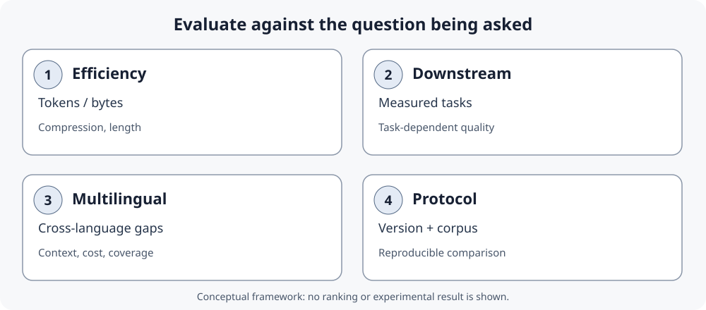

<!--
LLM-LAB-PAGE-MAP v1
id: "en/tokenizer-multilingual-evaluation"
summary: "Examines empirical dimensions of tokenizer evaluation, multilingual metrics, comparative studies, and their limitations."
scope: "Details representation metrics, research findings on downstream performance, cross-lingual differences, experimental protocols, and research resources."
purpose: "Interpret tokenizer comparisons while accounting for denominators, tasks, corpora, budgets, and causal limitations."
domain: "text-tokenization"
suggested_route:
  previous: null
  next: null
hierarchy:
  parents: ["en/tokenizer-design-evaluation"]
  children: []
related: ["en/tokenization-strategies", "en/text-data", "en/scaling-laws"]
tags: ["type:deep-dive", "destination:deepen", "topic:tokenization", "level:advanced", "language:en", "status:published"]
-->

::: {.chapter-lead}
The calendar story introduces the design trade-off and a first comparison protocol. This deep dive examines what studies actually measure: representation length, downstream performance, differences across languages, and reproducibility.
:::

**Return to the main page:** [The tokenizer as a compression engineer](tokenizer-design-evaluation.qmd).
**For segmentation mechanisms and implementation resources:** [Tokenization strategies](tokenization-strategies.qmd).

## Evaluation dimensions {#tokenizer-evaluation}

Comparing algorithms is not enough to establish whether a tokenizer is suitable for a use case. Several empirical questions must be separated; they do not collapse into one score.

{fig-alt="Four distinct dimensions: compression and sequence length; downstream task results; variation across languages and text types; and a reproducible protocol identifying tokenizer, version, and corpus." fig-cap="A reading framework, not an experimental result: these dimensions answer different questions and do not necessarily collapse into one ranking." width=100%}

### Four dimensions to keep separate

- **Representation efficiency**: how many tokens, characters, or bytes represent the same content? State the denominator explicitly: Unicode characters, code points, grapheme clusters, and UTF-8 bytes are not interchangeable.
- **Downstream performance**: segmentation choices can affect learning and task results. Measure these under comparable conditions rather than inferring them from token count.
- **Multilingual equity**: comparable content can produce different sequence lengths across languages and tokenizers. This may affect context budgets and training or inference costs; by itself, it does not prove a difference in generation quality.
- **Reproducibility**: record the exact tokenizer and revision, preprocessing, corpus, languages, metrics, task, budgets, and software versions.

#### External research figure: tokenizer fertility varies by language

{fig-alt="Six small-multiple bar charts show tokenizer fertility across English, French, German, Italian, Polish, and Spanish; the red bar marks the author's tokenizer and grey bars show alternatives." width=100%}

*Source: Catherine Arnett, [“wHy DoNt YoU jUsT uSe ThE lLaMa ToKeNiZeR??”](https://huggingface.co/blog/catherinearnett/dangers-of-tokenizer-recycling), 2024. This is a study-specific comparison, not a universal ranking: fertility depends on the text sample, word definition, and tokenizer set. The image is embedded from the author's hosted article and is not modified or redistributed in this repository. Rights review: pending in [#156](https://github.com/JM-Brun/llm-lab/issues/156); retained pending asset-level verification.*

### What the studies show — and what they do not

The following papers are complementary: they do not all measure the same object and should not be read as a direct tokenizer ranking.

| Study | Research question | Contribution to evaluation | Interpretive limitation |
|---|---|---|---|
| **Goldman et al. (2024)**, [*Unpacking Tokenization: Evaluating Text Compression and its Correlation with Model Performance*](https://aclanthology.org/2024.findings-acl.134/) | Is compression associated with model performance? | Empirically analyses the relationship between text compression and downstream results in the studied settings. | An experimental correlation does not establish a universal causal selection rule. |
| **Schmidt et al. (2024)**, [*Tokenization Is More Than Compression*](https://aclanthology.org/2024.emnlp-main.40/) | Can a tokenizer be selected by minimizing length alone? | Highlights the limits of an objective reduced to compression and motivates other relevant properties. | This does not make length irrelevant: it answers a specific representation and cost question. |
| **Ali et al. (2024)**, [*Tokenizer Choice For LLM Training: Negligible or Crucial?*](https://aclanthology.org/2024.findings-naacl.247/) | Does tokenizer choice change decoder-only model performance and training cost? | Trains 2.6B decoder-only models with 24 tokenizer configurations on matched English-only and five-language corpora; downstream effects vary by task, language, tokenizer library/algorithm and vocabulary size. | Five European Latin-script languages, zero-shot evaluation, one seed and no per-tokenizer hyperparameter search; the reported 68% is one German training-cost comparison, not a universal inference penalty. |
| **Wegmann et al. (2025)**, [*Tokenization is Sensitive to Language Variation*](https://aclanthology.org/2025.findings-acl.572/) | How do tokenizer components interact with variation within a language and task goals? | Controlled BERT-base/BPE experiments vary training corpus, pre-tokenizer and vocabulary size across lexical, orthographic, syntactic, dialectal and register variation; pre-tokenization has the largest aggregate effect in the tested tasks. | English encoder/classification experiments, not multilingual parity or decoder-only generation; effects are task-dependent and aggregate differences are modest. |
| **Arnett et al. (2025)**, [*Explaining and Mitigating Crosslingual Tokenizer Inequities*](https://proceedings.neurips.cc/paper_files/paper/2025/hash/5b91cefbfa52340af2f16f249572dc76-Abstract-Conference.html) | Why do tokenization costs differ across languages, even with comparable monolingual training? | Trains about 7,000 monolingual BPE/Unigram tokenizers across 97 languages; distinguishes crosslingual differences among monolingual tokenizers from multilingual shared-tokenizer effects. Language-specific vocabulary sizes and whitespace-crossing SuperBPE merges reduce token-premium variation in the tested compression setup. | CTC is the corpus-level token-count measure computed on parallel FLORES-200 text; token premium expresses relative token-count differences between content-matched languages. Neither is TokLens parity, which compares token-per-character rates on separate native-language corpora. No LMs are trained, so downstream quality is not established. The intervention covers seven languages and FLORES is translated from English. |
| **Chiu (ACL 2026)**, [*TokLens: A Multilingual Lens on Tokenizer Quality for LLMs*](https://aclanthology.org/2026.acl-srw.18/) | How can tokenizers be compared across languages and dimensions? | Defines six intrinsic metrics and evaluates 24 tokenizers across 15 languages. The English benchmark analysis covers 22 models (two additional tokenizers are metric-only); the MMLU-ProX analysis covers 7 models × 11 languages (77 model-language observations). No metric correlation survives model-size control and Bonferroni correction across 77 English comparisons; STRR, characters per token and parity are associated with per-language MMLU-ProX results. | These are distinct samples, not 24 model/tokenizer configurations. MMLU-ProX associations are observational and partly confounded by pretraining-data composition; they do not establish a causal tokenizer effect. Whitespace-based fertility and STRR do not represent linguistic word segmentation in Chinese, Japanese or Thai. |

**TokLens: read the six intrinsic metrics with their denominators.** Fertility is tokens per whitespace-delimited unit (a proxy for a word); characters per token and UTF-8 bytes per token use different text-length units; normalized sequence length is tokens per character; single-token retention rate (STRR) is the proportion of whitespace-delimited units retained as one token; and cross-lingual parity compares a language's tokens-per-character rate with English. Fertility and STRR therefore do not measure linguistic word segmentation in Chinese, Japanese or Thai. Character counts are also not information-equivalent across scripts. TokLens parity is computed on native-language corpora with a fixed character budget; it is not the same as Arnett's token premium on content-matched parallel texts or the FLORES-based CTC compression protocol.

Goldman et al. and Schmidt et al. should not be reduced to a simplistic contradiction. The former studies empirical associations between compression and downstream results; the latter reminds us that compression does not summarize every relevant property. TokLens adds a complementary finding: observed relationships differ between English and multilingual benchmarks. Its MMLU-ProX analysis covers 7 models and 11 languages; the reported associations remain correlational and partly confounded by pretraining-data composition. The null result on English benchmarks may reflect a metric/benchmark mismatch and limited variation in English tokenizer metrics, not proof that tokenization is irrelevant. The methodological conclusion is to **measure separately the dimensions that correspond to the decision being made**.

#### External research figure: representation length and execution time

{fig-alt="Scatter plot of tokenization length against RoBERTa execution time for languages in FLORES-200, with points colored by script family." width=80%}

*Source: Petrov, La Malfa, Torr, and Bibi, [“Language Model Tokenizers Introduce Unfairness Between Languages”](https://www.adelbibi.com/publication/langugage_unfairness_tokenizers/), NeurIPS 2023. The plot illustrates an association in the studied setup, not a universal causal law or a direct measure of generation quality. The author's page identifies the work as [CC BY-NC-ND 4.0](https://creativecommons.org/licenses/by-nc-nd/4.0/); the figure is embedded unchanged and linked to its source. Rights review: pending in [#156](https://github.com/JM-Brun/llm-lab/issues/156); retained pending assessment of the exact asset and intended use.*

### Building an interpretable comparison protocol

To compare two tokenizers:

1. Fix a corpus and document its provenance, languages, domains, and cleaning rules.
2. Pin the exact tokenizers: name, revision, vocabulary, configuration, library versions, and special tokens.
3. Report multiple intrinsic measures with definitions: tokens per text, characters or bytes per token, fertility if “word” is defined, coverage, and truncation.
4. Break results down by language, script, and text type; a global average can hide substantial disparities.
5. Evaluate downstream tasks separately, using the same data, compute/context budgets, and training or inference protocols where the comparison permits.
6. Report relevant system costs: latency, throughput, memory, and financial cost. A shorter sequence does not mechanically imply a faster system.
7. Publish uncertainty, limitations, and cases where results are not comparable.

**Reading rule:** token count measures length under a given tokenizer; it does not directly measure linguistic quality, model quality, or total system cost.

### Thematic bibliography and complementary resources

This bibliography brings together complementary references while distinguishing each work's question, contribution, and limitations. The study table remains the basis of the analysis; this list guides further reading without conflating different protocols.

- **Cross-language representation cost — Ahia et al. (2023), [*Do All Languages Cost the Same?*](https://aclanthology.org/2023.emnlp-main.614/).** Question: do languages incur comparable tokenization costs? Contribution: compares 22 languages and discusses API implications. Limitation: the measured costs alone do not establish generation quality.

- **Linguistic variation — Wegmann et al. (2025), [*Tokenization is Sensitive to Language Variation*](https://aclanthology.org/2025.findings-acl.572/).** Question: how do within-language variations affect segmentation? Contribution: analyses linguistic variation and the role of the pre-tokenizer. Limitation: findings depend on the languages, phenomena, and tokenizers studied; they do not provide a universal ranking.

- **Tokenizer choice during training — Ali et al. (2024), [*Tokenizer Choice For LLM Training: Negligible or Crucial?*](https://aclanthology.org/2024.findings-naacl.247/).** Question: does tokenizer choice change training cost and downstream performance? Contribution: compares 24 configurations on English-only and multilingual corpora. Limitation: five European Latin-script languages, one seed, zero-shot evaluation, and no per-tokenizer hyperparameter search.

- **Cross-lingual disparities — Arnett et al. (2025), [*Explaining and Mitigating Crosslingual Tokenizer Inequities*](https://proceedings.neurips.cc/paper_files/paper/2025/hash/5b91cefbfa52340af2f16f249572dc76-Abstract-Conference.html).** Question: why do tokenization costs differ across languages? Contribution: distinguishes differences among monolingual tokenizers from effects of a shared multilingual tokenizer and tests design factors. Limitation: the compression study does not establish downstream quality effects; CTC and token premium are not interchangeable with TokLens parity.

- **Sequence length and runtime — Petrov et al. (2023), [*Language Model Tokenizers Introduce Unfairness Between Languages*](https://www.adelbibi.com/publication/langugage_unfairness_tokenizers/).** Question: can segmentation differences create cross-language cost disparities? Contribution: relates tokenized length to runtime in the studied setup. Limitation: an experimental association, not a general causal law or direct measure of generation quality; figure provenance and licence are documented above.

- **Multilingual measures — Chiu (ACL 2026), [*TokLens: A Multilingual Lens on Tokenizer Quality for LLMs*](https://aclanthology.org/2026.acl-srw.18/).** Question: how can intrinsic metrics and their association with benchmarks be compared? Contribution: six metrics, 24 tokenizers, and 15 languages, with separate English and MMLU-ProX analyses. Limitation: observational associations, distinct samples, and whitespace-based metrics that do not capture linguistic word segmentation in Chinese, Japanese, and Thai.

- **Practitioner perspective — Catherine Arnett (2024), [article on tokenizer recycling](https://huggingface.co/blog/catherinearnett/dangers-of-tokenizer-recycling).** Question: why can reusing a pretrained tokenizer without checking it penalize some texts? Contribution: practical examples involving pre-tokenization and fertility disparities. Limitation: a community article and practitioner observations, not a controlled benchmark.

<!-- Legacy anchors: visual and mechanism resources now live on tokenization-strategies. -->

::: {.callout-note title="Resources moved"}
Visualizers, Karpathy video timestamps, and the pipeline illustration are now grouped beside the mechanism explanations in [Tokenization strategies](tokenization-strategies.qmd#mechanism-resources-and-implementations).
:::

### Additional research references

- [Ali et al. (2024), *Tokenizer Choice For LLM Training: Negligible or Crucial?*](https://aclanthology.org/2024.findings-naacl.247/): examines tokenizer choice effects on cost and performance, noting that intrinsic metrics do not always predict downstream results.
- [Wegmann et al. (2025), *Tokenization is Sensitive to Language Variation*](https://aclanthology.org/2025.findings-acl.572/): analyses linguistic variation and the role of the pre-tokenizer.
- [Arnett et al. (2025), *Explaining and Mitigating Crosslingual Tokenizer Inequities*](https://proceedings.neurips.cc/paper_files/paper/2025/hash/5b91cefbfa52340af2f16f249572dc76-Abstract-Conference.html): studies cross-language cost differences and design factors such as vocabulary size and pre-tokenization.
- [Ahia et al. (2023), *Do All Languages Cost the Same?*](https://aclanthology.org/2023.emnlp-main.614/): compares tokenization cost across 22 languages and discusses API implications.
- [Petrov et al. (2023), *Language Model Tokenizers Introduce Unfairness Between Languages*](https://www.adelbibi.com/publication/langugage_unfairness_tokenizers/): studies cross-language tokenization-length and runtime disparities; consult the paper for the experimental setup.
- [TokLens (ACL 2026 SRW)](https://aclanthology.org/2026.acl-srw.18/): a multilingual measurement toolkit to inspect as a method and software, not as evidence that one intrinsic metric is sufficient.

<!-- Legacy anchor: educational code resources now live on tokenization-strategies. -->

::: {.callout-note title="Implementation resources moved"}
Educational code resources (educational tiktoken, minbpe, and Raschka notebooks) are grouped in [Tokenization strategies](tokenization-strategies.qmd#mechanism-resources-and-implementations). Gage's historical reference remains explained in the BPE section of that page.
:::

::: {.language-switch}
**Language:** [Français](../fr/tokenizer-multilingual-evaluation.qmd) · [English](tokenizer-multilingual-evaluation.qmd)
:::
