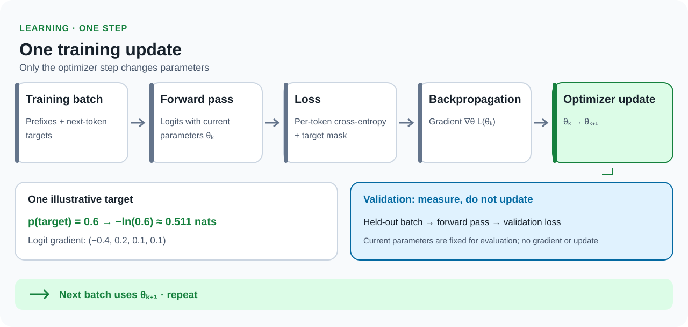
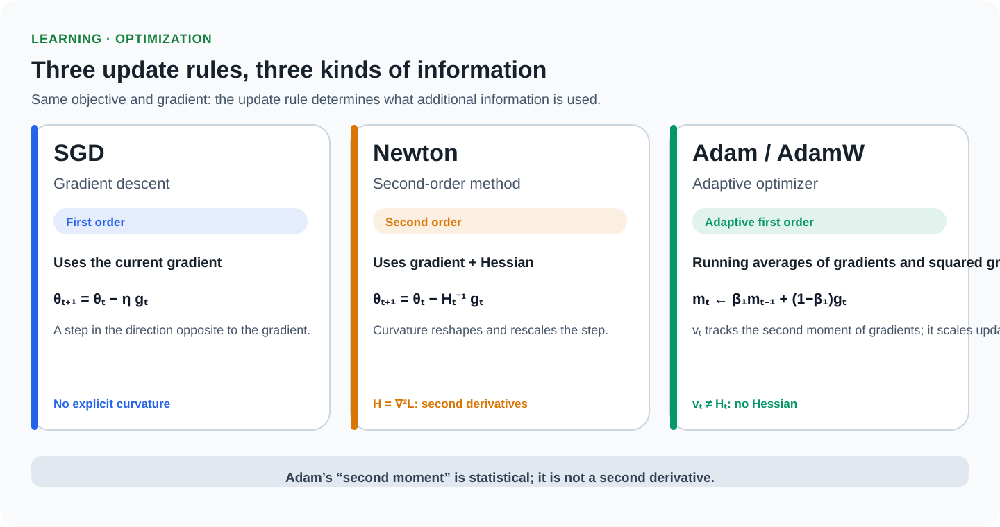

<!--
LLM-LAB-PAGE-MAP v1
id: "en/training-loop"
summary: "Shows how repeated gradient steps turn a randomly initialized model into a trained one, what an optimizer adds to the gradient, and why validation loss is measured on held-out data."
scope: "Assembles the computations into repeated training steps and distinguishes batch optimization from monitoring on held-out data."
purpose: "Order the operations in one iteration and interpret a divergence between training and validation curves."
suggested_route:
  previous: "en/gradients"
  next: null
hierarchy:
  parents: []
  children: ["en/post-training"]
related: ["en/loss", "en/gradients", "en/scaling-laws", "en/build-path", "en/experimental-evaluation"]
revision_support:
  status: integrated_sufficient
  evidence:
    - anchor: revision-summary
      note: "The recap separates forward pass, loss, gradient, actual parameter update and independent validation measurement; the worked questions, SGD calculations, and integrative exercise are collected on the [dedicated practice page](exercises/training-loop.qmd)."
tags: ["type:concept-lesson", "destination:understand", "topic:training-loop", "level:core", "language:en", "status:published"]
-->



::: {.chapter-lead}
Training repeats one cycle many times: predict, measure the loss, compute the gradient, update the parameters. Its objective is to improve fit to the training data; this does not guarantee a decrease at every step or better performance on unseen text, which must be measured separately on held-out data.
:::

::: {.callout-tip title="The one-minute mental model" #revision-summary}
A **training step** takes a batch of observed prefixes and targets, runs the forward pass, computes the [loss](loss.qmd), obtains the [gradient](gradients.qmd), and lets an **optimizer** turn that gradient into a parameter update. **Training** is this step repeated over many batches. Only the update changes the parameters.

A second measurement runs alongside: the same loss computed on **validation** data that never produces an update. Training loss tells you how well the model fits what it is fitted to; validation loss estimates how well that fit carries over.
:::

<div class="pipeline-stepper" role="group" aria-label="Operations in one training step">
  <span class="step-item">1. Batch</span>
  <span class="step-arrow" aria-hidden="true">→</span>
  <span class="step-item">2. Forward and loss</span>
  <span class="step-arrow" aria-hidden="true">→</span>
  <span class="step-item">3. Gradient</span>
  <span class="step-arrow" aria-hidden="true">→</span>
  <span class="step-item active">4. Update</span>
  <span class="step-arrow" aria-hidden="true">→</span>
  <span class="step-item">5. Repeat, and measure on validation data</span>
</div>

<figure id="fig-training-loop-update">
  <picture>
    <source media="(max-width: 600px)" srcset="../images/training-loop-visual-en-mobile.svg">
    
  </picture>
  <figcaption>One training batch changes the parameters only at the optimizer step. Validation measures the current model on held-out data; it does not update the model. The target-probability example uses the same illustrative values as the calculation below.</figcaption>
</figure>

## One step, then many

For a batch of observed prefixes with their next-token targets (see [teacher forcing](loss.qmd#observed-prefix-and-teacher-forcing)), one iteration performs:

1. **Forward pass.** With the current parameters $\theta_k$, compute logits for every valid target position.
2. **Loss.** Reduce the per-position [cross-entropy](cross-entropy.qmd) to the batch loss $\mathcal{L}(\theta_k)$ defined in [Loss](loss.qmd).
3. **Gradient.** Backpropagation gives $\nabla_\theta\mathcal{L}(\theta_k)$, as described in [Gradients](gradients.qmd).
4. **Update.** The optimizer computes $\theta_{k+1}$ from the gradient (and possibly its own state), and the next iteration uses $\theta_{k+1}$.

Steps 1–3 only read the parameters. Step 4 is the single place where they change. This is the contrast with [generation](generation.qmd) and [scoring](likelihood.qmd), which run the same forward computation with fixed parameters.

### Replay one step on the first token {#replay-one-step-on-the-first-token}

For the first step of the Romans example, if the current distribution is $(0.6,0.2,0.1,0.1)$ and the target is “They”, its local loss is $-\log(0.6)\approx0.511$ nats and its logit gradient is $(-0.4,0.2,0.1,0.1)$. Backpropagation carries this signal to the projection and earlier layers; the optimizer then updates parameters. The next forward pass must recompute logits and probabilities from the updated parameters—the old distribution is not reused. [Recompute the distribution after one SGD step](gradients.qmd#running-example-sgd) using the same output matrix as in the logits lesson.

### From one target to a batch

The calculation above follows one target. Under the reduction used here, differentiate the [mean loss over valid positions](loss.qmd#from-local-penalty-to-batch-loss).

A **sampled mini-batch** gives a noisy estimate of the loss and gradient over the full training set. This is the principle of *stochastic* gradient descent: successive mini-batches can pull the parameters in slightly different directions, and the average trend guides optimization. By contrast, if each update uses every training example, the method is called **full-batch gradient descent**. Counting conventions vary: a *step* is one parameter update, and an *epoch* is one pass over the training data; both depend on the batch size and dataset.

A freshly initialized model assigns roughly uniform probabilities, so its loss is near $\ln V$ for a vocabulary of size $V$ (a near-uniform start is a sanity check, not a guarantee: initialization scale matters). Training aims to lower this loss; with stochastic batches, measurements can fluctuate from one step to the next.

## Optimizer, gradient, and learning rate

These three are often conflated.

- The **gradient** is a quantity: how the loss changes locally with each parameter.
- The **optimizer** is a rule that maps gradients (and sometimes its own memory of earlier gradients) to an update. Plain SGD uses $\theta_{k+1}=\theta_k-\eta\,\nabla_\theta\mathcal{L}(\theta_k)$, as shown in [Gradients](gradients.qmd).
- The **learning rate** $\eta$ sets the size of the step. Too small, and training is slow; too large, and the loss can oscillate or diverge, because the gradient is only a *local* description.

::: {.callout-warning title="Misconceptions"}
- **“The optimizer computes the gradient.”** Backpropagation computes it; the optimizer only consumes it.
- **“A smaller learning rate is always safer.”** It is more stable per step but can be too slow to reach a useful loss within the available compute; the best value depends on model, batch size and optimizer.
- **“Training stops when the loss reaches zero.”** With perfectly separable one-hot targets and no regularization, softmax cross-entropy can approach zero as logits become increasingly confident, without reaching zero at finite logits. This is not a universal property of every objective or dataset; in practice, stopping depends on the compute budget and validation behaviour.
:::

## Training loss versus validation loss

If the only measurement were the loss that the optimizer minimizes, a model that memorizes its training text would look perfect. The standard remedy is to set aside data that never produces an update.

- **Training loss:** computed on batches used for updates. It measures fit to those examples.
- **Validation loss:** the same loss on a separate split, computed with fixed parameters, without any update. It estimates behaviour on unseen text from the same distribution.
- **Test loss:** a further split, kept untouched until a final assessment. Validation guides choices such as when to stop training or which learning rate to use. Repeatedly selecting configurations with the lowest loss on that split can favor a configuration that scores well there partly by chance. Its validation loss can then underestimate its loss on new data. The reserved test split provides a measurement independent of that selection. See [corpus preparation](corpus-preparation.qmd) for how splits are made without leakage and [Experimental evaluation](experimental-evaluation.qmd) for the broader protocol.

**Overfitting** occurs when the model fits details of the training sample that do not recur in new text. A common sign is validation loss leveling off or rising while training loss keeps falling. The gap between the two losses is the *generalization gap*. The amount of overfitting depends on model capacity relative to the amount and diversity of training data, on how many times the data is repeated, and on regularization.

The example below makes this visible with the smallest possible language model: a table of logits indexed by the previous token, trained on only 60 tokens drawn from a known random process and validated on 400 more.

With NumPy 2 and this seed, the run prints a training loss that falls from 2.485 ($=\ln 12$) to about 1.15, while the validation loss reaches a minimum near step 100 (about 2.01) and then rises to about 2.16. The training loss alone would suggest continuing. Among the checkpoints measured in this run, validation loss favors step 100. The exact numbers depend on the seed and library version; the assertions check the qualitative pattern, not the values.

This example is deliberately tiny: a lookup table and full-batch gradient-descent updates over all 60 training tokens at every step, not sampled mini-batches. It demonstrates the loop and the diagnosis, not the behaviour of a Transformer, and the same curve shape is not guaranteed in other setups. Passing the assertions shows that this configuration reproduces the pattern; it is not a general proof about overfitting.

To compare two checkpoints, try [aggregating validation loss over batches with different numbers of valid tokens](exercises/loss.qmd#ex-validation-loss-by-token).

[Reproduce the validation experiment](#implementation).

## Pretraining is the same loop at scale

*Pretraining* names this loop applied to a very large and diverse text corpus: the targets are the corpus's own next tokens, so no annotation is needed. What changes with scale is not the mathematics of one step, but the surrounding engineering: data volume and curation, batch size, learning-rate schedules, numerical precision, and spreading the computation over many devices. How loss varies with model size, data and compute is an empirical question treated in [Scaling laws](scaling-laws.qmd).

The from-scratch implementation of this loop, with checkpointing and a validation runner, is a milestone of the [Build path](build-path.qmd); its status is tracked there. This lesson does not require it. Training a pretrained model further on a narrower objective (supervised fine-tuning and related methods) reuses the same loop with different data and targets; it is introduced in the [LLM panorama](llm-overview.qmd), not here.

[Training-loop questions and exercises](exercises/training-loop.qmd).

[Review the Training stage in the learning plan](review-path.qmd#training).



After this path, you can study [post-training](post-training.qmd) or apply an [evaluation protocol](experimental-evaluation.qmd).

## Further exploration

### Implementation

::: {.callout-note collapse="true" title="Show the runnable code" data-reading-time="exclude"}

<span class="epistemic-badge badge-code">Run locally</span> The code uses the maintained `llm_lab.foundations.losses` functions for the loss and its gradient with respect to logits, and adds only the loop. Run it from the repository root after `uv sync`.

```python
import numpy as np
from llm_lab.foundations.losses import cross_entropy_from_logits, cross_entropy_gradient

rng = np.random.default_rng(0)
V = 12                                                  # vocabulary size
true_P = rng.dirichlet(np.full(V, 0.3), size=V)         # unknown next-token law, (V, V)

def sample(n):                                          # token stream -> (inputs, shifted targets)
    t = [0]
    for _ in range(n):
        t.append(rng.choice(V, p=true_P[t[-1]]))
    return np.array(t[:-1]), np.array(t[1:])

x_tr, y_tr = sample(60)                                 # small training split
x_va, y_va = sample(400)                                # held-out validation split

W = np.zeros((V, V))                                    # parameters: logits row per previous token
lr, history = 1.0, []
for step in range(301):
    if step % 50 == 0:                                  # measurement only: no parameter update
        history.append((step,
                        cross_entropy_from_logits(W[x_tr], y_tr),
                        cross_entropy_from_logits(W[x_va], y_va)))
    g_logits = cross_entropy_gradient(W[x_tr], y_tr)    # (60, V): dLoss / dlogits
    g_W = np.zeros_like(W)
    np.add.at(g_W, x_tr, g_logits)                      # chain rule through the row lookup
    W -= lr * g_W                                       # full-batch gradient-descent update

train = [h[1] for h in history]
val = [h[2] for h in history]
assert np.isclose(train[0], np.log(V)) and np.isclose(val[0], np.log(V))   # uniform start
assert all(a >= b for a, b in zip(train, train[1:]))    # training loss keeps falling
assert int(np.argmin(val)) < len(val) - 1               # validation loss turns upward
for s, tr, va in history:
    print(f"step {s:3d}  train {tr:.3f}  val {va:.3f}")
```

:::

### Compare optimizers

Language-model training commonly uses *adaptive* optimizers such as Adam and its decoupled-weight-decay variant AdamW. Intuitively, they keep running averages of recent gradients and squared gradients (their uncentred second moment), so that each parameter receives a step scaled to its own recent history, not one global step size. For the same data objective and parameters, the gradient of that objective is still the one computed by backpropagation; the optimizer determines how to use it. **AdamW additionally applies decoupled weight decay**: this contribution to the update is not the gradient of the data loss. Adam's running second moment is an estimate of gradient magnitude, **not** the Hessian used by Newton's method: Adam and AdamW are adaptive first-order optimizers, not second-order Newton methods. Their exact formulas, learning-rate schedules (warmup, decay) and gradient clipping are implementation choices that change training dynamics without changing the objective; they are outside this lesson's scope; the sources under *Further reading* define them.

<figure id="fig-optimizer-comparison">
  <picture>
    <source media="(max-width: 600px)" srcset="../images/optimizer-comparison-en-mobile.svg">
    
  </picture>
  <figcaption>SGD, Newton and Adam can optimize the same objective while using different information to choose an update. Adam's second moment tracks squared gradients; it does not calculate curvature.</figcaption>
</figure>

::: {.callout-note collapse="true" title="Why not use exact Newton updates for every LLM parameter? (advanced)" data-reading-time="exclude"}
A full Newton step solves $H_k d_k = \nabla_\theta\mathcal{L}(\theta_k)$ and updates $\theta_{k+1}=\theta_k-d_k$. For a model with millions or billions of parameters, storing and factorizing the dense Hessian is generally prohibitive. The Hessian can also be singular or indefinite, so an undamped Newton direction is not automatically a descent direction; practical second-order methods need safeguards such as damping, trust regions, or structured approximations. Quasi-Newton methods (for example L-BFGS) and structured preconditioners explore ways to capture curvature more cheaply, but they are not the same algorithm as Adam. This is why large-scale language-model training commonly favours first-order adaptive methods.
:::

:::: {.language-switch}
[Français](../fr/training-loop.qmd) · [English](training-loop.qmd)
::::

<details class="learning-resources">
<summary>
  <span class="learning-resources__title">Supplementary resources</span>
  <span class="learning-resources__description">Experiment, explore further, and practise the ideas from this lesson.</span>
</summary>
<div class="learning-resources__content" markdown="1">

### Additional implementation resources

::: {.callout-note title="What if you do not have a local GPU?"}
The training loop does not inherently depend on the machine that runs it. Once the program has been smoke-tested locally, you can run it on a managed GPU with Hugging Face Jobs: Python training code stays separate from the launcher, which selects the image, GPU, timeout and persistent storage. See the [bilingual remote-training recipe](https://github.com/JM-Brun/llm-lab/tree/main/experiments/huggingface-jobs) for the workflow, commands and limitations. This is optional and does not replace an independent validation loss.
:::

- [Hugging Face — A full training loop](https://huggingface.co/learn/llm-course/en/chapter3/4): a PyTorch example that makes visible the steps handled by a high-level API.
- [Hugging Face — Fine-tuning with Trainer](https://huggingface.co/learn/llm-course/en/chapter3/3): configuring evaluation, metrics, mixed precision, and gradient accumulation.
- [Hugging Face — Understanding Learning Curves](https://huggingface.co/learn/llm-course/en/chapter3/5): interpreting loss and metric curves during fine-tuning.

### Additional workflow examples

- [Hugging Face — Training a causal language model from scratch](https://huggingface.co/learn/llm-course/en/chapter7/6): a CodeParrot example connecting a code corpus, tokenizer, streaming, and causal pretraining. It is an applied case study, not a replacement for LLM Lab's minimal GPT path.
- [Hugging Face — Debugging the training pipeline](https://huggingface.co/learn/llm-course/en/chapter8/4): a diagnostic approach that inspects data, batching, model, optimizer, and evaluation in sequence.

### Further reading

- [Kingma and Ba — Adam: A Method for Stochastic Optimization](https://arxiv.org/abs/1412.6980): the adaptive optimizer introduced in the original paper.
- [Loshchilov and Hutter — Decoupled Weight Decay Regularization](https://arxiv.org/abs/1711.05101): defines AdamW and explains why weight decay is decoupled from the gradient step.
- [Goodfellow, Bengio and Courville — Deep Learning, chapter 5.2](https://www.deeplearningbook.org/contents/ml.html): capacity, overfitting and underfitting, with the train/validation/test vocabulary used above.
- [Karpathy — A Recipe for Training Neural Networks](https://karpathy.github.io/2019/04/25/recipe/): practical advice, including overfitting a small batch first and reading train and validation curves.
- [PyTorch — `torch.optim.AdamW`](https://docs.pytorch.org/docs/stable/generated/torch.optim.AdamW): documents the update rule and the optimizer state that is saved with a checkpoint.

</div>
</details>
