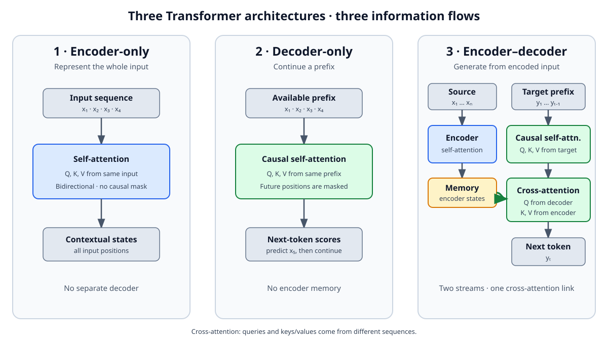

<!--
LLM-LAB-PAGE-MAP v1
id: "en/transformer-architectures"
scope: "Compares encoder-only, encoder–decoder, and decoder-only Transformer architectures by information flow, masking, typical training objectives, and uses; explicitly distinguishes architecture, objective, and task without claiming these families cover every language-model architecture."
purpose: "Readers should be able to explain how each family processes context, identify the differences between bidirectional self-attention, causal self-attention, and cross-attention, and understand why architecture alone does not determine a training objective or use."
suggested_route:
  previous: null
  next: null
hierarchy:
  parents: ["en/llm-overview"]
  children: ["en/cross-attention"]
related: ["en/transformer-history", "en/transformer", "en/cross-attention"]
tags: ["type:concept-lesson", "destination:understand", "topic:transformer-architectures", "level:core", "language:en", "status:published"]
-->

::: {.chapter-lead}
Transformers do not form a single architecture. Depending on whether a network uses an encoder, a decoder, or both, information flows differently: a sequence can be represented in both directions, transformed into another sequence, or extended one token at a time. These choices shape likely uses, but do not determine the training objective by themselves.
:::

::: {.callout-note .learning-outcomes collapse="true" title="Learning outcomes"}
You will be able to:
- compare encoder-only, encoder–decoder, and decoder-only architectures by context visibility and information flow;
- distinguish bidirectional context access in the encoder from causal access in the decoder;
- separate architecture, training objective, and task without treating typical pairings as rules.
:::

## At a glance

| Family | Information flow | Masking and attention | Typical objectives | Common uses | Examples |
|---|---|---|---|---|---|
| **Encoder-only** | The encoder transforms an entire input sequence into contextual representations. | Generally bidirectional self-attention: each position can use information from other positions in the input. | Masked language modeling, among other possible objectives. | Classification, semantic search, extraction, and text representation. | BERT, RoBERTa |
| **Encoder–decoder** | The encoder represents the input; the decoder produces a target sequence using that representation. | Encoder attention over the input; causal self-attention in the decoder; cross-attention to encoder states. | Reconstruction, denoising, or text-to-text learning, depending on the model. | Translation, summarization, and sequence-to-sequence transformation. | Original Transformer, T5 |
| **Decoder-only** | The decoder extends a prefix by producing representations used to predict the next token. | Causal self-attention: a position cannot attend to future tokens. | Autoregressive next-token prediction in classic GPT models. | Prompt-conditioned continuation and generation. | GPT, GPT-2 |

## The three architectures in one diagram

{fig-alt="Encoder-only: bidirectional self-attention. Decoder-only: causal self-attention. Encoder–decoder: encoder self-attention, causal decoder self-attention, and cross-attention to encoder memory." width=100%}

The distinguishing feature of the encoder–decoder architecture is that its decoder can read representations produced by the encoder. This mechanism is called **cross-attention**. Its detailed operation belongs in an [advanced deep dive](cross-attention.qmd); it is not required to understand the broad architecture comparison.

## What actually distinguishes the three families

### Encoder-only: contextualize an input

An encoder generally processes the supplied sequence as a whole. With bidirectional attention, a token representation can incorporate information from positions both before and after it in the input. This is useful for tasks that represent, classify, or compare a complete text.

In BERT, the best-known pretraining objective predicts masked tokens from their left and right context. This objective makes use of the architecture; it is not the definition of every encoder.

### Encoder–decoder: transform one sequence into another

The encoder builds a representation of the input. The decoder then generates the output, usually autoregressively, combining its already-produced context with information from the encoder through *cross-attention*.

This separation is natural when input and output play distinct roles: translating a sentence, summarizing a document, or converting text into another format. The original 2017 Transformer and T5 are important examples of this family. The mechanism—including the distinct origins of Q, K, and V—is covered in the [advanced cross-attention deep dive](cross-attention.qmd).

### Decoder-only: extend a prefix

A decoder-only model uses a causal mask: when computing a representation at one position, it cannot consult future tokens. During autoregressive training, each position learns to predict the token following the available prefix. At inference, the system repeats this prediction and appends each selected token to the context.

This is the architecture used in LLM Lab's small-GPT build route. It makes generation inspectable step by step; it does not mean every LLM is decoder-only.

## Architecture, objective, and task are different concepts

These terms are often conflated, but they answer different questions:

- **Architecture**: which operations and connections organize the computation?
- **Training objective**: what quantity does the model learn to predict or optimize? Examples include masked tokens, next tokens, or denoised sequences.
- **Use task**: what problem should the system solve? Examples include classification, translation, summarization, or generation.

One family can be trained with several objectives; similar objectives can be implemented in different architectures. The table shows common associations, not mandatory pairings.

## Scope of this comparison

The three families described here are major configurations of the **Transformer**. They do not cover every language- or sequence-modeling architecture: state-space models, recurrent architectures, and hybrids also exist. Conversely, a Transformer is not necessarily an LLM: architecture alone says nothing about model scale, data, or capabilities.

For an optional look beyond the Transformer foundations covered here, see the [Nemotron hybrid architecture case study](hybrid-llm-architectures.qmd). The [history of Transformers](transformer-history.qmd) places these architectures in the development of the field; the internal computation of the [decoder-only GPT used in this project](transformer.qmd) shows one particular implementation.

::: {.callout-note title="Key point — LLMs are not all pure Transformers"}
The Transformer is a major architecture, not a requirement. Other models use **recurrent states** to summarize the past in compact memory, or combine those states with selected attention layers. Others use **sparse activation**: only some expert networks process each token. These choices change the trade-offs between precise context access, memory, computation, and capacity. For now, the essential point is that several architectures can address language modeling; the mechanisms behind Mamba, MoE, and hybrid designs are explored in the [Nemotron case study](hybrid-llm-architectures.qmd).
:::

::: {.self-check}

## Complexity and parallelism: two different concepts

Dense Transformer attention performs a number of interactions that grows as \(T^2\) with sequence length \(T\). Yet those interactions are highly parallelizable during training and prompt prefill. Conversely, a recurrence may require linear work in \(T\) while depending on the state computed at the previous step. Standard autoregressive generation remains sequential across tokens even though each step uses parallel operations.

Keep three questions separate: **how much computation? how much memory? what dependency chain?** The [advanced guide to complexity and parallelism](llm-computational-complexity.qmd) examines them in detail.

## Check your understanding

[Extended exercises on this topic](../en/exercises.qmd#transformer).

1. **Why can BERT use tokens that appear after the token being represented?** Its encoder generally uses bidirectional attention over the full input; it is not subject to GPT's causal mask.
2. **Which operation particularly distinguishes an encoder–decoder from a decoder-only model?** The encoder–decoder's decoder has cross-attention to representations produced by the encoder.
3. **Does next-token prediction define every Transformer?** No. It is a typical objective for autoregressive decoders, not a property of all Transformers.
4. **Is a Transformer necessarily an LLM?** No. Architecture alone does not determine model scale or whether it qualifies as an LLM.
:::

::: {.language-switch}
**Language:** [Français](../fr/transformer-architectures.qmd) · [English](transformer-architectures.qmd)
:::
