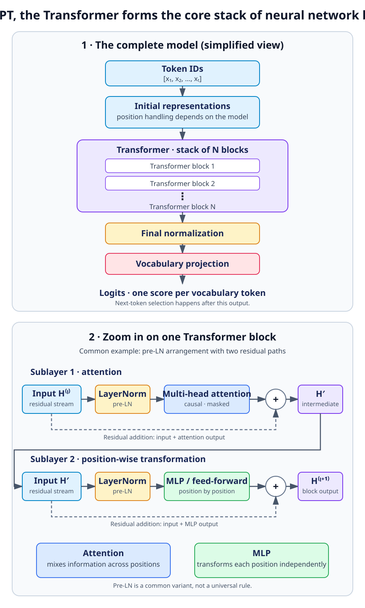
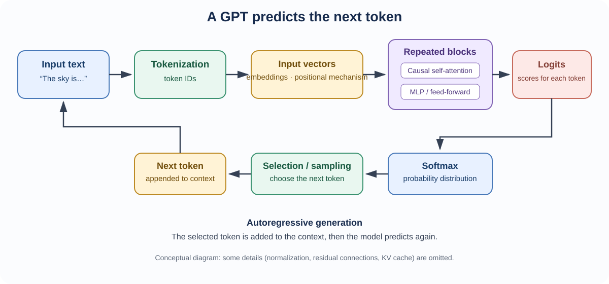

<!--
LLM-LAB-PAGE-MAP v1
id: "en/transformer"
summary: "Traces a decoder-only GPT computation from input representations, through repeated Transformer blocks, to the logits."
scope: "Introduces the decoder-only GPT computation flow, the general role of repeated blocks, and the boundary between the forward pass and decoding."
purpose: "Trace representations to logits, explain what a Transformer block repeats, and distinguish network computation from generation of the next token."
suggested_route:
  previous: "en/contextualized-representations"
  next: "en/queries-keys-values"
hierarchy:
  parents: ["en/index", "en/llm-overview", "en/transformer-architectures"]
  children: ["en/queries-keys-values", "en/scaled-dot-product-attention", "en/logits"]
related: ["en/transformer-history", "en/text-data", "en/embedding-space", "en/positional-encoding", "en/contextualized-representations", "en/contextualized-representations-advanced", "en/tensors", "en/generation", "en/transformer-block-walkthrough", "en/gpt-model-walkthrough", "en/transformer-exercises"]
revision_support:
  status: integrated_sufficient
  evidence:
    - anchor: revision-summary
      note: "The lesson focuses on the representations → blocks → logits flow and the essential roles of attention, the MLP and the residual stream. Sublayer and normalization details live in contextualized-representations-advanced; the 2017 diagram reading lives in transformer-history; detailed dimensions live in tensors. Practice remains on its dedicated companion page."
tags: ["type:system-overview", "destination:understand", "topic:transformer", "level:overview", "language:en", "status:published"]
-->


::: {.chapter-lead}
A **GPT** is a language model built around a **decoder-only Transformer**. The Transformer does not refer to a processing step placed between other components: it is a neural-network architecture. In a decoder-only GPT, its core is a stack of Transformer blocks that transform token representations. From these representations, the network computes **logits** — one score for every token in the vocabulary.

This page first shows what that architecture looks like, then follows a forward pass through its blocks to the logits. It stops at the network output: converting logits into probabilities and selecting the next token belong to decoding, not to the Transformer's internal computation.
:::

::: {.callout-tip title="The Transformer in one minute" #revision-summary}
A decoder-only GPT is a Transformer network made of repeated blocks. Within each block, self-attention mixes information across permitted positions, the MLP transforms each position, residual connections provide a direct path, and normalization helps control activation scale. The stack produces final representations and then logits; choosing the next token belongs to decoding.
:::

  <a class="step-item" href="contextualized-representations.qmd">1. Represented input</a>
  →
  2. Transformer block
  →
  3. Final state
  →
  <a class="step-item" href="logits.qmd">4. Logits</a>

The diagram below offers two levels of view: the complete GPT, to locate the data flow, and an enlarged block, to understand the repeated operations. We will then follow this flow from the network input to the logits, without retelling tokenization or the generation loop.

## The Transformer: the network at the heart of a GPT

<figure id="fig-transformer-stack">
  <picture>
    <source media="(max-width: 600px)" srcset="../images/transformer-stack-en-mobile.svg">
    
  </picture>
  <figcaption>The first panel locates the complete network; the second expands one common pre-LN block. Attention mixes information across positions, while the MLP transforms each position independently.</figcaption>
</figure>

*The stack of blocks is the Transformer in the GPT shown here. The expanded view shows a **pre-LN** arrangement: each sublayer is preceded by its own normalization. This is a common layout; sublayer order and normalization variants differ across models.*

In a decoder-only GPT, blocks are **stacked**: the output of one becomes the input to the next. Each block transforms the sequence of representations; it does not choose the next token itself. After the final block, a final normalization and a vocabulary projection produce the logits.

After following the forward pass, you can [compare this GPT with the 2017 diagram](#historical-transformer-diagram).

This diagram represents the **decoder-only** family used by autoregressive GPT models. Transformers are not limited to this architecture: the [Transformer architecture comparison](transformer-architectures.qmd) shows what changes in encoder-only and encoder-decoder models.

### Placing the network in the generation process

<figure id="fig-gpt-data-flow">
  <picture>
    <source media="(max-width: 600px)" srcset="../images/gpt-data-flow-en-mobile.svg">
    
  </picture>
  <figcaption>The diagram places the Transformer stack in the full generation loop: the selected token is appended to the context, then another prediction is computed with the same parameters.</figcaption>
</figure>

This second diagram answers a different question: it places the network in the complete process. **The stack of blocks in the middle is the Transformer shown above**; upstream operations prepare its input, while softmax, token selection, and feedback happen downstream. The decoding loop takes place after the network output.

## 1. From input IDs to the first block

The previous lessons established how text becomes a sequence of IDs, then how those IDs become vectors to which the architecture adds positional information. The first block therefore receives a sequence of representations, not raw text. In the project GPT with additive absolute positional embeddings, token and position embeddings are added before the first block. This is not a universal rule: with RoPE, positional information acts on queries and keys after projection, inside attention. The details remain in the lessons on [embeddings](embedding-space.qmd), [positional information](positional-encoding.qmd), and [contextualized representations](contextualized-representations.qmd).

token IDs → initial representations → first-block input

The prefix “It is a good situation, scribe?” then passes through the block stack before the model produces the next-token logits. The continuation is built through the generation loop; it is not written in advance in the prompt.

## 2. Transformer blocks

The stack consists of blocks of the same general type, repeated in depth. Each block transforms the sequence of representations while preserving its length and width: it combines two complementary sublayers.

- **Multi-head self-attention:** each position aggregates information from positions permitted by the mask. In GPT, [causal masking](causal-masking.qmd) prevents access to future tokens. The projections that feed this computation are covered in [Q/K/V](queries-keys-values.qmd), followed by score computation and aggregation in [scaled dot-product attention](scaled-dot-product-attention.qmd).
- **MLP (feed-forward network):** transforms each position independently, using parameters shared across positions. It provides a local nonlinear transformation without directly mixing positions.

Each sublayer is integrated into the **residual stream**: its correction is added to the flowing representation, and normalization accompanies the transformations. The exact order varies across architectures (pre-LN, post-LN, RMSNorm, and others). This lesson introduces their role; the [deep dive on contextualized representations](contextualized-representations-advanced.qmd) explains the sublayers, residual connections, and normalization in detail. The [block walkthrough](transformer-block-walkthrough.qmd), by contrast, focuses on the Python implementation.

### Parallel training, sequential generation

During training, the tokens in a sequence are known: the network can compute representations for multiple positions in parallel, while the causal mask prevents each position from using future tokens. This removes the position-by-position recurrent dependency found in RNNs.

During generation, the next token depends on tokens already produced, so decoding steps remain autoregressive. The key-value cache (KV cache) avoids recomputing some past keys and values, but does not remove this sequential dependency. The [generation lesson](generation.qmd) distinguishes initial prompt processing (prefill) from incremental production (decode).

- **Training:** `t₁ t₂ t₃ t₄` → one masked pass; positions are computed in parallel.
- **Generation:** `t₁` → `t₂` → `t₃` → … each step depends on the previous token.

### Depth and width: two architectural dimensions

- **Depth:** the number of Transformer blocks stacked in the network.
- **Width:** the dimension \(d_{\mathrm{model}}\) of the representations flowing through the residual stream.

These two dimensions describe the overall structure but are not sufficient to predict performance. Internal dimensions \(d_{\mathrm{head}}\) and \(d_{\mathrm{ff}}\), tensor shapes, and GPT-2 reference values are gathered in the [Tensors](tensors.qmd) page; the [GPT configuration walkthrough](gpt-config-walkthrough.qmd) shows how they are used in the project's model.

### Three levels that should not be conflated

1. **The attention sublayer** exchanges information across permitted positions.
2. **The Transformer block** combines attention with an MLP, residual connections, and normalization.
3. **The complete GPT** assembles input representations, a stack of blocks, then a final normalization and output head.

Attention is part of a block; the block is the repeated unit; the Transformer alone is not the complete GPT.

## 3. From representations to logits

The output of the final block is the network's **final state**. The final normalization and the output head then produce the **logits**: one unnormalized score for every vocabulary token. The output head is a simple linear projection: each `d_model`-dimensional representation becomes a vector of `vocab_size` scores (50,257 for GPT-2).

`final block output → final normalization → vocabulary projection → logits`

Downstream, outside the network: `logits → softmax → probabilities → chosen token`.

For our example prefix with GPT-2's dimensions: each position leaves the final block as a vector of 768 numbers, which becomes 50,257 scores. To extend an unpadded prefix, generation uses the **logits at its last position**; the causal mask guarantees that they depend only on the tokens already known. The [logits lesson](logits.qmd) explains what these scores represent; the [output probabilities lesson](probabilities.qmd) shows how *softmax* converts them into a distribution. The network stops at these scores: choosing a token, appending it to the context, and running the model again belong to [autoregressive generation](generation.qmd).

<!-- Legacy section anchors: see the linked companion page. -->



::: {.language-switch}
**Language:** [Français](../fr/transformer.qmd) · [English](transformer.qmd)
:::

## Practice

The questions and exercises for this lesson are collected on its [dedicated practice page](exercises/transformer.qmd).

## Further exploration

  Supplementary resources
  Explore the optional interactive workshop and further-reading resources for this lesson.

<h3>Optional interactive exploration</h3>

The <a href="transformer-explainer.qmd">GPT-2 exploration workshop</a> lets you observe these mechanisms on a real model: run controlled experiments and examine the limits of the visualization.

<h3 id="further-reading">Further reading</h3>

For visualizations and implementation resources, see the <a href="deepen.qmd#transformer-resources">Transformer resources in Deepen</a>. The guided reading of the original 2017 diagram is in <a href="transformer-history.qmd#historical-transformer-diagram">A history of Transformers</a>. For a complementary first overview, see <a href="https://dev.to/nishanthan-k/understanding-transformer-the-architecture-behind-modern-ai-55o8">Understanding Transformer: The Architecture Behind Modern AI</a>.

## For the original architecture diagram

The guided reading of the 2017 encoder–decoder Transformer has moved to [A history of Transformers](transformer-history.qmd#historical-transformer-diagram), alongside the research timeline and context.
