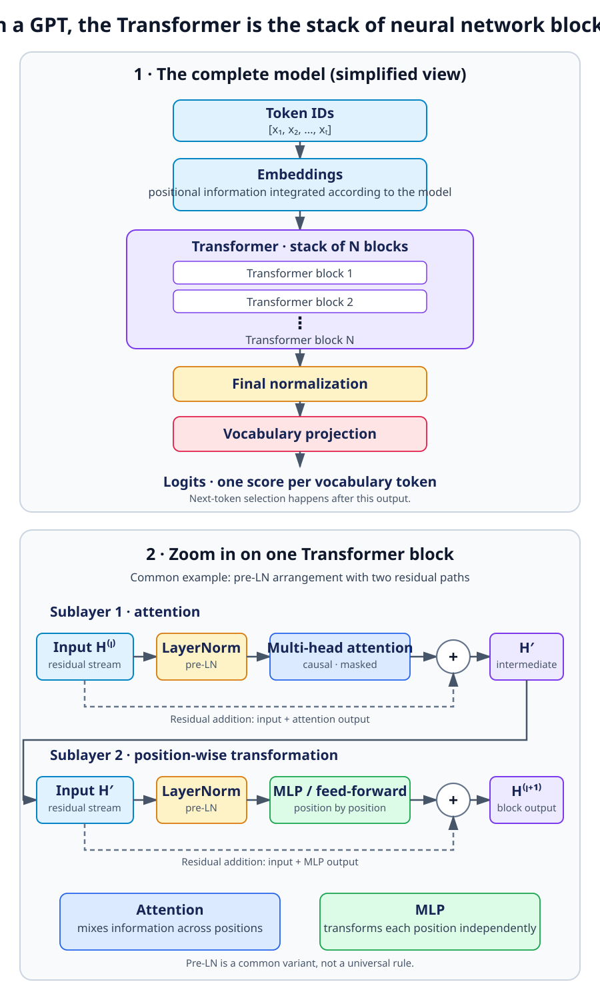

<!--
LLM-LAB-PAGE-MAP v1
id: "en/transformer"
summary: "Introduces the architecture of a decoder-only GPT, from its Transformer block stack to the output head, then traces a forward pass to the logits. Distinguishes attention, the repeated block, and the complete model."
scope: "Follows an autoregressive GPT computation inside the network, from input representations to logits, focusing on Transformer blocks, self-attention, the MLP, residual connections, and normalization; text preparation and the generation loop are located but not retaught."
purpose: "Readers should be able to recognize a decoder-only Transformer architecture, distinguish the attention sublayer, block, and complete network, then trace a forward pass to the logits without conflating it with generation."
suggested_route:
  previous: "en/contextualized-representations"
  next: "en/queries-keys-values"
hierarchy:
  parents: ["en/index", "en/llm-overview", "en/transformer-architectures"]
  children: ["en/queries-keys-values", "en/scaled-dot-product-attention"]
related: ["en/text-data", "en/embedding-space", "en/positional-encoding", "en/contextualized-representations", "en/logits", "en/tensors", "en/generation", "en/transformer-block-walkthrough", "en/gpt-model-walkthrough", "en/transformer-exercises"]
tags: ["type:system-overview", "destination:understand", "topic:transformer", "level:overview", "language:en", "status:published"]
-->



::: {.chapter-lead}
A **GPT** is a language model built around a **decoder-only Transformer**. The Transformer does not refer to a processing step placed between other components: it is a neural-network architecture. In a decoder-only GPT, its core is a stack of Transformer blocks that transform token representations. From these representations, the network computes **logits** — one score for every token in the vocabulary.

This page first shows what that architecture looks like, then follows a forward pass through its blocks to the logits. It stops at the network output: converting logits into probabilities and selecting the next token belong to decoding, not to the Transformer's internal computation.
:::

<div class="pipeline-stepper" role="navigation" aria-label="Steps in Transformer computation">
  <a class="step-item" href="contextualized-representations.qmd">1. Represented input</a>
  <span class="step-arrow" aria-hidden="true">→</span>
  <span class="step-item active" aria-current="step">2. Transformer block</span>
  <span class="step-arrow" aria-hidden="true">→</span>
  <span class="step-item">3. Final state</span>
  <span class="step-arrow" aria-hidden="true">→</span>
  <a class="step-item" href="logits.qmd">4. Logits</a>
</div>


The diagram below offers two levels of view: the complete GPT, to locate the data flow, and an enlarged block, to understand the repeated operations. We will then follow this flow from the network input to the logits, without retelling tokenization or the generation loop.

## The Transformer: the network at the heart of a GPT

{#fig-transformer-stack fig-alt="At the top, the complete network: token IDs, embeddings and positional information, a stack of N Transformer blocks, final normalization, vocabulary projection and logits. At the bottom, one pre-LN block: normalization, causal multi-head self-attention, a residual connection, then normalization, a position-wise MLP and a second residual connection." width=100%}

*The stack of blocks is the Transformer in the GPT shown here. The expanded view shows a **pre-LN** arrangement: each sublayer is preceded by its own normalization. This is a common layout; sublayer order and normalization variants differ across models.*

In a decoder-only GPT, blocks are **stacked**: the output of one becomes the input to the next. Each block transforms the sequence of representations; it does not choose the next token itself. After the final block, a final normalization and a vocabulary projection produce the logits.

If you have already come across the classic diagram from the founding paper (*Attention Is All You Need*), you will recognize the same building blocks here: the *Multi-Head Attention*, *Feed Forward*, and *Add & Norm* boxes correspond to the multi-head attention, the MLP, and the residual-plus-normalization pair described on this page. The paper and its visualizations are referenced in the [Deepen resources](deepen.qmd#transformer-resources).

This diagram represents the **decoder-only** family used by autoregressive GPT models. Transformers are not limited to this architecture: the [Transformer architecture comparison](transformer-architectures.qmd) shows what changes in encoder-only and encoder-decoder models.

### Placing the network in the generation process

{fig-alt="Complete pipeline: text, tokenization, embeddings and positional information, repeated Transformer blocks, logits, softmax, next-token selection, then addition to the context." width=100%}

This second diagram answers a different question: it places the network in the complete process. **The stack of blocks in the middle is the Transformer shown above**; upstream operations prepare its input, while softmax, token selection, and feedback happen downstream. The decoding loop takes place after the network output.

## 1. From token IDs to input representations

At the first block's input, each token ID has already been mapped to a vector, and the model has information about token order. The pages on [embeddings](embedding-space.qmd) and [positional information](positional-encoding.qmd) explain these initial representations; the page on [contextualized representations](contextualized-representations.qmd) shows what Transformer layers do with them. Here, we follow that computation at the block level.

In one line:

`token IDs → embedding table → + positional information → first block input`

In our example, "What have the Romans ever done for us?" passes through this stack of blocks before the model produces the logits for the next token. The continuation is not already written in the prompt: it is built one step at a time by the generation loop.

## 2. Transformer blocks

::: {.callout-tip title="The block in one sentence"}
A block applies two successive corrections to the stream of representations: attention first mixes information across positions, then the MLP transforms each position. Each correction is computed on a normalized copy of the stream and then **added** to it: the stream passes through the block without ever being replaced.
:::

The stack shown above consists of blocks of the same general type, repeated in depth. Each block chains together two main **sublayers**, framed by residual connections and normalizations:

- **Self-attention:** each position combines information from the positions allowed by the mask, including its own position. The causal mask prevents access to future tokens.
- **Feed-forward network (MLP):** a small neural network applied to each position separately, with the same weights everywhere. It transforms each representation locally, without touching the other positions.

**Why *feed-forward*, why *MLP*?** *Feed-forward* signals that information flows one way, from input to output, with no interaction between positions and no feedback loop. *MLP* (*multi-layer perceptron*) is the historical name for a chain of linear layers with nonlinear activations. Concretely, this subnetwork projects the representation from `d_model` to an intermediate dimension `d_ff` (often about four times larger, to give each position a wider intermediate workspace), applies a nonlinear activation, then maps the result back to `d_model`; the exact design varies by architecture.

**Why a residual connection?** Instead of replacing the flowing representation, each sublayer adds a correction. The stream that crosses the whole stack without interruption is called the **residual stream**; the residual connection gives information and gradients a direct path through it:

$$
x_{\text{out}} = x_{\text{in}} + F(x_{\text{in}}).
$$

**Why normalize?** Normalization (*LayerNorm* in classic GPT models) centers and rescales the hidden-vector components of each position independently of other positions. Its role is to stabilize the computation: residual connections add corrections block after block, so the magnitudes of the representations grow; without normalization, activations and gradients become unstable and training a deep stack fails. In a **pre-LN** block, each sublayer receives a normalized input: $x' = x + \operatorname{Attention}(\operatorname{LN}(x))$, then $x'' = x' + \operatorname{MLP}(\operatorname{LN}(x'))$. The opposite arrangement (post-LN) and normalization variants such as RMSNorm differ across models.

The same route, as a picture:

```{mermaid}
#| label: fig-block-prefln
#| fig-cap: "One pass through a pre-LN block: each sublayer reads a normalized copy of the stream, and its output is added back to the stream (residual connection)."
#| fig-alt: "Flow diagram: x enters the block; a copy passes through LayerNorm then multi-head attention, and rejoins x at an addition; the result x prime passes through LayerNorm then the MLP, which projects from d_model to d_ff and back to d_model, and rejoins x prime at a second addition, giving x double prime, the block output."
flowchart LR
    X(["x (block input)"]) --> LN1["LayerNorm"]
    LN1 --> ATT["Multi-head attention"]
    ATT --> ADD1((" + "))
    X -- "residual path" --> ADD1
    ADD1 --> X2(["x′ (after attention)"])
    X2 --> LN2["LayerNorm"]
    LN2 --> MLP["MLP: d_model to d_ff to d_model"]
    MLP --> ADD2((" + "))
    X2 -- "residual path" --> ADD2
    ADD2 --> Y(["x″ (block output)"])
```

In short, each block component has a distinct role:

- **self-attention** mixes information across the allowed positions;
- the **MLP** transforms each position separately, with shared weights;
- the **residual connection** keeps a direct path for information and gradients;
- **normalization** stabilizes magnitudes so the deep stack can train.

For a precise implementation (pre-LN order, projections, and residual paths), see the [Transformer block walkthrough](transformer-block-walkthrough.qmd).

{fig-alt="Self-attention allows exchanges between allowed positions; the same feed-forward network is applied separately to each position." width=100%}

The two sublayers divide the work:

| | Self-attention | Feed-forward network (MLP) |
|---|---|---|
| Scope | all positions allowed by the mask | each position, separately |
| Links between positions | yes; the causal mask sets which accesses are allowed | none |
| Weights across positions | shared | shared |
| Dimensions traversed | `d_model` to `d_model` | `d_model` to `d_ff`, then back to `d_model` |
| Question it answers | what to take from the context? | how to transform what was taken? |

Both operations are learned. Attention computes a weighted sum of learned value vectors: it does not literally search through human-readable notes.

Each attention sublayer is in fact **multi-head**: several attentions run in parallel on distinct learned projections, and their results are combined. Each head works in a reduced dimension `d_head` (64 for GPT-2), with H × `d_head` = `d_model`: 12 × 64 = 768. This diversity does not guarantee that each head develops a clear, human-interpretable specialization; the projections that feed attention are the subject of the [next lesson](queries-keys-values.qmd).

### Parallel training, sequential generation

A Transformer can compute representations for many positions of a training sequence in parallel: the input tokens are available, and the causal mask prevents each position from seeing the future. This removes the position-by-position recurrent dependency found in RNNs.

- **Training:** `t₁ t₂ t₃ t₄` → a single pass; all positions are computed in parallel, and the causal mask stops each one from seeing the next.
- **Generation:** `t₁` → `t₂` → `t₃` → … one position per step; each token depends on the tokens already generated.

**It does not make GPT generation fully parallel**: when producing a response, the next token depends on tokens already generated, so decoding steps remain autoregressive. The key-value cache (*KV cache*) avoids recomputing some past keys and values, but it does not remove this sequential dependency. See [the generation loop](generation.qmd) for the distinction between *prefill* and *decode*.

### Depth and width: two architectural dimensions

Two terms are commonly used to describe the size of a Transformer: depth stacks compute steps; width widens the representation processed at each step.

- **Depth:** the number of Transformer blocks stacked in the network.
- **Width:** the dimension of the representations flowing between blocks. In a classic GPT, this usually corresponds to `d_model`, often called the *hidden size* or **residual-stream** dimension.

These terms are not interchangeable with other internal dimensions: the **number of attention heads** tells you how many attention mechanisms run in parallel; `d_head` is the dimension of each head's vectors; `d_ff` is the intermediate MLP dimension, the one each representation is temporarily projected to before being mapped back to `d_model`.

::: {.callout-note title="Orders of magnitude: GPT-2 (the reference 124M-parameter version)"}
- depth: 12 blocks;
- width: `d_model` = 768;
- attention: 12 heads of `d_head` = 64, and 12 × 64 = 768 = `d_model`;
- MLP: `d_ff` = 3072 = 4 × `d_model`.

These values are landmarks; recent models vary. The build path names these dimensions `embedding_dim` and `mlp_hidden_dim`: see the [GPT configuration walkthrough](gpt-config-walkthrough.qmd).
:::

*Width* is sometimes used more broadly for other internal dimensions, so check which dimension an article or model card means. For tensor shapes and projection dimensions, see [Tensors](tensors.qmd); for a concrete configuration, see the [GPT configuration walkthrough](gpt-config-walkthrough.qmd). Depth and width describe network structure, but neither alone predicts model performance.

To unpack the attention sublayer, follow three successive questions: [which projections feed attention?](queries-keys-values.qmd) (Q, K, and V), [how do scores become a weighted aggregation?](scaled-dot-product-attention.qmd), and [which positions may a GPT consult?](causal-masking.qmd) (causal masking). These pages examine the attention mechanism inside a block, not a different architecture.

### Three levels that should not be conflated

Three levels should remain distinct:

1. **The attention sublayer** exchanges information between permitted positions.
2. **The Transformer block** combines attention with an MLP, residual connections, and normalization.
3. **The complete GPT** assembles input representations, a stack of blocks, then a final normalization and output head.

Or, as a tree:

```
Complete GPT
└── stack of N Transformer blocks
    └── one block
        ├── attention sublayer
        ├── MLP sublayer
        └── residual connections + normalizations
```

Attention is therefore part of a block; the block is the repeated unit; the Transformer alone is not the complete GPT. The [block walkthrough](transformer-block-walkthrough.qmd) examines one implementation, and the [GPT assembly walkthrough](gpt-model-walkthrough.qmd) shows how the blocks fit into the complete model.

## 3. From representations to logits

The output of the final block is the network's **final state**. The final normalization and the output head then produce the **logits**: one unnormalized score for every vocabulary token. The output head is a simple linear projection: each `d_model`-dimensional representation becomes a vector of `vocab_size` scores (50,257 for GPT-2).

`final block output → final normalization → vocabulary projection → logits`

Downstream, outside the network: `logits → softmax → probabilities → chosen token`.

For our example prefix with GPT-2's dimensions: each position leaves the final block as a vector of 768 numbers, which becomes 50,257 scores. During generation, only the **logits of the last position** are used to choose the next token; the causal mask guarantees that they depend only on the tokens already known. The [logits lesson](logits.qmd) explains what these scores represent; the [output probabilities lesson](probabilities.qmd) shows how *softmax* converts them into a distribution. The network stops at these scores: choosing a token, appending it to the context, and running the model again belong to [autoregressive generation](generation.qmd).

<!-- Legacy section anchors: see the linked companion page. -->
<span id="a-guided-four-part-exploration"></span>
<span id="controlled-experiments-move-from-observation-to-testing"></span>
<span id="read-transformer-explainers-source-code"></span>
<span id="critical-audit-a-visualization-is-not-a-specification"></span>
<span id="what-this-demonstration-does-and-does-not-establish"></span>
<span id="observe-a-transformer-in-action"></span>

<details class="learning-resources">
<summary>
  <span class="learning-resources__title">Supplementary resources</span>
  <span class="learning-resources__description">Experiment, explore further, and practise the ideas from this lesson.</span>
</summary>
<div class="learning-resources__content">

<h3>Explore in practice</h3>
<p>The <a href="transformer-explainer.qmd">GPT-2 exploration workshop</a> lets you observe these mechanisms on a real model: run controlled experiments and examine the limits of the visualization.</p>

<h3 id="further-reading">Further reading</h3>
<p>For visualizations, the foundational paper, and implementation resources, see the <a href="deepen.qmd#transformer-resources">Transformer resources in Deepen</a>. For a complementary first overview, see <a href="https://dev.to/nishanthan-k/understanding-transformer-the-architecture-behind-modern-ai-55o8">Understanding Transformer: The Architecture Behind Modern AI</a>.</p>

<h3>Practice</h3>
<p>The questions and exercises for this lesson are collected on its <a href="exercises/transformer.qmd">dedicated practice page</a>.</p>

</div>
</details>



::: {.language-switch}
**Language:** [Français](../fr/transformer.qmd) · [English](transformer.qmd)
:::

::: {.self-check}
## Check your understanding

[Dedicated Transformer exercises](exercises/transformer.qmd).

1. Which operation mixes information across positions, and which transforms each position independently?
2. Why does a residual connection not replace the sublayer's transformation?
3. What problem does normalization prevent in a deep stack of blocks?
4. Which dimensions does a representation traverse in a block's MLP, and in what order?
5. During generation, which logits are used to choose the next token?

<details>
<summary>Show the answers</summary>

1. Self-attention mixes information across permitted positions; the MLP applies a position-wise transformation with shared weights.
2. The residual connection adds the sublayer output to its input: $x_{out}=x_{in}+F(x_{in})$. It preserves a direct path through the block while allowing the sublayer to contribute a learned transformation.
3. Without normalization, the successive additions of the residual connections make the magnitudes of the representations grow: activations and gradients become unstable, and training a deep stack fails. Normalization re-centers and rescales the components of each position's vector, which stabilizes training.
4. `d_model` to `d_ff` (the intermediate dimension, often about 4 × `d_model`), then back to `d_model`; the nonlinear activation applies to the intermediate representation.
5. Only those of the last position: the causal mask guarantees they depend only on tokens already known. During training, by contrast, the logits of every position are used, each position being supervised to predict its next token.

</details>
:::