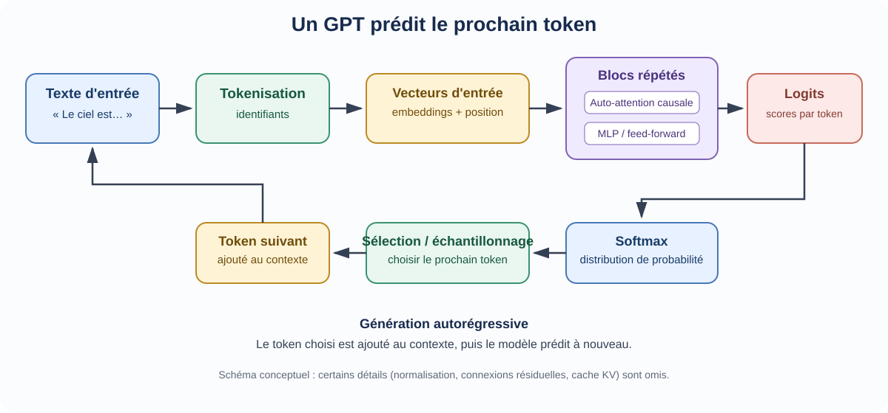
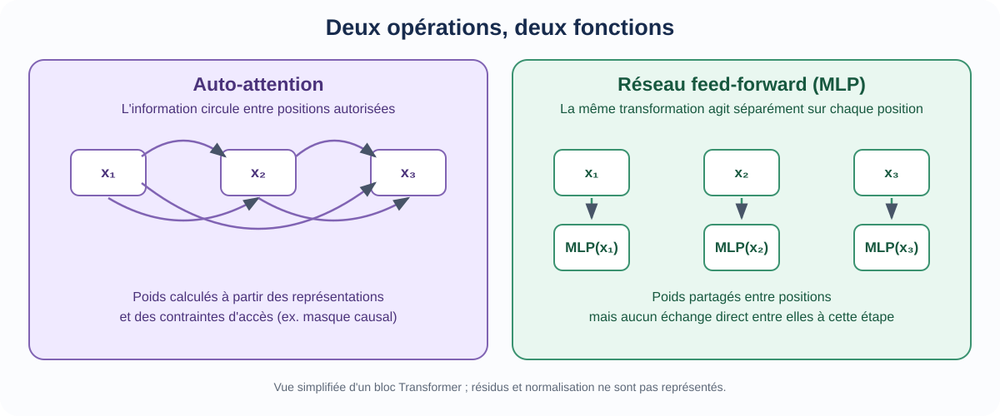

<!--
LLM-LAB-PAGE-MAP v1
id: "en/transformer"
scope: "Follows an autoregressive GPT computation inside the network—from the input token sequence through embeddings, positional information, Transformer blocks, attention, MLP, residual paths, and normalization to logits; it does not treat generation as a black-box loop or parameter learning as its main subject."
purpose: "Readers should be able to trace the computation to the logits, explain the main operations in a Transformer block, distinguish network depth from width, and separate representations, scores, and decoding."
suggested_route:
  previous: "en/llm-overview"
  next: "en/generation"
hierarchy:
  parents: ["en/index", "en/llm-overview"]
  children: ["en/embedding-space", "en/positional-encoding", "en/contextualized-representations", "en/queries-keys-values", "en/logits", "en/tensors", "en/transformer-explainer"]
related: ["en/text-data", "en/transformer-block-walkthrough"]
tags: ["type:system-overview", "destination:understand", "topic:transformer", "level:overview", "language:en", "status:published"]
-->

::: {.chapter-lead}
A **GPT** is a language model built on an autoregressive Transformer: it receives a sequence of tokens — the context — and estimates, for every token in the vocabulary, the probability that it comes next. Three things are worth distinguishing to understand the system: the path the data follows through the network, the learned parameters that shape that path, and the generation loop that repeats the computation.
:::

::: {.callout-note .learning-outcomes collapse="true" title="Learning outcomes"}
You will be able to:
- trace the computation from an input token sequence to the logits, identifying embeddings and positional information;
- explain the distinct roles of self-attention and the MLP in a Transformer block;
- distinguish contextualized representations, logits, and the selected token;
- distinguish depth, width, number of heads, and internal MLP dimensions.
:::

## The whole path, in one diagram

{fig-alt="Conceptual pipeline: text, tokenization, embeddings and position, repeated Transformer blocks, logits, softmax, next-token choice, then addition to the context." width=100%}

The diagram shows the conceptual path of one generation. It deliberately omits implementation details such as residual connections, normalization, the key-value cache (*KV cache*), and sampling variants.

::: {.callout-tip title="The guiding idea"}
Every GPT repeats one loop: **represent the context → compute a distribution over the next token → select one token → append it to the context**. The diagram above walks through it end to end, and sections 1 to 3 describe it step by step.

To situate architectures and the pretraining → adaptation → inference path, return to the [LLM panorama](llm-overview.qmd); if the move from raw text to tokens remains unclear, consult [From text to tokens](text-data.qmd).
:::

## 1. From text to representations

Text does not enter the network as is. The [tokenizer](text-data.qmd) splits it into tokens and replaces each with a number, its identifier. A table of numbers learned during training — the **embedding matrix** — then maps each identifier to a vector, the token's **embedding**. This is the numerical starting point of the computation: from here on, the network only manipulates vectors.

Token order carries information that these vectors, taken in isolation, do not encode: "the cat chases the dog" and "the dog chases the cat" contain exactly the same tokens. Positional information is therefore provided, either added to the embeddings or built into the attention computation; the [Positional encoding](positional-encoding.qmd) page compares these mechanisms.

One final distinction matters for what follows: a token's initial embedding does not depend on the context, but the Transformer layers then update the vectors according to the surrounding tokens. These are **contextualized** representations: the same word can correspond to different vectors depending on the sentence.

To go further: [the embedding space](embedding-space.qmd) and its geometry — [cosine similarity](cosine-similarity.qmd), the [linearity hypothesis](embedding-linearity.qmd) —, [contextualized representations](contextualized-representations.qmd), and [tensors](tensors.qmd), which detail how these vectors are organized in the computations.

## 2. Transformer blocks

The core of the network is a stack of identical blocks. Each block combines two operations:

- **Self-attention:** each position draws from previous positions the information that refines its representation. For example, when interpreting *it* in “Adam puts the ice cream in the freezer because it was melting”, attention can bring information about *the ice cream* into the representation at *it*. In GPT, a causal mask forbids reading future tokens.
- **Feed-forward network (MLP):** a small neural network applied to each position separately, with the same weights everywhere. It typically combines linear projections with a nonlinear activation to produce a transformed representation; the exact design varies by architecture.

Blocks also use **residual connections** and **normalization**. A residual connection adds a correction computed by a sublayer to the representation flowing through the network, rather than replacing that representation entirely. It therefore provides a direct path for information and gradients:

\[
x_{\text{out}} = x_{\text{in}} + F(x_{\text{in}}).
\]

Normalization (*LayerNorm* in classic GPT models) centers and normalizes the hidden-vector components of each position independently of other positions. Depending on the architecture, it is placed before or after selected sublayers. A typical **pre-LN** block, for example, uses $x' = x + \operatorname{Attention}(\operatorname{LN}(x))$, followed by $x'' = x' + \operatorname{MLP}(\operatorname{LN}(x'))$. This is one design, not a universal formula: pre-LN/post-LN order and normalization variants differ across models.

To see these operations in a concrete implementation without mistaking them for invariants of every Transformer, consult the [guided tour of the reference block](transformer-block-walkthrough.qmd).

{fig-alt="Self-attention allows exchanges between allowed positions; the same feed-forward network is applied separately to each position." width=100%}

The useful distinction is not that attention "understands" the tokens while the MLP does not: both transformations are learned. Attention mixes information across positions; the MLP transforms each representation locally, with weights shared across positions.

A useful mental model is that **attention gathers a context-dependent mixture of information from other positions**, while the **MLP processes the representation now available at each position**. The first operation exchanges information across positions; the second transforms each position independently. This is only an analogy: attention computes weighted sums of learned value vectors, not a literal search or collection of human-readable notes.

With **multi-head attention**, several attention operations run in parallel. Each head has its own learned query, key, and value projections, so heads *can* learn different matching patterns or focus on different relationships. Their outputs are concatenated and then mixed by an output projection. Do not assume that every head has a clean, human-interpretable specialization: that is an empirical question, not a guarantee of the architecture.

### Depth and width: two architectural dimensions

Two terms are commonly used to describe the size of a Transformer:

- **Depth:** the number of Transformer blocks stacked in the network.
- **Width:** the dimension of the representations flowing between blocks. In a classic GPT, this usually corresponds to `d_model`, often called the *hidden size* or residual-stream dimension.

These terms are not interchangeable with other internal dimensions: the **number of attention heads** tells you how many attention mechanisms run in parallel; `d_head` is the dimension of each head’s vectors; and `d_ff` is the intermediate MLP dimension, which can be larger than `d_model`.

*Width* is sometimes used more broadly for other internal dimensions, so check which dimension an article or model card means. For tensor shapes and projection dimensions, see [Tensors](tensors.qmd); for a concrete configuration, see the [GPT configuration walkthrough](gpt-config-walkthrough.qmd). Depth and width describe network structure, but neither alone predicts model performance.

### Understanding the attention computation

{fig-alt="Q and K produce scores that are scaled and masked before the softmax. The resulting weights combine the values V to produce the output vectors." width=100%}

1. [**Queries, keys and values (Q, K, V)**](queries-keys-values.qmd) — three learned projections give the representations distinct roles: look for information, be found by it, carry it.
2. [**Scaled dot-product attention**](scaled-dot-product-attention.qmd) — the scores from $QK^\top$ are normalized by $\sqrt{d_k}$, then turned into weights by the *softmax*.
3. [**Causal mask**](causal-masking.qmd) — excludes future positions before the *softmax*.

Positional information also plays a part here: depending on the model, it was added to the embeddings or is built into the queries and keys (see [Positional encoding](positional-encoding.qmd)).

Attention weights are not a complete explanation of a prediction: they describe one aggregation step. The projections, the values, the other heads, the following layers, and the final output all contribute to the result.

## 3. From representations to probabilities

After the last block, an output projection produces the **logits**: one unnormalized score for every token in the vocabulary. The *softmax* turns them into a probability distribution over the next token. These probabilities say nothing, by themselves, about the truth of the text or the calibration of the model: see [logits](logits.qmd), [probabilities](probabilities.qmd), and [likelihood](likelihood.qmd).

### Numerical example: from context to a distribution

Suppose the context is "The cat" and a toy vocabulary contains only four candidates for the next token. The output projection produces the following **illustrative** logits:

| Candidate token | Logit | Probability after softmax |
|---|---:|---:|
| `sleeps` | 2 | 64.4% |
| `runs` | 1 | 23.7% |
| `eats` | 0 | 8.7% |
| `plays` | −1 | 3.2% |

The probabilities are computed as \(p_i = \exp(z_i)/\sum_j\exp(z_j)\). These numbers are chosen to make the calculation readable: they do not come from the repository's reference GPT or from a trained language model. A real model has many more vocabulary candidates, and its logits depend on the context, parameters, and position being considered.

During generation, a selection rule picks the next token: maximum, sampling, or a more elaborate method. In the toy example, greedy selection would choose `sleeps`, while sampling could select another candidate according to the probabilities. The chosen token joins the context, and the computation starts again. Generation is therefore **autoregressive**: text is built token by token, not as a single prediction of a whole answer.

### A forward pass is not a generation loop

A **forward pass** receives the available context and computes the logits for the processed positions. To pick the next token, you read the logits of the last position, then a decoding rule selects one token. The **generation loop** then repeats: forward pass → selection → append the token to the context → new forward pass. The network never computes the whole future answer in one pass.

::: {.self-check}
## Check your understanding

[See the extended generation exercises](exercises.qmd#generation) — this short check reuses the numerical example on this page.

1. If the four candidates' logits become $(3, 2, 1, 0)$ instead of $(2, 1, 0, -1)$, does the greedy token change? Do the probabilities stay the same?
2. In the example, why is the token with 64.4% probability not necessarily selected by sampling?
3. After selecting a token, why must the context be recomputed before predicting the next one?

Show answers and reasoning

1. The argmax does not change: the first candidate remains maximal. The probabilities also remain unchanged because adding the same constant to every logit leaves softmax unchanged.
2. Sampling draws a candidate according to the distribution: the other candidates have non-zero probability. The most probable token is therefore not guaranteed on every draw.
3. The model is autoregressive: the next distribution is conditioned on the updated prefix, which now includes the appended token. A new forward pass on that updated context is therefore required.

:::

## Explore in practice

The [GPT-2 exploration workshop](transformer-explainer.qmd) lets you observe these mechanisms on a real model: run controlled experiments and examine the limits of the visualization. It is an independent analysis exercise — useful, but not required to follow the flow described here.

## Training and generation: two modes not to conflate

During training of an autoregressive model, the positions of a sequence are computed in parallel, thanks to the shift between inputs and targets and to the causal mask. During ordinary generation, the next token depends on the context actually available: the model advances step by step. Optimizations such as the KV cache avoid recomputing keys and values already produced.

This distinction explains why "the model predicts the next token" remains true in both cases, while the organization of the computations differs.

## Limits and misconceptions

- **"A GPT is just an attention layer."** No: it is an architecture with embeddings, repeated blocks, feed-forward transformations, residual connections, normalizations, and an output head.
- **"Tokens are words."** Not necessarily: a token can be a word, a word fragment, a punctuation sign, or another fragment.
- **"A high probability guarantees a true answer."** No: the distribution is learned to predict tokens observed in the data; factual truth and calibration require other evaluations.
- **"Attention weights alone reveal the model's reasoning."** No: they do not establish the causal influence of a piece of information on the output.
- **"All Transformers are GPTs."** No: the original 2017 architecture used an encoder and a decoder; GPT is an autoregressive decoder-only family.

## To go further

### Building intuition with visualizations

- [3Blue1Brown — *Transformers, the tech behind LLMs*](https://www.3blue1brown.com/lessons/gpt/): an animated explanation of the system, from embeddings through Transformer blocks to logits and generation.
- [3Blue1Brown — *Attention in transformers, step by step*](https://www.3blue1brown.com/lessons/attention/): a focused visual explanation of attention, masking, multiple heads, and cross-attention.
- [Jay Alammar — *The Illustrated Transformer*](https://jalammar.github.io/illustrated-transformer/): a step-by-step visual explanation of the **original encoder–decoder Transformer**. It illuminates the 2017 design but does not represent all modern GPTs.
- [Jay Alammar — *The Illustrated GPT-2*](https://jalammar.github.io/illustrated-gpt2/): a visual presentation more directly related to decoder-only GPT-style models.

### Connecting equations to an implementation

- [Vaswani et al. (2017), *Attention Is All You Need*](https://arxiv.org/abs/1706.03762): the primary paper describing the original Transformer formulation. It presents an encoder–decoder architecture; GPT is a later decoder-only family.
- [Harvard NLP — *The Annotated Transformer*](https://nlp.seas.harvard.edu/annotated-transformer/): an executable, annotated implementation tied to the original paper. It helps connect equations to code, but its architecture and training choices do not define all modern LLMs.
- [PyTorch — scaled dot-product attention](https://docs.pytorch.org/docs/stable/generated/torch.nn.functional.scaled_dot_product_attention.html): the API contract of one operation, not a full explanation or implementation of a Transformer.

### Following a structured path

- [Sebastian Raschka — *Build a Large Language Model (From Scratch)*](https://www.sebastianraschka.com/llms-from-scratch/) and [the source repository](https://github.com/rasbt/LLMs-from-scratch): a book-and-code path through data, attention, GPT implementation, pretraining, and fine-tuning. Use it as a substantial reference, not as the mandatory order of this site.
- [Raschka — reading recommendations](https://github.com/rasbt/LLMs-from-scratch/blob/main/ch01/reading-recommendations.md): advice on first building a big-picture understanding, then reading alongside code.
- [DeepLearning.AI — *How Transformer LLMs Work*](https://www.deeplearning.ai/courses/how-transformer-llms-work): a compact video course by Jay Alammar and Maarten Grootendorst covering tokenization, embeddings, attention, modern block components, and selected efficiency variants. Course access and terms may change.

These resources are complementary, not interchangeable: visualizations build intuition, the primary paper records the original formulation, annotated code exposes implementation choices, and API documentation specifies one library contract.

::: {.language-switch}
**Language:** [Français](../fr/transformer.qmd) · [English](transformer.qmd)
:::
