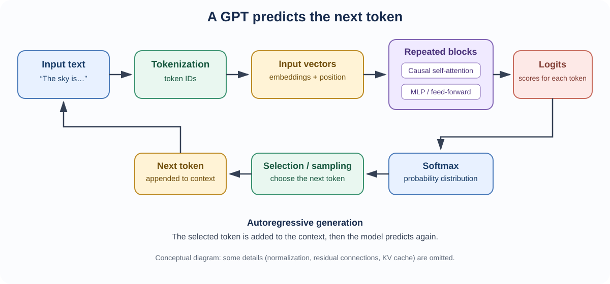
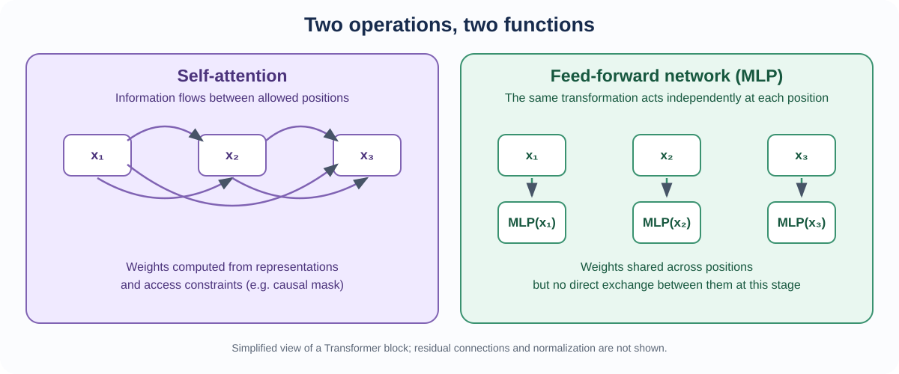
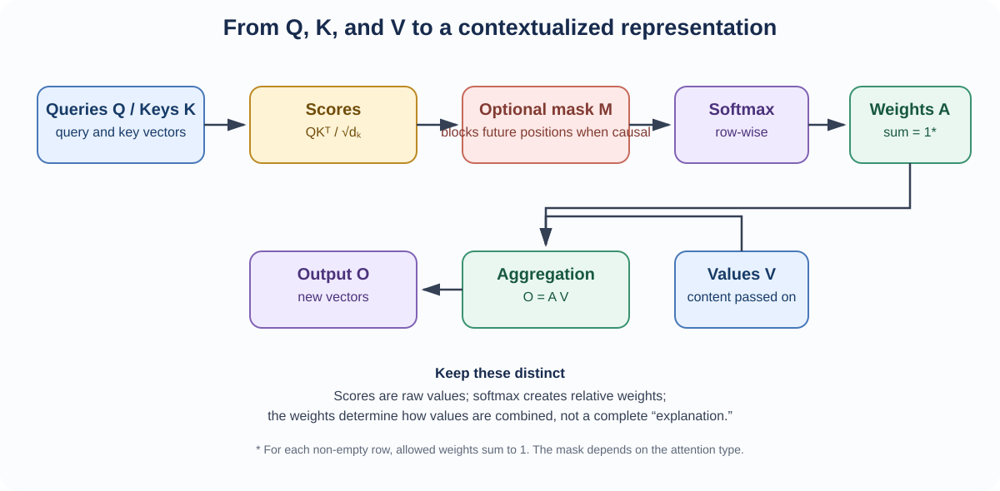

::: {.chapter-lead}
A **GPT** is a language model based on an autoregressive Transformer: given a context of tokens, it estimates a distribution over the next token. To understand the system, distinguish the data flow, the learned parameters, and the generation loop. This page provides the overview; linked concept pages explain individual operations.
:::

## The full path, at a glance

{fig-alt="Conceptual pipeline: text, tokenization, embeddings and position, repeated Transformer blocks, logits, softmax, next-token selection, then adding the token to the context." width=100%}

The diagram shows the conceptual path of generation. It intentionally omits implementation details such as residual connections, normalization, the key-value cache (KV cache), and sampling variants.

## 1. From text to representations

A tokenizer maps text to token IDs. An embedding matrix maps each ID to a learned vector. Positional information is also supplied, for example by adding a positional vector or by integrating position into attention as in [RoPE](positional-encoding.qmd).

An initial token embedding is not the same as a **contextual representation**: Transformer layers progressively update vectors using context. See [embedding space](embedding-space.qmd) for the representation basics, then explore [representation geometry and interpretability](embedding-space.qmd): [cosine similarity](cosine-similarity.qmd) and the [linearity hypothesis](embedding-linearity.qmd). [Tensors](tensors.qmd) explain how these representations are organised in computation.

## 2. Transformer blocks

A block combines two main operations:

- **Self-attention:** each position combines information from allowed positions. In GPT, a causal mask prevents access to future tokens.
- **Feed-forward network (MLP):** applies the same learned transformation independently to each position at this stage.

Blocks also include residual connections and normalization. Their exact order depends on the architecture: the diagram is an abstraction, not a specification of any particular model.

{fig-alt="Self-attention allows information to flow between allowed positions; the same feed-forward network is applied independently at each position." width=100%}

The important distinction is not that attention “understands” tokens while the MLP does not: both transformations are learned. Attention mixes information across positions; the MLP transforms each representation locally, with shared weights across positions.

### Follow the attention calculation

{fig-alt="Queries and keys produce scores. After scaling and optional masking, softmax creates weights that combine values into output vectors." width=100%}

1. [**Queries, keys, and values (Q, K, V)**](queries-keys-values.qmd) — three learned projections give representations distinct roles.
2. [**Scaled dot-product attention**](scaled-dot-product-attention.qmd) — scores from $QK^\top$ are scaled by $\sqrt{d_k}$ and converted into weights by softmax.
3. [**Causal masking**](causal-masking.qmd) — excludes future positions before softmax.
4. [**Positional information**](positional-encoding.qmd) — supplies information about token order; the [positional encoding and RoPE lesson](positional-encoding.qmd) explains the mechanism in detail.

Attention weights are not a complete explanation of a prediction. They describe one aggregation step; projections, values, other heads, later layers, and the output projection also contribute.

## 3. From representations to probabilities

After the blocks, an output projection produces **logits**—unnormalized scores associated with the vocabulary. Softmax converts them into a probability distribution. A normalized distribution is not automatically calibrated or factually reliable: see [logits](logits.qmd), [probabilities](probabilities.qmd), and [likelihood](likelihood.qmd).

During generation, a selection rule chooses the next token: greedy selection, sampling, or a more elaborate method. The selected token is appended to the context, and the model runs again. Generation is therefore **autoregressive**; the model does not produce the whole response in a single prediction.

## Training and generation are not the same computation

During training, positions in an autoregressive sequence can be processed in parallel because the input-target shift and causal mask prevent future-token leakage. During ordinary generation, each next token depends on the context currently available, so the model advances step by step. Optimizations such as the KV cache avoid recomputing keys and values that have already been produced.

The objective—predicting the next token—remains the same, but the computation is organized differently.

## Limitations and common misconceptions

- **“A GPT is just an attention layer.”** No. It is an architecture with embeddings, repeated blocks, feed-forward transformations, residual connections, normalization, and an output head.
- **“Tokens are words.”** Not necessarily: a token can be a word, word fragment, punctuation mark, or another text fragment.
- **“A high probability guarantees a true answer.”** No. The distribution is learned to predict tokens in training data; factuality and calibration require separate evaluation.
- **“Attention weights reveal the model's reasoning by themselves.”** No. They do not establish the causal influence of a piece of information on the final output.
- **“All Transformers are GPTs.”** No. The original 2017 architecture used an encoder and a decoder; GPT is an autoregressive decoder-only family.

## Continue learning

- [Tensors](tensors.qmd) — read data shapes and axes.
- [Embedding space](embedding-space.qmd) — distinguish initial vectors from contextual representations.
- [Queries, keys, and values](queries-keys-values.qmd) — understand attention projections.
- [Scaled dot-product attention](scaled-dot-product-attention.qmd) — follow the mathematical operations.
- [Causal masking](causal-masking.qmd) — understand access to the preceding context.
- [Mathematical foundations](mathematical-foundations.qmd) — connect logits, probabilities, likelihood, and loss.
- [History of Transformers](transformer-history.qmd) — place architecture choices in context.

## Further reading, selected by purpose

You do not need to consume every resource. Choose one that answers your current question; return to the others when you want a different explanation or more technical depth.

### Build intuition with visuals

- [3Blue1Brown — *Transformers, the tech behind LLMs*](https://www.3blue1brown.com/lessons/gpt/): an animated system-level explanation of embeddings, Transformer blocks, logits, and generation.
- [3Blue1Brown — *Attention in transformers, step by step*](https://www.3blue1brown.com/lessons/attention/): a focused visual explanation of attention, masking, multiple heads, and cross-attention.
- [Jay Alammar — *The Illustrated Transformer*](https://jalammar.github.io/illustrated-transformer/): a step-by-step visual explanation of the **original encoder–decoder Transformer**. Use it to understand the 2017 design, not as a diagram of every modern GPT.
- [Jay Alammar — *The Illustrated GPT-2*](https://jalammar.github.io/illustrated-gpt2/): a more directly relevant visual walkthrough of a decoder-only GPT-style model.

### Connect equations to an implementation

- [Vaswani et al. (2017), *Attention Is All You Need*](https://arxiv.org/abs/1706.03762): the primary paper for the original Transformer formulation. It describes an encoder–decoder architecture; GPT is a later decoder-only family.
- [Harvard NLP — *The Annotated Transformer*](https://nlp.seas.harvard.edu/annotated-transformer/): an annotated, executable implementation aligned with the original paper. It is valuable for connecting equations to code, but its architecture and training choices should not be treated as a specification for all modern LLMs.
- [PyTorch — Scaled dot-product attention](https://docs.pytorch.org/docs/stable/generated/torch.nn.functional.scaled_dot_product_attention.html): the API contract for one operation, not a full explanation or implementation of a Transformer.

### Follow a structured learning path

- [Sebastian Raschka — *Build a Large Language Model (From Scratch)*](https://www.sebastianraschka.com/llms-from-scratch/) and [the source repository](https://github.com/rasbt/LLMs-from-scratch): a book-and-code path through data, attention, GPT implementation, pretraining, and fine-tuning. Use it as a substantial reference, not as the mandatory order of this site.
- [Raschka — reading recommendations](https://github.com/rasbt/LLMs-from-scratch/blob/main/ch01/reading-recommendations.md): advice on first building a big-picture understanding, then reading alongside code.
- [DeepLearning.AI — *How Transformer LLMs Work*](https://www.deeplearning.ai/courses/how-transformer-llms-work): a compact video course by Jay Alammar and Maarten Grootendorst, including tokenization, embeddings, attention, modern block components, and selected efficiency variants. Course access and terms may change.

These sources have different jobs: visual resources build intuition, the primary paper records the original formulation, annotated code exposes implementation choices, and API documentation specifies one library contract. They are complementary, not interchangeable. Where an explanation simplifies or an implementation makes a convention-specific choice, check the assumptions and scope before generalizing it.
:::: {.language-switch}
**Language:** [Français](../fr/transformer.qmd) · [English](transformer.qmd)
::::
