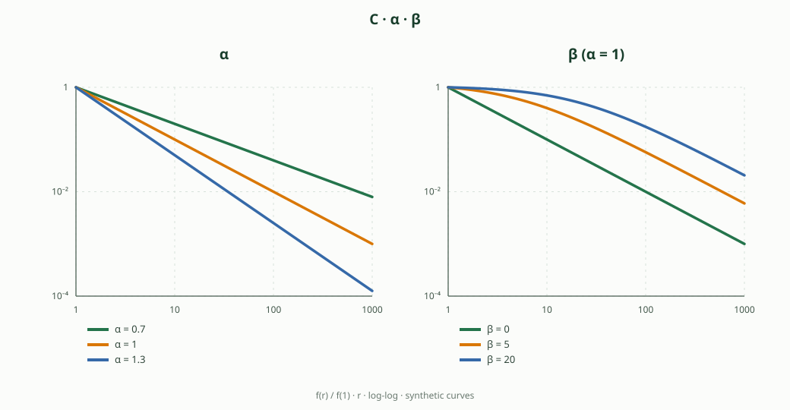

<!--
LLM-LAB-PAGE-MAP v1
id: "en/zipf-law-deep-dive"
summary: "Explores Zipf’s law beyond the initial intuition: the Mandelbrot variant, multilingual data, history, applications, and limitations."
scope: "Collects mathematical extensions, comparative empirical findings, historical milestones, and uses in corpus analysis, information retrieval, and model studies."
purpose: "Interpret empirical results without overgeneralizing and connect rank-frequency statistics to practical uses."
domain: "probabilistic-foundations-training"
suggested_route:
  previous: null
  next: null
hierarchy:
  parents: ["en/advent-calendar-story-day-01"]
  children: []
related: ["en/exercises-zipf-law", "en/text-data", "en/tokenization-strategies"]
tags: ["type:deep-dive", "destination:deepen", "topic:zipfs-law", "level:advanced", "language:en", "status:published"]
-->

::: {.chapter-lead}
The calendar story introduced the rank-frequency relation and its limits. This companion gathers the material that benefits from more room: richer models, cross-corpus comparisons, historical context, and practical uses in language technology.
:::

**Return to the story:** [Why does the word “I” appear so often?](advent-calendar-story-day-01.qmd).

## The Zipf-Mandelbrot law {#zipf-mandelbrot-law}

The simple form does not describe some distributions perfectly, particularly at the very highest ranks. Mandelbrot proposed a generalization:

$$
f(r) \propto \frac{1}{(r+\beta)^\alpha}
$$

The parameter $\beta$ shifts the rank. When $\beta=0$, we recover classical Zipf. For $\beta>0$, the relative decline is less abrupt across the very first ranks; when $r$ becomes much larger than $\beta$, the tail approaches the same asymptotic slope governed by $-\alpha$. We can isolate this effect by comparing frequencies with the frequency at rank 1:

$$
\frac{f(r)}{f(1)}=\left(\frac{1+\beta}{r+\beta}\right)^\alpha.
$$

The scale factor $C$ cancels in this ratio: the curves compare distribution shapes independently of their absolute frequency level.

Thus, $\beta$ mainly changes the curvature around the first ranks; it is neither the number of function words nor a linguistic cause. It adds a parameter that can improve the fit to some datasets, but not necessarily all. Compare residuals and parameter stability, ideally on held-out data, rather than automatically preferring the more flexible model.

{#fig-advent-zipf-parameter-effects fig-alt="Two logarithmic plots. On the left, increasing alpha makes the decay steeper. On the right, increasing beta softens the curvature at the first ranks; the long-tail slope remains governed by alpha." width=100%}

*These are synthetic curves normalized so that relative frequency at rank 1 equals 1. They isolate parameter effects; they are not fitted to a real corpus.*

For example, at rank 10 with $\beta=0$, values $\alpha=0.7$, $1$ and $1.3$ give relative frequencies of about $0.20$, $0.10$ and $0.05$. At rank 2 with $\alpha=1$, values $\beta=0$, $5$ and $20$ give about $0.50$, $0.86$ and $0.95$. All curves equal 1 at rank 1; $\beta$ mainly changes the first ranks, while $\alpha$ governs the long-tail slope.

This extension reminds us that an empirical law is a model to fit and evaluate, not a formula to apply without checking its assumptions.

## Cross-linguistic observations {#cross-linguistic-observations}

The regularity is not limited to English or French. To avoid comparing figures from incompatible corpora, the following table is drawn from a single study of *child-directed speech*. The authors aggregated conversational corpora and estimated the parameters of a Zipf-Mandelbrot distribution.

| Language | Child age | Corpora | Word occurrences | Types | $\alpha$ | $\beta$ | Pearson $r$ |
|---|---:|---:|---:|---:|---:|---:|---:|
| British English | 2–42 months | 12 | 6,311,249 | 27,476 | 1.57 | 19.48 | 0.970 |
| French | 11–42 months | 8 | 1,540,284 | 19,327 | 1.53 | 17.98 | 0.990 |
| German | 5–42 months | 7 | 2,168,002 | 37,018 | 1.42 | 12.69 | 0.998 |
| Spanish | 11–42 months | 12 | 353,104 | 10,057 | 1.39 | 9.96 | 0.994 |
| Japanese | 6–42 months | 6 | 941,006 | 25,648 | 1.30 | 7.12 | 0.993 |

*Source: Lavi-Rotbain and Arnon (2023), Study 1. “Occurrences” refers to the number of words counted in the transcripts; types are distinct orthographic forms. $\alpha$ is the exponent and $\beta$ the shift in the Zipf-Mandelbrot law. r is Pearson’s correlation between the observed and expected frequencies under the model. It is neither an exponent nor proof that the distribution follows an exact power law.*

These results show two things:

1. A distribution close to Zipf-Mandelbrot is observed across languages from different language families.
2. The estimated exponent varies: we should not replace corpus data with a universal value of $\alpha$.

**Caution when interpreting the table.** These figures concern speech addressed to children, not all written or spoken texts in each language. The corpora differ in size and are not identical in their properties. The comparison illustrates a cross-linguistic regularity in a specific empirical setting; it does not rank languages by some supposed “compliance with Zipf”.

The study also found that the parameters depend on sample size and the choice of linguistic unit. The authors used a minimum threshold of 100,000 occurrences for their main estimates. They define a word by its orthographic form, aggregate conversations by language and randomly assign ranks to tied forms. Their result is described as *near-Zipfian*: an empirical approximation, not an exact power law. This is another reason not to draw general conclusions from our 196-occurrence text.

## A history older than its name

The law is named after George Kingsley Zipf, but its history starts earlier.

- **1916 — Jean-Baptiste Estoup.** This French stenographer describes a regularity between word rank and frequency in *Gammes sténographiques*. Historical accounts mention preparatory observations as early as 1912; 1916 is an important bibliographic landmark.
- **1930s — George Kingsley Zipf.** Zipf studies and popularizes the relation in his work on relative word frequency, notably *The Psycho-Biology of Language* (1935).
- **1949 — Wider dissemination.** In *Human Behavior and the Principle of Least Effort*, Zipf extends his analysis to other human and social phenomena. This book strongly contributes to associating his name with the law.
- **1953 — Benoît Mandelbrot.** He develops a generalization that improves the fit of some linguistic distributions, now known as the Zipf-Mandelbrot law.

“Zipf’s law” is therefore a historical shortcut. For lexical statistics, “Estoup-Zipf law” better reflects this lineage.

## What is it actually used for?

Zipf’s law is not a computational step performed by a language model. A Transformer does not consult this formula at every prediction. It is primarily a **descriptive model**. To understand what it contributes, distinguish its direct use from methods that merely exploit frequency statistics.

| Situation | Role of Zipf | What should not be attributed to it |
|---|---|---|
| Corpus analysis | Directly compare a rank-frequency distribution with a Zipf or Zipf-Mandelbrot model | A deviation does not by itself diagnose a corpus error or poor quality |
| Document indexing and retrieval | Potentially provide a descriptive approximation of frequency inequality in a collection | TF-IDF, BM25 and index compression are not applications of the Zipf formula; they use frequency statistics in their own calculations |
| Studying training data | Describe the long tail and frame the problem of rare units | Tokenization algorithms are not directly derived from Zipf’s law |
| Comparing generated texts | Directly compare rank-frequency distributions with those of reference texts | A Zipf-like curve proves neither text quality nor lexical richness |

### 5.1 Describe and audit a corpus

We can count forms, rank them, plot the rank-frequency curve and compare the distribution with a Zipf or Zipf-Mandelbrot model. This analysis helps us:

- compare corpora from different genres, periods or languages;
- detect an unusual distribution, perhaps caused by duplicates, noise or automatically generated text;
- measure the importance of the long tail and the share of very rare forms;
- check how normalization, lemmatization or filtering changes the vocabulary.

Here, the law is a **statistical reference**: a deviation can be informative, but does not by itself prove that a corpus is poor.

### 5.2 Design information-retrieval systems

In a search engine, terms do not all occur equally often across a document collection. This frequency inequality is a property of the data that can sometimes be described by a Zipf approximation. It matters for index organization and size.

However, posting-list compression and result ranking rely on their own mechanisms. TF-IDF and BM25 use term and document-frequency statistics; they do not calculate Zipf’s law. The connection is therefore **statistical and indirect**: Zipf helps characterize the underlying distribution, while retrieval methods use frequency statistics for their own objectives.

### 5.3 Understand language-model training challenges

Training corpora are also highly imbalanced:

- frequent units provide many examples;
- rare units have fewer observations;
- unknown words and new forms create a vocabulary-coverage problem;
- tokenization choices determine how the long tail is distributed between whole words and subwords.

The long tail helps frame the coverage problem: a system must represent forms that are rarely observed or entirely new. Subword units offer a practical response by reusing fragments. The connection to Zipf is nevertheless **indirect**: BPE and other tokenization methods construct segmentations from rules and statistics specific to their objectives; they do not apply Zipf’s formula. Zipf’s law therefore determines neither the tokenization algorithm nor the optimal vocabulary size.

Most importantly, two distributions must be distinguished. A Zipf curve describes a **marginal frequency in a corpus**: how often each form or token appears across all contexts. An autoregressive model instead computes a distribution **conditioned on the context** at each position:

$$
p_\theta(x_t\mid x_{<t}).
$$

A token’s corpus frequency influences how many training examples are observed, but it is not the model’s predicted probability in a particular context. A globally rare token can be highly probable after a particular prefix; a globally frequent token can be unlikely in that same context.

### 5.4 Evaluate distributions produced by a model

We can directly compare the rank-frequency distributions of human-written and model-generated texts. A difference may indicate a different concentration of frequencies or a more or less pronounced long tail. To interpret this comparison, we must control for language, text length, tokenizer, normalization and sampling settings. A rank-frequency curve alone cannot establish excessive repetition, insufficient lexical diversity or lower quality. **It does not directly measure lexical richness.** It describes how frequencies are distributed across forms; two texts with comparable richness may have different curves because of length, topic, genre and normalization. Conversely, a Zipf-like curve does not guarantee a rich vocabulary. Lexical diversity requires complementary measures and protocols that control, in particular, for text length.

Recent work even studies links between token distributions, vocabulary choice and downstream performance. This is a research direction, not yet a universal design rule. In particular, word distributions in a corpus must be distinguished from token distributions produced by a tokenizer: subword segmentation changes the statistical object being studied.

**In short:** Zipf is used to characterize data, compare distributions and formulate hypotheses about systems that use them. It is neither a training algorithm nor a complete causal explanation of language.

### Sources

- Estoup, J.-B. (1916), *Gammes sténographiques*, Institut sténographique de France — historical landmark for the observation of the rank-frequency relation.
- Zipf, G. K. (1935), *The Psycho-Biology of Language* — formulation and dissemination of lexical-frequency analysis.
- Zipf, G. K. (1949), *Human Behavior and the Principle of Least Effort* — book that widely popularized this regularity.
- Mandelbrot, B. (1953), “An informational theory of the statistical structure of language” — generalization of the rank-frequency relation.
- Petruszewycz, M. (1973), [*L'histoire de la loi d'Estoup-Zipf : documents*](https://www.numdam.org/item/MSH_1973__44__41_0/) — documentary landmarks on the law’s origins.
- Piantadosi, S. T. (2014), [*Zipf’s word frequency law in natural language: A critical review and future directions*](https://doi.org/10.3758/S13423-014-0585-6) — critical review of regularities, estimation methods and proposed explanations.
- Lavi-Rotbain, O. and Arnon, I. (2023), [*Zipfian Distributions in Child-Directed Speech*](https://doi.org/10.1162/opmi_a_00070) — multilingual study of frequencies in child-directed speech.
- Linders, G. M. and Louwerse, M. M. (2023), [*Zipf’s law revisited: Spoken dialog, linguistic units, parameters, and the principle of least effort*](https://doi.org/10.3758/s13423-022-02142-9) — extends the analysis to conversation and multiple linguistic units.
- He, Y., Zeng, Q. and Jiang, M. (2025), [*Pre-trained Models Perform the Best When Token Distributions Follow Zipf’s Law*](https://aclanthology.org/2025.emnlp-main.1421/) — recent study of the link between token distributions, vocabulary size and performance.

[Back to the calendar](scientific-calendar.qmd).

::: {.language-switch}
**Language:** [Français](../fr/zipf-law-deep-dive.qmd) · [English](zipf-law-deep-dive.qmd)
:::
