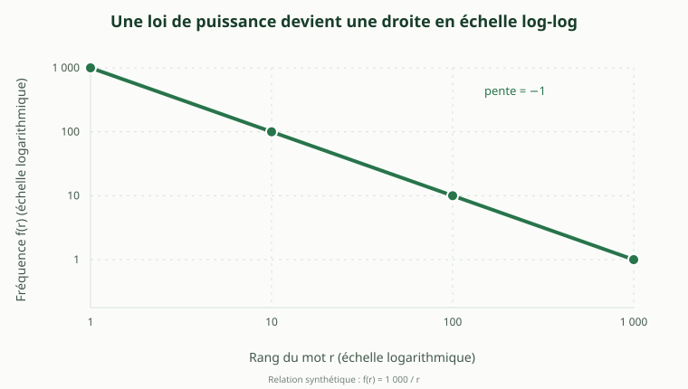

<!--
LLM-LAB-PAGE-MAP v1
id: "fr/advent-calendar-story-day-01"
summary: "Construit un corpus à partir de la tirade d’Otis pour comprendre les fréquences lexicales, la loi de Zipf et ses usages."
scope: "Explique les unités de comptage, la relation rang-fréquence, les variantes de Zipf-Mandelbrot, les résultats multilingues, l’histoire, les applications et les limites empiriques."
purpose: "Construire et normaliser un corpus, distinguer types et occurrences, interpréter un exposant estimé et évaluer ce que la loi permet réellement de faire."
domain: "probabilistic-foundations-training"
suggested_route:
  previous: null
  next: null
hierarchy:
  parents: ["fr/deepen"]
  children: []
related: ["fr/scientific-calendar","fr/text-data","fr/tokenization-strategies","fr/entropy","fr/language-modeling-math","fr/zipf-law-exercises","fr/exercises-zipf-law"]
tags: ["type:deep-dive", "destination:deepen", "topic:zipfs-law", "level:overview", "language:fr", "status:published"]
-->

*Calendrier de l’Avent 2026 · Porte 1 · environ 12 minutes*

Cette leçon part d'un personnage et d'une tirade : Otis, le scribe d’*Astérix et Obélix : Mission Cléopâtre*. Nous allons transformer ce fil rouge en petit corpus, compter ses mots, puis confronter cette expérience à des corpus linguistiques réels.

Le passage ci-dessous est une **reformulation pédagogique originale de la situation d’Otis**, et non une transcription du dialogue du film. Elle permet de travailler sur un texte maîtrisé, dont nous pouvons expliciter exactement les conventions de comptage.

## 1. Construire le corpus d’Otis

Imaginons Otis racontant son travail de scribe :

> Otis est scribe. Dans son bureau, Otis écrit des textes sur des papyrus. Il raconte son travail, ses outils et ses journées. Le scribe copie des mots, relit les textes et classe les rouleaux. Pour Otis, écrire est un métier, mais aussi une manière de réfléchir. Chaque jour, il écrit, corrige et recommence. Les mots passent du papyrus au lecteur ; le travail du scribe ne s'arrête jamais.

Ce paragraphe constitue notre **corpus miniature**. Il contient 67 occurrences lexicales et 46 formes distinctes, selon les conventions suivantes :

- conversion en minuscules ;
- suppression de la ponctuation comme unité de comptage ;
- conservation des accents ;
- conservation des formes fléchies distinctes : « écrit » et « écrire » sont deux formes ;
- conservation de l'élision dans « s'arrête », comptée ici comme une seule forme.

Ces choix ne sont pas neutres. Si nous décidions de lemmatiser le texte, de séparer les élisions ou de traiter différemment les majuscules, les nombres changeraient.

### Type, occurrence lexicale et token de tokenizer : trois notions à distinguer

La terminologie est source de confusion parce que le mot *token* est utilisé dans deux contextes proches, mais différents.

| Notion | Définition | Exemple dans notre corpus |
|---|---|---|
| **Type lexical** (*word type*) | Une forme distincte, après application des règles de normalisation | « scribe » est un type |
| **Occurrence lexicale** (*word token*) | Une apparition concrète d'une forme dans le texte | « scribe » apparaît trois fois : trois occurrences |
| **Token de tokenizer** (*model token*) | Une unité produite par un algorithme de tokenisation et représentée par un identifiant dans le vocabulaire du modèle | « scribe » peut correspondre à un token ou à plusieurs sous-mots selon le tokenizer |

Les deux usages de *token* sont liés, mais ne sont pas interchangeables. Une occurrence lexicale est une position dans le texte ; un token de tokenizer est une unité de représentation. Un mot peut être découpé en plusieurs tokens de modèle, et un tokenizer peut aussi traiter la ponctuation, les espaces ou des fragments de mots comme des unités distinctes.

La différence apparaît aussi dans la notion de type. Dans notre convention orthographique, « écrit » et « écrire » sont deux types ; une lemmatisation pourrait les rattacher au même lemme. De même, « Otis » et « otis » sont confondus ici parce que nous avons choisi de passer le texte en minuscules.

**À retenir :** avant de comparer des fréquences, il faut toujours préciser l'unité comptée et la normalisation appliquée.

### Le comptage et le classement

Comptons maintenant les occurrences de chaque type lexical, puis classons les types par fréquence décroissante.

| Forme | Occurrences | Rang ou intervalle de rang |
|---|---:|---:|
| Otis, scribe, des, et, les | 3 chacun | 1 à 5 |
| est, son, écrit, textes, papyrus, il, travail, ses, le, mots, du | 2 chacun | 6 à 16 |
| Les 30 autres formes | 1 chacune | 17 à 46 |

Plusieurs formes ont la même fréquence. Il n'existe donc pas de rang unique à leur attribuer sans convention supplémentaire : on peut leur donner un ordre arbitraire, un rang moyen ou présenter un intervalle. Pour ce petit exemple, l'intervalle est le plus honnête.

Le rang n'est pas une propriété intrinsèque d'un mot. Il dépend du corpus, de la langue, de la période, du genre de texte, de sa taille, de son contenu et des conventions de normalisation. Dans un texte consacré à l'Égypte antique, « papyrus » pourrait remonter dans le classement ; dans une conversation ordinaire, il serait probablement beaucoup plus rare.

Notre corpus sert à comprendre les opérations. Avec seulement 67 occurrences, il est beaucoup trop petit pour estimer sérieusement une loi de puissance : les égalités de fréquence et les effets du sujet dominent.

## 2. La loi de Zipf : une approximation rang-fréquence

Sur de grands corpus, on observe souvent une régularité : quelques formes sont très fréquentes, tandis qu'un grand nombre de formes sont rares. La loi de Zipf propose une approximation simple de cette distribution :

$$
f(r) \propto \frac{1}{r^\alpha}
$$

où :

- $r$ est le rang du type lexical dans le classement ;
- $f(r)$ est sa fréquence, en nombre d'occurrences ou en fréquence relative ;
- $\alpha$ est l'exposant de la loi, estimé à partir des données ;
- le symbole $\propto$ signifie « proportionnel à ».

Dans la forme classique, on prend souvent $\alpha$ proche de 1. On peut alors écrire, pour une constante $C$ dépendant du corpus :

$$
f(r) \approx \frac{C}{r}
$$

Si le type le plus fréquent apparaît 1 000 fois, cette approximation prévoit 500 occurrences au rang 2, 200 au rang 5 et 100 au rang 10. Ce sont des valeurs théoriques illustratives, pas des mesures de notre corpus d’Otis.

### Que signifie l'exposant ?

L'exposant $\alpha$ règle la pente de la distribution :

- un $\alpha$ plus grand correspond à une décroissance plus rapide : les premiers rangs dominent davantage ;
- un $\alpha$ plus faible correspond à une décroissance plus progressive ;
- $\alpha = 1$ donne la règle intuitive « doubler le rang divise approximativement la fréquence par deux ».

L'exposant n'est pas une constante universelle de la langue française. Il doit être estimé pour un corpus et un modèle donnés. Sa valeur dépend notamment de la période, du genre, du registre, de la taille du corpus, de la définition des mots et de la méthode d'ajustement.

### Pourquoi une droite sur un graphique logarithmique ?

Partons de la forme générale :

$$
f(r) = C r^{-\alpha}
$$

En prenant le logarithme des deux côtés :

$$
\log f(r) = \log C - \alpha \log r
$$

Sur un graphique représentant $\log f(r)$ en fonction de $\log r$, cette relation devient une droite de pente $-\alpha$.

{#fig-advent-zipf-rank-frequency fig-alt="Sur des axes logarithmiques, la courbe synthétique f(r)=1000/r descend de 1 000 occurrences au rang 1 à 1 occurrence au rang 1 000 ; sa pente vaut −1." width=95%}

*Cette courbe est synthétique : elle montre la forme de la relation, pas une distribution mesurée dans un corpus réel.*

### Une extension utile : la loi de Zipf-Mandelbrot

La forme simple décrit imparfaitement certaines distributions, en particulier les tout premiers rangs. Mandelbrot a proposé une généralisation :

$$
f(r) \propto \frac{1}{(r+\beta)^\alpha}
$$

Le paramètre $\beta$ décale le rang et permet de mieux ajuster la distribution observée. Cette extension est souvent appelée loi de Zipf-Mandelbrot. Elle rappelle qu'une loi empirique est un modèle à ajuster et à évaluer, pas une formule à appliquer sans vérifier ses hypothèses.

## 3. Que trouve-t-on dans plusieurs langues ?

La régularité n'est pas limitée au français ou à l'anglais. Pour éviter de comparer des chiffres issus de corpus incompatibles, voici un extrait d'une même étude consacrée au langage adressé aux jeunes enfants (*child-directed speech*). Les auteurs ont agrégé des corpus de conversations et estimé les paramètres d'une distribution de Zipf-Mandelbrot.

| Langue | Occurrences lexicales | Types | Exposant $\alpha$ | Corrélation observé / attendu |
|---|---:|---:|---:|---:|
| Anglais britannique | 6 311 249 | 27 476 | 1,57 | 0,970 |
| Français | 1 540 284 | 19 327 | 1,53 | 0,990 |
| Allemand | 2 168 002 | 37 018 | 1,42 | 0,998 |
| Espagnol | 353 104 | 10 057 | 1,39 | 0,994 |
| Japonais | 941 006 | 25 648 | 1,30 | 0,993 |

*Source : Lavi-Rotbain et Arnon (2023), étude 1. « Occurrences » traduit ici le nombre de mots comptés dans les transcriptions ; les types sont les formes orthographiques distinctes. $\\alpha$ est l'exposant et $\\beta$ le décalage de la loi de Zipf-Mandelbrot. La corrélation est celle entre fréquences observées et fréquences attendues par le modèle, et non une corrélation entre rang et fréquence.*

Ces résultats montrent deux choses :

1. Une distribution proche de Zipf-Mandelbrot est observée dans des langues de familles différentes.
2. L'exposant estimé varie : il ne faut donc pas remplacer les données d'un corpus par une valeur universelle de $\alpha$.

**Attention à l'interprétation.** Ces chiffres concernent le langage adressé aux enfants, pas l'ensemble des textes écrits ou parlés de chaque langue. Les corpus n'ont ni la même taille ni exactement les mêmes propriétés. La comparaison illustre une régularité translinguistique dans un cadre expérimental précis ; elle ne permet pas de classer les langues selon une prétendue « conformité à Zipf ».

L'étude a également montré que les paramètres dépendent de la taille des échantillons et du choix de l'unité linguistique. Les auteurs ont notamment utilisé un seuil minimal de 100 000 occurrences pour leurs estimations principales. C'est une raison supplémentaire de ne pas tirer de conclusion générale à partir de notre paragraphe de 67 occurrences.

## 4. Une histoire plus ancienne que son nom

La loi porte le nom de George Kingsley Zipf, mais l'histoire commence avant lui.

- **1916 — Jean-Baptiste Estoup.** Ce sténographe français décrit une régularité entre le rang et la fréquence des mots dans *Gammes sténographiques*. Des travaux historiques signalent des observations préparatoires dès 1912 ; 1916 constitue un repère bibliographique important.
- **Années 1930 — George Kingsley Zipf.** Zipf étudie et popularise cette relation dans ses travaux sur la fréquence relative des mots, notamment *The Psycho-Biology of Language* (1935).
- **1949 — Une diffusion plus large.** Dans *Human Behavior and the Principle of Least Effort*, Zipf étend son analyse à d'autres phénomènes humains et sociaux. C'est cet ouvrage qui contribue fortement à installer son nom dans la littérature.
- **1953 — Benoît Mandelbrot.** Il développe une généralisation qui améliore l'ajustement de certaines distributions linguistiques, aujourd'hui connue sous le nom de loi de Zipf-Mandelbrot.

L'appellation « loi de Zipf » est donc un raccourci historique : pour la statistique lexicale, « loi d'Estoup-Zipf » rend mieux compte de cette filiation.

## 5. À quoi sert-elle concrètement ?

La loi de Zipf n'est pas une étape de calcul exécutée par un modèle de langage. Un Transformer ne consulte pas une formule de Zipf à chaque prédiction. C'est avant tout un **modèle descriptif** qui aide à comprendre, contrôler et parfois dimensionner des systèmes fondés sur des données textuelles.

### 5.1 Décrire et auditer un corpus

On peut compter les formes, les classer, tracer la courbe rang-fréquence et comparer la distribution à un modèle de Zipf ou de Zipf-Mandelbrot. Cette analyse aide à :

- comparer des corpus de genres, de périodes ou de langues différents ;
- repérer une distribution anormale, par exemple à cause de doublons, de bruit ou de texte généré automatiquement ;
- mesurer l'importance de la longue traîne et la part des formes très rares ;
- vérifier comment la normalisation, la lemmatisation ou le filtrage modifient le vocabulaire.

La loi sert ici de **référence statistique** : un écart peut être informatif, mais ne prouve pas à lui seul qu'un corpus est mauvais.

### 5.2 Concevoir des systèmes de recherche d'information

Dans un moteur de recherche, les termes n'apparaissent pas tous le même nombre de fois dans une collection de documents. Cette forte inégalité intervient dans la taille des index, la compression des listes de documents et les modèles de pondération des termes.

La loi de Zipf fournit un modèle simple de la distribution des fréquences de collection. Des méthodes comme TF-IDF répondent à une question complémentaire : un terme est-il fréquent dans un document, mais suffisamment rare dans la collection pour aider à distinguer ce document ? TF-IDF n'est pas « la loi de Zipf » ; il exploite des statistiques de fréquence à une autre fin.

### 5.3 Comprendre les difficultés d'apprentissage des modèles de langage

Les corpus d'entraînement sont eux aussi très déséquilibrés :

- les unités fréquentes fournissent de nombreux exemples ;
- les unités rares disposent de moins d'observations ;
- les mots inconnus ou les formes nouvelles posent un problème de couverture du vocabulaire ;
- les choix de tokenisation déterminent comment cette longue traîne est répartie entre mots entiers et sous-mots.

Cela aide à comprendre pourquoi les tokenizers modernes utilisent souvent des unités sous-lexicales : ils permettent de représenter des formes rares ou inédites à partir de fragments réutilisables. Mais la loi de Zipf ne détermine pas à elle seule l'algorithme de tokenisation ni la taille optimale du vocabulaire.

### 5.4 Évaluer les distributions produites par un modèle

On peut enfin comparer les fréquences des mots ou des tokens dans des textes humains et dans des textes générés par un modèle. Une différence peut révéler une diversité lexicale trop faible, une répétition excessive ou un comportement dépendant des paramètres de génération.

Des travaux récents étudient même les liens entre distribution des tokens, choix de vocabulaire et performances en aval. Il s'agit d'un axe de recherche, pas encore d'une règle universelle de conception.

**En résumé :** Zipf est utilisée pour caractériser des données, comparer des distributions et formuler des hypothèses sur les systèmes qui les exploitent. Elle n'est ni un algorithme d'apprentissage, ni une explication causale complète de la langue.

## 6. Une régularité, pas une loi universelle

Une droite approximative sur un graphique logarithmique ne suffit pas à démontrer qu'un mécanisme de loi de puissance produit les données. Plusieurs difficultés doivent être prises en compte :

- **La dépendance entre rang et fréquence.** Si les deux sont estimés sur le même échantillon, une fluctuation aléatoire peut augmenter la fréquence observée d'un mot et le faire remonter dans le classement. Les deux axes ne sont alors pas indépendants.
- **La longue traîne.** Les formes rares sont nombreuses, mais leurs fréquences sont difficiles à estimer avec précision dans un corpus fini.
- **La non-stationnarité.** Un mot peut être très fréquent dans un corpus consacré à un sujet et rare dans un autre. Les fréquences agrégées mélangent des contextes différents.
- **Les conventions linguistiques.** Les formes fléchies, les composés, les élisions, les caractères et les unités de segmentation changent le nombre de types et leur fréquence.
- **Le choix du modèle.** Une loi de puissance simple, une loi de Zipf-Mandelbrot ou un autre modèle peuvent décrire différemment les extrémités de la distribution.

Steven Piantadosi (2014) insiste sur le fait que les représentations classiques peuvent masquer une structure plus riche et que les explications causales proposées ne rendent pas compte de tous les phénomènes. Séparer les données utilisées pour estimer les rangs de celles utilisées pour estimer les fréquences est une manière de réduire un biais important, mais cela ne résout pas toutes les difficultés d'estimation.

La conclusion raisonnable est donc la suivante : **les fréquences lexicales présentent souvent une régularité proche de Zipf, mais sa forme exacte dépend des données, des unités et de la méthode d'analyse.**

## 7. Retour à Otis : ce que notre petit corpus nous a appris

Nous avons construit un corpus, choisi une normalisation, distingué 67 occurrences de 46 types et établi un classement. Nous savons maintenant pourquoi ce classement n'est pas une propriété intrinsèque des mots, pourquoi les égalités de fréquence compliquent les rangs et pourquoi un texte si court ne permet pas d'estimer un exposant robuste.

Sur un grand corpus, la même démarche devient une analyse statistique : compter, classer, estimer les paramètres, comparer les fréquences observées aux fréquences attendues, puis examiner les écarts. La formule devient utile seulement après ces choix méthodologiques.

## S’exercer

Les calculs, questions de transfert et corrigés sont regroupés dans une page dédiée afin de pouvoir enrichir progressivement la pratique sans alourdir cette leçon.

[Accéder aux exercices sur la loi de Zipf](exercises/zipf-law.qmd).

## L'idée à retenir

La loi de Zipf décrit une régularité fréquente dans les distributions de fréquences lexicales : quelques formes dominent, tandis qu'une longue traîne rassemble de nombreuses formes rares. Elle est utile pour analyser des corpus, comprendre certaines difficultés du traitement automatique des langues et étudier les distributions produites par les modèles. Mais elle ne dispense jamais de définir les unités, de décrire les données et de tester la qualité de l'ajustement.

## Pour aller plus loin

- La leçon sur les [données textuelles](text-data.qmd) présente les représentations et unités manipulées dans le pipeline du LLM.
- La leçon sur la [tokenisation](tokenization-strategies.qmd) explique comment une chaîne est découpée en tokens de modèle.
- La page d'[exercices sur la loi de Zipf](exercises/zipf-law.qmd) permet de prolonger l'analyse par des calculs et des expériences.

### Sources

- Estoup, J.-B. (1916), *Gammes sténographiques*, Institut sténographique de France — repère historique sur l'observation de la relation rang-fréquence.
- Zipf, G. K. (1935), *The Psycho-Biology of Language* — formulation et diffusion de l'analyse des fréquences lexicales.
- Zipf, G. K. (1949), *Human Behavior and the Principle of Least Effort* — ouvrage qui popularise largement cette régularité.
- Mandelbrot, B. (1953), “An informational theory of the statistical structure of language” — généralisation de la relation rang-fréquence.
- Petruszewycz, M. (1973), [*L'histoire de la loi d'Estoup-Zipf : documents*](https://www.numdam.org/item/MSH_1973__44__41_0/) — repères documentaires sur les origines de la loi.
- Piantadosi, S. T. (2014), [*Zipf’s word frequency law in natural language: A critical review and future directions*](https://doi.org/10.3758/S13423-014-0585-6) — revue critique des régularités, des méthodes d'estimation et des explications proposées.
- Lavi-Rotbain, O. et Arnon, I. (2023), [*Zipfian Distributions in Child-Directed Speech*](https://doi.org/10.1162/opmi_a_00070) — étude multilingue des fréquences dans le langage adressé aux enfants.
- Linders, G. M. et Louwerse, M. M. (2023), [*Zipf’s law revisited: Spoken dialog, linguistic units, parameters, and the principle of least effort*](https://doi.org/10.3758/s13423-022-02142-9) — extension de l'analyse à la conversation et à plusieurs unités linguistiques.
- He, Y., Zeng, Q. et Jiang, M. (2025), [*Pre-trained Models Perform the Best When Token Distributions Follow Zipf’s Law*](https://aclanthology.org/2025.emnlp-main.1421/) — étude récente du lien entre distributions de tokens, taille du vocabulaire et performances.

[Retour au calendrier de l’Avent](scientific-calendar.qmd).

::: {.language-switch}
**Langue :** [Français](advent-calendar-story-day-01.qmd) · [English](../en/advent-calendar-story-day-01.qmd)
:::
