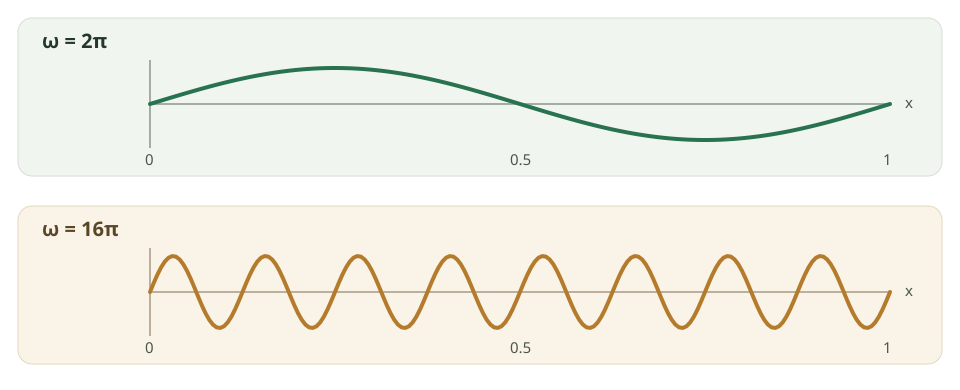

<!--
LLM-LAB-PAGE-MAP v1
id: "fr/advent-calendar-story-day-06"
summary: "Montre pourquoi transformer une coordonnée en plusieurs caractéristiques sinusoïdales rend explicites différentes échelles de variation."
scope: "Explique les représentations sinusoïdales multi-fréquences et le biais spectral, avec le codage positionnel du Transformer comme application."
purpose: "Distinguer une coordonnée brute, une banque de caractéristiques fréquentielles et la capacité d’un réseau à exploiter ces caractéristiques."
domain: "mathematical-tools-geometry"
suggested_route:
  previous: null
  next: null
hierarchy:
  parents: []
  children: []
related: ["fr/positional-encoding"]
tags: ["type:deep-dive", "destination:deepen", "topic:advent-story-sine-wave", "level:overview", "language:fr", "status:planned"]
-->

*Histoire indépendante · environ 10 minutes · Pilote A — brouillon pour relecture*

## Une position est un nombre. Est-ce déjà une représentation ?

Un token occupe une position dans une séquence : 0, 1, 2, 3… Cette coordonnée dit **où** il se trouve. Mais elle ne dit pas encore au réseau comment comparer cette position à d’autres, ni à quelles échelles une variation doit être remarquée.

Le problème dépasse le langage. En apprentissage automatique, on donne souvent à un réseau une coordonnée numérique — un temps, une position, un point dans l’espace — puis on lui demande de représenter une fonction qui varie avec cette coordonnée. Une variation lente et une oscillation rapide ne sont pas également faciles à apprendre à partir du seul nombre brut.

Une idée consiste à transformer cette coordonnée en plusieurs caractéristiques sinusoïdales. C’est le principe général des *Fourier features* : rendre disponibles, dans la représentation d’entrée, des variations à différentes fréquences.

## Une même coordonnée, plusieurs échelles

Considérons une coordonnée normalisée $x \in [0,1]$ et la fonction :

$$
f(x)=\sin(16\pi x).
$$

Cette fonction effectue huit oscillations sur l’intervalle [0,1]. Quelques valeurs suffisent à le voir :

| $x$ | $16\pi x$ | $f(x)$ |
|---:|---:|---:|
| 0 | 0 | 0 |
| $1/32$ | $\pi/2$ | 1 |
| $1/16$ | $\pi$ | 0 |
| $3/32$ | $3\pi/2$ | -1 |
| $1/8$ | $2\pi$ | 0 |

Une lecture linéaire du seul nombre $x$ ne peut pas reproduire exactement cette oscillation. En revanche, si l’entrée contient déjà la caractéristique $\sin(16\pi x)$, une simple lecture linéaire peut retrouver $f(x)$ exactement : il suffit de lui donner un poids égal à 1 sur cette coordonnée.

Ce petit exemple ne prouve pas qu’un réseau non linéaire serait incapable d’apprendre cette fonction à partir de $x$. Il montre autre chose : **la représentation choisie détermine quelles variations sont directement accessibles à une lecture donnée**.

{#fig-advent-frequency-scales width=95%}

*La coordonnée $x$ parcourt le même intervalle dans les deux panneaux. Seule la fréquence change.*

## Le biais spectral : représenter n’est pas apprendre

Il faut distinguer deux questions :

- **Expressivité :** le réseau possède-t-il une fonction capable de reproduire le signal recherché ?
- **Dynamique d’apprentissage :** avec les données, l’initialisation et l’optimisation choisies, apprend-il cette fonction rapidement et de manière fiable ?

Ces deux propriétés ne sont pas équivalentes. Des réseaux peuvent représenter des fonctions très variées, tout en apprenant certaines composantes fréquentielles plus tôt que d’autres.

Rahaman et ses coauteurs ont étudié ce phénomène à l’aide de l’analyse de Fourier. Dans les réseaux et conditions qu’ils examinent, les composantes de basse fréquence sont généralement apprises avant les composantes de haute fréquence. C’est ce qu’ils appellent le **biais spectral**. Il ne s’agit pas d’une impossibilité de représenter les détails fins : c’est une différence de vitesse d’apprentissage, dépendante du modèle et du problème.

Les *Fourier features* de Tancik et ses coauteurs répondent à une difficulté proche dans les MLP qui apprennent des fonctions à partir de coordonnées de faible dimension. Leur transformation rend certaines fréquences plus accessibles et modifie le comportement fréquentiel effectif du réseau. Dans les tâches étudiées, elle peut ainsi faciliter l’apprentissage de détails à haute fréquence.

## Choisir les fréquences : un compromis

Une banque simple de caractéristiques sinusoïdales peut s’écrire :

$$
\gamma(x)=
[
\sin(2\pi b_1x),\cos(2\pi b_1x),
\dots,
\sin(2\pi b_mx),\cos(2\pi b_mx)
].
$$

Chaque fréquence $b_j$ fournit une paire de coordonnées. Les basses fréquences changent lentement lorsque $x$ varie ; les hautes fréquences changent plus rapidement. La représentation donne donc au modèle plusieurs « horloges » qui ne battent pas au même rythme.

On peut voir le choix de ces fréquences comme un choix de résolution :

- une banque concentrée sur les basses fréquences décrit facilement les variations lentes, mais expose moins directement les détails rapides ;
- une banque qui inclut des fréquences plus élevées rend ces détails accessibles à la lecture ;
- augmenter sans discernement la bande fréquentielle n’est pas une solution universelle : il faut l’adapter au signal, aux données disponibles et au risque d’ajuster des variations qui ne se reproduiront pas.

Le résultat de Tancik et ses coauteurs n’est donc pas « plus de fréquences est toujours mieux ». Le choix de l’échelle fréquentielle — notamment la bande passante de la transformation — est un paramètre de conception à ajuster au problème.

## Pourquoi cela apparaît-il dans un Transformer ?

Une position de token est elle aussi une coordonnée. Dans le Transformer original, Vaswani et ses coauteurs ajoutent aux embeddings des paires de sinus et de cosinus dont les fréquences suivent une progression géométrique. Les paires ne varient donc pas toutes à la même vitesse : certaines changent rapidement avec la position, d’autres beaucoup plus lentement.

C’est une parenté d’idée avec les *Fourier features* : transformer une coordonnée en un vecteur qui expose plusieurs échelles de variation. Mais les deux constructions ne sont pas identiques :

- le Transformer original utilise une banque déterministe de fréquences fixées par une formule ;
- les *Fourier features* étudiées par Tancik et ses coauteurs utilisent une transformation de coordonnées dont les fréquences sont échantillonnées selon une distribution ;
- dans le Transformer, le vecteur positionnel est ajouté à l’embedding du token ; il ne remplace ni le contenu lexical ni le calcul de l’attention.

La sinusoïde ne signifie donc pas que le texte serait périodique. Elle fournit un système de coordonnées pour les positions. Le modèle combine ensuite ce signal avec le contenu des tokens et apprend, au cours de l’entraînement, quelles informations exploiter.

La propriété algébrique qui relie un décalage fixe à une transformation linéaire de chaque paire est importante, mais elle est déjà dérivée dans la [leçon canonique sur l’encodage positionnel](positional-encoding.qmd). Ici, l’angle est différent : comprendre pourquoi une banque de fréquences peut être une représentation utile d’une coordonnée, et pourquoi le choix de ces fréquences influence ce qu’un réseau apprend facilement.

## Ce que cette idée ne garantit pas

Trois précautions évitent de tirer des conclusions trop fortes.

1. **Ce n’est pas une transformée de Fourier du texte.** On ne décompose pas une phrase en fréquences ; on transforme une coordonnée de position en caractéristiques.
2. **Une banque finie ne couvre pas toutes les variations possibles.** Les fréquences choisies définissent les échelles directement accessibles ; elles ne garantissent pas que toute fonction sera bien représentée.
3. **Une représentation n’est pas une capacité acquise.** Le modèle doit encore apprendre à utiliser les caractéristiques. Les auteurs du Transformer présentent l’extrapolation à des séquences plus longues comme une motivation possible, pas comme une garantie universelle.

Le biais spectral n’est pas non plus une loi uniforme applicable à toute architecture, toute donnée ou tout régime d’entraînement. Les résultats cités décrivent des familles de réseaux et des conditions précises. Ils donnent un cadre pour raisonner, pas une prédiction automatique du comportement de chaque LLM.

## À vous de jouer

On souhaite représenter le signal :

$$
g(x)=\sin(2\pi x)+0{,}2\sin(16\pi x).
$$

On dispose d’abord d’une lecture linéaire alimentée uniquement par les caractéristiques $\sin(2\pi x)$ et $\cos(2\pi x)$.

**Question :** cette représentation suffit-elle pour reconstruire exactement $g$ ? Quelle caractéristique faut-il ajouter pour rendre les deux composantes directement accessibles ?

Voir la solution

Non. La banque initiale donne accès à la fréquence d’un cycle sur l’intervalle, mais pas directement à celle de huit cycles. Il faut ajouter au minimum la caractéristique $\sin(16\pi x)$. Une banque symétrique peut ajouter la paire $\sin(16\pi x),\cos(16\pi x)$.

Une lecture linéaire peut alors reconstruire le signal en combinant la première composante avec un poids de 1 et la seconde avec un poids de 0,2. Cela démontre une propriété de cette représentation et de cette lecture linéaire ; cela ne signifie pas qu’un MLP sans ces caractéristiques serait incapable d’apprendre $g$.

## Pour aller plus loin

La [leçon sur l’encodage positionnel](positional-encoding.qmd) explique la formule exacte du Transformer, son ajout aux embeddings et la propriété de décalage relatif. Cette histoire en donne une autre lecture, à partir des représentations fréquentielles.

### Sources

- [Rahaman et al. (2019), *On the Spectral Bias of Neural Networks*](https://proceedings.mlr.press/v97/rahaman19a.html) — biais spectral, vitesse d’apprentissage dépendante de la fréquence et rôle de la géométrie des données.
- [Vaswani et al. (2017), *Attention Is All You Need*](https://arxiv.org/abs/1706.03762), section 3.5 — encodages positionnels sinusoïdaux et motivation liée aux positions relatives.
- [Tancik et al. (2020), *Fourier Features Let Networks Learn High Frequency Functions in Low Dimensional Domains*](https://proceedings.neurips.cc/paper/2020/hash/55053683268957697aa39fba6f231c68-Abstract.html) — caractéristiques de Fourier, biais spectral et apprentissage de fonctions à haute fréquence.
