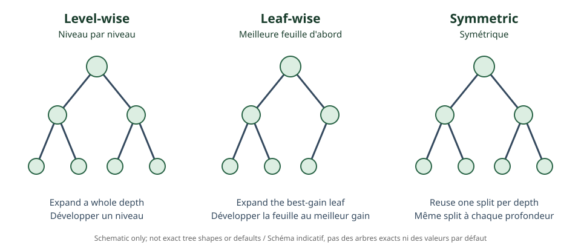

<!--
LLM-LAB-PAGE-MAP v1
id: "fr/catboost"
scope: "Explique le traitement ordonné des variables catégorielles, ordered boosting, permutations et arbres symétriques."
purpose: "Identifier le target leakage du target encoding naïf et distinguer les mécanismes CatBoost des optimisations concurrentes."
suggested_route:
  previous: "fr/lightgbm"
  next: null
hierarchy:
  parents: ["fr/gradient-boosting"]
  children: []
related: ["fr/xgboost", "fr/lightgbm"]
tags: ["type:concept-lesson", "destination:deepen", "topic:catboost", "level:advanced", "language:fr", "status:published"]
-->
::: {.chapter-lead}
CatBoost est un algorithme de gradient boosting conçu notamment pour traiter les variables catégorielles. Il cherche à éviter qu'un encodage utilise indirectement la cible de la ligne qu'il représente.
:::
## Le piège du target encoding

Une catégorie peut être encodée par une statistique de cible, par exemple sa moyenne. Si cette moyenne inclut la cible de la ligne encodée, la représentation dépend de la réponse à prédire : c'est une fuite de cible (*target leakage*), particulièrement risquée pour les catégories rares.

## Statistiques ordonnées

CatBoost utilise des permutations. Pour une ligne, la statistique est calculée à partir des observations précédentes dans une permutation, sans utiliser la cible de la ligne courante. Une forme simplifiée est :

\[
\operatorname{TS}(x_k)=
\frac{\sum_{j:x_j=x_k,\;j\prec k}y_j+aP}
{\#\{j:x_j=x_k,\;j\prec k\}+a},
\]

où $j\prec k$ signifie que $j$ précède $k$, $P$ est un a priori et $a$ son poids. C'est un schéma illustratif : CatBoost utilise plusieurs statistiques et variantes.

{fig-alt="Trois structures illustrant la croissance niveau par niveau, leaf-wise et symétrique ; schéma indicatif."}

## Ordered boosting et arbres symétriques

L'ordered boosting construit les estimations de gradient de façon ordonnée, en évitant d'utiliser la cible de l'observation dans l'estimation correspondante. Il réduit certains biais de prédiction, mais ne remplace pas une séparation train/validation/test et ne prévient pas toutes les fuites.

CatBoost utilise souvent des arbres symétriques (*oblivious trees*) : à une profondeur donnée, la même condition de split s'applique à tous les nœuds de ce niveau. Cela facilite l'évaluation mais impose une forme de partition particulière. Le type d'arbre dépend de la configuration.

CatBoost n'est pas automatiquement supérieur : qualité et vitesse dépendent des données, de la métrique, du budget, des valeurs manquantes et du protocole. Les permutations doivent respecter les dépendances temporelles ou de groupe.

::: {.self-check}
## Vérifier sa compréhension
1. Pourquoi un target encoding calculé sur toutes les lignes peut-il fuir la cible ?

Afficher la réponse
La moyenne d'une catégorie peut inclure la cible de la ligne elle-même et transmettre une information dérivée de la réponse à prédire.

2. Que change une statistique ordonnée ?

Afficher la réponse
L'encodage utilise les observations précédentes dans une permutation et exclut la cible courante.

3. Ordered boosting dispense-t-il d'une validation indépendante ?

Afficher la réponse
Non. Il vise un biais particulier d'estimation des gradients, pas toutes les fuites ou erreurs d'évaluation.

:::
## Références
- [Prokhorenkova et al. (2018), CatBoost: unbiased boosting with categorical features](https://arxiv.org/abs/1706.09516).
- [Documentation CatBoost](https://catboost.ai/docs/).
- [AiEdge — Understanding CatBoost!](https://newsletter.theaiedge.io/p/understanding-catboost).
::: {.language-switch}
[Français](catboost.qmd) · [English](../en/catboost.qmd)
:::
