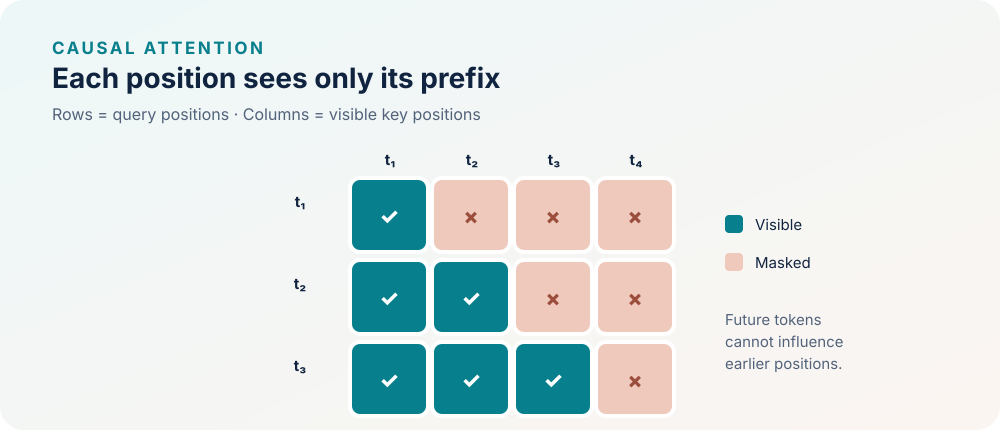

<!--
LLM-LAB-PAGE-MAP v1
id: "fr/causal-masking"
summary: "Montre comment le masque causal interdit à chaque position d’utiliser les tokens futurs, ce qui rend possible la prédiction autorégressive."
scope: "Explique la contrainte causale appliquée aux scores d’attention dans un modèle autorégressif : une position ne peut pas exploiter les positions futures ; distingue ce masque de la sélection du prochain token et des autres masques de padding ou de séquence."
purpose: "Le lecteur doit pouvoir lire un masque causal, expliquer quelles interactions il interdit et relier cette contrainte à la factorisation autorégressive de la probabilité d’une séquence."
suggested_route:
  previous: "fr/scaled-dot-product-attention"
  next: "fr/logits"
hierarchy:
  parents: ["fr/scaled-dot-product-attention"]
  children: []
related: ["fr/logits", "fr/causal-masking-exercises"]
tags: ["type:concept-lesson", "destination:understand", "topic:causal-masking", "level:core", "language:fr", "status:published"]
-->



::: {.chapter-lead}
Pour prédire le token suivant à la position $t+1$, le modèle ne doit utiliser que les tokens déjà disponibles. Le masque causal impose cette règle dans le calcul de l'attention : ce n'est pas seulement un repère graphique.
:::

  Concept vérifié
  Architecture : Décodeur autorégressif

::: {.callout-tip title="L'idée à retenir en une minute"}
Le masque causal impose une règle d'information : **la sortie à la position $i$ ne doit pas dépendre d'un token situé après $i$**. Il bloque les scores correspondants avant le softmax. Il autorise généralement la position courante, car la cible prédite est le token suivant.

**Première lecture :** observez la matrice triangulaire et retenez la règle $j\leq i$. Le modèle peut ainsi calculer plusieurs positions en parallèle sans leur révéler le futur.

**Pour approfondir :** étudiez les conventions de masques booléens propres aux API, puis le test d'invariance qui détecte une fuite d'information.
:::

## Pourquoi ce masque est nécessaire

Lorsqu'on entraîne un modèle à prédire le token suivant, toutes les positions d'une séquence peuvent être calculées en parallèle. Sans masque, cependant, la représentation d'une position pourrait utiliser des tokens qui ne seraient pas encore connus au moment de la génération. Le masque rend donc l'entraînement parallèle compatible avec l'objectif autorégressif.

## Définition

Pour une séquence de longueur $T$, la position $i$ peut accéder aux positions $j\leq i$. On peut représenter cette relation par deux conventions booléennes complémentaires : $\mathrm{allowed}_{ij}=\mathbf{1}[j\leq i]$ (clé autorisée) et $\mathrm{blocked}_{ij}=\mathbf{1}[j>i]$ (clé interdite). On peut aussi utiliser le masque additif $M$ :

$$
M_{ij}=
\begin{cases}
0 & j\leq i,\\
-\infty & j>i.
\end{cases}
$$

Le masque additif est appliqué aux scores **avant** softmax :

$$
A=\operatorname{softmax}\left(\frac{QK^\top}{\sqrt{d_k}}+M\right).
$$

Les positions futures reçoivent alors un poids nul en arithmétique idéale. En pratique, les bibliothèques peuvent représenter le masque sous forme booléenne ou employer une primitive d'attention qui intègre cette contrainte. Chaque ligne de requête doit conserver au moins une clé autorisée : si tous les scores d'une ligne sont masqués à $-\infty$, le softmax usuel n'est pas défini et ce cas doit être traité explicitement. Dans la primitive de référence `scaled_dot_product_attention`, une ligne entièrement masquée reçoit par convention des poids nuls et une sortie nulle ; ces poids ne forment pas une distribution de probabilité. Cette convention d'implémentation n'est pas universelle. Le masque causal triangulaire présenté ici évite ce cas en autorisant toujours la diagonale.

::: {.callout-note collapse="true" title="Convention des API de code (approfondissement)"}
En code, **la polarité d'un masque booléen dépend de l'API**. Dans [l'attention à produit scalaire mise à l'échelle de PyTorch 2.15](https://docs.pytorch.org/docs/2.15/generated/torch.nn.functional.scaled_dot_product_attention.html), `True` dans le masque booléen `attn_mask` signifie qu'un couple requête-clé participe à l'attention. Dans [PyTorch 2.15 MultiheadAttention](https://docs.pytorch.org/docs/2.15/generated/torch.nn.modules.activation.MultiheadAttention.html), `True` dans `attn_mask` signifie que le couple n'est pas autorisé à participer ; `True` dans `key_padding_mask` signifie que la clé correspondante est ignorée. La polarité des masques booléens de MultiheadAttention est donc opposée à celle de `attn_mask` dans SDPA. Ne transférez pas un masque booléen d'une API à l'autre sans vérifier la convention documentée. Cela ne change pas la règle causale elle-même : les couples requête-clé autorisés doivent toujours exclure les clés futures.
:::

**À retenir :** `allowed` et `blocked` codent deux représentations booléennes complémentaires de la même relation causale. L'interprétation de `True` dépend de l'API, comme détaillé ci-dessus.

**Note de version :** les conventions d'API ci-dessus ont été vérifiées dans la documentation PyTorch 2.15, publiée le 28 octobre 2026 ([annonce de version](https://pytorch.org/blog/pytorch-2-15-release-blog/)). Les détails d'API peuvent évoluer ; consultez la documentation correspondant à la version installée avant de transférer des masques.

## Masque causal et autres masques : des rôles distincts

- **Masque causal (attention)** : interdit à une requête de lire une clé située dans le futur ; il impose la contrainte autorégressive.
- **Masque de padding (attention)** : empêche généralement les positions de padding d'être utilisées comme clés ; il ne définit pas l'ordre temporel. Le traitement des requêtes correspondant au padding dépend de l'implémentation.
- **Masque de frontière de document (attention)** : dans des séquences où plusieurs documents sont concaténés, peut interdire les interactions entre documents distincts. Il peut se combiner avec le masque causal.
- **Masque de loss / de cible** : exclut certaines positions du calcul de l'objectif d'entraînement ; il ne bloque pas à lui seul l'accès à l'information dans les couches d'attention. La construction des cibles décalées et des masques de padding/loss relève de la leçon sur les données et les corpus.

Ces masques répondent donc à des questions différentes et ne doivent pas être substitués les uns aux autres.

{fig-alt="Matrice triangulaire inférieure : chaque position accède à elle-même et aux positions précédentes" width=100%}

## Provenance et utilité

Le masque causal est un moyen de réaliser une factorisation autorégressive de la distribution de séquence :

$$
P(x_1,\ldots,x_T)=\prod_{t=1}^{T}P(x_t\mid x_{<t}).
$$

Dans la convention d'entraînement courante, la sortie calculée à la position $i$ est comparée à la cible $x_{i+1}$ : les entrées et les cibles sont donc décalées d'un token. Le masque autorise la diagonale $j=i$ parce que l'entrée à cette position contient $x_i$, et non la cible future $x_{i+1}$. Le traitement des bornes dépend notamment des conventions choisies pour les tokens de début et de fin de séquence.

Les Transformers décodeurs comme GPT utilisent cette contrainte pour apprendre à prédire le prochain token tout en calculant en parallèle les positions d'un batch d'entraînement. Le papier [*Attention Is All You Need* (Vaswani et al., 2017)](https://arxiv.org/abs/1706.03762) décrit le masquage de l'attention du décodeur.

## Idées reçues et contre-exemples

- **« Les données sont déjà dans le bon ordre, donc le masque est inutile. »** Faux : l'ordre des tokens n'empêche pas une opération d'attention non masquée de lire les représentations des positions futures.
- **« Le softmax suffit à rendre l'attention causale. »** Non : sans masque, la normalisation s'applique encore aux positions futures, qui reçoivent des poids positifs.
- **« Mettre les poids futurs à zéro après softmax suffit. »** Sans renormalisation, les poids restants peuvent ne plus sommer à un. Un masquage suivi d'une renormalisation est équivalent en arithmétique exacte si la somme restante est non nulle ; masquer les scores avant softmax est la formulation usuelle.
- **« Tester uniquement la matrice du masque prouve l'absence de fuite. »** Faux : un autre chemin de calcul pourrait laisser passer l'information future.
- **« Causal signifie que l'attention ne regarde que le token précédent. »** Faux : elle peut regarder toutes les positions antérieures, sauf si une autre restriction (par exemple une fenêtre glissante) est imposée.

Piège fréquent : « Pourquoi s'embêter avec $-\infty$ avant le softmax ? Il suffit de multiplier par zéro après le softmax ! »

<strong>Pourquoi ?</strong> Si des positions futures ont un poids positif, les annuler après le softmax sans renormaliser laisse une somme inférieure à 1. Le résultat diffère alors de l'attention causale normalisée ; la norme de la sortie ne diminue pas nécessairement, car les vecteurs peuvent se compenser. Masquer avant le softmax normalise sur les positions autorisées. Annuler puis renormaliser donne le même résultat en arithmétique exacte si la somme restante est non nulle.

::: {.callout-note collapse="true" title="Vérifier l'invariance en pratique"}
La règle causale se formule aussi comme une propriété de préfixe : à paramètres et préfixe inchangés, ajouter ou modifier des tokens futurs ne doit pas changer les sorties déjà calculées pour ce préfixe. L'[exercice CA-A](exercises-attention.qmd#ca-a-prefix-invariance) fait construire le masque, examiner le décalage des cibles et interpréter les tests d'invariance du code de référence. Il distingue également le test d'une opération élémentaire d'attention de celui du modèle complet.
:::

## Liens avec les autres concepts

- [Requêtes, clés et valeurs](queries-keys-values.qmd) définit les projections qui produisent les scores.
- [Attention à produit scalaire mise à l'échelle](scaled-dot-product-attention.qmd) explique l'ordre score → masque → softmax → agrégation.
- [Objectif et fondations mathématiques](mathematical-foundations.qmd) relie la contrainte au prochain-token et à la loss.
- [Synthèse Transformer](transformer.qmd) replace le masque dans l'architecture globale.

## Exercices

The questions and exercises for this lesson are collected on its [dedicated practice page](exercises/causal-masking.qmd).

::: {.callout-note collapse="true" title="Code et tests de référence (approfondissement)"}
Une implémentation de référence testée est disponible dans `src/llm_lab/foundations/attention.py` (`causal_mask` et `scaled_dot_product_attention`). La fonction d'attention accepte un masque additif 2D de forme exacte `(T_q, T_k)` ; elle ne prend pas en charge les masques booléens ni le broadcasting batch/tête. La suite de tests `tests/unit/test_attention.py` comprend un cas similaire d'invariance sur une tête, ainsi que des vérifications du masque et des formes ; elle ne teste pas un GPT complet.

- [Implémentation du masque causal](https://github.com/JM-Brun/llm-lab/tree/main/src/llm_lab/foundations/attention.py)
- [Tests d'invariance temporelle](https://github.com/JM-Brun/llm-lab/tree/main/tests/unit/test_attention.py)
- [Critères d'acceptation prévus](https://github.com/JM-Brun/llm-lab/blob/main/docs/roadmap.md#deferred--causal-attention-implementation)
:::



::: {.language-switch}
**Langue :** [Français](causal-masking.qmd) · [English](../en/causal-masking.qmd)
:::
