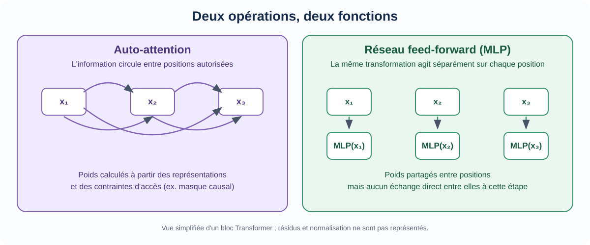

<!--
LLM-LAB-PAGE-MAP v1
id: "fr/contextualized-representations-advanced"
summary: "Formalise les dépendances contextuelles, approfondit les blocs Transformer et confronte les intuitions aux résultats empiriques sur les représentations et les couches."
scope: "Approfondit la contextualisation après le lookup initial : traitement positionnel, positions accessibles, dépendances d'un bloc Transformer, rôles du MLP et de l'auto-attention, flux résiduel, normalisation, études empiriques de contextualité et probing des couches."
domain: "architectures-mechanisms"
purpose: "Formaliser quelles positions peuvent contribuer à un état caché, distinguer décodeur causal et encodeur bidirectionnel, expliquer les sous-couches et interpréter avec prudence les résultats empiriques sur la contextualité, la géométrie et les informations décodables entre couches."
suggested_route:
  previous: null
  next: null
hierarchy:
  parents: ["fr/deepen"]
  children: []
related: ["fr/contextualized-representations", "fr/queries-keys-values-advanced", "fr/rope", "fr/transformer"]
tags: ["type:deep-dive", "destination:deepen", "topic:contextualized-representations-advanced", "level:advanced", "language:fr", "status:published"]
-->




Cette page prolonge la [présentation introductive des représentations contextualisées](contextualized-representations.qmd). Elle suppose que le lecteur distingue déjà l'ID du token, le vecteur obtenu par lookup et l'état caché produit par le réseau.

## 1. De l'embedding initial à l'entrée du réseau

Pour une architecture qui ajoute des embeddings positionnels absolus, on peut écrire :

$$
h_t^{(0)} = E[\text{ID}_t] + P_t.
$$

Le même ID sélectionne le même terme d'embedding dans une table fixe, mais une position différente peut fournir un terme positionnel différent. Cette écriture ne décrit pas toutes les architectures. Avec RoPE, par exemple, l'information de position intervient dans les transformations des vecteurs requête et clé au sein de l'attention, plutôt que par l'ajout universel d'un vecteur à l'embedding initial. Voir [position et RoPE](positional-encoding.qmd) et [Q/K/V avancé](queries-keys-values-advanced.qmd).

## 2. Formaliser le contexte accessible

On peut résumer conceptuellement la dépendance d'un état à la couche suivante par :

$$
h_t^{(\ell+1)} =
F_\ell\!\left(
h_t^{(\ell)},
\{h_j^{(\ell)} : j \in A(t)\}
\right),
$$

où $A(t)$ désigne les positions accessibles depuis la position $t$, selon le masque d'attention.

- **Décodeur causal** (GPT) : en indexation à partir de 1, $A(t)=\{1,\ldots,t\}$. La position peut utiliser son propre état et ceux du préfixe, jamais ceux des tokens futurs.
- **Encodeur bidirectionnel** : les positions accessibles peuvent inclure toute la séquence, sous réserve du masque utilisé.
- **Masques plus spécifiques** : certaines architectures limitent davantage les positions accessibles, par exemple avec des fenêtres locales ou des motifs structurés.

La fonction $F_\ell$ représente ici un bloc complet. Cette notation décrit les dépendances possibles, pas une implémentation universelle ni une équation exacte de toutes les opérations internes.

## 3. Rôle des sous-couches

Dans un bloc Transformer standard, les opérations ont des rôles distincts :

1. **Auto-attention** : chaque position calcule des poids de mélange sur les positions accessibles et agrège leurs vecteurs valeur. Les projections Q/K/V, le masque et la normalisation des scores déterminent ce mélange.
2. **MLP / réseau feed-forward** : transforme ensuite chaque position indépendamment des autres positions à cette sous-couche, avec des paramètres partagés entre positions.
3. **Connexions résiduelles et normalisation** : organisent le flux et la stabilité des transformations ; leur ordre exact dépend de la variante du bloc (pré-LN, post-LN, etc.).

### Le MLP : une transformation locale à chaque position

*Feed-forward* signale que l'information y circule dans un seul sens, de l'entrée vers la sortie, sans interaction entre positions ni boucle de retour. *MLP* (*multi-layer perceptron*) est le nom historique d'un enchaînement de couches linéaires et d'activations non linéaires. Concrètement, ce sous-réseau projette la représentation de dimension \(d_{\mathrm{model}}\) vers une dimension intermédiaire \(d_{\mathrm{ff}}\) (souvent environ quatre fois plus grande), applique une activation non linéaire, puis ramène le résultat à \(d_{\mathrm{model}}\). Sa conception précise varie selon les modèles.

### Connexion résiduelle : ajouter une correction au flux

Au lieu de remplacer la représentation qui circule, chaque sous-couche ajoute une correction. Le flux qui traverse ainsi toute la pile sans discontinuité s'appelle le **flux résiduel** ; la connexion résiduelle lui fournit un chemin direct pour l'information et pour le gradient :

$$
x_{\text{sortie}} = x_{\text{entrée}} + F(x_{\text{entrée}}).
$$

### Normalisation et ordre des opérations

La normalisation (*LayerNorm*, dans les GPT classiques) centre et remet à l'échelle les composantes du vecteur caché de chaque position, indépendamment des autres positions. Elle contribue à contrôler l'échelle des activations et à rendre la propagation des gradients plus favorable à l'optimisation. Son effet dépend notamment de son emplacement : [Xiong et al. (2020)](https://proceedings.mlr.press/v119/xiong20b.html) montrent qu'à l'initialisation le Transformer Post-LN original peut présenter des gradients élevés près de la sortie, tandis que le Pre-LN étudié donne des gradients mieux comportés. Il serait donc trop général de conclure que toute pile profonde échoue sans cette disposition précise : la stabilité dépend de l'architecture et des choix d'initialisation et d'entraînement.

Dans le bloc **pré-LN** illustré ci-dessous, chaque sous-couche reçoit une entrée normalisée : \(x' = x + \operatorname{Attention}(\operatorname{LN}(x))\), puis \(x'' = x' + \operatorname{MLP}(\operatorname{LN}(x'))\). La disposition inverse (post-LN) et les variantes de normalisation, comme RMSNorm, diffèrent entre modèles.

```{mermaid}
%%| label: fig-bloc-prefln
%%| fig-cap: "Une passe dans un bloc pré-LN : chaque sous-couche lit une copie normalisée du flux, et sa sortie vient s'ajouter au flux (connexion résiduelle)."
%%| fig-alt: "Diagramme de flux : x entre dans le bloc ; une copie passe par LayerNorm puis l'attention multi-têtes, et rejoint x par une addition ; le résultat x prime passe par LayerNorm puis le MLP, qui projette de d_model vers d_ff puis revient à d_model, et rejoint x prime par une seconde addition, donnant x seconde, sortie du bloc."
flowchart LR
    X["x — entrée du bloc"] --> LN1["LayerNorm"]
    LN1 --> ATT["Attention multi-têtes"]
    ATT --> ADD1["Addition"]
    X -- "chemin résiduel" --> ADD1
    ADD1 --> X2["x′ — après l'attention"]
    X2 --> LN2["LayerNorm"]
    LN2 --> MLP["MLP : d_model vers d_ff vers d_model"]
    MLP --> ADD2["Addition"]
    X2 -- "chemin résiduel" --> ADD2
    ADD2 --> Y["x″ — sortie du bloc"]
```

L'image résume la différence de portée entre les deux sous-couches :

{fig-alt="L'auto-attention permet des échanges entre positions autorisées ; le même réseau feed-forward est appliqué séparément à chaque position." width=100%}

| | Auto-attention | Réseau feed-forward (MLP) |
|---|---|---|
| Portée | toutes les positions autorisées par le masque | chaque position, séparément |
| Liens entre positions | oui ; le masque causal fixe les accès autorisés | aucun |
| Poids entre positions | partagés | partagés |
| Dimensions traversées | \(d_{\mathrm{model}}\) vers \(d_{\mathrm{model}}\) | \(d_{\mathrm{model}}\) vers \(d_{\mathrm{ff}}\), puis retour vers \(d_{\mathrm{model}}\) |
| Question à laquelle il répond | que retenir du contexte ? | comment transformer ce qui a été retenu ? |

Les deux opérations sont apprises. L'attention calcule une somme pondérée de vecteurs de valeur : elle ne recherche pas littéralement des informations dans des notes lisibles par un humain.

### Attention multi-têtes

Chaque sous-couche d'attention est en réalité **multi-têtes** : plusieurs attentions s'exécutent en parallèle sur des projections apprises distinctes, puis leurs résultats sont combinés. Chaque tête travaille dans une dimension réduite \(d_{\mathrm{head}}\) (64 pour GPT-2), avec \(H \times d_{\mathrm{head}} = d_{\mathrm{model}}\) dans cette configuration : \(12 \times 64 = 768\). Cette diversité ne garantit pas que chaque tête développe une spécialisation nette et interprétable par un humain ; les projections qui alimentent l'attention sont détaillées dans la leçon [Q/K/V](queries-keys-values.qmd).

La répétition de ces sous-couches fait évoluer les états cachés. La section 2 formalise les dépendances entre positions et couches ; pour le calcul détaillé, voir [Q/K/V](queries-keys-values.qmd), [Q/K/V avancé](queries-keys-values-advanced.qmd) et [le Transformer](transformer.qmd).

## 4. Isoler l'effet du contexte dans l'exemple *bank*

Considérons :

- “The river bank eroded.”
- “The financial bank collapsed.”

Pour isoler l'effet du contexte, on suppose un token *bank* unique et on place les deux occurrences à la même position (troisième mot, avec l'hypothèse simplificatrice d'un token par mot). Elles partagent donc le même ID, le même lookup initial et le même traitement positionnel à cette position, dans une architecture dont le mécanisme positionnel dépend de la position.

Dans un décodeur causal, la différence de représentation à cette position peut alors provenir du préfixe accessible (*The river* ou *The financial*), et non d'une différence de position absolue. Dans un autre exemple, position et contexte peuvent tous deux contribuer à la différence.

Cette comparaison est un dispositif pédagogique contrôlé, pas une affirmation selon laquelle le modèle encode les sens humains dans des régions géométriques nettement séparées.

## 4 bis. Une dépendance entre positions : la référence pronominale

Considérons : « L'animal était fatigué parce qu'il avait couru. » Le pronom « il » renvoie à « l'animal ». Il ne s'agit pas de désambiguïser deux sens d'un même token, mais de traiter une relation entre des positions distinctes.

La représentation du pronom peut intégrer des informations issues de son préfixe accessible. Cet exemple motive l'étude des interactions entre positions ; il ne démontre pas qu'une tête d'attention particulière identifie nécessairement l'antécédent, ni que l'attention seule réalise toute la résolution de coréférence.

## 5. Suivre une position à travers les couches

$h_t^{(0)}$ désigne l'entrée initiale à la position $t$. Chaque bloc produit un nouvel état, $h_t^{(1)}$, puis $h_t^{(2)}$, et ainsi de suite. L'indice $t$ reste fixe : c'est la représentation de cette position que l'on suit à travers la profondeur du réseau.

Le vecteur n'est pas remplacé par une étiquette de sens. Il est transformé par des opérations apprises qui intègrent progressivement l'information autorisée par l'architecture et le masque.

## 6. Ce que les études empiriques permettent d'affirmer

Les études sur les représentations contextualisées apportent des éléments complémentaires, mais elles ne mesurent pas toutes le même objet et ne portent pas sur la même architecture.

### Des représentations dépendantes de la séquence avant les Transformers

Peters et al. (2018) introduisent ELMo (*Embeddings from Language Models*), dont les représentations de mots sont des fonctions apprises des états internes d'un modèle de langue bidirectionnel à LSTM. Le travail établit l'intérêt de représentations sensibles au contexte avant l'adoption des Transformers. Il ne décrit donc pas le mécanisme d'auto-attention d'un GPT.

### Une mesure de la contextualité et ses limites géométriques {#mesure-contextualite-limites-geometriques}

Ethayarajh (2019) étudie ELMo, BERT et GPT-2. Après correction de l'anisotropie, les représentations d'un même mot dans des contextes différents restent en moyenne plus proches entre elles que celles de mots différents, mais cette auto-similarité diminue dans les couches supérieures.

L'article rapporte aussi une **Maximum Explainable Variance (MEV) moyenne inférieure à 5 %** dans les couches étudiées, après ajustement de l'anisotropie. La MEV estime la proportion de variance des représentations d'un mot expliquée par leur première composante principale ; elle fournit une borne supérieure à ce qu'un unique vecteur statique pourrait expliquer dans ce protocole. Ce n'est donc ni une mesure brute de variance, ni une comparaison directe avec n'importe quel embedding statique pré-entraîné.

Deux précautions sont essentielles :

- ce résultat est agrégé sur les modèles, couches et données étudiés en 2019 ; ce n'est pas une constante universelle applicable à tout LLM ;
- les représentations sont anisotropes : une similarité cosinus brute élevée peut provenir de cette géométrie et ne suffit pas à établir que deux vecteurs portent le même sens.

La mesure indique que, selon ce protocole, un vecteur statique explique peu la variabilité des occurrences d'un mot ; elle ne prouve pas que chaque sens humain corresponde à une région géométrique distincte.

### Des informations linguistiques réparties entre les couches

Tenney, Das et Pavlick (2019) utilisent des tâches de *probing* pour étudier où certaines informations linguistiques sont accessibles dans BERT. Ils observent, en moyenne, une progression allant des catégories grammaticales vers la syntaxe, les entités nommées, les rôles sémantiques et la coréférence. Leur analyse qualitative montre toutefois que le modèle peut réviser des décisions de niveau inférieur à la lumière d'informations contextuelles plus élevées.

Un résultat de *probing* indique qu'une information est décodable depuis une représentation avec un protocole donné. Il ne démontre pas, à lui seul, que le modèle utilise cette information comme un humain, qu'une couche possède une fonction exclusive, ou qu'une tête donnée réalise une opération linguistique identifiable.

**À retenir :** les états sont bien dépendants du contexte dans les modèles étudiés, mais leur contenu, leur géométrie et leur organisation entre couches dépendent de l'architecture, de l'objectif d'entraînement, du modèle et de la méthode de mesure.

Références primaires :

- Peters et al. (2018), [*Deep Contextualized Word Representations*](https://aclanthology.org/N18-1202/).
- Ethayarajh (2019), [*How Contextual are Contextualized Word Representations?*](https://aclanthology.org/D19-1006/).
- Tenney, Das et Pavlick (2019), [*BERT Rediscovers the Classical NLP Pipeline*](https://aclanthology.org/P19-1452/).

## Limites de cette formalisation

- Les états cachés sont des vecteurs appris ; cette notation ne leur attribue pas une interprétation sémantique unique.
- Une dépendance computationnelle n'implique pas qu'une tête particulière réalise à elle seule une tâche linguistique identifiable.
- Les positions accessibles dépendent de l'architecture et du masque ; la causalité de GPT ne doit pas être généralisée aux encodeurs bidirectionnels.
- Les variantes de blocs peuvent modifier l'ordre, la normalisation, les connexions résiduelles et les mécanismes d'attention.

**À retenir :** le lookup fixe l'identité du vecteur token initial ; l'architecture positionnelle et les blocs déterminent ensuite comment l'état à chaque position dépend des autres états accessibles.


## Explorer une feature sans la prendre pour une explication complète

[Neuronpedia](https://www.neuronpedia.org/) permet d'explorer des features, activations, neurones, têtes d'attention et graphes d'attribution. Pour une première inspection, la documentation présente [Gemma 2 2B · Gemma Scope · couche 20 · résiduel · 16k · feature 10956](https://www.neuronpedia.org/gemma-2-2b/20-gemmascope-res-16k/10956).

Une feature de sparse autoencoder (SAE) est une direction/variable latente dans une décomposition apprise des activations. Elle n'est pas automatiquement un concept humain unique, un neurone natif ou une explication exhaustive. Le tableau de bord réunit plusieurs indices à lire séparément : exemples d'activations, tokens mis en évidence, logits associés, densité d'activation et explications textuelles. Les explications automatiques sont produites par des modèles et peuvent être fausses ou trop générales.

**Protocole d'enquête :**
1. Notez modèle, release/source, couche, hook et index. Un même index dans deux sources différentes ne désigne pas la même feature.
2. Lisez les activations positives les plus fortes et plusieurs exemples moins typiques. Cherchez des contre-exemples où la feature s'active sans correspondre à l'étiquette proposée.
3. Comparez l'explication automatique aux exemples justificatifs. Relevez le modèle et la méthode qui l'ont produite, ainsi que son score éventuel ; un score automatique n'est pas un étalon indépendant.
4. Examinez densité d'activation et logits positifs/négatifs. Distinguez contextes d'activation, tokens dont le logit change et rôle causal dans le comportement global.
5. Si l'inférence sur texte personnalisé est disponible pour cette source, testez des exemples positifs, négatifs et adversariaux rédigés avant le test.
6. Formulez une conclusion calibrée : « les exemples inspectés sont compatibles avec l'hypothèse X dans cette couche/source » est défendable ; « le modèle comprend X grâce à cette feature » ne l'est pas sur cette seule base.

Les graphes d'attribution et outils de steering enrichissent l'enquête, mais leur interprétation dépend des approximations, interventions et contrôles. Une activation corrélée à un motif, une étiquette générée ou une réponse modifiée par steering ne suffit pas à établir un mécanisme causal complet. Il faut des interventions contrôlées, des ablations/contrôles pertinents et des cas susceptibles de réfuter l'hypothèse.

Pour pratiquer, utilisez la [fiche d'enquête](exercises/contextualized-representations.qmd). Références : [SAE overview](https://docs.neuronpedia.org/sparse-autoencoders/overview), [feature dashboards](https://docs.neuronpedia.org/sparse-autoencoders/feature-dashboards), [auto-interp](https://docs.neuronpedia.org/sparse-autoencoders/auto-interp), [key concepts](https://docs.neuronpedia.org/getting-started/key-concepts).

## Pour continuer

- [Revenir à la leçon sur les représentations contextualisées](contextualized-representations.qmd) — le modèle mental essentiel.
- [Approfondir Q/K/V](queries-keys-values-advanced.qmd) — les projections et le calcul de l'attention.
- [Revenir à la carte des approfondissements](deepen.qmd).

::: {.language-switch}
**Langue :** [Français](contextualized-representations-advanced.qmd) · [English](../en/contextualized-representations-advanced.qmd)
:::
