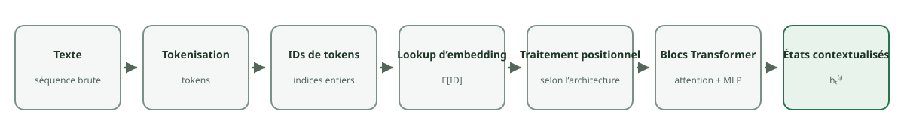
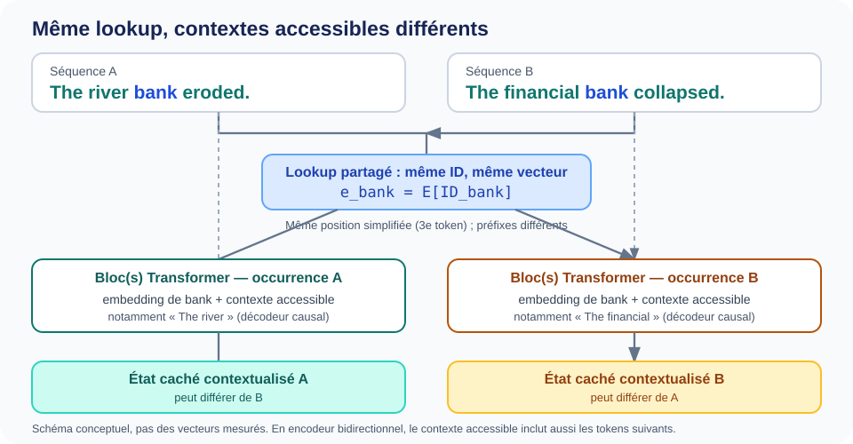

<!--
LLM-LAB-PAGE-MAP v1
id: "fr/contextualized-representations"
summary: "Montre comment les couches du Transformer transforment les vecteurs initiaux en états dépendant du contexte, de sorte qu’un même token puisse avoir plusieurs représentations."
scope: "Explique comment les couches du Transformer transforment les embeddings initiaux en vecteurs dépendant du contexte et pourquoi un même ID peut donc correspondre à des états contextualisés différents selon sa position et son contexte ; ne confond pas ces états avec les vecteurs statiques de la table d’embeddings."
purpose: "Le lecteur doit pouvoir expliquer pourquoi deux occurrences d’un même token partagent un embedding initial mais peuvent avoir des représentations contextualisées différentes, et relier cette différence au traitement par les couches du Transformer."
suggested_route:
  previous: "fr/positional-encoding"
  next: "fr/transformer"
hierarchy:
  parents: ["fr/embedding-space", "fr/positional-encoding"]
  children: []
related: ["fr/queries-keys-values", "fr/transformer", "fr/contextualized-representations-exercises"]
tags: ["type:concept-lesson", "destination:understand", "topic:contextualized-representations", "level:core", "language:fr", "status:published"]
-->



::: {.callout-note .learning-outcomes collapse="true" title="Objectifs d’apprentissage"}
À la fin de cette leçon, vous devriez pouvoir :
- expliquer pourquoi deux occurrences d’un même ID de token partagent un embedding initial mais développent des états cachés distincts ;
- identifier à quel moment l'information positionnelle et les interactions séquentielles transforment l'état interne ;
- réfuter la confusion attribuant au lookup d'embedding une compréhension sémantique ou une désambiguïsation du contexte.
:::

::: {.chapter-lead}

  Concept vérifié
  Architecture : Blocs Transformer

Deux phrases peuvent contenir le même token sans lui donner le même rôle : *bank* désigne une rive dans l'une, un établissement financier dans l'autre. Pourtant, le tokenizer peut attribuer le même ID aux deux occurrences. **Le lookup ne change pas ; c'est le traitement de la séquence par le Transformer qui construit des états cachés dépendant du contexte.**
:::

::: {.callout-tip title="L'idée à retenir en une minute"}
- **Même ID, même lookup :** avec une matrice fixe, les deux occurrences sélectionnent la même ligne.
- **Position :** l'architecture introduit l'ordre selon son mécanisme (embedding absolu, RoPE, etc.).
- **Contexte :** chaque bloc transforme l'état d'une position à partir des tokens auxquels elle peut accéder.
- **Résultat :** les états cachés peuvent différer, sans garantir une représentation géométrique nette des « sens » humains.

**Question rapide :** comment deux occurrences peuvent-elles partager le même vecteur initial tout en ayant des états cachés différents ?
:::

  
<strong>Embeddings de tokens</strong>Vecteurs initiaux issus du lookup

  
<strong>Signal positionnel</strong>Injecté à un endroit qui dépend de l’architecture

  

    
<strong>Encodage absolu</strong><small>Ajout du vecteur de position à l’entrée, avant les couches Transformer</small>

    
<strong>RoPE</strong><small>Rotation de Q/K à l’intérieur des mécanismes d’attention des couches Transformer</small>

  

  
<strong>Couches Transformer répétées</strong><small>Attention, MLP, connexions résiduelles et normalisation</small>

  
<strong>Représentations contextualisées</strong><small>Chaque état dépend du contenu et des interactions autorisées avec le contexte</small>

{.pipeline-figure fig-alt="Le texte est tokenisé en IDs ; les IDs sélectionnent des vecteurs dans la table d'embeddings ; le modèle traite la position puis les blocs Transformer produisent des états contextualisés." fig-cap="Du texte aux états contextualisés : chaque étape transforme ou enrichit la représentation, du symbole jusqu'aux états cachés dépendant du contexte." width=100%}

Ce schéma est une illustration originale et simplifiée, et non une reproduction de la figure de Rushang Chauhan. Le traitement positionnel dépend de l'architecture : par exemple, RoPE ne consiste pas à ajouter simplement un vecteur de position à chaque embedding. Pour une autre présentation pédagogique du passage des tokens au contexte, voir l'article de [Rushang Chauhan, *Embeddings: The Bridge Between Tokens and Context*](https://www.linkedin.com/pulse/embeddings-bridge-between-tokens-context-rushang-chauhan-oqpzf/).

## Ce qui reste identique

Supposons que le token visible `bank` soit représenté par le même ID dans deux phrases :

- “The river bank eroded.”
- “The financial bank collapsed.”

Sous cette hypothèse explicite, les deux occurrences récupèrent le même **vecteur de plongement initial** (embedding) :

`e_bank = E[ID_bank]`

Le lookup est un accès à une table. Il n'examine pas les mots voisins, ne déduit pas le sens visé et ne produit pas un vecteur propre à chaque phrase.

Une précision est nécessaire : un mot visible ne correspond pas nécessairement à un seul token. Un tokenizer peut le découper en plusieurs tokens. Cet exemple isole le principe de contextualisation en supposant un ID commun.

### Une autre dépendance : la référence pronominale

Considérons maintenant : *“The animal was tired because it had been running.”* Le pronom `it` renvoie ici à `the animal`. Ce cas ne porte pas sur les deux sens possibles d'un même mot : il illustre une dépendance entre des positions différentes de la séquence. Pour construire une représentation contextuelle de `it`, le modèle peut exploiter des informations provenant d'autres tokens du contexte.

Cet exemple est repris comme motivation pédagogique dans le tutoriel de [Nishanthan K sur Q, K et V](https://dev.to/nishanthan-k/how-query-key-and-value-qkv-work-in-transformers). Il ne démontre pas qu'une tête d'attention particulière identifie nécessairement l'antécédent, ni que l'attention seule réalise toute la résolution de coréférence. Il sert à distinguer deux motivations complémentaires : lever une ambiguïté lexicale (*bank*) et exploiter une relation entre tokens (*it* / *the animal*).

## Ce qui change avec la position et le contexte

Le lookup initial ne suffit pas à décrire l'entrée du réseau : l'architecture doit aussi traiter la position, puis les blocs Transformer construisent des états dépendant du contexte accessible. Le mécanisme positionnel varie selon les modèles ; un vecteur de position n'est donc pas toujours ajouté directement à l'embedding.

Pour comprendre les dépendances entre positions, les masques causaux et les rôles distincts de l'auto-attention et du MLP, consultez l'[approfondissement sur les représentations contextualisées](contextualized-representations-advanced.qmd). La formalisation détaillée est volontairement séparée de cette première explication.

Piège fréquent : « Pour que deux sens d'un mot comme "bank" soient reconnus, le tokenizer doit leur attribuer des IDs distincts »

<strong>Contre-exemple :</strong> Le tokenizer découpe le texte selon des règles de vocabulaire indépendantes du sens de la phrase ; il attribue le même ID au mot « bank » quel que soit son sens financier ou fluvial. C'est l'agrégation pondérée par l'attention au fil des couches qui spécialise la représentation interne $h_t^{(\ell)}$. Attribuer des IDs distincts selon le sens réintroduirait une étape de désambiguïsation symbolique manuelle avant le modèle.

{fig-alt="Deux séquences placent bank à la même position simplifiée. Les deux occurrences partagent le même lookup initial, tandis que chaque bloc Transformer combine cet état avec le contexte accessible propre à la séquence avant de produire un état caché qui peut différer." fig-cap="Même ID et même position simplifiée : le lookup est identique. Les préfixes accessibles diffèrent ; les états cachés peuvent donc différer." width=100%}

Cette illustration originale s'inspire de [Ethayarajh (2019), *How Contextual are Contextualized Word Representations?*](https://arxiv.org/abs/1909.00512). Elle illustre le principe, pas des vecteurs mesurés. Selon le tokenizer, un mot visible peut être constitué de plusieurs tokens.

## Distinguer les étapes et les représentations

| Objet | De quoi dépend-il ? | Dépend-il du contexte ? |
|---|---|---|
| ID du token | Vocabulaire et règles du tokenizer | Non ; il identifie une entrée du vocabulaire |
| Vecteur de plongement initial du token (embedding) | Ligne sélectionnée dans la matrice de plongements | Non, pour une matrice et un ID fixes |
| État caché à la couche \(\ell\) | État de la couche précédente, information positionnelle et tokens accessibles selon le masque | Oui, en général |

Deux confusions fréquentes viennent du mélange de ces étapes :

- **« Le lookup comprend la phrase. »** Non. Il sélectionne une ligne apprise ; le contexte est intégré par les opérations ultérieures du réseau.
- **« Le même token doit toujours avoir le même état caché. »** Non. Le lookup initial peut être identique alors que la position et le contexte modifient les représentations suivantes.

Cela ne garantit pas non plus que le modèle représente les sens interprétés par un humain sous forme de groupes géométriques nettement séparés. La contextualisation est un mécanisme de calcul, pas la garantie d'une géométrie sémantique particulière.

## Où se situe cette étape dans le modèle ?

Pour replacer cette transformation dans le parcours complet :

1. Le tokenizer transforme le texte en IDs de tokens.
2. La table de plongements (table d'embeddings) associe un vecteur initial à chaque ID.
3. L'architecture introduit l'information positionnelle selon ses choix.
4. Les couches du Transformer produisent des états cachés dépendants du contexte.
5. Les couches suivantes et la tête de sortie utilisent ces états pour prédire le token suivant.

Le [lookup dans l’espace des plongements (embeddings)](embedding-space.qmd) associe les IDs aux vecteurs initiaux. Pour voir comment le réseau transforme ensuite ces vecteurs en états contextualisés, poursuivez avec [Le Transformer dans un GPT](transformer.qmd) : cette page situe la pile de blocs et distingue l'attention du MLP. Les pages sur [Q/K/V](queries-keys-values.qmd) et l'[attention à produit scalaire mise à l'échelle](scaled-dot-product-attention.qmd) détaillent ensuite le mécanisme d'attention.

## Exercices

Les questions et exercices de cette leçon sont regroupés sur sa [page d’exercices dédiée](exercises/contextualized-representations.qmd).



::: {.language-switch}
**Langue :** [Français](contextualized-representations.qmd) · [English](../en/contextualized-representations.qmd)
:::

::: {.self-check}
## Vérifier sa compréhension

[Exercices dédiés](exercises/contextualized-representations.qmd).

Deux occurrences du même ID de token apparaissent dans deux phrases différentes.

1. Le lookup renvoie-t-il le même vecteur initial ?
2. Les états cachés après les couches Transformer doivent-ils rester identiques ?
3. À quelle étape l'information contextuelle intervient-elle ?

Afficher le raisonnement

Avec une matrice d'embeddings fixe, le même ID sélectionne la même ligne. Les états cachés peuvent ensuite différer, car les couches Transformer combinent l'information de la position avec celle des autres tokens accessibles. Le lookup seul ne désambiguïse pas le sens du mot.

:::
