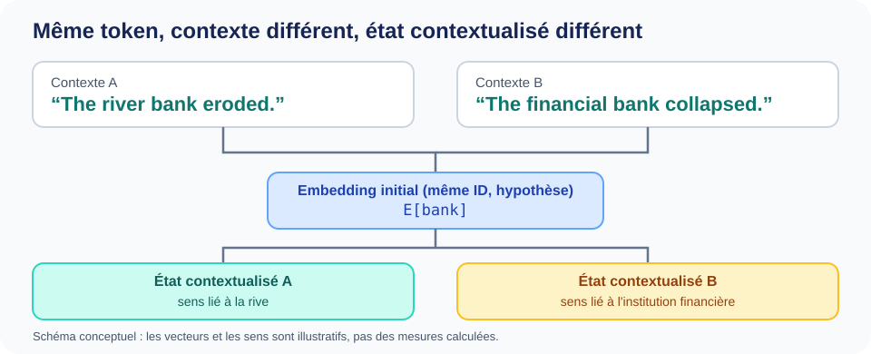

::: {.chapter-lead}
Un même ID de token sélectionne toujours la même ligne dans une matrice d'embeddings fixe. Pourtant, ce token peut jouer des rôles différents selon la phrase. La distinction essentielle est la suivante : **le lookup fournit un vecteur initial ; le Transformer construit ensuite des représentations qui dépendent du contexte**.
:::

Ce complément répond à une question précise, en marge de [la page principale sur l'espace des embeddings](embedding-space.qmd). Il approfondit un mécanisme sans interrompre le parcours principal des IDs vers les vecteurs, puis vers la géométrie des représentations.

## Ce qui reste identique

Supposons que le mot visible `banque` soit représenté par le même ID dans deux phrases :

- “The river bank eroded.”
- “The financial bank collapsed.”

Le mot anglais `bank` est conservé dans cet exemple pour garder une même forme lexicale dans les deux contextes.

Sous cette hypothèse explicite, les deux occurrences récupèrent le même embedding initial :

\[
e_{\text{bank}} = E[\text{ID}_{\text{bank}}].
\]

Le lookup est un accès à une table. Il n'examine pas les mots voisins, ne déduit pas le sens visé et ne produit pas un vecteur propre à chaque phrase.

Une précision est nécessaire : un mot visible ne correspond pas nécessairement à un seul token. Un tokenizer peut le découper en plusieurs tokens. Cet exemple isole le principe de contextualisation en supposant un ID commun.

## Ce qui change avec la position et le contexte

Les deux occurrences occupent des positions différentes et sont entourées de tokens différents. Le traitement exact de la position dépend de l'architecture.

Dans un modèle utilisant des embeddings positionnels absolus appris, l'entrée initiale à la position \(t\) peut s'écrire :

\[
h_t^{(0)} = E[\text{ID}_t] + P_t.
\]

Le même ID donne le même terme d'embedding du token, mais une position différente peut fournir un terme positionnel différent. Les architectures utilisant RoPE traitent la position autrement : le mécanisme modifie les vecteurs requête et clé dans l'attention, au lieu d'ajouter un vecteur positionnel absolu à l'embedding du token. Voir [encodage positionnel et RoPE](positional-encoding.qmd).

Les couches du Transformer traitent ensuite l'information à travers la séquence. À un niveau conceptuel :

\[
h_t^{(\ell+1)}
=
F_\ell\big(h_1^{(\ell)},\ldots,h_t^{(\ell)}\big),
\]

Dans un décodeur causal comme GPT, l'état à la position \(t\) peut utiliser le token courant et son contexte précédent, mais pas les tokens futurs. D'autres architectures, comme les encodeurs bidirectionnels, utilisent des masques d'attention différents. La fonction \(F_\ell\) représente un bloc complet ; cette écriture est conceptuelle et ne spécifie pas son implémentation.

Les deux occurrences peuvent donc produire des états cachés différents, même si leur lookup initial du token est identique.

{fig-alt="Deux phrases utilisent le token anglais bank dans des contextes différents. En supposant le même ID, les deux occurrences partagent l'embedding initial, puis peuvent produire des états contextualisés différents." fig-cap="Même ID, même lookup initial ; des informations positionnelles et contextuelles différentes peuvent conduire à des états cachés différents." width=100%}

Cette illustration originale s'inspire de [Ethayarajh (2019), *How Contextual are Contextualized Word Representations?*](https://arxiv.org/abs/1909.00512). Elle illustre le principe, pas des vecteurs mesurés. Selon le tokenizer, un mot visible peut être constitué de plusieurs tokens.

## Distinguer trois objets

| Objet | De quoi dépend-il ? | Dépend-il du contexte ? |
|---|---|---|
| ID du token | Vocabulaire et règles du tokenizer | Non ; il identifie une entrée du vocabulaire |
| Embedding initial du token | Ligne sélectionnée dans la matrice d'embeddings | Non, pour une matrice et un ID fixes |
| État caché contextualisé | Représentation initiale, traitement positionnel, séquence environnante, architecture et couche | Oui, en général |

Deux confusions fréquentes viennent du mélange de ces étapes :

- **« Le lookup comprend la phrase. »** Non. Il sélectionne une ligne apprise ; le contexte est intégré par les opérations ultérieures du réseau.
- **« Le même token doit toujours avoir le même état caché. »** Non. Le lookup initial peut être identique alors que la position et le contexte modifient les représentations suivantes.

Cela ne garantit pas non plus que le modèle représente les sens interprétés par un humain sous forme de groupes géométriques nettement séparés. La contextualisation est un mécanisme de calcul, pas la garantie d'une géométrie sémantique particulière.

## Où se situe cette étape dans le modèle ?

Le parcours est le suivant :

1. Le tokenizer transforme le texte en IDs de tokens.
2. La table d'embeddings associe un vecteur initial à chaque ID.
3. L'architecture introduit l'information positionnelle selon ses choix.
4. Les couches du Transformer produisent des états cachés dépendants du contexte.
5. Les couches suivantes et la tête de sortie utilisent ces états pour prédire le token suivant.

Pour retrouver l'exemple complet de lookup, les dimensions matricielles, le nombre de paramètres et la géométrie des représentations, retournez à [la page principale sur l'espace des embeddings](embedding-space.qmd). Pour approfondir le traitement de la séquence, poursuivez avec [Requêtes, clés et valeurs](queries-keys-values.qmd) puis [Attention à produit scalaire redimensionné](scaled-dot-product-attention.qmd).

::: {.language-switch}
**Langue :** [Français](contextualized-representations.qmd) · [English](../en/contextualized-representations.qmd)
:::
