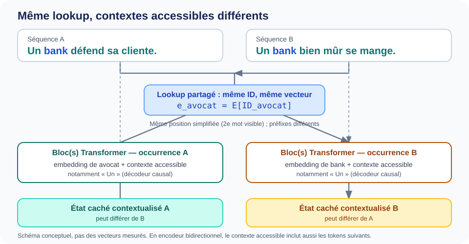

<!--
LLM-LAB-PAGE-MAP v1
id: "fr/contextualized-representations"
summary: "Distingue le vecteur initial sélectionné par l’ID de l’état caché construit pour chaque occurrence à partir de sa position et du contexte accessible."
scope: "Compare le lookup initial et les états cachés par position, puis explique leur dépendance au contexte accessible dans un GPT causal. La formalisation des sous-couches et l’analyse de dépendances linguistiques particulières sont réservées à l’approfondissement."
purpose: "Prédire ce qui peut modifier l’état d’une occurrence, en séparant l’ID, la position, le préfixe accessible et les transformations du réseau."
suggested_route:
  previous: "fr/positional-encoding"
  next: "fr/transformer"
hierarchy:
  parents: []
  children: []
related: ["fr/embedding-space", "fr/positional-encoding", "fr/transformer", "fr/queries-keys-values", "fr/contextualized-representations-advanced", "fr/contextualized-representations-exercises"]
revision_support:
  status: integrated_sufficient
  evidence:
    - anchor: revision-summary
      note: "La synthèse en une minute distingue lookup, position et contexte accessible ; la page Practice ajoute quatre cartes de rappel et une comparaison contrôlée passé/futur. Les détails des sous-couches, les résultats empiriques et l'enquête SAE restent dans l'approfondissement."
tags: ["type:concept-lesson", "destination:understand", "topic:contextualized-representations", "level:core", "language:fr", "status:published"]
-->



::: {.callout-note .learning-outcomes collapse="true" title="Objectifs d’apprentissage"}
À la fin de cette leçon, vous devriez pouvoir :
- expliquer pourquoi deux occurrences d’un même ID de token partagent un embedding initial et peuvent produire des états cachés distincts ;
- identifier à quel moment l'information positionnelle et les interactions séquentielles transforment l'état interne ;
- réfuter la confusion attribuant au lookup d'embedding une compréhension sémantique ou une désambiguïsation du contexte.
:::

::: {.chapter-lead}

  Concept vérifié
  Architecture : Blocs Transformer

Le mot *situation* apparaît dans « une bonne situation, ça, scribe ? », puis dans « de bonne ou de mauvaise situation ». Le premier emploi désigne un poste ; le second, les circonstances. En supposant un ID commun et une position simplifiée identique, le lookup initial est le même. **Le Transformer construit ensuite des états cachés contextualisés à partir du contexte.**
:::

**Questions et exercices :** [Accéder à la page dédiée](exercises/contextualized-representations.qmd).

Pour isoler maintenant l’effet du contexte, nous fixons les paramètres, l’ID du token étudié et sa position. Seul le préfixe accessible varie. La leçon précédente faisait varier la position ; celle-ci maintient cette position fixe pour étudier ce que les blocs peuvent en faire.

## Ce qui reste identique

Considérons deux emplois du mot `situation` :

- Dans la question : « une bonne situation, ça, scribe ? » — un poste, une profession ;
- Dans la réponse : « de bonne ou de mauvaise situation » — les circonstances, les conditions.

Pour isoler le mécanisme, supposons que le tokenizer attribue le même ID au mot dans les deux occurrences. Elles récupèrent alors le même **vecteur de plongement initial** :

$e_{\text{situation}} = E[\text{ID}_{\text{situation}}]$

Le lookup est un accès à une table. Il n'examine pas les mots voisins, ne déduit pas le sens visé et ne produit pas un vecteur propre à chaque phrase.

Une précision : un mot visible ne correspond pas nécessairement à un seul token. Un tokenizer peut le découper en plusieurs tokens. Cet exemple isole le principe de contextualisation en supposant un ID commun.

## Ce qui change avec la position et le contexte {#effets-position-contexte}

Le lookup initial ne suffit pas à décrire l'entrée du réseau : l'architecture doit aussi traiter la position, puis les blocs Transformer construisent des états dépendant du contexte accessible. Le mécanisme positionnel varie selon les modèles ; un vecteur de position n'est donc pas toujours ajouté directement à l'embedding.

<figure id="fig-contextualized-embeddings">
  <picture>
    <source media="(max-width: 600px)" srcset="../images/contextualized-embeddings-fr-mobile.svg">
    
  </picture>
  <figcaption>Même ID et position simplifiée identique : le lookup initial est le même. Les contextes accessibles diffèrent ; les états cachés peuvent donc différer.</figcaption>
</figure>

Cette illustration originale s'inspire de [Ethayarajh (2019), *How Contextual are Contextualized Word Representations?*](https://arxiv.org/abs/1909.00512). Elle illustre le principe, pas des vecteurs mesurés. Selon le tokenizer, un mot visible peut être constitué de plusieurs tokens.

Piège fréquent : « Pour que deux occurrences du mot "situation" soient comprises, le tokenizer doit leur attribuer des IDs distincts »

<strong>Contre-exemple :</strong> Dans cet exemple, on suppose explicitement que les deux occurrences de « situation » reçoivent le même ID. Le tokenizer segmente le texte selon son vocabulaire et ses règles ; il ne réalise pas d'interprétation contextuelle à l'échelle de la phrase. Les couches du modèle peuvent ensuite construire des états cachés différents à partir des contextes accessibles. Exiger des IDs distincts confondrait segmentation des tokens et contextualisation.

Les dépendances entre positions ne se limitent pas à l’ambiguïté d’un mot : elles peuvent aussi concerner la référence d’un pronom. Cet exemple demande davantage d’analyse linguistique et est réservé à l’[approfondissement sur les représentations contextualisées](contextualized-representations-advanced.qmd).

## Distinguer les étapes et les représentations

| Objet | De quoi dépend-il ? | Dépend-il du contexte ? |
|---|---|---|
| ID du token | Vocabulaire et règles du tokenizer | Un token fixé garde son ID dans ce vocabulaire. Le découpage du texte, par exemple avec ou sans espace initial, peut changer le token obtenu. |
| Vecteur de plongement initial du token (embedding) | Ligne sélectionnée dans la matrice de plongements | Non, pour une matrice et un ID fixes |
| État caché à la couche $\ell$ | État de la couche précédente, information positionnelle et tokens accessibles selon le masque | Oui, en général |

Deux confusions fréquentes viennent du mélange de ces étapes :

- **« Le lookup comprend la phrase. »** Non. Il sélectionne une ligne apprise ; le contexte est intégré par les opérations ultérieures du réseau.
- **« Le même token doit toujours avoir le même état caché. »** Non. Le lookup initial peut être identique alors que la position et le contexte modifient les représentations suivantes.

Cela ne garantit pas non plus que le modèle représente les sens interprétés par un humain sous forme de groupes géométriques nettement séparés. La contextualisation est un mécanisme de calcul, pas la garantie d'une géométrie sémantique particulière.

::: {.callout-tip title="L'idée à retenir en une minute" #revision-summary}
- **Même ID, même lookup :** avec une matrice fixe, les deux occurrences sélectionnent la même ligne.
- **Position :** l'architecture introduit l'ordre selon son mécanisme (embedding absolu, RoPE, etc.).
- **Contexte :** chaque bloc transforme l'état d'une position à partir des tokens auxquels elle peut accéder.
- **Résultat :** les états cachés peuvent différer, sans garantir une représentation géométrique nette des « sens » humains.
:::

Le fil rouge se prolonge ensuite avec « Vous savez, moi je ne crois pas… ». Les tokens ajoutés occupent de nouvelles positions ; ils peuvent influer sur les états calculés à ces positions et aux suivantes, sans modifier les états déjà calculés aux positions antérieures dans un GPT causal.

Dans un GPT causal, le préfixe accessible à une position s’arrête au token courant. À position et poids fixés, une modification du préfixe accessible peut changer l’état courant ; une modification située après cette position ne doit pas le changer.

### Une expérience contrôlée : modifier le passé ou le futur

Fixons une position $i$, les paramètres du modèle et le token présent à cette position. Comparons trois entrées :

| Expérience | Modification | L'état à la position $i$ peut-il changer ? |
|---|---|---|
| A — référence | Aucun changement | Non : c'est le point de comparaison |
| B — passé modifié | Un token situé strictement avant $i$ change | Oui, potentiellement : une entrée consultable a changé |
| C — futur modifié | Un token situé strictement après $i$ change | Non, dans un GPT causal correctement masqué |

Cette comparaison est plus précise que dire simplement que « le contexte change le sens ». Elle identifie **quel contexte** peut intervenir dans le calcul d'un état donné. Le résultat suppose que l'on compare la même position, avec les mêmes paramètres et le même mécanisme causal.

Elle permet aussi de distinguer deux sources de variation :

- le **lookup** dépend de l'ID et de la matrice d'embeddings ;
- l'**état caché** dépend des transformations successives et des informations auxquelles la position a accès.

La page d'[exercices dédiée](exercises/contextualized-representations.qmd#ex-contextualization-causal-boundary) propose de tester cette frontière avec des cas concrets.

## Où se situe cette étape dans le modèle ?

Le rapprochement de ces objets prépare la lecture du Transformer. Dans le calcul, les blocs produisent les états contextualisés à partir de leurs entrées.

1. Le tokenizer transforme le texte en IDs de tokens.
2. La table de plongements (table d'embeddings) associe un vecteur initial à chaque ID.
3. L'architecture traite la position à l'endroit prévu par son mécanisme : dans la représentation d'entrée ou au sein de l'attention.
4. Les blocs du Transformer produisent des états cachés dépendants du contexte en utilisant ce mécanisme.
5. Les couches suivantes et la tête de sortie utilisent ces états pour prédire le token suivant.

:::: {.pipeline-stepper .meta-flow .meta-flow--branch role="group" aria-label="Des embeddings aux représentations contextualisées selon le traitement positionnel"}
::: {.meta-flow__source}
<strong>Embeddings de tokens</strong>Vecteurs initiaux issus du lookup
:::
::: {.meta-flow__source}
<strong>Signal positionnel</strong>Injecté à un endroit qui dépend de l’architecture
:::
::: {.meta-flow__comparison}
::: {.meta-flow__comparison-item}
<strong>Encodage absolu</strong><small>Ajout du vecteur de position à l’entrée, avant les couches Transformer</small>
:::
::: {.meta-flow__comparison-item}
<strong>RoPE</strong><small>Rotation de Q/K à l’intérieur des mécanismes d’attention des couches Transformer</small>
:::
:::
::: {.meta-flow__result}
<strong>Couches Transformer répétées</strong><small>Attention, MLP, connexions résiduelles et normalisation</small>
:::
::: {.meta-flow__result .meta-flow__branch--active}
<strong>Représentations contextualisées</strong><small>Chaque état dépend du contenu et des interactions autorisées avec le contexte</small>
:::
::::

::: {.callout-note title="Autre présentation pédagogique"}
Pour une présentation complémentaire du passage des tokens au contexte, voir l'article de [Rushang Chauhan, *Embeddings: The Bridge Between Tokens and Context*](https://www.linkedin.com/pulse/embeddings-bridge-between-tokens-context-rushang-chauhan-oqpzf/).
:::

::: {.callout-note title="Où se situent Q/K/V ?"}
Q, K et V ne constituent pas une étape qui vient après les représentations contextualisées. Ce sont des projections calculées **à l'intérieur du sous-bloc d'auto-attention** de chaque couche Transformer ; les blocs répétés construisent progressivement les états contextualisés. Voir la page dédiée à [Q/K/V](queries-keys-values.qmd).
:::

Le [lookup dans l’espace des plongements (embeddings)](embedding-space.qmd) associe les IDs aux vecteurs initiaux. Pour voir comment le réseau transforme ensuite ces vecteurs en états contextualisés, poursuivez avec [Le Transformer dans un GPT](transformer.qmd) : cette page situe la pile de blocs et distingue l'attention du MLP. Les pages sur [Q/K/V](queries-keys-values.qmd) et l'[attention à produit scalaire mise à l'échelle](scaled-dot-product-attention.qmd) détaillent ensuite le mécanisme d'attention.

Pour comprendre les dépendances entre positions, les masques causaux et les rôles distincts de l'auto-attention et du MLP, consultez l'[approfondissement sur les représentations contextualisées](contextualized-representations-advanced.qmd). La formalisation détaillée est volontairement séparée de cette première explication.



::: {.language-switch}
**Langue :** [Français](contextualized-representations.qmd) · [English](../en/contextualized-representations.qmd)
:::

