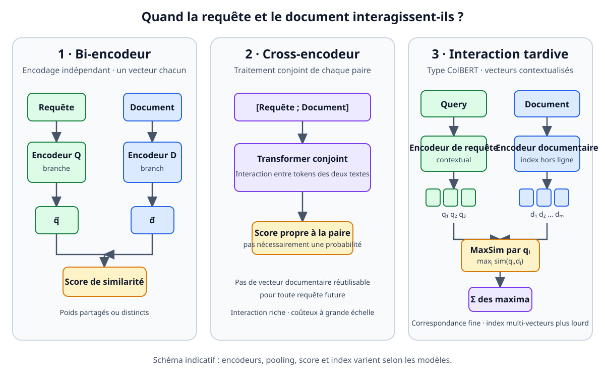

<!--
LLM-LAB-PAGE-MAP v1
id: "fr/cosine-similarity"
scope: "Étudie la similarité cosinus comme alignement angulaire entre vecteurs de représentation non nuls, avec les hypothèses de normalisation, l’anisotropie, le hubness, les effets sur les plus proches voisins et le choix de métrique selon la tâche. Elle distingue proximité géométrique et équivalence sémantique, sans traiter un score élevé comme une preuve de pertinence ou de vérité."
purpose: "Calculer et interpréter une similarité cosinus, expliquer quelle information la normalisation des vecteurs retire, repérer les conditions qui peuvent déformer les classements et concevoir des vérifications adaptées à la tâche plutôt que de supposer que le cosinus mesure directement le sens."
domain: "mathematical-tools-geometry"
suggested_route:
  previous: "fr/tensors"
  next: "fr/linearite-embeddings"
hierarchy:
  parents: ["fr/embedding-space"]
  children: []
related: ["fr/exercises-foundations"]
tags: ["type:deep-dive", "destination:deepen", "topic:cosine-similarity", "level:advanced", "language:fr", "status:published"]
-->

La similarité cosinus s’interprète dans la géométrie de l’[espace des embeddings (plongements)](embedding-space.qmd) ; elle ne suffit pas à établir une proximité sémantique. L’[hypothèse de linéarité des embeddings](linearite-embeddings.qmd) porte sur une autre question : comment les caractéristiques sont-elles représentées et décodables ?

**S'exercer :** [Exercices — Fondations mathématiques](exercises-foundations.qmd), notamment le calcul et l'interprétation du cosinus.

## Que mesure vraiment le cosinus ?

La similarité cosinus compare souvent des plongements (embeddings) de phrases, de documents ou de requêtes. Elle est simple à calculer et ne dépend pas de la norme des vecteurs. Elle mesure toutefois l'angle entre deux représentations produites par un modèle donné, pas directement leur « similarité sémantique ».

Cette distinction compte. La métrique ne peut être interprétée indépendamment de **la tâche, de l'encodeur, de la distribution des données et de l'objectif d'entraînement**.

## 1. Définition et hypothèses

Pour deux vecteurs non nuls $x,y\in\mathbb{R}^d$,

$$
\operatorname{cos}(x,y)=\frac{x^\top y}{\|x\|_2\,\|y\|_2}.
$$

Le score appartient à $[-1,1]$. Une valeur élevée signifie que les vecteurs pointent dans des directions proches. Il ne signifie pas, à lui seul, que les textes sont équivalents, qu'ils impliquent la même réponse ou qu'ils sont interchangeables dans un système de recherche.

La normalisation retire l'information portée par la norme. C'est souhaitable si cette norme est un facteur parasite ; c'est potentiellement dommageable si le modèle a appris à y encoder un signal utile. Steck, Ekanadham et Kallus montrent analytiquement que, pour certaines familles de modèles linéaires régularisés, les similarités cosinus peuvent être arbitraires, non uniques ou dépendantes de la régularisation. Leur résultat invite à éviter l'usage automatique de la métrique, mais ne prouve pas que le cosinus échoue pour tous les encodeurs modernes.

## 2. Pourquoi le cosinus peut être trompeur

### Anisotropie et concentration des scores {#anisotropie-concentration-scores}

Un espace est anisotrope lorsque les vecteurs ne sont pas répartis uniformément dans toutes les directions. Dans ce cas, des paires de phrases peu liées peuvent malgré tout avoir des cosinus élevés. Li et al. (EMNLP 2020) analysent l'anisotropie des embeddings de phrases BERT pré-entraînés et montrent qu'elle nuit à la similarité sémantique dans leurs expériences. Ethayarajh (2019) observe également des représentations contextualisées non isotropes dans BERT, ELMo et GPT-2.

**Conséquence pratique :** regarder uniquement quelques exemples de scores est insuffisant. Examiner la distribution des scores pour des paires positives, négatives et aléatoires, et mesurer si la métrique sépare effectivement les classes pertinentes.

### Le phénomène de *hubness*

Dans les espaces de grande dimension, certains points peuvent devenir les plus proches voisins d'un grand nombre d'autres points. Ces « hubs » peuvent apparaître fréquemment dans les résultats sans être de bons résultats pour chaque requête. Le classement local peut alors être biaisé, même si la formule de distance est calculée correctement.

### Une proximité n'est pas une pertinence

Deux textes peuvent être très proches lexicalement ou thématiquement mais exprimer des faits opposés (« le traitement fonctionne » / « le traitement ne fonctionne pas »). Inversement, deux formulations très différentes peuvent répondre à la même question. La similarité de représentation n'est donc pas automatiquement équivalente à l'équivalence logique, à la pertinence documentaire ou à l'utilité pour un RAG.

### La métrique dépend du modèle et de l'objectif d'entraînement {#metrique-modele-objectif}

Les modèles Sentence Transformers ne partagent pas tous la même fonction de score cible : certains sont entraînés ou recommandés pour le produit scalaire, d'autres pour le cosinus. La documentation Sentence Transformers précise que le produit scalaire de vecteurs normalisés équivaut au cosinus, tandis que le produit scalaire de vecteurs non normalisés conserve l'information de norme. Il faut respecter les hypothèses du modèle choisi plutôt que remplacer la métrique par défaut sans évaluation.


## Encoder une paire de textes : bi-encoder ou cross-encoder ?

La similarité entre deux textes dépend aussi de **la manière dont le modèle les encode**. Deux architectures courantes répondent à des contraintes différentes :

| | Bi-encoder | Cross-encoder |
|---|---|---|
| Encodage | Chaque entrée est encodée indépendamment par sa branche. Les branches peuvent partager leurs poids (architecture siamoise) ou avoir des poids distincts. | Les deux textes sont assemblés et traités conjointement, ce qui permet des interactions entre tokens pendant le calcul du score. |
| Sortie typique | Deux vecteurs réutilisables, comparés ensuite par une métrique adaptée. | Un score propre à la paire, calculé après interaction entre les textes. |
| Atout | Les documents peuvent être encodés et indexés à l'avance ; la recherche sur un grand corpus est efficace. | Le modèle peut prendre en compte les interactions entre les deux textes pendant le calcul du score. |
| Limite | Les deux textes ne peuvent pas interagir directement pendant leur encodage ; la qualité dépend fortement de l'objectif d'entraînement et des données. | Chaque paire candidate doit être recalculée ; comparer une requête à tout un corpus devient coûteux. |


{fig-alt="Trois architectures de recherche : le bi-encoder encode séparément requête et document en un vecteur chacun ; le cross-encoder traite conjointement la requête et chaque document candidat ; l'interaction tardive de type ColBERT encode séparément des vecteurs contextualisés par token, puis compare chaque token de la requête aux tokens du document par MaxSim et somme les maxima." fig-cap="La différence principale tient au moment de l'interaction requête–document : absente pendant l'encodage bi-encoder, présente pendant le calcul du cross-encoder, ou différée après deux encodages contextualisés indépendants." width=100%}

Un bi-encoder se définit par **l'encodage indépendant**, pas par le partage obligatoire des poids. Un bi-encoder *siamois* lie les poids de ses deux branches, comme dans l'architecture originale de Sentence-BERT ; d'autres architectures à double encodeur peuvent utiliser des encodeurs de requête et de document distincts. Voir Reimers et Gurevych (2019), [Sentence-BERT](https://aclanthology.org/D19-1410/).

La sortie d'un cross-encoder est un **score de paire propre à une tâche**. Ce n'est pas automatiquement une probabilité calibrée, une mesure universelle de similarité sémantique ni un score comparable entre modèles différents. Sa valeur pour le classement doit être mesurée sur la tâche cible.

### Un compromis utile : l'interaction tardive

**ColBERT** encode indépendamment la requête et chaque document en *ensembles* de vecteurs contextualisés par token, puis les compare au moment de la recherche. Dans sa formulation MaxSim, chaque vecteur de token de la requête prend sa similarité maximale avec les vecteurs des tokens du document ; ces maxima sont agrégés en un score documentaire. Les documents peuvent être encodés hors ligne, tandis que le rapprochement token par token préserve des interactions plus fines qu'un bi-encoder à vecteur unique. Ce n'est ni un bi-encoder standard à vecteur unique, ni un cross-encoder qui fait passer conjointement chaque paire dans le Transformer.

Le compromis est un index multi-vecteurs plus volumineux, une infrastructure de recherche plus complexe et des contraintes supplémentaires de stockage et de service. [Khattab et Zaharia (2020), ColBERT](https://arxiv.org/abs/2004.12832) et [Santhanam et al. (2022), ColBERTv2](https://aclanthology.org/2022.naacl-main.272/) décrivent l'architecture et ses améliorations de compression. ColBERTv2 réduit le coût mémoire, sans faire disparaître le compromis lié aux représentations multiples.

**D'autres solutions utiles ne sont pas toutes des bi-encodeurs denses :**
- **La recherche lexicale (BM25)** constitue une baseline solide et peu coûteuse lorsque les termes exacts, noms, identifiants ou vocabulaires techniques rares comptent.
- **La recherche sparse apprise (SPLADE)** apprend des représentations creuses pondérées par terme et s'appuie sur une recherche de type index inversé ; elle peut étendre le vocabulaire au-delà de la correspondance littérale tout en conservant une infrastructure sparse efficace et interprétable. Voir [Formal et al. (2021)](https://arxiv.org/abs/2107.05720).
- **La recherche hybride** combine des listes de candidats lexicales et denses (ou sparse neuronales). Elle peut améliorer le rappel, mais la fusion n'aide pas nécessairement chaque requête ou corpus : il faut la mesurer plutôt que la considérer comme une règle.
- **Le reranking** peut suivre n'importe quel générateur de candidats — BM25, recherche dense, sparse, hybride ou structurée. Il ne peut pas récupérer un document pertinent que la première étape n'a jamais proposé.

Le [benchmark BEIR](https://arxiv.org/abs/2104.08663) apporte un contrepoint utile aux conclusions tirées d'un seul jeu de données : il compare des systèmes lexicaux, sparse, denses, à interaction tardive et de reranking sur des domaines hétérogènes, et met en évidence des compromis réels entre efficacité et coût. Aucune architecture n'est universellement meilleure.

Un pipeline fréquent combine les deux : un **bi-encoder** récupère rapidement un ensemble de candidats, puis un **cross-encoder** réordonne (*rerank*) ce sous-ensemble en évaluant chaque paire requête–passage. Le cross-encoder n'est donc pas nécessairement un remplacement de la recherche vectorielle : il peut être une seconde étape plus précise, appliquée à une liste courte.

Cette distinction explique aussi pourquoi un état contextualisé produit par un BERT pré-entraîné n'est pas automatiquement un bon embedding de phrase : le *pooling*, l'objectif d'entraînement, les exemples de paires et la tâche visée comptent. Il faut choisir un encodeur de phrases ou de recherche évalué pour l'usage prévu, puis mesurer la qualité du classement sur des requêtes représentatives. Une similarité élevée n'est ni une preuve d'équivalence logique ni une garantie de pertinence.

**AugSBERT** illustre un compromis supplémentaire : utiliser un cross-encoder pour produire des scores ou des étiquettes de paires, puis entraîner un bi-encoder plus rapide à reproduire ces jugements. La description détaillée et l'implémentation de l'article sont partiellement inaccessibles ; voir la [partie 2](https://www.dailydoseofds.com/augsbert-bi-encoders-cross-encoders-for-sentence-pair-similarity-scoring-part-2/), à lire comme une piste d'approfondissement et non comme une validation indépendante des performances.

Pour voir comment ces architectures s'insèrent dans la recherche textuelle et visuelle, consulter [RAG, mémoire et récupération documentaire](rag-memory-boundaries.qmd), notamment l'exemple ColPali. Le [guide illustré Daily Dose sur les bi-encodeurs, cross-encodeurs et ColBERT](https://blog.dailydoseofds.com/p/visual-guide-to-bi-encoders-cross) propose une vue d'ensemble concise.

## 3. Quand le cosinus est un bon choix

Le cosinus est une baseline raisonnable lorsque :

- l'encodeur est conçu et évalué pour la similarité sémantique ;
- la normalisation est cohérente avec son entraînement et son usage recommandé ;
- l'objectif est de comparer des directions plutôt que les amplitudes des représentations ;
- le système est validé sur des requêtes et documents représentatifs de l'usage réel ;
- le classement des voisins, pas seulement la valeur absolue du score, est évalué.

Il devient moins fiable comme indicateur autonome lorsque l'encodeur n'a pas été adapté à la tâche, que les scores sont concentrés dans une plage étroite, que les données sont hors distribution, ou que la tâche exige une distinction logique fine.

## 4. Expérience reproductible à ajouter au dépôt

L'expérience doit isoler la métrique du reste du système.

1. Choisir un jeu d'évaluation documenté (par exemple STS Benchmark pour la similarité de phrases, et un jeu de recherche pertinent pour un scénario de retrieval).
2. Comparer plusieurs encodeurs : un modèle de phrases entraîné pour la similarité, un modèle d'embeddings de recherche et, si possible, des embeddings BERT bruts comme témoin.
3. Comparer cosinus, produit scalaire, distance euclidienne et classement par rang. Documenter si les vecteurs sont normalisés.
4. Rapporter les métriques adaptées à la tâche : Spearman/Pearson pour un score de similarité annoté, Recall@k / MRR / nDCG pour la recherche.
5. Inspecter les faux positifs, les hubs et la distribution des scores ; fournir des intervalles d'incertitude lorsque le protocole le permet.

Ne pas comparer des métriques sur des modèles entraînés avec des objectifs différents puis attribuer tout écart à la seule formule. Si l'on compare cosinus et produit scalaire, inclure explicitement le cas des vecteurs normalisés, où les deux sont équivalents en classement.

```python
import numpy as np

def cosine_similarity(x: np.ndarray, y: np.ndarray) -> float:
    """Cosine similarity for two non-zero vectors."""
    x_norm = np.linalg.norm(x)
    y_norm = np.linalg.norm(y)
    if x_norm == 0 or y_norm == 0:
        raise ValueError("Cosine similarity is undefined for zero vectors.")
    return float(np.dot(x, y) / (x_norm * y_norm))
```

Ce fragment suppose des tableaux finis, unidimensionnels et de même forme ; il explicite la définition et le cas limite des vecteurs nuls, mais ne valide pas ces préconditions. Il ne constitue ni un benchmark ni une implémentation numérique durcie pour la production. Les normes et produits scalaires directs peuvent déborder pour des valeurs finies extrêmement grandes ou sous-déborder pour des valeurs extrêmement petites ; un code de production doit s'appuyer sur une implémentation testée dont le comportement numérique est documenté.


## Vérifications qui discriminent les interprétations

- **Idée reçue :** « Un cosinus élevé prouve que deux textes ont le même sens. » Contre-exemple : « le traitement fonctionne » et « le traitement ne fonctionne pas » peuvent rester proches dans un espace dominé par le vocabulaire partagé.
- **Idée reçue :** « Le produit scalaire est toujours une alternative différente. » Si les deux vecteurs sont normalisés, produit scalaire et cosinus donnent le même score ; sinon, la norme peut changer le classement.
- **Limite à préserver :** l'anisotropie ou la *hubness* sont des diagnostics possibles, pas des explications automatiques de toute erreur de retrieval. Il faut les mesurer sur les représentations et la tâche concernées.

Pour auditer une conclusion, demander : quelle hypothèse sur l'encodeur et la normalisation est nécessaire ? Quel contre-exemple réfuterait l'interprétation sémantique ? Quelle métrique de tâche cible permettrait de départager les choix ?

## À retenir

Pour comprendre ce que ces vecteurs représentent et comment ils sont construits, voir aussi l'[espace des embeddings](embedding-space.qmd).

Le cosinus est une **métrique géométrique**, pas une définition universelle de la sémantique. Il constitue une hypothèse à confronter à une baseline et à des erreurs concrètes sur la tâche cible ; aucune propriété géométrique isolée ne garantit la pertinence du système.


::: {.language-switch}
**Langue :** [Français](cosine-similarity.qmd) · [English](../en/cosine-similarity.qmd)
:::

<details class="learning-resources">
<summary>
  <span class="learning-resources__title">Ressources complémentaires</span>
  <span class="learning-resources__description">Lectures scientifiques et illustrations pour approfondir l'interprétation du cosinus.</span>
</summary>
<div class="learning-resources__content" markdown="1">

#### Articles scientifiques

- **Steck, Ekanadham & Kallus (2024).** [Is Cosine-Similarity of Embeddings Really About Similarity? — arXiv:2403.05440](https://arxiv.org/abs/2403.05440), également publié dans les actes *WWW 2024 Companion* ([DOI](https://doi.org/10.1145/3589335.3651526)). Analyse théorique de l'effet de la régularisation sur les similarités calculées à partir d'embeddings.
- **Li et al. (2020).** [On the Sentence Embeddings from Pre-trained Language Models — EMNLP 2020](https://aclanthology.org/2020.emnlp-main.733/). Étudie l'anisotropie des embeddings de phrases BERT et propose BERT-flow.
- **Ethayarajh (2019).** [How Contextual are Contextualized Word Representations? — arXiv:1909.00512](https://arxiv.org/abs/1909.00512). Compare la géométrie des représentations de BERT, ELMo et GPT-2.
- **Nastase & Merlo (2025).** [Testing the assumptions about the geometry of sentence embedding spaces: the cosine measure need not apply — arXiv:2509.01606](https://arxiv.org/abs/2509.01606). Examine si la géométrie des embeddings de phrases prédit les performances sur diverses tâches linguistiques ; à lire en distinguant ses résultats empiriques de toute généralisation universelle.

#### Compléments scientifiques et illustrations

- **Zhelezniak et al. (2019).** [Correlation Coefficients and Semantic Textual Similarity — arXiv:1905.07790](https://arxiv.org/abs/1905.07790). Montre que cosinus et corrélation de Pearson sont liés pour certaines représentations, et évalue des cas où les corrélations de rang sont plus adaptées. Utile pour rappeler que la métrique doit être validée sur la tâche et le type de vecteurs.
- **Nielsen & Hansen (2024).** [Hubness Reduction Improves Sentence-BERT Semantic Spaces — PMLR](https://proceedings.mlr.press/v233/nielsen24a.html) ([arXiv](https://arxiv.org/abs/2311.18364)). Étudie le phénomène de *hubness* et des méthodes pour le réduire dans des espaces Sentence-BERT.
- **Illustration interactive.** [A Fifth of Your Corpus Is Unreachable. It Isn’t the Dimensions](https://sugeerth.github.io/blog/hubness/). Simulation reproductible dans le navigateur montrant comment la *hubness* des plus proches voisins peut émerger de la géométrie seule. Le corpus gaussien synthétique est un modèle pédagogique, pas une estimation des performances d’un système de recherche réel.

#### Documentation et explications techniques

- **Sentence Transformers.** [Semantic Textual Similarity](https://sbert.net/docs/sentence_transformer/usage/semantic_textual_similarity.html) et [fonctions de similarité disponibles](https://sbert.net/docs/package_reference/util/similarity.html). Référence pratique pour comprendre les métriques exposées par la bibliothèque et la différence entre cosinus, produit scalaire et distances.
- **Sentence Transformers.** [Modèles pré-entraînés](https://sbert.net/docs/sentence_transformer/pretrained_models.html). Exemples de modèles de recherche conçus pour le produit scalaire : le choix de métrique peut faire partie du contrat d'utilisation du modèle.

La documentation d'une bibliothèque décrit un comportement d'implémentation ; elle ne remplace pas une évaluation scientifique. Les articles cités portent sur des modèles, des objectifs et des protocoles différents : leurs résultats ne doivent pas être fusionnés en une conclusion unique sans tenir compte de ces différences.

</div>
</details>
