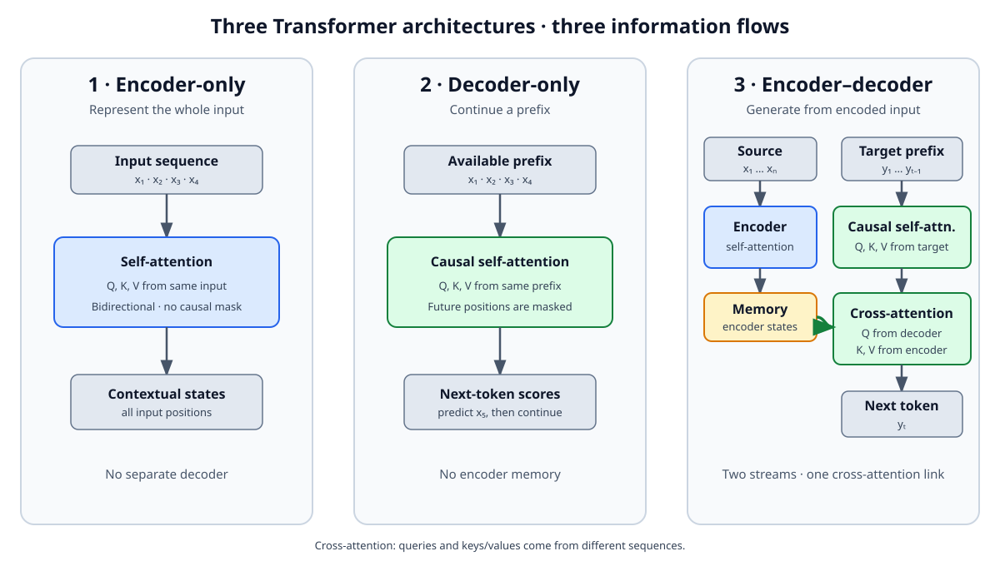

<!--
LLM-LAB-PAGE-MAP v1
id: "fr/cross-attention"
scope: "Explique l'attention croisée dans les Transformers encodeur-décodeur, la provenance de Q, K et V, les dimensions, le flux d'information et les masques éventuels."
purpose: "Le lecteur doit pouvoir expliquer pourquoi Q provient du décodeur alors que K et V proviennent de l'encodeur, écrire l'équation de l'attention croisée et la distinguer de l'auto-attention."
suggested_route:
  previous: "fr/transformer-architectures"
  next: "fr/scaled-dot-product-attention"
hierarchy:
  parents: ["fr/transformer-architectures"]
  children: []
related: ["fr/queries-keys-values", "fr/scaled-dot-product-attention", "fr/causal-masking"]
tags: ["type:concept-lesson", "destination:understand", "topic:cross-attention", "level:core", "language:fr", "status:published"]
-->

::: {.chapter-lead}
L'attention croisée (*cross-attention*) permet à une séquence de consulter les représentations d'une autre. Dans un Transformer encodeur-décodeur, le décodeur produit les requêtes **Q**, tandis que les clés **K** et les valeurs **V** proviennent de la sortie de l'encodeur. C'est cette séparation des sources qui la distingue de l'auto-attention.
:::

::: {.callout-note .learning-outcomes collapse="true" title="Objectifs d’apprentissage"}
Vous pourrez :
- identifier la provenance de Q, K et V dans l'attention croisée ;
- expliquer comment chaque position cible sélectionne et agrège l'information de l'entrée ;
- distinguer attention croisée, auto-attention bidirectionnelle et auto-attention causale ;
- interpréter les dimensions des matrices et les masques éventuels.
:::

## L'idée en un schéma

{fig-alt="Trois flux : encodeur seul avec auto-attention bidirectionnelle ; décodeur seul avec auto-attention causale ; encodeur-décodeur avec encodeur, mémoire, auto-attention causale du décodeur et lien d'attention croisée." width=100%}

Dans l'architecture encodeur-décodeur, deux flux coexistent :

1. **L'encodeur** lit toute la séquence source et construit des représentations contextualisées.
2. **Le décodeur** construit la séquence cible progressivement. À chaque couche concernée, il peut consulter les représentations de l'encodeur grâce à l'attention croisée.

L'encodeur ne transmet donc pas directement des tokens au décodeur : il fournit une mémoire de vecteurs contextualisés.

## Auto-attention ou attention croisée ?

La différence essentielle ne tient pas à la formule de calcul, mais à **l'origine des trois matrices**.

| Mécanisme | Requêtes Q | Clés K | Valeurs V |
|---|---|---|---|
| Auto-attention (*self-attention*) | Séquence A | Séquence A | Séquence A |
| Attention croisée (*cross-attention*) | Séquence cible / décodeur | Séquence source / encodeur | Séquence source / encodeur |

En auto-attention, une séquence interagit avec elle-même. En attention croisée, les positions d'une séquence interrogent les positions d'une autre.

::: {.callout-tip title="L'idée à retenir"}
**Q vient de la séquence qui consulte ; K et V viennent de la séquence consultée.**

Dans un décodeur qui consulte l'encodeur :
- Q représente ce que les positions du décodeur cherchent dans la mémoire source ;
- K permet de comparer ces requêtes aux positions de cette mémoire ;
- V contient l'information source qui sera agrégée.

Les termes « chercher » et « consulter » sont des analogies fonctionnelles : Q, K et V sont des projections apprises, pas des questions ou des étiquettes symboliques.
:::

## D'où viennent Q, K et V ?

Notons :
- (X\in\mathbb{R}^{S\times d_e}), les représentations produites par l'encodeur pour les (S) positions source ;
- (Y\in\mathbb{R}^{T\times d_d}), les représentations du décodeur pour les (T) positions cible disponibles.

Les projections apprises sont distinctes :

\[
Q=YW_Q,\qquad K=XW_K,\qquad V=XW_V.
\]

Avec (W_Q\in\mathbb{R}^{d_d\times d_k}), (W_K\in\mathbb{R}^{d_e\times d_k}) et (W_V\in\mathbb{R}^{d_e\times d_v}), on obtient :

- (Q\in\mathbb{R}^{T\times d_k}) ;
- (K\in\mathbb{R}^{S\times d_k}) ;
- (V\in\mathbb{R}^{S\times d_v}).

Les longueurs (T) et (S) peuvent être différentes. C'est attendu : le décodeur interroge une mémoire source dont le nombre de positions n'a aucune raison d'être égal au nombre de tokens déjà produits dans la cible.

L'attention croisée à produit scalaire mise à l'échelle s'écrit :

\[
\operatorname{CrossAttention}(Y,X)
=\operatorname{softmax}\left(\frac{QK^\top}{\sqrt{d_k}}+M\right)V.
\]

La matrice des scores (QK^\top) a la forme (T\times S) : chaque ligne correspond à une position cible, chaque colonne à une position source. Une ligne fournit donc la distribution de poids avec laquelle une position du décodeur agrège les valeurs de l'encodeur.

## Exemple concret : traduire une phrase

Supposons que l'encodeur reçoive « The cat is sleeping » et que le décodeur ait déjà produit « Le chat ».

- La position cible qui doit produire le token suivant construit une requête Q à partir de son état courant.
- Cette requête est comparée aux clés K associées aux positions source (« The », « cat », « is », « sleeping »).
- Les scores normalisés donnent des poids sur les positions source.
- Ces poids combinent les valeurs V pour fournir au décodeur un résumé pertinent de l'entrée.

Le modèle n'est pas obligé d'aligner un token cible sur un unique token source. La distribution peut être diffuse, et les têtes d'attention peuvent apprendre des relations différentes. Cet exemple décrit le flux de calcul, pas une garantie d'alignement linguistique explicite.

## Quels masques s'appliquent ?

Il faut distinguer deux contraintes :

- **Auto-attention du décodeur :** masque causal sur la séquence cible. Une position ne peut pas consulter les tokens cibles futurs.
- **Attention croisée :** dans le Transformer encodeur-décodeur classique, chaque position cible peut généralement consulter toutes les positions source valides. Un masque de padding peut toutefois exclure les positions source qui ne correspondent pas à de vrais tokens.

L'attention croisée n'a donc pas besoin d'un masque causal sur la source : l'entrée source est déjà disponible au moment où le décodeur génère la sortie. Des variantes d'architecture peuvent imposer d'autres contraintes, mais elles ne définissent pas le mécanisme classique.

## Où se trouve-t-elle dans le bloc décodeur ?

Dans le Transformer original, une couche du décodeur combine notamment :
1. une auto-attention masquée sur les tokens cibles ;
2. une sous-couche d'attention croisée vers les sorties de l'encodeur ;
3. un réseau feed-forward.

Les connexions résiduelles et les normalisations entourent ces sous-couches selon la variante du bloc. Les implémentations modernes peuvent modifier l'ordre ou la disposition, mais la provenance des Q, K et V reste le critère conceptuel central.

::: {.callout-note collapse="true" title="Attention croisée hors des Transformers texte-à-texte"}
Le mécanisme n'est pas réservé à la traduction. Il apparaît notamment dans des modèles multimodaux, où des requêtes issues d'un flux (par exemple le texte) consultent les représentations d'un autre flux (par exemple l'image ou l'audio). Le principe Q depuis le flux qui consulte, K/V depuis le flux consulté, reste le même ; l'architecture complète et les masques peuvent différer.
:::

## Idées reçues et limites

- **« Q, K et V viennent toujours du même tenseur. »** C'est vrai pour l'auto-attention standard, pas pour l'attention croisée.
- **« L'attention croisée aligne nécessairement un token cible avec un token source. »** Non : chaque tête peut agréger plusieurs positions, sans alignement un-à-un.
- **« La source est causale parce que la cible est générée token par token. »** Non : le masque causal concerne l'auto-attention du décodeur. La source complète est généralement accessible.
- **« L'attention croisée est une simple concaténation des deux séquences. »** Non : elle calcule des scores entre requêtes et clés, puis agrège les valeurs.

## Liens avec les autres concepts

- [Architectures Transformer](transformer-architectures.qmd) compare les trois grandes organisations de l'information.
- [Requêtes, clés et valeurs](queries-keys-values.qmd) introduit les projections et leurs rôles.
- [Attention à produit scalaire mise à l'échelle](scaled-dot-product-attention.qmd) détaille scores, softmax et agrégation.
- [Masque causal](causal-masking.qmd) explique la contrainte temporelle dans l'auto-attention du décodeur.
- [Historique des Transformers](transformer-history.qmd) replace l'encodeur-décodeur dans le papier fondateur.

::: {.self-check}
## Vérifier sa compréhension

**Dans l'attention croisée du décodeur, d'où viennent Q, K et V ?**

Afficher le raisonnement

Q est projeté depuis les états du décodeur, car ce sont les positions qui consultent. K et V sont projetés depuis les sorties de l'encodeur, qui constituent la mémoire consultée. La matrice des scores a donc une ligne par position cible et une colonne par position source.

:::

::: {.language-switch}
**Langue :** [Français](cross-attention.qmd) · [English](../en/cross-attention.qmd)
:::
