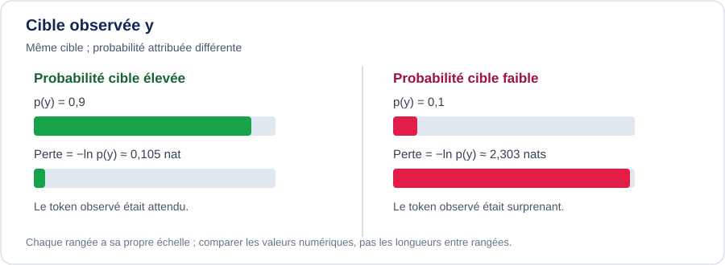

<!--
LLM-LAB-PAGE-MAP v1
id: "fr/cross-entropy"
summary: "Relie une distribution cible à la distribution prédite par le modèle. Dans le cas d’une cible one-hot, l’entropie croisée devient la pénalité associée au token observé et prépare la définition de la loss."
scope: "Définit la pénalité locale d’une prédiction face à une distribution cible. Le cas one-hot relie cette pénalité à la NLL d’un token."
purpose: "Calculer H(q,p) à une position et retrouver −log p(y) quand la cible est concentrée sur y."
suggested_route:
  previous: "fr/vraisemblance"
  next: "fr/loss"
hierarchy:
  parents: ["fr/entropy"]
  children: []
related: ["fr/vraisemblance", "fr/loss", "fr/language-modeling-math", "fr/cross-entropy-exercises"]
revision_support:
  status: integrated_sufficient
  evidence:
    - anchor: revision-summary
      note: "Le rappel présente le cas one-hot, l'alignement logits[t] avec cible[t+1], la séparation masque causal/masque de loss et le dénominateur des seules positions valides."
tags: ["type:concept-lesson", "destination:understand", "topic:cross-entropy", "level:core", "language:fr", "status:published"]
-->



::: {.chapter-lead}
Pour un même contexte, le modèle propose une distribution $p$ et l’on dispose d’une cible $q$. Quelle pénalité attribuer à cette prédiction, à une seule position ? Quand $q$ désigne le token observé, la réponse est sa [log-vraisemblance négative](vraisemblance.qmd). La [perte du lot](loss.qmd) utilise ensuite ces pénalités locales.
:::

::: {.callout-tip title="L'idée à retenir en une minute" #revision-summary}
- **Une cible :** pour une cible one-hot $y$, $\ell=-\log p_\theta(y\mid x_{<t})$ ; une faible probabilité attribuée au token observé coûte cher.
- **Une distribution cible :** plus généralement, $H(q,p)=-\sum_i q_i\log p_i$. L'entropie croisée n'est pas l'entropie prédictive $H(p)$.

**Question rapide.** Comment retrouver la NLL d’un token à partir de H(q,p) ?
:::

<div class="pipeline-stepper" role="group" aria-label="Étapes du calcul de l’entropie croisée">
  <a class="step-item" href="vraisemblance.qmd">Cible observée</a>
  <span class="step-arrow" aria-hidden="true">+</span>
  <a class="step-item" href="probabilites.qmd">Distribution prédite</a>
  <span class="step-arrow" aria-hidden="true">→</span>
  <span class="step-item active">Pénalité à une position</span>
</div>


Pour relier cette formule à l’entraînement, voir aussi la construction des [exemples entrée-cible](training-examples.qmd) et les règles de masquage de la perte. À ne pas confondre avec l'[entropie de la distribution prédite](entropy.qmd) : l'entropie décrit la dispersion des probabilités avant de connaître le token suivant ; la perte de cross-entropie évalue la probabilité donnée à la cible observée (ou à une distribution cible).

Dans cet exemple, le token cible est le prochain token effectivement présent dans la continuation de référence. La cross-entropie pénalise le modèle lorsque la probabilité attribuée à ce token est faible ; elle ne compare pas directement des phrases entières comme des objets indivisibles.

## Objectif pour un token {#objectif-pour-un-token} {#objectif-pour-un-token}

Ici, $t$ indexe le **token cible** : les logits sont alignés sur $x_t$ et représentent $p_\theta(x_t\mid x_{<t})$. Certaines implémentations indexent plutôt les logits par la position d'entrée ; la ligne correspondant à l'entrée $t$ prédit alors $x_{t+1}$. Ces conventions ne sont équivalentes que si les logits et les labels sont décalés de manière cohérente. Pour une cible one-hot, la perte vaut :

$$
\ell_t=-\log p_\theta(x_t\mid x_{<t}).
$$

Si $y$ est l'indice du token cible et $p=\operatorname{softmax}(z)$, on peut écrire :

$$
\ell(z,y)=-z_y+\log\sum_{j=1}^{V}e^{z_j}.
$$

Le coût augmente lorsque le modèle attribue une faible probabilité au token observé. Une prédiction incorrecte mais très confiante est donc fortement pénalisée.

### Calcul repris du fil rouge

Au premier tour de la génération, la distribution illustrative est $p=(0{,}6;\,0{,}2;\,0{,}1;\,0{,}1)$ pour (« Vous », « Je », « Moi », « Oui »). La cible observée dans la continuation illustrative est « Vous », représentée par la distribution one-hot $q=(1;0;0;0)$. L'entropie croisée se réduit alors à :

$$
H(q,p)=-\sum_i q_i\log p_i=-\log(0{,}6)\approx0{,}511\text{ nat}.
$$

Les trois autres probabilités ne disparaissent pas de la distribution : elles contribuent indirectement à la normalisation de la softmax et donc au gradient par rapport aux logits. Cette valeur est la perte d'une position, pas encore la loss moyenne d'une séquence ou d'un batch.

### Quand le token choisi et la cible diffèrent {#chosen-token-vs-target}

Reprenez le même préfixe et les mêmes probabilités. Le décodage glouton choisit « Vous » ($0{,}6$). Imaginez maintenant une **autre continuation observée** qui commence par « Je » ($0{,}2$).

- **Avant de connaître la cible**, l’[entropie prédictive](entropy.qmd) vaut toujours $1{,}089$ nat. La distribution de ce premier tour est identique.
- **Pour scorer « Je »**, la perte à cette position vaut $-\ln(0{,}2)\approx 1{,}609$ nat. Elle se calcule à partir de la cible observée.
- **Pour entraîner le modèle**, cette perte peut contribuer à l’[objectif du lot](loss.qmd). La rétropropagation calcule les gradients et l’[optimiseur](training-loop.qmd) applique la mise à jour.

Après le premier token, la génération poursuit avec « Vous » dans son préfixe. Le scoring poursuit avec « Je » dans le sien. [Comparer les deux préfixes sur une trace de deux tokens](exercises/vraisemblance.qmd#ex-generation-versus-scoring).

## Intuition visuelle : la perte mesure la surprise du token observé {#intuition-visuelle} {#intuition-visuelle}

<figure id="fig-cross-entropy-target-probability">
  <picture>
    <source media="(max-width: 600px)" srcset="../images/cross-entropy-target-probability-fr-mobile.svg">
    
  </picture>
  <figcaption>La probabilité et la perte ont chacune leur propre échelle commune aux deux cas. La perte augmente fortement lorsque la probabilité attribuée à la cible diminue.</figcaption>
</figure>

Les deux cas concernent **le même token cible** : seul le poids de probabilité que le modèle lui attribue change. Quand $p(y)=0{,}9$, la perte vaut environ $0{,}105$ nat ; quand $p(y)=0{,}1$, elle vaut environ $2{,}303$ nats. La seconde perte est près de 22 fois plus grande. La fonction $-\log p(y)$ rend donc les erreurs confiantes coûteuses, sans pour autant dire si le token observé est vrai ou utile dans un sens plus large.

Cette image illustre la perte d'un token avec une cible one-hot ; elle ne représente ni la distribution complète du vocabulaire, ni la moyenne sur les positions valides, ni l'ensemble de l'objectif d'entraînement.

## Lien avec le gradient

La dérivée de la cross-entropie one-hot par rapport aux logits est $p_i-\mathbb{1}[i=y]$. Son interprétation et son rôle dans la rétropropagation sont développés dans la page [Gradients](gradients.qmd).

## Plusieurs positions : décalage causal et masques {#plusieurs-positions} {#plusieurs-positions}

Dans un modèle autorégressif, la représentation à la position $t$ sert à prédire le token suivant. Selon la convention du code, les logits et les labels doivent donc être décalés de manière cohérente : le modèle ne doit pas recevoir le token cible comme contexte non masqué pour prédire ce même token.

Pour un batch, les logits ont souvent la forme $(B,T,V)$ et les labels $(B,T)$. Avant d'interpréter la loss, vérifier :

- **Décalage des cibles :** chaque logit est comparé au token qui doit être prédit, pas au token d'entrée par erreur.
- **Padding et masques :** les positions ignorées ne doivent pas contribuer à la somme ni au dénominateur de la moyenne.
- **Réduction :** une somme, une moyenne par token valide et une moyenne par séquence n'ont pas la même échelle.
- **Pondération :** poids de classes, label smoothing ou pertes auxiliaires modifient l'objectif par rapport au cas one-hot non pondéré.
- **Comparaison :** préciser le tokenizer, les positions incluses et la convention de moyenne avant de comparer deux valeurs.

## Perplexité {#lien-avec-la-perplexité}

Pour une cible one-hot, la cross-entropie moyenne calculée sur les mêmes positions valides et avec la même convention de réduction coïncide avec la NLL moyenne. La définition de la perplexité, son interprétation et les conditions nécessaires pour comparer des scores sont regroupées dans la page [Vraisemblance](vraisemblance.qmd).

## Idées reçues {#idees-recues} {#idees-recues}

- **« La cross-entropie est comprise entre 0 et 1. »** Faux : elle peut être arbitrairement grande si le modèle attribue une probabilité proche de zéro à la cible.

- **« Une loss d'entraînement qui baisse prouve que le modèle s'améliore. »** Non : il faut examiner la validation, les fuites, les baselines et la généralisation.

- **« Une perplexité plus faible prouve une capacité générale supérieure. »** Non : elle mesure la prédiction moyenne sur un corpus donné, pas la réussite directe à toutes les tâches. Elle ne capture pas nécessairement les gains du post-entraînement ou du raisonnement, et son plancher informationnel reste inconnu. Les comparaisons entre laboratoires sont délicates si les corpus d'évaluation et les mélanges d'entraînement diffèrent. Voir [OpenAI — *Perplexity and Intelligence*](https://openai.com/index/perplexity-and-intelligence/) et [Raschka — *Pre-training is (still) not plateauing*](https://sebastianraschka.com/blog/2026/pretraining-is-still-not-plateauing.html).




## Cibles souples et divergence KL {#cibles-souples-kl} {#cibles-souples-kl}

Le cas one-hot suffit pour calculer la pénalité d'un token observé. Pour une cible qui répartit sa masse sur plusieurs tokens, la relation $H(q,p)=H(q)+D_{\mathrm{KL}}(q\Vert p)$, ses hypothèses et ses cas limites sont développés dans l'approfondissement [Formaliser mathématiquement la modélisation du langage](language-modeling-math.qmd). Cette dérivation n'est pas nécessaire pour calculer la NLL d'un token observé.

## Implémentations — NumPy, PyTorch et stabilité numérique

::::: {.callout-note collapse="true" title="Afficher les exemples de code" data-reading-time="exclude"}

::: {.callout-note collapse="true" title="Implémentation NumPy et tests (approfondissement)"}
L'[implémentation de référence NumPy](https://github.com/JM-Brun/llm-lab/blob/main/src/llm_lab/foundations/losses.py) et ses [tests unitaires](https://github.com/JM-Brun/llm-lab/blob/main/tests/unit/test_losses.py) couvrent volontairement un cas restreint : des logits de forme $(B,C)$, une cible entière par ligne et la **moyenne non pondérée sur les lignes**. La perte utilise le logarithme naturel et s'exprime donc en nats. La fonction de gradient renvoie la dérivée de cette même perte moyenne par rapport aux logits, et non par rapport aux paramètres d'un modèle.

Cette référence ne met **pas** en œuvre le décalage des entrées/cibles d'une séquence, les masques de tokens ou `ignore_index`, les cibles souples, les poids de classes, ni la perplexité. Pour la modélisation du langage au niveau token, l'appelant doit aligner les logits et les cibles et sélectionner les positions cibles valides avant d'utiliser cette fonction ligne par ligne. Cette implémentation ne doit pas être confondue avec une loss complète d'entraînement d'un LLM.

Les tests vérifient une valeur connue, l'accord avec des différences finies centrées, la stabilité pour de grands logits, l'invariance à l'ajout d'une constante par ligne, la somme nulle des gradients par ligne, l'absence de mutation des entrées et le rejet des entrées invalides. Ils étayent le périmètre annoncé de cette référence ; ils ne valident ni le masquage ni l'alignement des séquences, qui ne sont pas implémentés ici.
:::

::: {.callout-note collapse="true" title="Exemple PyTorch : logits, cibles et positions ignorées"}
L'exemple autonome suivant utilise la forme de sortie courante d'un modèle de langage, `(B,T,V)`, puis aplatit les deux premières dimensions car `CrossEntropyLoss` attend les classes dans la deuxième dimension. Les cibles sont supposées **déjà alignées** sur les logits : ce code ne construit pas le décalage autorégressif des entrées et cibles.

```python
import torch
import torch.nn.functional as F

# B=1 séquence, T=3 positions, V=3 tokens du vocabulaire.
logits = torch.tensor(
    [[[2.0, 0.0, -1.0], [0.0, 1.0, 0.0], [1.0, 0.0, 2.0]]],
    dtype=torch.float64,
)
targets = torch.tensor([[0, 2, -100]], dtype=torch.long)
# Vérifier le contrat au niveau de la séquence avant d'inspecter les dimensions.
assert logits.ndim == 3
batch_size, seq_len, vocab_size = logits.shape
assert targets.shape == (batch_size, seq_len)
assert targets.dtype == torch.long
valid = targets.ne(-100)
in_range = targets.ge(0) & targets.lt(vocab_size)
assert torch.all(in_range | targets.eq(-100))
assert valid.any()

flat_logits = logits.reshape(-1, vocab_size)
flat_targets = targets.reshape(-1)

per_token_loss = torch.nn.CrossEntropyLoss(
    ignore_index=-100, reduction="none"
)(flat_logits, flat_targets).reshape(batch_size, seq_len)
mean_loss = torch.nn.CrossEntropyLoss(
    ignore_index=-100, reduction="mean"
)(flat_logits, flat_targets)

manual_loss = -F.log_softmax(logits[valid], dim=-1).gather(
    1, targets[valid].unsqueeze(1)
).mean()

# La réduction du framework correspond à la moyenne sur les positions cibles valides.
torch.testing.assert_close(per_token_loss[valid].mean(), mean_loss)
torch.testing.assert_close(mean_loss, manual_loss)

# Passer des probabilités comme s'il s'agissait de logits modifie l'objectif.
softmax_first_loss = torch.nn.CrossEntropyLoss(ignore_index=-100)(
    logits.softmax(dim=-1).reshape(-1, vocab_size), flat_targets
)
assert not torch.isclose(mean_loss, softmax_first_loss)

print("per-token:", per_token_loss.tolist())
print("mean:", mean_loss.item())  # 0.860645...
print("softmax-first:", softmax_first_loss.item())  # 0.946560...
```

La dernière position est ignorée par `ignore_index` ; elle ne contribue ni à la somme ni au dénominateur de la moyenne. `reduction="none"` permet d'inspecter les pertes locales, tandis que `reduction="mean"` moyenne les cibles valides (sans poids de classes dans cet exemple). La softmax préalable est incorrecte pour l'usage attendu de cette API : elle transforme les logits en nouvelles entrées de scores et change la loss. Cet exemple illustre l'API et l'agrégation ; il ne remplace ni le masque causal, ni l'alignement des cibles, ni une boucle d'entraînement.

PyTorch accepte aussi des cibles sous forme de distributions de probabilité (par exemple pour le *label smoothing*), mais `ignore_index` ne s'applique qu'aux cibles sous forme d'indices. Cet exemple utilise volontairement des indices entiers.
:::

### Erreur fréquente de dimension : normaliser sur le temps plutôt que sur le vocabulaire

Pour des logits de forme `(B,T,V)`, chaque position temporelle doit définir une distribution de probabilité sur le **vocabulaire**. La softmax doit donc utiliser `dim=-1` (l'axe du vocabulaire). Une normalisation sur `dim=1` répartit au contraire les probabilités dans le temps pour chaque entrée du vocabulaire ; elle ne produit pas une distribution catégorielle sur les tokens à chaque position.

```python
import torch

logits = torch.tensor(
    [[[2.0, 0.0, -1.0], [0.0, 1.0, 0.0], [1.0, 0.0, 2.0]]],
    dtype=torch.float64,
)
batch_size, seq_len, vocab_size = logits.shape

correct_probs = logits.softmax(dim=-1)
wrong_axis_probs = logits.softmax(dim=1)

# Les probabilités sur le vocabulaire somment à un pour chaque position.
torch.testing.assert_close(
    correct_probs.sum(dim=-1),
    torch.ones((batch_size, seq_len), dtype=logits.dtype),
)
# Avec le mauvais axe, les sommes sur le vocabulaire ne valent pas un.
wrong_sums = wrong_axis_probs.sum(dim=-1)
assert not torch.allclose(
    wrong_sums,
    torch.ones_like(wrong_sums),
)
```

C'est pourquoi l'exemple aplatit d'abord `(B,T,V)` en `(B×T,V)` : la dimension des classes/du vocabulaire devient alors sans ambiguïté la dimension 1 attendue par `CrossEntropyLoss`.

### Cas numérique extrême : log-softmax stable

Une opération `softmax` directe peut faire sous-déborder à zéro la probabilité d'une cible très improbable. Son logarithme vaut alors l'infini, même si la cross-entropie mathématique est finie. La cross-entropie fusionnée et numériquement stable calcule l'expression équivalente via log-softmax sans matérialiser d'abord cette probabilité nulle.

```python
import torch
import torch.nn.functional as F

extreme_logits = torch.tensor(
    [[1000.0, 0.0, -1000.0]], dtype=torch.float64
)
extreme_target = torch.tensor([2], dtype=torch.long)

stable_loss = F.cross_entropy(extreme_logits, extreme_target)
naive_probability = extreme_logits.softmax(dim=-1)[0, 2]
naive_loss = -torch.log(naive_probability)

torch.testing.assert_close(
    stable_loss, torch.tensor(2000.0, dtype=torch.float64)
)
assert torch.isfinite(stable_loss)
assert naive_probability == 0.0
assert torch.isinf(naive_loss)
```

Le résultat infini est un échec du calcul naïf en virgule flottante, pas une perte mathématique infinie : pour ces logits, la perte exacte vaut 2000 nats. En pratique, passer directement les logits à `CrossEntropyLoss` ou utiliser `log_softmax` suivi de l'extraction de la cible ; ne pas calculer soi-même `log(softmax(logits))`.

::: {.callout-note collapse="true" title="Détail d'API (approfondissement)"}
- **« PyTorch CrossEntropyLoss attend des probabilités. »** Pour la classification catégorielle usuelle, l'API attend des logits non normalisés et combine une opération de type log-softmax avec la NLL. Vérifier les formes, ignore_index, les cibles et la réduction.
:::

:::::

Pour revisiter le lien avec la théorie de l’information, consultez la [synthèse sur l’entropie](synthese-entropie.qmd), la [fiche de révision](revision-information-theory.qmd) et l’[expérience sur la compression prédictive](experience-information-theory.qmd).

::: {.language-switch}
[Français](cross-entropy.qmd) · [English](../en/cross-entropy.qmd)
:::

## Exercices

Les questions et exercices de cette leçon sont regroupés sur sa [page d’exercices dédiée](exercises/cross-entropy.qmd).

<details class="learning-resources">
<summary>
  <span class="learning-resources__title">Ressources complémentaires</span>
  <span class="learning-resources__description">Expérimenter, approfondir et s'exercer sur les notions de cette leçon.</span>
</summary>
<div class="learning-resources__content" markdown="1">


### Exercices complémentaires

La [collection de fondations mathématiques](exercises.qmd#fondations) contient des exercices corrigés sur les logits, la perte et le masquage ; d'autres thèmes restent prévus.

### Références

- [PyTorch — CrossEntropyLoss](https://docs.pytorch.org/docs/stable/generated/torch.nn.CrossEntropyLoss.html) — comportement de l'API, pas définition générale de la cross-entropie.
- [PyTorch — LogSoftmax](https://docs.pytorch.org/docs/stable/generated/torch.nn.LogSoftmax.html) — transformation log-softmax utilisée pour calculer des log-probabilités de façon stable.
- C. E. Shannon (1948), [*A Mathematical Theory of Communication*](https://people.math.harvard.edu/~ctm/home/text/others/shannon/entropy/entropy.pdf).
- Cover & Thomas, [*Elements of Information Theory*](https://onlinelibrary.wiley.com/doi/book/10.1002/047174882X).
- [3Blue1Brown — But what is cross-entropy?](https://www.youtube.com/watch?v=GlYgs6v2YfU) — intuition visuelle complémentaire à la dérivation.


</div>
</details>
