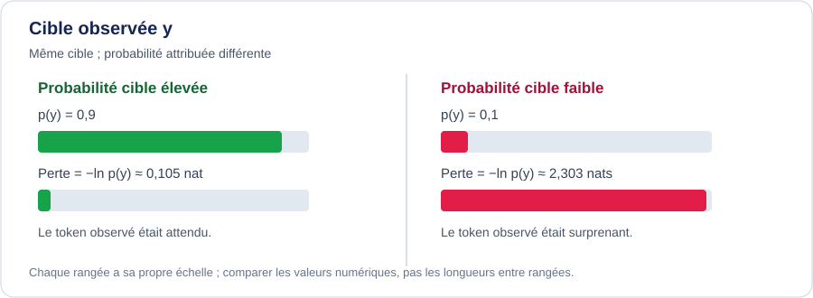

<!--
LLM-LAB-PAGE-MAP v1
id: "fr/cross-entropy"
summary: "Relie une distribution cible à la distribution prédite par le modèle. Dans le cas d’une cible one-hot, l’entropie croisée devient la pénalité associée au token observé et prépare la définition de la loss."
scope: "Définir l'entropie croisée entre une distribution cible et la distribution prédite par le modèle à une position cible, y compris le cas one-hot qui se réduit à la négative log-probabilité du token ; la distinguer de l'entropie de la prédiction et des conventions de masquage et de réduction de la loss sur un batch."
purpose: "Dériver l'entropie croisée pour une distribution cible, retrouver la négative log-probabilité dans le cas one-hot et expliquer l'effet de l'alignement des tokens et du masquage des cibles valides pendant l'entraînement autorégressif."
suggested_route:
  previous: "fr/vraisemblance"
  next: "fr/loss"
hierarchy:
  parents: ["fr/entropy"]
  children: ["fr/loss"]
related: ["fr/vraisemblance", "fr/cross-entropy-exercises"]
tags: ["type:concept-lesson", "destination:understand", "topic:cross-entropy", "level:core", "language:fr", "status:published"]
-->



::: {.chapter-lead}
Pour une cible one-hot, la cross-entropie d'une position est la négative log-probabilité du token observé. En entraînement autorégressif, cette quantité est calculée pour les positions cibles autorisées, puis agrégée selon une convention qu'il faut expliciter.
:::

::: {.callout-tip title="L'idée à retenir en une minute"}
- **Une cible :** pour une cible one-hot $y$, $\ell=-\log p_\theta(y\mid x_{<t})$ ; une faible probabilité attribuée au token observé coûte cher.
- **Une distribution cible :** plus généralement, $H(q,p)=-\sum_i q_i\log p_i$. L'entropie croisée n'est pas l'entropie prédictive $H(p)$.
- **Une séquence :** aligner chaque logit sur le bon token cible, décaler entrées et cibles de façon cohérente, puis exclure les positions invalides du numérateur et du dénominateur.
- **Un batch :** somme, moyenne par token valide et moyenne par séquence définissent des échelles différentes ; préciser la convention avant de comparer.

**Question de contrôle :** pouvez-vous retrouver la NLL d'un token et expliquer pourquoi le masque de perte ne remplace pas le masque causal ?
:::

Pour relier cette formule à l’entraînement, voir aussi la construction des [exemples entrée-cible](training-examples.qmd) et les règles de masquage de la perte. À ne pas confondre avec l'[entropie de la distribution prédite](entropy.qmd) : l'entropie décrit la dispersion des probabilités avant de connaître le token suivant ; la perte de cross-entropie évalue la probabilité donnée à la cible observée (ou à une distribution cible).

## Objectif pour un token

Ici, \(t\) indexe le **token cible** : les logits sont alignés sur \(x_t\) et représentent \(p_\theta(x_t\mid x_{<t})\). Certaines implémentations indexent plutôt les logits par la position d'entrée ; la ligne correspondant à l'entrée \(t\) prédit alors \(x_{t+1}\). Ces conventions ne sont équivalentes que si les logits et les labels sont décalés de manière cohérente. Pour une cible one-hot, la perte vaut :

\[
\ell_t=-\log p_\theta(x_t\mid x_{<t}).
\]

Si \(y\) est l'indice du token cible et \(p=\operatorname{softmax}(z)\), on peut écrire :

\[
\ell(z,y)=-z_y+\log\sum_{j=1}^{V}e^{z_j}.
\]

Le coût augmente lorsque le modèle attribue une faible probabilité au token observé. Une prédiction incorrecte mais très confiante est donc fortement pénalisée.

## Intuition visuelle : la perte mesure la surprise du token observé

{fig-alt="Deux cas pour le même token observé : p(y)=0,9 donne −ln p(y)≈0,105 nat ; p(y)=0,1 donne −ln p(y)≈2,303 nats. Une probabilité cible plus faible entraîne une perte beaucoup plus grande." width=100%}

Les deux cas concernent **le même token cible** : seul le poids de probabilité que le modèle lui attribue change. Quand \(p(y)=0{,}9\), la perte vaut environ \(0{,}105\) nat ; quand \(p(y)=0{,}1\), elle vaut environ \(2{,}303\) nats. La seconde perte est près de 22 fois plus grande. La fonction \(-\log p(y)\) rend donc les erreurs confiantes coûteuses, sans pour autant dire si le token observé est vrai ou utile dans un sens plus large.

Cette image illustre la perte d'un token avec une cible one-hot ; elle ne représente ni la distribution complète du vocabulaire, ni la moyenne sur les positions valides, ni l'ensemble de l'objectif d'entraînement.

::: {.callout-note title="Prolongement : cibles souples et divergence KL"}
Pour une distribution cible générale $q$, l'entropie croisée s'écrit $H(q,p)=-\sum_{i=1}^{V}q_i\log p_i$ ; le cas one-hot ci-dessus en est le cas particulier. La relation complète avec la divergence KL — $H(q,p)=H(q)+D_{\mathrm{KL}}(q\Vert p)$, et donc l'équivalence entre minimiser l'entropie croisée et minimiser la divergence KL pour une cible fixe — est dérivée dans la page [Formaliser mathématiquement la modélisation du langage](language-modeling-math.qmd).
:::

## Plusieurs positions : décalage causal et masques

Dans un modèle autorégressif, la représentation à la position \(t\) sert à prédire le token suivant. Selon la convention du code, les logits et les labels doivent donc être décalés de manière cohérente : le modèle ne doit pas recevoir le token cible comme contexte non masqué pour prédire ce même token.

Pour un batch, les logits ont souvent la forme \((B,T,V)\) et les labels \((B,T)\). Avant d'interpréter la loss, vérifier :

- **Décalage des cibles :** chaque logit est comparé au token qui doit être prédit, pas au token d'entrée par erreur.
- **Padding et masques :** les positions ignorées ne doivent pas contribuer à la somme ni au dénominateur de la moyenne.
- **Réduction :** une somme, une moyenne par token valide et une moyenne par séquence n'ont pas la même échelle.
- **Pondération :** poids de classes, label smoothing ou pertes auxiliaires modifient l'objectif par rapport au cas one-hot non pondéré.
- **Comparaison :** préciser le tokenizer, les positions incluses et la convention de moyenne avant de comparer deux valeurs.

::: {.callout-note collapse="true" title="Implémentation NumPy et tests (approfondissement)"}
L'[implémentation de référence NumPy](https://github.com/JM-Brun/llm-lab/blob/main/src/llm_lab/foundations/losses.py) et ses [tests unitaires](https://github.com/JM-Brun/llm-lab/blob/main/tests/unit/test_losses.py) couvrent volontairement un cas restreint : des logits de forme \((B,C)\), une cible entière par ligne et la **moyenne non pondérée sur les lignes**. La perte utilise le logarithme naturel et s'exprime donc en nats. La fonction de gradient renvoie la dérivée de cette même perte moyenne par rapport aux logits, et non par rapport aux paramètres d'un modèle.

Cette référence ne met **pas** en œuvre le décalage des entrées/cibles d'une séquence, les masques de tokens ou `ignore_index`, les cibles souples, les poids de classes, ni la perplexité. Pour la modélisation du langage au niveau token, l'appelant doit aligner les logits et les cibles et sélectionner les positions cibles valides avant d'utiliser cette fonction ligne par ligne. Cette implémentation ne doit pas être confondue avec une loss complète d'entraînement d'un LLM.

Les tests vérifient une valeur connue, l'accord avec des différences finies centrées, la stabilité pour de grands logits, l'invariance à l'ajout d'une constante par ligne, la somme nulle des gradients par ligne, l'absence de mutation des entrées et le rejet des entrées invalides. Ils étayent le périmètre annoncé de cette référence ; ils ne valident ni le masquage ni l'alignement des séquences, qui ne sont pas implémentés ici.
:::

::: {.callout-note collapse="true" title="Exemple PyTorch : logits, cibles et positions ignorées"}
L'exemple autonome suivant utilise la forme de sortie courante d'un modèle de langage, `(B,T,V)`, puis aplatit les deux premières dimensions car `CrossEntropyLoss` attend les classes dans la deuxième dimension. Les cibles sont supposées **déjà alignées** sur les logits : ce code ne construit pas le décalage autorégressif des entrées et cibles.

```python
import torch
import torch.nn.functional as F

# B=1 batch, T=3 positions, V=3 vocabulary tokens.
logits = torch.tensor(
    [[[2.0, 0.0, -1.0], [0.0, 1.0, 0.0], [1.0, 0.0, 2.0]]],
    dtype=torch.float64,
)
targets = torch.tensor([[0, 2, -100]], dtype=torch.long)
# Validate the sequence-level contract before inspecting dimensions.
assert logits.ndim == 3
batch_size, seq_len, vocab_size = logits.shape
assert targets.shape == (batch_size, seq_len)
assert targets.dtype == torch.long
valid = targets.ne(-100)
in_range = targets.ge(0) & targets.lt(vocab_size)
assert torch.all(in_range | targets.eq(-100))
assert valid.any()

flat_logits = logits.reshape(-1, vocab_size)
flat_targets = targets.reshape(-1)

per_token_loss = torch.nn.CrossEntropyLoss(
    ignore_index=-100, reduction="none"
)(flat_logits, flat_targets).reshape(batch_size, seq_len)
mean_loss = torch.nn.CrossEntropyLoss(
    ignore_index=-100, reduction="mean"
)(flat_logits, flat_targets)

manual_loss = -F.log_softmax(logits[valid], dim=-1).gather(
    1, targets[valid].unsqueeze(1)
).mean()

# The framework reduction agrees with the mean over valid target positions.
torch.testing.assert_close(per_token_loss[valid].mean(), mean_loss)
torch.testing.assert_close(mean_loss, manual_loss)

# Passing probabilities as if they were logits changes the objective.
softmax_first_loss = torch.nn.CrossEntropyLoss(ignore_index=-100)(
    logits.softmax(dim=-1).reshape(-1, vocab_size), flat_targets
)
assert not torch.isclose(mean_loss, softmax_first_loss)

print("per-token:", per_token_loss.tolist())
print("mean:", mean_loss.item())  # 0.860645...
print("softmax-first:", softmax_first_loss.item())  # 0.946560...
```

La dernière position est ignorée par `ignore_index` ; elle ne contribue ni à la somme ni au dénominateur de la moyenne. `reduction="none"` permet d'inspecter les pertes locales, tandis que `reduction="mean"` moyenne les cibles valides (sans poids de classes dans cet exemple). La softmax préalable est incorrecte pour l'usage attendu de cette API : elle transforme les logits en nouvelles entrées de scores et change la loss. Cet exemple illustre l'API et l'agrégation ; il ne remplace ni le masque causal, ni l'alignement des cibles, ni une boucle d'entraînement.

PyTorch accepte aussi des cibles sous forme de distributions de probabilité (par exemple pour le *label smoothing*), mais `ignore_index` ne s'applique qu'aux cibles sous forme d'indices. Cet exemple utilise volontairement des indices entiers.
:::

### Erreur fréquente de dimension : normaliser sur le temps plutôt que sur le vocabulaire

Pour des logits de forme `(B,T,V)`, chaque position temporelle doit définir une distribution de probabilité sur le **vocabulaire**. La softmax doit donc utiliser `dim=-1` (l'axe du vocabulaire). Une normalisation sur `dim=1` répartit au contraire les probabilités dans le temps pour chaque entrée du vocabulaire ; elle ne produit pas une distribution catégorielle sur les tokens à chaque position.

```python
import torch

logits = torch.tensor(
    [[[2.0, 0.0, -1.0], [0.0, 1.0, 0.0], [1.0, 0.0, 2.0]]],
    dtype=torch.float64,
)
batch_size, seq_len, vocab_size = logits.shape

correct_probs = logits.softmax(dim=-1)
wrong_axis_probs = logits.softmax(dim=1)

# Les probabilités sur le vocabulaire somment à un pour chaque position.
torch.testing.assert_close(
    correct_probs.sum(dim=-1),
    torch.ones((batch_size, seq_len), dtype=logits.dtype),
)
# Avec le mauvais axe, les sommes sur le vocabulaire ne valent pas un.
wrong_sums = wrong_axis_probs.sum(dim=-1)
assert not torch.allclose(
    wrong_sums,
    torch.ones_like(wrong_sums),
)
```

C'est pourquoi l'exemple aplatit d'abord `(B,T,V)` en `(B×T,V) : la dimension des classes/du vocabulaire devient alors sans ambiguïté la dimension 1 attendue par `CrossEntropyLoss`.

### Cas numérique extrême : log-softmax stable

Une opération `softmax` directe peut faire sous-déborder à zéro la probabilité d'une cible très improbable. Son logarithme vaut alors l'infini, même si la cross-entropie mathématique est finie. La cross-entropie fusionnée et numériquement stable calcule l'expression équivalente via log-softmax sans matérialiser d'abord cette probabilité nulle.

```python
import torch
import torch.nn.functional as F

extreme_logits = torch.tensor(
    [[1000.0, 0.0, -1000.0]], dtype=torch.float64
)
extreme_target = torch.tensor([2], dtype=torch.long)

stable_loss = F.cross_entropy(extreme_logits, extreme_target)
naive_probability = extreme_logits.softmax(dim=-1)[0, 2]
naive_loss = -torch.log(naive_probability)

torch.testing.assert_close(
    stable_loss, torch.tensor(2000.0, dtype=torch.float64)
)
assert torch.isfinite(stable_loss)
assert naive_probability == 0.0
assert torch.isinf(naive_loss)
```

Le résultat infini est un échec du calcul naïf en virgule flottante, pas une perte mathématique infinie : pour ces logits, la perte exacte vaut 2000 nats. En pratique, passer directement les logits à `CrossEntropyLoss` ou utiliser `log_softmax` suivi de l'extraction de la cible ; ne pas calculer soi-même `log(softmax(logits))`.

## Lien avec la perplexité

Si \(\bar{\ell}\) est la cross-entropie moyenne en nats sur les tokens valides, la perplexité est :

\[
\operatorname{PPL}=\exp(\bar{\ell}).
\]

Avec une moyenne en bits, la formule devient \(2^{\bar{\ell}}\). La perplexité dépend donc de la base du logarithme et de la convention d'évaluation. Elle mesure la performance probabiliste sur les tokens évalués ; elle n'est pas une mesure directe de vérité factuelle ou de qualité globale d'un assistant.

## Lien avec le gradient

La dérivée de la cross-entropie one-hot par rapport aux logits est $p_i-\mathbb{1}[i=y]$. Son interprétation et son rôle dans la rétropropagation sont développés dans la page [Gradients](gradients.qmd).

::: {.callout-note collapse="true" title="Détail d'API (approfondissement)"}
- **« PyTorch CrossEntropyLoss attend des probabilités. »** Pour la classification catégorielle usuelle, l'API attend des logits non normalisés et combine une opération de type log-softmax avec la NLL. Vérifier les formes, ignore_index, les cibles et la réduction.
:::

## Idées reçues

- **« La cross-entropie est comprise entre 0 et 1. »** Faux : elle peut être arbitrairement grande si le modèle attribue une probabilité proche de zéro à la cible.

- **« Une loss d'entraînement qui baisse prouve que le modèle s'améliore. »** Non : il faut examiner la validation, les fuites, les baselines et la généralisation.
- **« La perplexité compare directement n'importe quels modèles. »** Non sans contrôler le tokenizer, les données et les conventions d'évaluation.

## S’exercer

Les questions et exercices de cette leçon sont regroupés sur sa [page d’exercices dédiée](exercises/cross-entropy.qmd).


- [PyTorch — CrossEntropyLoss](https://docs.pytorch.org/docs/stable/generated/torch.nn.CrossEntropyLoss.html) — comportement de l'API, pas définition générale de la cross-entropie.
- [PyTorch — LogSoftmax](https://docs.pytorch.org/docs/stable/generated/torch.nn.LogSoftmax.html) — transformation log-softmax utilisée pour calculer des log-probabilités de façon stable.
- C. E. Shannon (1948), [*A Mathematical Theory of Communication*](https://people.math.harvard.edu/~ctm/home/text/others/shannon/entropy/entropy.pdf).
- Cover & Thomas, [*Elements of Information Theory*](https://onlinelibrary.wiley.com/doi/book/10.1002/047174882X).
- [3Blue1Brown — But what is cross-entropy?](https://www.youtube.com/watch?v=GlYgs6v2YfU) — intuition visuelle complémentaire à la dérivation.



::: {.language-switch}
[Français](cross-entropy.qmd) · [English](../en/cross-entropy.qmd)
:::
