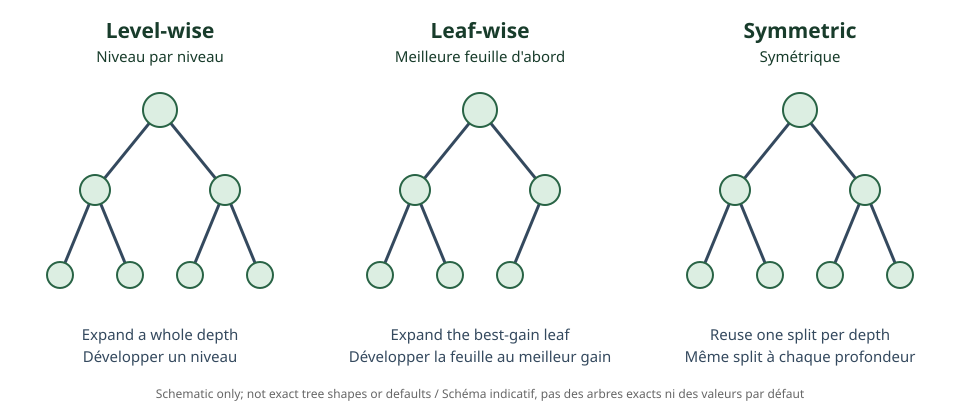

<!--
LLM-LAB-PAGE-MAP v1
id: "fr/decision-trees"
scope: "Décrit les arbres de décision comme partitions récursives de l'espace des variables, les critères de split, les prédictions des feuilles et le contrôle de complexité."
purpose: "Lire un arbre, expliquer une séparation gloutonne et distinguer critère local, objectif global et régularisation."
suggested_route:
  previous: "fr/bias-variance"
  next: "fr/gradient-boosting"
hierarchy:
  parents: []
  children: []
related: ["fr/gradient-boosting", "fr/xgboost", "fr/lightgbm", "fr/catboost"]
tags: ["type:concept-lesson", "destination:deepen", "topic:decision-trees", "level:applied", "language:fr", "status:published"]
-->
::: {.chapter-lead}
Un arbre de décision représente une prédiction par une suite de tests sur les variables. Chaque séparation partitionne les observations ; une feuille produit la prédiction finale. Les arbres modélisent des interactions non linéaires sans imposer une forme globale linéaire.
:::
## Structure d'un arbre

Un nœud interne applique un test, par exemple $x_j < s$. Les observations sont envoyées dans une branche ou l'autre ; les tests successifs définissent des régions de l'espace des variables. Une feuille contient une valeur prédite (régression) ou une distribution/étiquette de classe (classification).

## Choisir une séparation

Les arbres CART cherchent gloutonnement une variable et un seuil qui réduisent l'impureté des enfants par rapport au parent. En régression, on utilise souvent la réduction de somme des carrés ; en classification, des critères comme Gini ou l'entropie. Pour une classification, l'impureté de Gini est :

\[
G(S)=1-\sum_{k=1}^{K}p_k^2,
\]

où $p_k$ est la proportion de la classe $k$ dans le nœud. Le gain d'un split pondère l'impureté des enfants par leur taille. Un choix glouton optimal localement ne garantit pas l'arbre globalement optimal.

## Complexité et généralisation

Un arbre profond peut créer des régions très spécifiques et mémoriser le bruit. On contrôle sa complexité avec profondeur maximale, nombre minimal d'observations par feuille, gain minimal de séparation, élagage ou pénalisation du nombre de feuilles. Ces contraintes interagissent avec le volume de données et la loss.

{fig-alt="Trois structures schématiques illustrant level-wise, leaf-wise et symétrique."}

Les critères d'un arbre isolé ne sont pas identiques à ceux d'un arbre boosté. Dans XGBoost, les gradients et Hessiennes de l'ensemble courant contribuent au gain du split ; le critère ne se réduit donc pas à Gini ou à la réduction de variance brute.

## Place dans les ensembles

- **Bagging / forêt aléatoire** : plusieurs arbres indépendants sont agrégés pour stabiliser les prédictions.
- **Boosting** : les arbres sont ajoutés séquentiellement pour corriger le modèle courant.
- **Arbre boosté** : souvent un arbre peu profond, dont la contribution est régularisée.

Voir [Gradient Boosting](gradient-boosting.qmd), puis les variantes [XGBoost](xgboost.qmd), [LightGBM](lightgbm.qmd) et [CatBoost](catboost.qmd).

::: {.self-check}
## Vérifier sa compréhension
1. Pourquoi une feuille correspond-elle à une région de l'espace des variables ?

Afficher la réponse
Les tests le long du chemin imposent une suite de contraintes ; leur intersection définit la région des observations arrivant à cette feuille.

2. Pourquoi un split glouton ne garantit-il pas l'arbre optimal ?

Afficher la réponse
Il optimise un gain local sans explorer toutes les combinaisons possibles de splits futurs.

3. Pourquoi un arbre boosté n'utilise-t-il pas nécessairement Gini ?

Afficher la réponse
Il est ajusté à partir des gradients de la loss de l'ensemble courant ; les scores de split sont définis par l'objectif de boosting et sa régularisation.

:::
## Références
- [Breiman et al. (1984), Classification and Regression Trees](https://doi.org/10.1201/9781315139470).
- [The Elements of Statistical Learning](https://hastie.su.domains/ElemStatLearn/), chapitre 9.
::: {.language-switch}
[Français](decision-trees.qmd) · [English](../en/decision-trees.qmd)
:::
