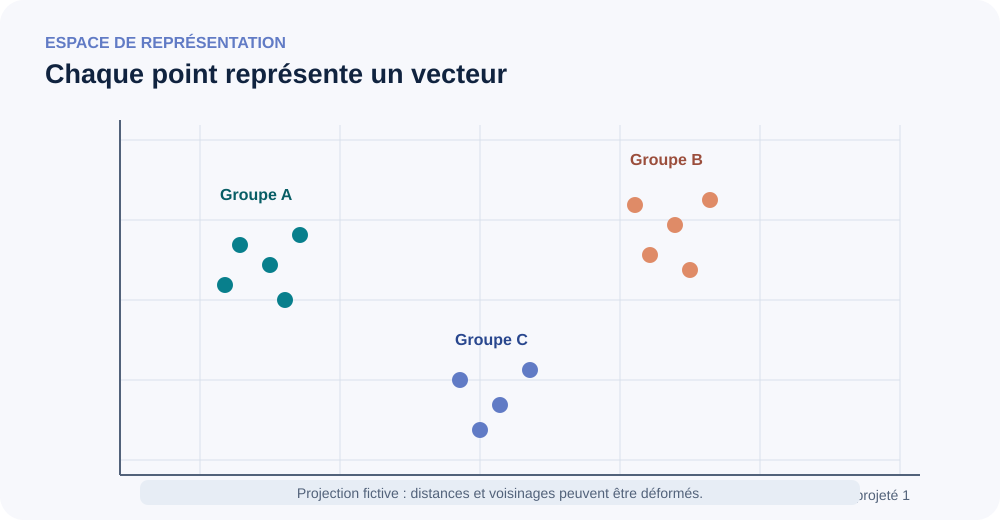

<!--
LLM-LAB-PAGE-MAP v1
id: "fr/deepen"
scope: "Point d'entrée dans les approfondissements avancés : organise les pages par familles de questions et explicite leur place par rapport au parcours Understand."
purpose: "Choisir un approfondissement selon une question, identifier les notions voisines et comprendre le niveau attendu sans transformer ces lectures en prérequis."
suggested_route:
  previous: null
  next: null
hierarchy:
  parents: []
  children: ["fr/next-concept-modeling", "fr/contextualized-representations-advanced"]
related: []
tags:
  - "type:entry-point"
  - "destination:deepen"
  - "topic:deepen-hub"
  - "level:overview"
  - "language:fr"
  - "status:published"
-->

# Approfondir : une carte, pas une liste

La partie **Approfondir** rassemble les traitements qui dépassent le modèle mental nécessaire pour suivre le parcours principal. Elle n'est ni une deuxième séquence obligatoire, ni un dépôt de sujets spécialisés sans liens entre eux.

Chaque entrée répond à une question plus précise : pourquoi un mécanisme fonctionne, dans quelles conditions il reste valide, quels compromis il introduit, ou comment l'étudier rigoureusement. Les pages sont regroupées par **problème intellectuel**, pas alphabétiquement. Une page peut avoir des liens transversaux, mais conserve une seule rubrique principale pour stabiliser son point d'entrée.

## Choisir par question

| Votre question | Domaine |
|---|---|
| Comment une architecture spécialisée modifie-t-elle le flux d'information ? | [Attention, position et architectures](#architectures-et-mecanismes) |
| Comment concevoir et évaluer la représentation du texte ? | [Texte et tokenisation](#texte-et-tokenisation) |
| Quels outils mathématiques permettent d'analyser les représentations ? | [Outils mathématiques et géométrie](#outils-mathematiques-et-geometrie) |
| Comment relier probabilités, objectif d'apprentissage et gradients ? | [Formalisation probabiliste et chaîne de l’entraînement](#fondements-probabilistes-et-entrainement) |
| Comment produire des sorties et quels coûts cela implique-t-il ? | [Inférence et efficacité](#inference-et-efficacite) |
| Que peut-on conclure sur l'échelle et les capacités des modèles ? | [Échelle et questions de recherche](#echelle-et-questions-de-recherche) |

## Attention, position et architectures {#architectures-et-mecanismes}

**Question directrice :** quelles variantes changent la circulation de l'information ou la structure de calcul ?

- [Pourquoi mettre les scores d'attention à l'échelle ?](attention-score-scaling.qmd) — variance des produits scalaires sous hypothèses gaussiennes, concentration du softmax et limites du facteur $\sqrt{d_k}$.
- [Représentations contextualisées : dépendances entre positions et couches](contextualized-representations-advanced.qmd) — formalisation du contexte accessible, des masques et de l'évolution des états cachés.
- [Q/K/V : formulation mathématique et variantes](queries-keys-values-advanced.qmd) — équations par position, dimensions avec lot, géométrie des compatibilités, chemins de gradient et partage des têtes/projections.
- [Attention croisée](cross-attention.qmd) — transfert d'information entre deux séquences, notamment dans les architectures encodeur-décodeur et multimodales.
- [RoPE : encodage positionnel rotatif](rope.qmd) — géométrie des rotations, dépendance aux positions relatives et limites d'extrapolation.
- [Architectures hybrides : Nemotron 3 et 3.5](hybrid-llm-architectures.qmd) — combinaison de récurrence, attention, experts et prédiction multi-token dans un cas concret.
- [Next-Concept Modeling](next-concept-modeling.qmd) — génération non autorégressive par niveaux de codes discrets, comparée à GPT et aux modèles de diffusion.

Les variantes spécialisées ne rejoignent pas le parcours principal simplement parce qu'un modèle récent les utilise. Il faut démontrer qu'elles sont indispensables à la compréhension générale.

### Ressources complémentaires pour comprendre le Transformer {#ressources-transformer}

Ces ressources proposent des explications visuelles, une formulation historique de l'architecture ou des exemples d'implémentation. Elles complètent les pages conceptuelles de LLM Lab ; elles ne constituent ni un parcours parallèle ni des prérequis.

#### Construire l'intuition avec des visualisations

- [3Blue1Brown — *Transformers, the tech behind LLMs*](https://www.3blue1brown.com/lessons/gpt/) : une explication animée du système, des embeddings aux blocs Transformer, aux logits et à la génération.
- [3Blue1Brown — *Attention in transformers, step by step*](https://www.3blue1brown.com/lessons/attention/) : une explication visuelle ciblée de l'attention, du masquage, des têtes multiples et de la cross-attention.
- [Jay Alammar — *The Illustrated Transformer*](https://jalammar.github.io/illustrated-transformer/) : une explication visuelle pas à pas du **Transformer original encodeur-décodeur**. Elle éclaire la conception de 2017, mais ne représente pas tous les GPT modernes.
- [Jay Alammar — *The Illustrated GPT-2*](https://jalammar.github.io/illustrated-gpt2/) : une présentation visuelle plus directement liée aux modèles de type GPT à décodeur seul.

#### Relier les équations à une implémentation

- [Vaswani et al. (2017), *Attention Is All You Need*](https://arxiv.org/abs/1706.03762) : l'article primaire décrivant la formulation du Transformer original. Il présente une architecture encodeur-décodeur ; GPT est une famille ultérieure à décodeur seul.
- [Harvard NLP — *The Annotated Transformer*](https://nlp.seas.harvard.edu/annotated-transformer/) : une implémentation exécutable et annotée, liée à l'article original. Elle aide à relier les équations au code, mais son architecture et ses choix d'entraînement ne définissent pas tous les LLM modernes.
- [PyTorch — attention à produit scalaire mise à l'échelle](https://docs.pytorch.org/docs/stable/generated/torch.nn.functional.scaled_dot_product_attention.html) : le contrat d'API d'une opération, pas une explication ou une implémentation complète d'un Transformer.

#### Livres et cours complémentaires (facultatifs)

- [Sebastian Raschka — *Build a Large Language Model (From Scratch)*](https://www.sebastianraschka.com/llms-from-scratch/) et [le dépôt source](https://github.com/rasbt/LLMs-from-scratch) : un ouvrage accompagné de code couvrant les données, l'attention, l'implémentation de GPT, le préentraînement et le fine-tuning. C'est une référence importante, pas l'ordre de lecture obligatoire de ce site.
- [Raschka — conseils de lecture](https://github.com/rasbt/LLMs-from-scratch/blob/main/ch01/reading-recommendations.md) : conseils pour construire d'abord une vue d'ensemble, puis approfondir avec le code.
- [DeepLearning.AI — *How Transformer LLMs Work*](https://www.deeplearning.ai/courses/how-transformer-llms-work) : un cours vidéo compact de Jay Alammar et Maarten Grootendorst sur la tokenisation, les embeddings, l'attention, les blocs modernes et quelques variantes d'efficacité. L'accès et les conditions du cours peuvent évoluer.

Ces ressources sont complémentaires, pas interchangeables : les visualisations construisent l'intuition, l'article original documente la formulation, le code annoté expose les choix d'implémentation et la documentation d'API précise le contrat d'une opération de bibliothèque.

## Texte et tokenisation

**Question directrice :** comment les choix de représentation du texte influencent-ils les propriétés d'un système ?

- [Unicode et représentation du texte](unicode-text.qmd) — couches de représentation des caractères et conséquences.
- [Concevoir et évaluer un tokenizer](tokenizer-design-evaluation.qmd) — familles BPE, WordPiece et Unigramme, conception et protocole empirique.

La page [Stratégies de tokenisation](tokenization-strategies.qmd) du parcours principal reste le point d'entrée conceptuel ; la conception et l'évaluation comparative sont des approfondissements.

## Outils mathématiques et géométrie {#outils-mathematiques-et-geometrie}

**Question directrice :** quelles opérations et propriétés mathématiques permettent d'analyser les représentations et les calculs ?

- [Tenseurs](tensors.qmd) — dimensions, opérations et conventions.
- [Similarité cosinus](cosine-similarity.qmd) — mesure angulaire et limites d'interprétation.
- [Linéarité des embeddings](linearite-embeddings.qmd) — hypothèses et preuves empiriques associées aux relations linéaires dans les espaces de représentation.

### Repères historiques : des vecteurs statiques aux représentations contextualisées

Les premières représentations neuronales distribuées du texte, puis des méthodes comme Word2Vec, ont appris des vecteurs associés à des mots ou à des unités lexicales. Ces vecteurs dits **statiques** ne changeaient pas selon la phrase. Les modèles contextualisés ont ensuite produit des états différents selon le contexte, tout en conservant une table de plongements initiale pour les IDs d'entrée. Cette transition est un repère historique utile, mais pas une évolution linéaire unique ni le remplacement de toutes les méthodes précédentes.

- [Bengio et al. (2003), *A Neural Probabilistic Language Model*](https://www.jmlr.org/papers/v3/bengio03a.html) — modèle neuronal de langage avec représentations distribuées apprises.
- [Mikolov et al. (2013), *Efficient Estimation of Word Representations in Vector Space*](https://arxiv.org/abs/1301.3781) — architectures CBOW et Skip-gram associées à Word2Vec.
- [Peters et al. (2018), *Deep Contextualized Word Representations*](https://arxiv.org/abs/1802.05365) — ELMo et représentations dépendantes du contexte.

#### Ce que la comparaison historique permet — et ne permet pas — de conclure

Word2Vec apprend des vecteurs associés aux mots du vocabulaire. Dans CBOW, le modèle prédit un mot cible à partir de son contexte ; dans Skip-gram, il prédit des mots de contexte à partir du mot cible. Une fois le modèle entraîné, un mot donné possède un vecteur statique : le vecteur de `bank` ne change pas entre *the river bank* et *the financial bank*. Cette limite motive notamment les représentations contextualisées, mais ne signifie pas que les tables d'embeddings d'entrée des Transformers ont disparu : elles fournissent toujours les vecteurs initiaux associés aux IDs.

Pour isoler cette distinction, l'exemple anglais `bank` est utile : si les deux occurrences sont bien encodées par le même ID, elles récupèrent la même ligne initiale ; le contexte traité ensuite par le réseau peut produire des états cachés différents. La segmentation et l'ID exacts restent propres au tokenizer considéré. Il s'agit d'un exemple conceptuel, pas d'une affirmation sur une tokenisation universelle.

#### Géométrie des représentations : précautions d'interprétation

{fig-alt="Des vecteurs sont projetés dans un plan abstrait ; les regroupements sont illustratifs et ne garantissent pas une proximité sémantique." fig-cap="Une projection 2D est un outil exploratoire, pas une preuve de séparation dans l'espace d'origine." width=100%}

Un vecteur de dimension (d) peut être interprété comme un point dans un espace vectoriel, mais les visualisations en deux dimensions sont des projections : elles ne conservent généralement qu'une partie des distances et des voisinages. Des groupes visuellement séparés sur une figure 2D ne prouvent donc ni une séparation robuste dans l'espace d'origine, ni une capacité de classification sur des données nouvelles.

La proximité dépend de l'objet comparé (embedding initial, couche et position d'un état contextualisé, ou embedding de phrase), du modèle, de la couche, du corpus, de la méthode de pooling éventuelle et de la métrique choisie. Une similarité cosinus élevée n'implique pas une équivalence de sens : la négation ou une relation logique peuvent changer le sens avec un vocabulaire presque identique. De même, les résultats sur les embeddings de phrases ne se transposent pas automatiquement aux activations internes d'un LLM.

- [Ethayarajh (2019), *How Contextual are Contextualized Word Representations?*](https://arxiv.org/abs/1909.00512) — analyse du caractère contextuel des représentations selon les couches.
- [Li et al. (2020), *On the Sentence Embeddings from Pre-trained Language Models*](https://aclanthology.org/2020.emnlp-main.733/) — étude des propriétés et limites des embeddings de phrases issus de modèles préentraînés.
- [Steck, Ekanadham & Kallus (2024), *Is Cosine-Similarity of Embeddings Really About Similarity?*](https://arxiv.org/abs/2403.05440) — mise en question de l'interprétation naïve de la similarité cosinus.
- [Sentence Transformers — Semantic Textual Similarity](https://sbert.net/docs/sentence_transformer/usage/semantic_textual_similarity.html) — exemple de tâche et de protocole conçus pour comparer des embeddings de phrases.

Pour les outils de mesure, voir [la similarité cosinus](cosine-similarity.qmd) ; pour les relations géométriques et leurs preuves empiriques, voir [la linéarité des embeddings](linearite-embeddings.qmd). Pour une introduction visuelle à l'entrée d'un GPT, consulter aussi [The Illustrated GPT-2](https://jalammar.github.io/illustrated-gpt2/).

Ces pages fournissent des outils d'analyse ; elles ne constituent pas un cours de prérequis à terminer avant de construire un petit GPT.

## Formalisation probabiliste et chaîne de l’entraînement {#fondements-probabilistes-et-entrainement}

**Question directrice :** comment relier distribution prédite, vraisemblance observée, fonction objectif et optimisation ?

- [Formaliser mathématiquement la modélisation du langage](language-modeling-math.qmd) — factorisation autorégressive, entropie croisée et divergence KL.
- [La chaîne mathématique de l'entraînement d'un LLM](mathematical-foundations.qmd) — des logits aux gradients, en distinguant les objets mathématiques.
- [Centrage du score en RL hors politique](score-centering.qmd) — correction de la dérive du gradient lorsque les distributions du sampler et du trainer diffèrent.

Les pages canoniques du parcours principal restent propriétaires des définitions locales de vraisemblance, entropie, entropie croisée, loss et gradients. Ces approfondissements les relient ou les généralisent sans les remplacer.

## Inférence et efficacité {#inference-et-efficacite}

**Question directrice :** comment le modèle exploite-t-il le contexte, choisit-il ses sorties et mobilise-t-il ses ressources ?

- [Apprentissage en contexte](in-context-learning.qmd) — exemples dans le prompt sans mise à jour des paramètres.
- [Stratégies avancées de décodage](decoding-strategies.qmd) — transformations de distribution et recherche de séquences.
- [Complexité et parallélisme dans les LLM](llm-computational-complexity.qmd) — calcul, mémoire et parallélisme en entraînement, préremplissage et décodage.

Le parcours principal présente la génération autorégressive et ses opérations minimales. Cette rubrique traite les stratégies et coûts non nécessaires à cette première compréhension.

## Échelle et questions de recherche {#echelle-et-questions-de-recherche}

**Question directrice :** quelles régularités empiriques et quelles affirmations sur les capacités sont soutenues par les données ?

- [De GPT-2 aux systèmes LLM contemporains](llm-evolution.qmd) — synthèse transversale des évolutions de l'échelle au post-entraînement, du raisonnement aux systèmes utilisant des outils.
- [Lois d'échelle : paramètres, données et calcul](scaling-laws.qmd) — relations empiriques entre ressources d'entraînement et perte, et limites d'extrapolation.
- [Émergence](emergence.qmd) — amélioration graduelle, effets de seuil liés aux métriques et véritables discontinuités.
- [JEPA et l'hypothèse de représentation platonique](jepa-platonic-representation.qmd) — graphes de paires positives, bonnes et mauvaises vues, théorème de convergence conditionnel et lecture qualifiée des preuves d'alignement intermodal.

Distinguer systématiquement observations, hypothèses explicatives et conclusions dépendantes du protocole.

## Classer une nouvelle notion

Une entrée se classe selon son **objectif d'apprentissage principal**, pas selon le mot-clé de son titre.

1. **Nécessité conceptuelle :** le mécanisme est-il indispensable au premier modèle mental ? Si oui, intégrer le minimum exact dans Understand et réserver ici les dérivations ou variantes. Sinon, le garder dans Approfondir.
2. **Question traitée :** architecture/flux, texte/tokenisation, outil mathématique, fondement probabiliste/entraînement, inférence/efficacité, ou échelle/recherche.
3. **Propriété du contenu :** étendre une page canonique si le nouvel apport relève de son périmètre. Créer une page seulement pour une question durable et distincte.
4. **Nature du lien :** parent/enfant pour une généralisation ou décomposition ; related pour une connexion transversale ; suggested_route pour un ordre conseillé. Toute dépendance n'est pas une relation hiérarchique.
5. **Niveau de preuve :** expliciter hypothèses et conventions des dérivations ; documenter données, métriques et protocoles empiriques ; séparer principes généraux et choix propres aux études de cas.

### Règle de maintenance

Toute nouvelle page avancée doit être ajoutée simultanément à cette carte, à la navigation FR/EN, à la liste de rendu Quarto, à l'inventaire éditorial et au graphe de métadonnées. La version anglaise conserve le même périmètre, niveau et relations. Créer une rubrique lorsqu'elle regroupe plusieurs pages ou représente un axe de recherche durable ; éviter les rubriques à entrée unique sauf justification.

**Cette carte est une taxonomie de découverte, pas un nouveau parcours obligatoire.** L'ordre des rubriques ne crée aucun prérequis.
