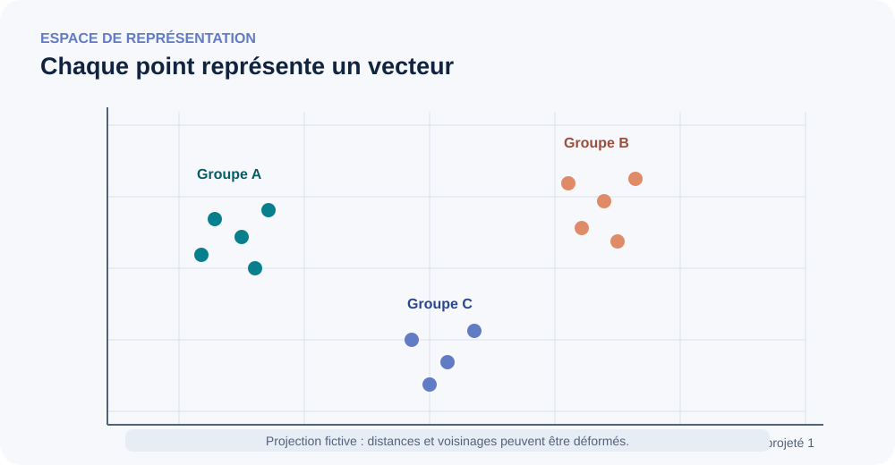

::: {.chapter-lead}
Un **embedding** est un vecteur numérique associé à un objet, par exemple un token. L'ensemble de ces vecteurs forme un espace de représentation. On peut comparer leurs directions, leurs distances ou leurs voisins, mais leur interprétation dépend du modèle, de son entraînement et de la tâche : la géométrie n'est pas un dictionnaire universel du sens.
:::

Cette page établit d'abord comment les identifiants sélectionnent des vecteurs et comment un Transformer transforme les embeddings initiaux en représentations contextualisées. Elle examine ensuite la géométrie de ces représentations, les limites des mesures de similarité et les pièges d'interprétation.

## D'où viennent les vecteurs ?

Un tokenizer découpe le texte en tokens et associe généralement chaque token à un identifiant entier. Une matrice d'embedding $E\in\mathbb{R}^{V\times d}$ contient un vecteur par identifiant : $V$ est la taille du vocabulaire et $d$ la dimension de l'embedding. Pour le token d'identifiant $i$, son embedding initial est la ligne $E_i$.

Dans un Transformer, cette représentation est ensuite transformée par les couches du réseau. Il faut distinguer trois objets :

- **Embedding de token :** vecteur initial récupéré dans la matrice du vocabulaire.
- **Représentation contextualisée :** vecteur produit après traitement du contexte, notamment par l'attention.
- **Embedding de phrase ou de document :** vecteur calculé par un modèle et une méthode d'agrégation conçus pour représenter un texte plus long.

Ces objets ne sont pas interchangeables. Une méthode adaptée aux embeddings de phrases pour la recherche documentaire ne se transfère pas automatiquement aux activations internes d'un LLM.

## Des identifiants aux vecteurs : une sélection par indice calculable à la main

Supposons que le vocabulaire contienne cinq identifiants et que chaque embedding ait deux coordonnées. Voici une petite matrice illustrative :

\[
E =
\begin{bmatrix}
0.1 & 0.0 \\
0.0 & 0.2 \\
0.8 & -0.1 \\
-0.2 & 0.5 \\
0.3 & 0.7
\end{bmatrix}
\in \mathbb{R}^{5\times 2}.
\]

Pour les identifiants \([2,0,3]\), la sélection par indice choisit les lignes \(E_2\), \(E_0\) et \(E_3\) :

\[
X =
\begin{bmatrix}
0.8 & -0.1 \\
0.1 & 0.0 \\
-0.2 & 0.5
\end{bmatrix}
\in \mathbb{R}^{3\times 2}.
\]

Les identifiants sont des indices de ligne ; les vecteurs obtenus sont des paramètres appris. Les valeurs ci-dessus sont inventées uniquement pour rendre le calcul vérifiable à la main. Elles ne représentent pas de vraies relations sémantiques : l'identifiant 3 n'est pas « plus proche » du 2 parce que les entiers se suivent.

Pour un lot de séquences, le changement de forme usuel est :

\[
\text{IDs des tokens }[B,L]
\;\longrightarrow\;
\text{embeddings des tokens }[B,L,d],
\]

où \(B\) est la taille du lot, \(L\) la longueur de séquence et \(d\) la dimension des embeddings. Le lookup ne mélange pas l'information entre les positions : deux occurrences du même identifiant récupèrent la même ligne avant l'ajout éventuel d'information positionnelle et le traitement contextuel.

### Une trace reproductible : texte → IDs → lignes d'embedding

L'exemple relie un encodage de tokenizer réel et identifié à une table d'embeddings **synthétique**. Il utilise l'encodage BPE au niveau des octets de GPT-2 fourni par `tiktoken` ; les IDs ci-dessous sont vérifiés dans les tests publics de la bibliothèque. Installez la version figée avec `python -m pip install tiktoken==0.14.0`. NumPy est déjà une dépendance du projet.

```python
import numpy as np
import tiktoken

text = "hello world"  # une chaîne Unicode Python
utf8_bytes = text.encode("utf-8")
encoding = tiktoken.get_encoding("gpt2")
token_ids = encoding.encode(text)
token_bytes = [encoding.decode_single_token_bytes(i) for i in token_ids]
token_strings = [part.decode("utf-8") for part in token_bytes]

assert utf8_bytes == b"hello world"
assert token_ids == [31373, 995]
assert token_strings == ["hello", " world"]
assert encoding.decode(token_ids) == text

# Poids synthétiques : GPT-2 réel utilise une autre dimension et des valeurs apprises.
vocab_size, d = 50_257, 2
E = np.zeros((vocab_size, d), dtype=np.float32)
E[31373] = [0.1, 0.2]
E[995] = [-0.3, 0.4]
X = E[token_ids]

assert X.shape == (2, 2)
assert np.allclose(X, [[0.1, 0.2], [-0.3, 0.4]])

# Vecteurs positionnels absolus illustratifs, pas les paramètres réels de GPT-2.
P = np.array([[0.01, 0.02], [0.03, 0.04]], dtype=np.float32)
Z = X + P
assert Z.shape == (2, 2)
assert np.allclose(Z, [[0.11, 0.22], [-0.27, 0.44]])
```

Voici comment lire cette trace :

1. `text` est du texte Unicode ; son encodage UTF-8 produit des octets.
2. L'encodage `gpt2` choisi transforme le texte en IDs `[31373, 995]` ; leurs fragments d'octets se décodent en `"hello"` et `" world"`. L'espace initial appartient au second token.
3. Les IDs indexent les lignes de `E`. Les deux vecteurs sont des valeurs **inventées**, pas les embeddings du GPT-2 préentraîné ; la table utilise seulement la même plage d'indices de vocabulaire pour que les IDs réels puissent sélectionner des lignes.
4. `P` illustre l'ajout de vecteurs positionnels dans une architecture donnée. `Z` garde la forme `[L,d]` ; cet exemple n'exécute pas de bloc Transformer et ne calcule donc pas les états cachés contextualisés.

Les IDs exacts dépendent de l'encodage et du comportement de la bibliothèque ; un autre tokenizer peut produire des fragments et IDs différents. Les assertions rendent ces changements visibles au lieu de présenter la tokenisation comme universelle. Voir le [dépôt officiel de tiktoken](https://github.com/openai/tiktoken) et ses [tests d'encodage](https://github.com/openai/tiktoken/blob/0.14.0/tests/test_encoding.py) pour la sortie de référence.

## Taille du vocabulaire, dimension et paramètres

La taille du vocabulaire \(V\) et la dimension d'embedding \(d\) sont deux choix distincts. La matrice d'embeddings \(E\in\mathbb{R}^{V\times d}\) contient \(V\) lignes — une par ID — et \(d\) composantes par ligne. Pour une séquence de longueur \(L\), le lookup produit une matrice de forme \(L\times d\) ; pour un lot de \(B\) séquences, la forme usuelle est \(B\times L\times d\).

- **\(V\)** dépend du tokenizer et du vocabulaire qu'il définit, y compris les tokens spéciaux.
- **\(d\)** est un hyperparamètre de l'architecture, choisi avec la profondeur, les têtes d'attention et le budget de calcul ; il n'est pas déduit de \(V\).
- La table d'embeddings contient \(Vd\) paramètres.

**Ordre de grandeur calculable :** avec \(V=50\,000\) tokens et \(d=768\), la table contient \(50\,000\times768=38\,400\,000\) paramètres. En précision 32 bits, les poids seuls occupent environ 153,6 MB en unités décimales (ou 146,5 MiB), hors gradients, états de l'optimiseur et autres paramètres. C'est une estimation du coût de la table, pas la description d'un modèle particulier.
- Si la projection de sortie possède une matrice distincte, elle ajoute typiquement \(dV\) paramètres, éventuellement plus un biais. Certains modèles partagent les poids d'entrée et de sortie (*weight tying*) : il faut vérifier l'architecture avant d'additionner les deux matrices.
- Les IDs et les poids associés sont couplés. Modifier le vocabulaire, l'ordre des IDs ou \(V\) exige une stratégie explicite d'adaptation ou de réentraînement ; ce n'est pas une substitution neutre.

À chaque position, la distribution de sortie comporte en général \(V\) logits. La [page sur les tenseurs](tensors.qmd) explique comment lire les axes et les formes ; la [page sur les logits](logits.qmd) approfondit les scores de sortie. Cette section complète la vue d'ensemble [du texte aux tokens](text-data.qmd), sans confondre lookup initial et contextualisation par le Transformer.

## Des embeddings de tokens aux représentations contextualisées

L'étape suivante dépend de l'architecture. Dans un modèle de type GPT-2 utilisant des embeddings positionnels absolus appris, un vecteur propre à la position est ajouté à chaque embedding de token :

\[
X_{b,t}=E_{\text{token}_{b,t}}+P_t.
\]

Les deux termes ont la dimension \(d\), donc l'entrée combinée a la forme \([B,L,d]\). Les blocs Transformer contextualisent ensuite chaque position à partir de la séquence ; dans un bloc standard qui conserve la largeur, la forme des états cachés reste \([B,L,d]\), même si leurs valeurs changent lorsque le contexte est intégré.

Cette addition n'est **pas universelle**. Par exemple, [RoPE](positional-encoding.qmd) applique des rotations dépendant de la position aux vecteurs requête et clé dans l'attention, au lieu d'ajouter un vecteur de position aux embeddings initiaux. Il faut identifier l'architecture avant de fixer le pipeline exact.

Pendant l'entraînement, les gradients peuvent modifier les lignes de la table d'embeddings utilisées par les exemples. La sélection par indice ne rend pas, à elle seule, un vecteur contextuel : la contextualisation intervient dans les couches suivantes du réseau. Voir les [tenseurs](tensors.qmd) pour les conventions de dimensions et [du texte aux tokens](text-data.qmd) pour l'étape précédente du tokenizer.

### De l'embedding initial à l'état contextualisé

Un même ID récupère le même embedding initial, mais sa représentation peut évoluer lorsque le Transformer traite l'information positionnelle et les tokens environnants. Cette distinction mérite un complément ciblé : [Pourquoi un même token peut-il avoir plusieurs représentations contextualisées ?](contextualized-representations.qmd).

## Une carte de représentations

{fig-alt="Points regroupés dans un plan abstrait. Les regroupements sont illustratifs et les axes ne correspondent pas nécessairement à des concepts humains." width=100%}

Cette image est une illustration conceptuelle en deux dimensions. Les embeddings réels ont souvent des centaines ou des milliers de coordonnées ; une projection 2D peut déformer les distances et les voisinages.

## Que signifie la proximité ?

On peut comparer deux vecteurs par produit scalaire, distance euclidienne ou similarité cosinus. Le cosinus compare leurs directions :

$$
\operatorname{cos}(x,y)=\frac{x^\top y}{\|x\|_2\|y\|_2}.
$$

Un score élevé signifie que les directions sont proches. Il ne prouve pas que les textes sont équivalents, qu'ils impliquent la même conclusion ou qu'un document répond correctement à une question.

Par exemple, « le traitement est efficace » et « le traitement n'est pas efficace » partagent presque tous leurs mots, alors que la négation change le sens décisif. À l'inverse, deux formulations très différentes peuvent exprimer la même information.

## Une géométrie apprise, pas universelle

Les dimensions d'un embedding n'ont généralement pas d'étiquettes humaines stables. Par exemple, un changement orthogonal de coordonnées peut mélanger les dimensions tout en préservant les produits scalaires, les distances et les similarités cosinus ; la même géométrie s'exprime alors selon d'autres axes. Cela illustre pourquoi un axe isolé n'a pas de signification humaine garantie. Ne pas interpréter une dimension comme « le sentiment » ou « la causalité » sans expérience qui étaye cette interprétation.

La géométrie dépend notamment de l'objectif d'entraînement, des données, de la couche observée, de la normalisation, de la métrique et de la tâche. L'**anisotropie** (vecteurs concentrés dans certaines directions) et la **hubness** (points qui deviennent voisins d'un grand nombre d'autres points) peuvent dégrader la recherche par similarité. Ce sont des phénomènes à mesurer, pas des explications à supposer systématiquement.

## Une projection 2D peut-elle tromper ?

Oui. UMAP, t-SNE et les autres méthodes de réduction de dimension cherchent à préserver certaines relations, pas toute la géométrie originale. Les distances sur l'image ne doivent pas être interprétées comme si elles étaient les distances exactes de l'espace initial. Une séparation visuelle nette ne prouve pas non plus que le modèle distingue correctement les catégories sur de nouvelles données.

Pour évaluer un espace d'embeddings, revenir à la tâche réelle : recherche documentaire, similarité annotée, classification, etc. Mesurer par exemple Recall@k, MRR ou nDCG pour une tâche de recherche, ou une corrélation adaptée lorsque les scores de similarité sont annotés. Inspecter également les faux positifs et les exemples hors distribution.

## Idées reçues

- **« Chaque dimension correspond à un concept. »** Rien ne le garantit ; une caractéristique peut être distribuée entre plusieurs dimensions.
- **« Deux vecteurs proches représentent toujours des sens proches. »** La négation, les contradictions et les usages hors distribution peuvent déjouer cette intuition.
- **« Une belle visualisation démontre la qualité des embeddings. »** Elle illustre une projection ; une évaluation adaptée mesure l'utilité pour la tâche.
- **« Tous les embeddings doivent être comparés au cosinus. »** Le choix dépend du modèle et de son objectif. Produit scalaire et cosinus donnent le même classement lorsque les vecteurs sont normalisés.

## Pour poursuivre

- [Similarité cosinus](cosine-similarity.qmd) : métriques et limites.
- [Linéarité des représentations](linearite-embeddings.qmd) : décodabilité, linéarité et interprétation.
- [Tenseurs](tensors.qmd) : organisation des vecteurs dans les calculs du réseau.
- [Encodage positionnel et RoPE](positional-encoding.qmd) : information de position dans le traitement des tokens.

## Références

- [Mikolov et al. (2013), Efficient Estimation of Word Representations in Vector Space](https://arxiv.org/abs/1301.3781).
- [Ethayarajh (2019), How Contextual are Contextualized Word Representations?](https://arxiv.org/abs/1909.00512).
- [Li et al. (2020), On the Sentence Embeddings from Pre-trained Language Models](https://aclanthology.org/2020.emnlp-main.733/).
- [Steck, Ekanadham & Kallus (2024), Is Cosine-Similarity of Embeddings Really About Similarity?](https://arxiv.org/abs/2403.05440).
- [Sentence Transformers — Semantic Textual Similarity](https://sbert.net/docs/sentence_transformer/usage/semantic_textual_similarity.html).

::: {.language-switch}
**Langue :** [Français](embedding-space.qmd) · [English](../en/embedding-space.qmd)
:::
