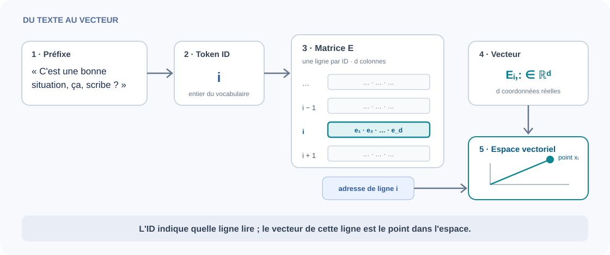

<!--
LLM-LAB-PAGE-MAP v1
id: "fr/embedding-space"
summary: "Explique comment un Token ID sélectionne une ligne de la matrice de plongements et comment le vecteur obtenu devient l'entrée des traitements ultérieurs."
scope: "Présente le lookup dans la matrice de plongements, la distinction entre adresse de ligne et coordonnées vectorielles, l'apprentissage de la matrice et la transition vers les représentations contextualisées. Le code, les exercices, les références et l'histoire détaillée sont déportés vers Build, Practice et Deepen."
purpose: "Le lecteur doit pouvoir expliquer qu'un Token ID sert d'indice/adresse de ligne dans E, identifier le vecteur contenu dans cette ligne et ne pas confondre ce vecteur avec un état contextualisé."
suggested_route:
  previous: "fr/text-data"
  next: "fr/positional-encoding"
hierarchy:
  parents: ["fr/text-data"]
  children: ["fr/positional-encoding", "fr/contextualized-representations", "fr/cosine-similarity", "fr/linearite-embeddings"]
related: ["fr/embedding-space-exercises", "fr/gpt-model-walkthrough"]
tags: ["type:concept-lesson", "destination:understand", "topic:embedding-space", "level:core", "language:fr", "status:published"]
-->



::: {.chapter-lead}
Après la tokenisation, le modèle reçoit une séquence d'**IDs entiers**. Chaque ID permet de retrouver un vecteur appris dans une table de paramètres : la **matrice de plongements** (*embedding matrix*). Cette page explique ce lookup, puis distingue soigneusement l'adresse de la ligne, le vecteur stocké dans cette ligne et les représentations que le Transformer construira ensuite.
:::

::: {.callout-note .learning-outcomes collapse="true" title="Objectifs d’apprentissage"}
À la fin de cette leçon, vous devriez pouvoir :
- expliquer comment un Token ID sélectionne une ligne de la matrice de plongements ;
- distinguer l'adresse de ligne du vecteur qui occupe cette ligne ;
- expliquer pourquoi deux occurrences du même ID partagent le même vecteur initial, mais peuvent ensuite avoir des états contextualisés différents.
:::

## Le point de départ : le préfixe fourni au modèle

Reprenons le fil rouge du parcours. Le texte déjà présent dans le contexte est la question de Panoramix :

> **Préfixe / prompt :** « C'est une bonne situation, ça, scribe ? »

La continuation commence ensuite par la réponse d'Otis — « Vous savez, moi je ne crois pas qu'il y ait de bonne ou de mauvaise situation... » — mais cette suite n'est pas encore présente au moment où le modèle traite le préfixe. Pour les démonstrations numériques reproductibles, le projet utilise aussi une continuation pédagogique originale ; aucune segmentation ni aucun ID ne doit être supposé universel.

Le tokenizer découpe le préfixe en tokens selon son vocabulaire et ses règles. Il attribue à chaque token un ID entier. Un mot visible n'est pas nécessairement un token unique : la segmentation exacte dépend du tokenizer utilisé.

## Le lookup : sélectionner une ligne, pas une coordonnée

La matrice de plongements, notée $E$, est une table apprise. Elle contient une ligne par ID du vocabulaire ; chaque ligne contient un vecteur de nombres réels.

{fig-alt="Le préfixe est découpé en tokens. Un token reçoit un ID i, utilisé comme indice ou adresse de ligne pour sélectionner la ligne i de la matrice E. Cette ligne contient un vecteur de d nombres, représentable comme un point dans l'espace de plongement. L'adresse de ligne et le point sont deux objets différents." fig-cap="Le Token ID sert à retrouver une ligne dans la table ; le vecteur contenu dans cette ligne est l'objet représenté dans l'espace vectoriel." width=100%}

La distinction est essentielle :

| Objet | Ce qu'il désigne | Rôle |
|---|---|---|
| **Token ID** $i$ | Un entier associé à un token par le tokenizer | Identifie une entrée du vocabulaire |
| **Indice / adresse de ligne** $i$ | La position de cette entrée dans la matrice $E$ | Indique quelle ligne sélectionner |
| **Vecteur d'embedding** $E_{i,:}$ | Les $d$ nombres réels stockés sur cette ligne | Représentation numérique initiale du token |
| **Point dans l'espace** | L'interprétation géométrique du vecteur $E_{i,:}$ | Permet d'étudier distances, directions et voisinages |

L'expression **adresse de ligne** décrit donc l'accès à la table, pas la position géométrique du token. Le vecteur est une liste de coordonnées ; c'est lui que l'on peut représenter comme un point dans un espace de dimension $d$.

## La matrice en une formule

Si le vocabulaire contient $V$ IDs et si chaque vecteur contient $d$ composantes, la matrice a $V$ lignes et $d$ colonnes :

$$
E \in \mathbb{R}^{V \times d}
$$

Pour un ID $i$, le lookup sélectionne la ligne correspondante :

$$
\mathbf{x}_i = E_{i,:} \in \mathbb{R}^{d}
$$

- $V$ est la taille du vocabulaire du tokenizer associé au modèle.
- $d$ est la dimension des vecteurs d'embedding.
- $E_{i,:}$ désigne toutes les composantes de la ligne $i$.

La matrice contient donc $V \times d$ paramètres. L'entier $i$ n'est ni une coordonnée de l'espace vectoriel, ni une mesure de proximité : deux IDs consécutifs peuvent sélectionner deux vecteurs très éloignés.

## D'où viennent les valeurs de la table ?

Les lignes de $E$ ne sont pas des définitions écrites à la main. La matrice fait partie des **paramètres appris** du réseau. Dans un entraînement classique, ses valeurs sont initialisées, puis ajustées avec les autres paramètres : le modèle produit des prédictions, une fonction de perte mesure l'écart avec les tokens cibles, la rétropropagation calcule des gradients et l'optimiseur met à jour les paramètres. Les gradients issus des exemples traversent aussi l'opération de lookup : les lignes sélectionnées par les IDs de ces exemples peuvent ainsi être ajustées pendant l'entraînement.

Le détail du calcul et du code appartient au parcours **Build** : [assembler le GPT et suivre les tables d'embeddings](gpt-model-walkthrough.qmd), dans la [visite guidée de construction](build-path.qmd). Pour le rôle de la loss et des gradients, voir aussi [la fonction de perte](loss.qmd) et [les gradients](gradients.qmd).

## Du vecteur initial à la représentation contextualisée

Avec une matrice fixe, deux occurrences du même ID sélectionnent la même ligne et obtiennent donc le même vecteur initial. Le lookup ne lit pas les mots voisins et ne désambiguïse pas le sens d'une phrase.

La position et le contexte interviennent ensuite, selon l'architecture. Les couches du Transformer transforment les vecteurs d'entrée en **états cachés contextualisés** : deux occurrences ayant le même vecteur initial peuvent alors avoir des représentations différentes si leurs positions ou leurs contextes accessibles diffèrent.

Pour la suite immédiate, consultez [l'encodage positionnel](positional-encoding.qmd), puis [les représentations contextualisées](contextualized-representations.qmd).

## Pour continuer selon votre objectif

- **Pratiquer :** [exercices sur les embeddings](exercises/embedding-space.qmd).
- **Construire :** [visite guidée du modèle GPT](gpt-model-walkthrough.qmd) — tables d'embeddings, dimensions et passe avant.
- **Approfondir :** [outils mathématiques et géométrie des représentations](deepen.qmd#outils-mathematiques-et-geometrie), notamment l'histoire des vecteurs de mots statiques, la similarité cosinus et les limites des interprétations géométriques.



::: {.language-switch}
**Langue :** [Français](embedding-space.qmd) · [English](../en/embedding-space.qmd)
:::
