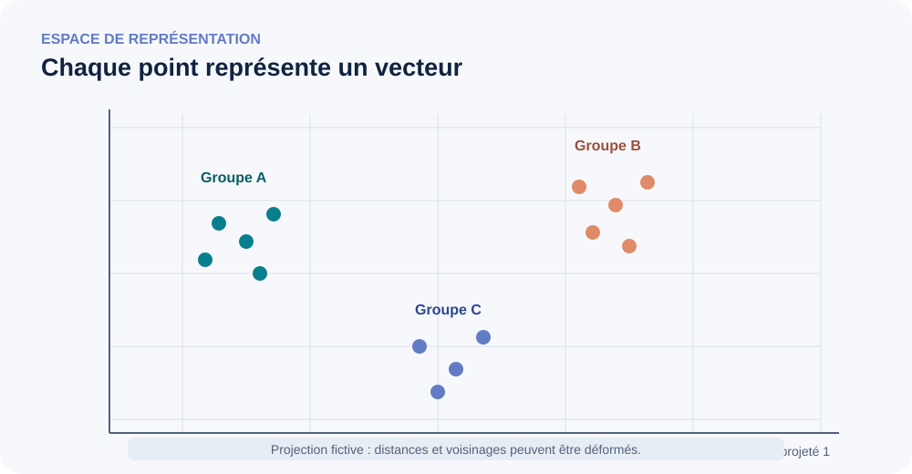

<!--
LLM-LAB-PAGE-MAP v1
id: "fr/embedding-space"
scope: "Explique le lookup qui associe chaque ID de token à un vecteur initial appris, puis distingue ce vecteur des représentations contextualisées produites par les couches du Transformer ; introduit prudemment la géométrie sans en faire un prérequis."
purpose: "Le lecteur doit pouvoir expliquer comment un ID sélectionne une ligne de la matrice de plongements (embedding), distinguer le vecteur de plongement initial de la représentation contextualisée, et comprendre pourquoi les propriétés géométriques demandent une interprétation dépendante du modèle et de la tâche."
suggested_route:
  previous: "fr/tokenization-strategies"
  next: "fr/positional-encoding"
hierarchy:
  parents: ["fr/text-data", "fr/transformer"]
  children: ["fr/positional-encoding", "fr/contextualized-representations", "fr/cosine-similarity", "fr/linearite-embeddings"]
related: []
tags: ["type:concept-lesson", "destination:understand", "topic:embedding-space", "level:core", "language:fr", "status:published"]
-->

::: {.chapter-lead}
Un **embedding**, ou **plongement**, est ici un vecteur numérique associé à un objet, par exemple un token. L'ensemble de ces vecteurs forme un espace de représentation. Le terme anglais reste très courant en apprentissage automatique ; *plongement* est son équivalent français et sera employé aussi dans cette page. On peut comparer leurs directions, leurs distances ou leurs voisins, mais leur interprétation dépend du modèle, de son entraînement et de la tâche : la géométrie n'est pas un dictionnaire universel du sens.
:::

<div class="pipeline-stepper" role="navigation" aria-label="Étapes du parcours LLM">
  <a class="step-item" href="text-data.qmd">1. Texte</a>
  <span class="step-arrow" aria-hidden="true">→</span>
  <span class="step-item active" aria-current="step">2. Embeddings</span>
  <span class="step-arrow" aria-hidden="true">→</span>
  <a class="step-item" href="queries-keys-values.qmd">3. Attention (Q, K, V)</a>
  <span class="step-arrow" aria-hidden="true">→</span>
  <a class="step-item" href="logits.qmd">4. Logits</a>
  <span class="step-arrow" aria-hidden="true">→</span>
  <a class="step-item" href="cross-entropy.qmd">5. Perte & Entraînement</a>
</div>

::: {.callout-tip title="L'idée à retenir en une minute"}
Un ID est une **adresse de ligne**, pas une coordonnée sémantique. La matrice d'embeddings — ou table de plongements — contient un vecteur appris par ID ; le lookup sélectionne simplement la bonne ligne. Deux occurrences du même ID récupèrent donc le même vecteur initial. C'est ensuite le traitement par le Transformer qui construit une représentation dépendant du contexte.

**Première lecture :** comprenez le lookup sur la petite matrice et retenez qu’un ID sélectionne une ligne, sans encoder lui-même une coordonnée sémantique.

**Pour approfondir :** la trace Python et le comptage des paramètres sont repliés dans des encadrés facultatifs ; les propriétés géométriques sont développées dans les pages sur la similarité cosinus et la linéarité.
:::


## D'où viennent les vecteurs ?

Un tokenizer découpe le texte en tokens et associe généralement chaque token à un identifiant entier. Une **matrice de plongements** (ou matrice d'embeddings) $E\in\mathbb{R}^{V\times d}$ contient un vecteur par identifiant : $V$ est la taille du vocabulaire et $d$ la dimension du plongement. Pour le token d'identifiant $i$, son **vecteur de plongement initial** est la ligne $E_i$.

Dans un Transformer, cette représentation est ensuite transformée par les couches du réseau. Il faut distinguer trois objets :

- **Embedding (plongement) de token :** vecteur initial récupéré dans la matrice du vocabulaire.
- **Représentation contextualisée :** vecteur produit après traitement du contexte, notamment par l'attention.
- **Plongement de phrase ou de document :** vecteur calculé par un modèle et une méthode d'agrégation conçus pour représenter un texte plus long.

Ces objets ne sont pas interchangeables. Une méthode adaptée aux plongements de phrases (embeddings de phrases) pour la recherche documentaire ne se transfère pas automatiquement aux activations internes d'un LLM.

### Une distinction historique : les vecteurs de mots statiques

Avant les modèles de langage contextualisés, des méthodes comme Word2Vec apprenaient **un vecteur par type de mot** à partir des régularités observées dans son contexte. CBOW prédit un mot cible à partir de son contexte ; Skip-gram prédit les mots environnants à partir d'un mot cible. Dans un modèle Word2Vec entraîné, le vecteur associé à une entrée du vocabulaire telle que `bank` reste le même quelle que soit la phrase où le mot apparaît.

Un Transformer procède autrement : sa table de plongements (table d'embeddings) associe chaque **ID de token** (souvent une unité sous-lexicale, et non un mot entier) à un vecteur initial. Un même ID sélectionne toujours la même ligne, mais les couches suivantes combinent cette représentation avec l'information positionnelle et contextuelle ; l'état caché obtenu peut donc varier d'une occurrence à l'autre. Un vecteur de mot statique Word2Vec, un embedding initial de token dans un Transformer et un état caché contextualisé sont des notions apparentées, mais non interchangeables.

Cette comparaison est conceptuelle : elle ne signifie pas que les embeddings des Transformers modernes sont initialisés ou entraînés comme ceux de Word2Vec. Voir [Mikolov et al. (2013)](https://arxiv.org/abs/1301.3781) pour les architectures originales de représentation des mots.

## Des identifiants aux vecteurs : une sélection par indice calculable à la main

Supposons que le vocabulaire contienne cinq identifiants et que chaque embedding ait deux coordonnées. Voici une petite matrice illustrative :

\[
E =
\begin{bmatrix}
0.1 & 0.0 \\
0.0 & 0.2 \\
0.8 & -0.1 \\
-0.2 & 0.5 \\
0.3 & 0.7
\end{bmatrix}
\in \mathbb{R}^{5\times 2}.
\]

Pour les identifiants \([2,0,3]\), la sélection par indice choisit les lignes \(E_2\), \(E_0\) et \(E_3\) :

\[
X =
\begin{bmatrix}
0.8 & -0.1 \\
0.1 & 0.0 \\
-0.2 & 0.5
\end{bmatrix}
\in \mathbb{R}^{3\times 2}.
\]

Les identifiants sont des indices de ligne ; les vecteurs obtenus sont des paramètres appris. Les valeurs ci-dessus sont inventées uniquement pour rendre le calcul vérifiable à la main. Elles ne représentent pas de vraies relations sémantiques : l'identifiant 3 n'est pas « plus proche » du 2 parce que les entiers se suivent.

Pour un lot de séquences, le changement de forme usuel est :

\[
\text{IDs des tokens }[B,L]
\;\longrightarrow\;
\text{embeddings des tokens }[B,L,d],
\]

où \(B\) est la taille du lot, \(L\) la longueur de séquence et \(d\) la dimension des embeddings. Le lookup ne mélange pas l'information entre les positions : deux occurrences du même identifiant récupèrent la même ligne avant l'ajout éventuel d'information positionnelle et le traitement contextuel.

::: {.callout-note collapse="true" title="Exemple facultatif"}

### Une trace reproductible : texte → IDs → lignes d'embedding
L'exemple relie un encodage de tokenizer réel et identifié à une table d'embeddings **synthétique**. Il utilise l'encodage BPE au niveau des octets de GPT-2 fourni par `tiktoken` ; les IDs ci-dessous sont vérifiés dans les tests publics de la bibliothèque. Installez la version figée avec `python -m pip install tiktoken==0.14.0`. NumPy est déjà une dépendance du projet.

```python
import numpy as np
import tiktoken

text = "hello world"  # une chaîne Unicode Python
utf8_bytes = text.encode("utf-8")
encoding = tiktoken.get_encoding("gpt2")
token_ids = encoding.encode(text)
token_bytes = [encoding.decode_single_token_bytes(i) for i in token_ids]
token_strings = [part.decode("utf-8") for part in token_bytes]

assert utf8_bytes == b"hello world"
assert token_ids == [31373, 995]
assert token_strings == ["hello", " world"]
assert encoding.decode(token_ids) == text

# Poids synthétiques : GPT-2 réel utilise une autre dimension et des valeurs apprises.
vocab_size, d = 50_257, 2
E = np.zeros((vocab_size, d), dtype=np.float32)
E[31373] = [0.1, 0.2]
E[995] = [-0.3, 0.4]
X = E[token_ids]

assert X.shape == (2, 2)
assert np.allclose(X, [[0.1, 0.2], [-0.3, 0.4]])

# Vecteurs positionnels absolus illustratifs, pas les paramètres réels de GPT-2.
P = np.array([[0.01, 0.02], [0.03, 0.04]], dtype=np.float32)
Z = X + P
assert Z.shape == (2, 2)
assert np.allclose(Z, [[0.11, 0.22], [-0.27, 0.44]])
```

Voici comment lire cette trace :

1. `text` est du texte Unicode ; son encodage UTF-8 produit des octets.
2. L'encodage `gpt2` choisi transforme le texte en IDs `[31373, 995]` ; leurs fragments d'octets se décodent en `"hello"` et `" world"`. L'espace initial appartient au second token.
3. Les IDs indexent les lignes de `E`. Les deux vecteurs sont des valeurs **inventées**, pas les embeddings du GPT-2 préentraîné ; la table utilise seulement la même plage d'indices de vocabulaire pour que les IDs réels puissent sélectionner des lignes.
4. `P` illustre l'ajout de vecteurs positionnels dans une architecture donnée. `Z` garde la forme `[L,d]` ; cet exemple n'exécute pas de bloc Transformer et ne calcule donc pas les états cachés contextualisés.

Les IDs exacts dépendent de l'encodage et du comportement de la bibliothèque ; un autre tokenizer peut produire des fragments et IDs différents. Les assertions rendent ces changements visibles au lieu de présenter la tokenisation comme universelle. Voir le [dépôt officiel de tiktoken](https://github.com/openai/tiktoken) et ses [tests d'encodage](https://github.com/openai/tiktoken/blob/0.14.0/tests/test_encoding.py) pour la sortie de référence.
:::

::: {.callout-note title="Coût en paramètres : où le trouver"}
La table d'embeddings contient $V \times d$ paramètres ; une projection de sortie distincte peut en ajouter $d \times V$, sauf si les poids d'entrée et de sortie sont partagés (*weight tying*). Le détail du comptage, les formes associées et un ordre de grandeur calculable sont proposés dans la page [Tenseurs](tensors.qmd).
:::

## De l'embedding initial aux représentations contextualisées

Le lookup s'arrête à la sélection d'une ligne de la matrice : il ne contextualise pas le vecteur. L'information positionnelle et le traitement par les couches du Transformer interviennent ensuite ; leur mécanisme dépend de l'architecture. Pour éviter de confondre ces étapes, voir la page dédiée à [l'encodage positionnel](positional-encoding.qmd), puis celle sur les [représentations contextualisées](contextualized-representations.qmd).

Pendant l'entraînement, les gradients peuvent modifier les lignes de la table d'embeddings utilisées par les exemples. Pour les conventions de dimensions et les opérations sur les tenseurs, voir la page [Tenseurs](tensors.qmd) ; pour l'étape précédente, voir [du texte aux tokens](text-data.qmd).

## Interpréter la géométrie avec prudence

{fig-alt="Points regroupés dans un plan abstrait. Les regroupements sont illustratifs et les axes ne correspondent pas nécessairement à des concepts humains." width=100%}

Cette projection est illustrative : les embeddings réels ont souvent des centaines ou des milliers de coordonnées, et une représentation 2D peut déformer les distances comme les voisinages.

La proximité géométrique dépend du modèle, de la couche, de l'entraînement et de la métrique. Elle ne prouve pas que deux textes sont équivalents ni qu'un document répond correctement à une question — la négation suffit parfois à inverser le sens malgré un vocabulaire presque identique.

Pour approfondir ces questions sans les confondre avec le mécanisme de lookup, voir la page sur la [similarité cosinus](cosine-similarity.qmd) et celle sur l'[hypothèse de linéarité des représentations](linearite-embeddings.qmd).

::: {.self-check}
## Vérifier sa compréhension

La [collection approfondie sur le Transformer](exercises.qmd#transformer) est prévue ; utilisez les vérifications ci-dessous en attendant.

1. Une matrice contient \(V\) lignes et des vecteurs de dimension \(d\). Combien de paramètres contient-elle, et que sélectionne l'ID \(i\) ?

<details>
<summary>Afficher le raisonnement</summary>

La matrice contient \(V\times d\) paramètres. L'ID \(i\) sélectionne la ligne \(E_i\) ; sa valeur entière sert d'indice, pas de coordonnée sémantique. Le traitement positionnel et la contextualisation interviennent ensuite, selon l'architecture (voir les deux pages dédiées).

</details>

2. Une projection 2D montre deux groupes de points bien séparés. Cela prouve-t-il que le modèle distingue correctement ces catégories sur de nouvelles données ?

<details>
<summary>Afficher le raisonnement</summary>

Non. Une projection 2D ne préserve qu’une partie de la géométrie et peut créer ou accentuer des séparations visuelles. Il faut définir une tâche, une métrique et un protocole d’évaluation sur des données pertinentes tenues à l’écart ; une figure exploratoire ne constitue pas une preuve de performance.

</details>
:::

## Références

- [Mikolov et al. (2013), Efficient Estimation of Word Representations in Vector Space](https://arxiv.org/abs/1301.3781).
- [Ethayarajh (2019), How Contextual are Contextualized Word Representations?](https://arxiv.org/abs/1909.00512).
- [Li et al. (2020), On the Sentence Embeddings from Pre-trained Language Models](https://aclanthology.org/2020.emnlp-main.733/).
- [Steck, Ekanadham & Kallus (2024), Is Cosine-Similarity of Embeddings Really About Similarity?](https://arxiv.org/abs/2403.05440).
- [Sentence Transformers — Semantic Textual Similarity](https://sbert.net/docs/sentence_transformer/usage/semantic_textual_similarity.html).

::: {.language-switch}
**Langue :** [Français](embedding-space.qmd) · [English](../en/embedding-space.qmd)
:::
