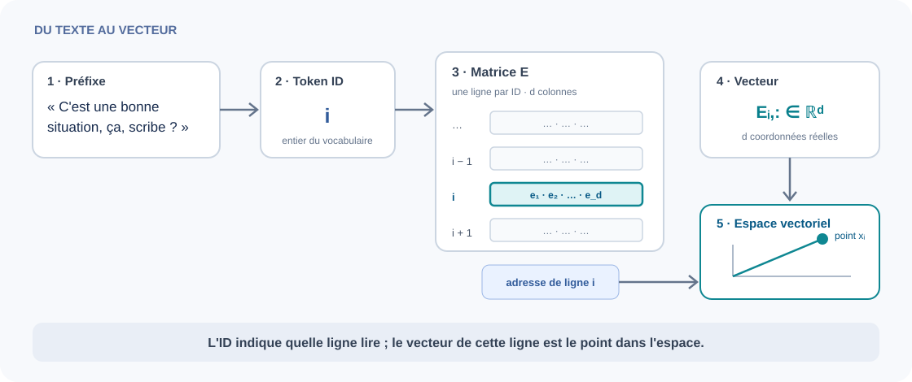

<!--
LLM-LAB-PAGE-MAP v1
id: "fr/embedding-space"
summary: "Suit une séquence d’IDs jusqu’aux vecteurs initiaux sélectionnés dans la matrice de plongements, en conservant leur ordre et les répétitions."
scope: "Suit le lookup d’une séquence d’IDs : position dans la séquence, identifiant, ligne lue et vecteur initial obtenu. Distingue ce résultat du traitement positionnel et des états contextualisés."
purpose: "Pour une séquence d’IDs, retrouver dans l’ordre les lignes et vecteurs lus, expliquer pourquoi deux occurrences du même ID partagent le même vecteur à table fixée et prévoir l’effet d’une renumérotation coordonnée."
suggested_route:
  previous: "fr/text-data"
  next: "fr/positional-encoding"
hierarchy:
  parents: []
  children: ["fr/cosine-similarity", "fr/linearite-embeddings"]
related: ["fr/text-data", "fr/positional-encoding", "fr/contextualized-representations", "fr/embedding-space-exercises", "fr/gpt-model-walkthrough"]
revision_support:
  status: integrated_sufficient
  evidence:
    - anchor: revision-summary
      note: "Le rappel distingue l’ID comme adresse, la position dans la séquence et le vecteur initial sélectionné. La fiche fait prédire l’ordre des lignes et la répétition du vecteur ; l’exercice associé étend le raisonnement à la renumérotation coordonnée des IDs et de la table."
tags: ["type:concept-lesson", "destination:understand", "topic:embedding-space", "level:core", "language:fr", "status:published"]
-->



::: {.chapter-lead}
Après la tokenisation, le modèle reçoit une séquence ordonnée d’**IDs entiers**. Chaque ID sélectionne une ligne de la **matrice de plongements** (*embedding matrix*) et le vecteur appris qui y est stocké : c’est le **lookup**. Les valeurs de cette matrice sont des paramètres du modèle, ajustés pendant l’entraînement ; le tokenizer fournit les IDs, mais ne calcule pas ces vecteurs.
:::

::: {.callout-note .learning-outcomes collapse="true" title="Objectifs d’apprentissage"}
À la fin de cette leçon, vous devriez pouvoir :

- expliquer comment un Token ID sélectionne une ligne de la matrice de plongements ;
- distinguer la position dans la séquence, l’ID et le vecteur sélectionné ;
- retrouver dans l’ordre les vecteurs d’une séquence d’IDs et justifier pourquoi les occurrences d’un même ID partagent le même vecteur initial à table fixée.
:::

## Le point de départ : le préfixe fourni au modèle

Le texte déjà présent dans le contexte est :

> **Préfixe / prompt :** « C'est une bonne situation, ça, scribe ? »

La [tokenisation du préfixe](text-data.qmd#tokenizer-output) donne à son dernier token l’ID GPT-2 `5633`. Dans la table associée à GPT-2, cet ID indique quelle ligne lire. La position indique le rang du token dans la séquence. Le découpage dépend du tokenizer, y compris à la fin de la question.

Contexte du fil rouge

La continuation commence par « Vous savez, moi je ne crois pas qu'il y ait de bonne ou de mauvaise situation... ». Elle n'est pas encore présente lorsque le modèle traite le préfixe ; elle sera ajoutée token par token pendant la génération. Aucune segmentation ni aucun ID ne doit être supposé universel.

## Le lookup : sélectionner une ligne, pas une coordonnée {#lookup}

La matrice de plongements, notée $E$, est une table apprise. Elle contient une ligne par ID du vocabulaire ; chaque ligne contient un vecteur de nombres réels.

Pour calculer les lignes et les vecteurs à la main, distinguons maintenant la sortie GPT-2 du préfixe de la séquence jouet `[17, 42, 8, 17]` utilisée dans l’[exercice sur le lookup](exercises/text-data.qmd#ex-text-to-embedding-lookup). Le tokenizer jouet découpe « chat suit le chat » en quatre tokens. Avec une indexation des positions à partir de zéro, la position $t$ indique le rang dans la séquence, tandis que $i_t$ désigne l’ID présent à cette position. Le lookup lit donc, dans l’ordre, les lignes $E_{17,:}$, $E_{42,:}$, $E_{8,:}$ et $E_{17,:}$.

| Position $t$ | 0 | 1 | 2 | 3 |
|---|---:|---:|---:|---:|
| ID $i_t$ | 17 | 42 | 8 | 17 |
| Ligne sélectionnée | $E_{17,:}$ | $E_{42,:}$ | $E_{8,:}$ | $E_{17,:}$ |
| Vecteur obtenu | $(2,-1)$ | $E_{42,:}$ | $E_{8,:}$ | $(2,-1)$ |

Dans l’exercice suivant sur l’[entrée du premier bloc](exercises/text-data.qmd#ex-token-to-block-input), le vecteur jouet de la ligne 17 est fixé à $(2,-1)$ pour suivre les deux occurrences de `chat` jusqu’à l’étape positionnelle. Cette valeur est illustrative : elle ne correspond pas à une ligne extraite des poids réels de GPT-2. Les deux occurrences lisent exactement le même vecteur parce qu’elles utilisent le même ID et la même table. Les vecteurs des lignes 42 et 8 restent symboliques ici ; l’exercice permet de raisonner sur leur ordre sans inventer leurs valeurs.

<figure id="fig-embedding-lookup">
  <picture>
    <source media="(max-width: 600px)" srcset="../images/embedding-lookup-fr-mobile.svg">
    
  </picture>
  <figcaption>Le Token ID sert à retrouver une ligne dans la table ; le vecteur contenu dans cette ligne est l’objet représenté dans l’espace vectoriel.</figcaption>
</figure>

| Objet | Ce qu'il désigne | Rôle |
|---|---|---|
| **Token ID** $i$ | Un entier associé à un token par le tokenizer | Identifie une entrée du vocabulaire |
| **Indice / adresse de ligne** $i$ | La position de cette entrée dans la matrice $E$ | Indique quelle ligne sélectionner |
| **Vecteur d'embedding** $E_{i,:}$ | Les $d$ nombres réels stockés sur cette ligne | Représentation numérique initiale du token |
| **Point dans l'espace** | L'interprétation géométrique du vecteur $E_{i,:}$ | Permet d'étudier distances, directions et voisinages |

L'expression **adresse de ligne** décrit donc l'accès à la table, pas la position géométrique du token. Le vecteur est une liste de coordonnées ; c'est lui que l'on peut représenter comme un point dans un espace de dimension $d$.

## La matrice en une formule {#embedding-matrix-lookup}

Si le vocabulaire contient $V$ IDs et si chaque vecteur contient $d$ composantes, la matrice a $V$ lignes et $d$ colonnes :

$$
E \in \mathbb{R}^{V \times d}
$$

Pour un ID $i$, le lookup sélectionne la ligne correspondante :

$$
\mathbf{x}_i = E_{i,:} \in \mathbb{R}^{d}
$$

- $V$ est la taille du vocabulaire du tokenizer associé au modèle.
- $d$ est la dimension des vecteurs d'embedding.
- $E_{i,:}$ désigne toutes les composantes de la ligne $i$.

Pour une séquence d'IDs $(i_0,\ldots,i_{T-1})$, le lookup s'applique à chaque position $t$, dans le même ordre :

$$
X = \begin{bmatrix}
E_{i_0,:} \\
E_{i_1,:} \\
\vdots \\
E_{i_{T-1},:}
\end{bmatrix}
\in \mathbb{R}^{T \times d}
$$

$T$ est le nombre de positions de la séquence et $d$ la dimension de chaque vecteur. Pour l’exemple $[17,42,8,17]$, $T=4$ et la sortie a donc la forme $(4,d)$. Si un ID apparaît deux fois, les lignes correspondantes de $X$ sont identiques avant tout traitement positionnel. La position $t$, l’ID $i_t$ et le vecteur $E_{i_t,:}$ désignent trois objets distincts.

La matrice contient donc $V \times d$ paramètres. L'entier $i$ n'est ni une coordonnée de l'espace vectoriel, ni une mesure de proximité : deux IDs consécutifs peuvent sélectionner deux vecteurs très éloignés.

Les numéros d'ID sont des étiquettes, pas des propriétés des vecteurs : renuméroter le vocabulaire en déplaçant les lignes correspondantes de la matrice préserve le lookup. La [leçon sur le passage du texte aux tokens](text-data.qmd#experience-texte-ids) explique cette invariance à l'échelle du contrat entre tokenizer et modèle ; l'exercice associé permet de la vérifier sur une séquence concrète.

Le tokenizer fixe le vocabulaire et l'association entre tokens et IDs ; il ne fournit pas les valeurs de $E$. Ces valeurs sont des **paramètres appris du réseau** : elles sont initialisées, puis ajustées pendant l'entraînement. Lorsqu'un exemple utilise l'ID $i$, le gradient de la perte peut contribuer à l'ajustement de la ligne $E_{i,:}$. Le lookup sélectionne cette ligne ; il ne calcule pas lui-même son contenu.

## Du vecteur initial à la représentation contextualisée {#du-lookup-a-la-representation-contextualisee}

Avec une matrice fixe, deux occurrences du même ID sélectionnent la même ligne et obtiennent donc le même vecteur initial. Le lookup ne lit pas les mots voisins et ne désambiguïse pas le sens d'une phrase.

La position et le contexte interviennent ensuite, selon l'architecture. Les couches du Transformer transforment les vecteurs d'entrée en **états cachés contextualisés** : deux occurrences ayant le même vecteur initial peuvent alors avoir des représentations différentes si leurs positions ou leurs contextes accessibles diffèrent.

::: {.callout-tip title="L'idée à retenir en une minute" #revision-summary}
Un **Token ID est une adresse de ligne**, pas un vecteur ni une coordonnée dans l'espace. La matrice d'embeddings $E\in\mathbb{R}^{V\times d}$ associe à chaque ID un vecteur initial de dimension $d$. Deux occurrences du même ID partagent ce vecteur de lookup ; les couches du Transformer peuvent produire des états contextualisés différents selon la position et le contexte.
:::

Ces deux occurrences lisent le même vecteur. L’[encodage positionnel](positional-encoding.qmd) explique comment leur rang intervient dans le calcul. Les blocs Transformer intègrent les informations du préfixe accessible pour produire des [représentations contextualisées](contextualized-representations.qmd).

## Exercices

Les questions et exercices de cette leçon sont regroupés sur sa [page d’exercices dédiée](exercises/embedding-space.qmd).



::: {.language-switch}
**Langue :** [Français](embedding-space.qmd) · [English](../en/embedding-space.qmd)
:::

## Approfondir

:::: {.supplementary-resources}

Ressources complémentaires

::: {.learning-resources__content}

### Pour continuer selon votre objectif

- **Construire :** [visite guidée du modèle GPT](gpt-model-walkthrough.qmd) — tables d'embeddings, dimensions et passe avant.
- **Approfondir :** [outils mathématiques et géométrie des représentations](deepen.qmd#outils-mathematiques-et-geometrie), notamment l'histoire des vecteurs de mots statiques, la similarité cosinus et les limites des interprétations géométriques.

### D'où viennent les valeurs de la table ?

Le détail du calcul et du code appartient au parcours **Build** : [assembler le GPT et suivre les tables d'embeddings](gpt-model-walkthrough.qmd), dans la [visite guidée de construction](build-path.qmd). Pour le rôle de la loss et des gradients, voir aussi [la fonction de perte](loss.qmd) et [les gradients](gradients.qmd).

:::

::::
