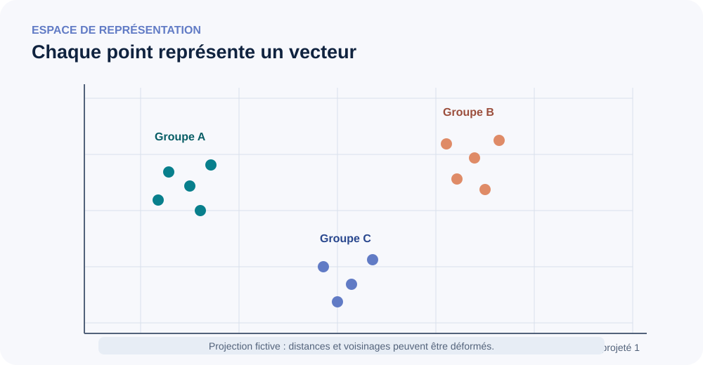

<!--
LLM-LAB-PAGE-MAP v1
id: "fr/embeddings-deep-dive"
summary: "Dossier spécialisé et autonome sur les représentations vectorielles, leurs familles, leurs objectifs d'apprentissage, leur géométrie, leur évaluation et leurs usages."
scope: "Prend du recul sur les embeddings au sens large, y compris hors LLM. Reprend les intuitions visuelles et l'étude de cas de la source Hesam Sheikh Hessani, sans remplacer les leçons canoniques du parcours principal."
purpose: "Permettre au lecteur de comparer les grandes familles d'embeddings, de comprendre ce qu'un vecteur encode selon son objectif, de choisir une métrique et un protocole d'évaluation adaptés, et de ne pas confondre token, contexte, phrase et représentation multimodale."
suggested_route:
  previous: null
  next: null
hierarchy:
  parents: ["fr/deepen"]
  children: []
related: ["fr/embedding-space", "fr/contextualized-representations", "fr/cosine-similarity", "fr/linearite-embeddings", "fr/tokenizer-design-evaluation"]
tags: ["type:deep-dive", "destination:deepen", "topic:embeddings", "level:advanced", "language:fr", "status:published"]
-->

# Pourquoi consacrer un dossier entier aux embeddings ?

Un **embedding** est une représentation d'un objet sous la forme d'un vecteur numérique. L'objet peut être un mot, un token, une phrase, un document, une image, un segment audio, un utilisateur, un produit ou un nœud de graphe. Le terme ne désigne donc pas une technique unique, ni une propriété magique de « compréhension » : il désigne une famille de représentations dont la forme, l'espace et l'utilité dépendent de la tâche et de la méthode qui les a produites.

Les LLM utilisent des embeddings, mais l'histoire et les usages des représentations vectorielles sont beaucoup plus vastes. Ce dossier est volontairement autonome : il reprend certaines notions déjà rencontrées dans le parcours principal et les développe sous un angle comparatif, historique, mathématique et expérimental.

::: {.callout-note}
**Fil directeur :** un vecteur n'a pas de sens indépendamment de son objet, de son modèle, de son objectif d'apprentissage, de ses transformations et de la tâche pour laquelle on l'évalue.
:::

## 1. Une même idée générale, des objets très différents

On peut résumer le principe en trois opérations :

1. définir les objets à représenter et les distinctions que l'on souhaite conserver ;
2. apprendre ou calculer une fonction qui associe à chaque objet un vecteur ;
3. exploiter ces vecteurs pour une tâche : recherche, classement, regroupement, prédiction, recommandation, alignement multimodal, etc.

```{mermaid}
flowchart LR
    A["Objet à représenter<br/>mot · document · image · son · nœud"] --> B["Méthode / encodeur<br/>règles, statistiques ou réseau appris"]
    B --> C["Vecteur<br/>dense ou creux"]
    C --> D["Opération géométrique<br/>distance · similarité · projection"]
    D --> E["Tâche<br/>recherche · classification · clustering · recommandation"]
```

Cette chaîne met en évidence une distinction essentielle : **l'encodeur construit une représentation ; la métrique et la tâche déterminent ce que l'on en fait**. Une proximité géométrique n'est pas une définition universelle de la similarité.

### Représenter n'est pas simplement compresser

Une représentation peut conserver certaines informations et en négliger d'autres. Un embedding entraîné pour retrouver des documents pertinents peut privilégier les indices utiles à la recherche, pas toutes les nuances linguistiques. Un embedding d'image entraîné pour distinguer des catégories visuelles n'est pas nécessairement adapté à la recherche de similarité esthétique. Un vecteur est toujours le résultat d'un choix de représentation et d'un objectif.

## 2. Les grandes familles : une carte plutôt qu'une succession de remplacements

Les familles ci-dessous se recouvrent parfois. Elles ne forment pas une chronologie où chaque méthode rendrait la précédente obsolète.

```{mermaid}
flowchart TD
    E["Représentations vectorielles"] --> S["Creuses / lexicales"]
    E --> D["Denses / distribuées"]
    S --> O["One-hot · comptages · TF-IDF"]
    D --> W["Vecteurs statiques de mots"]
    D --> C["Représentations contextualisées"]
    D --> P["Phrases et documents"]
    D --> M["Multimodales"]
    W --> W1["Word2Vec · GloVe · fastText"]
    C --> C1["ELMo · BERT · états de Transformers"]
    P --> P1["Pooling · SBERT · encodeurs contrastifs"]
    M --> M1["CLIP et espaces texte-image<br/>audio-texte, etc."]
```

| Famille | Objet représenté | Ce qui la caractérise | Exemple d'usage |
|---|---|---|---|
| **One-hot** | Identifiant discret | Vecteur creux, une seule composante active ; aucune proximité sémantique native | Entrée catégorielle, base de comparaison |
| **Comptages / TF-IDF** | Document ou fragment de texte | Dimensions associées aux termes ; pondération par fréquence et rareté | Recherche lexicale, classement documentaire |
| **Vecteurs statiques** | Mot ou unité lexicale | Un vecteur par entrée du vocabulaire, quel que soit le contexte | Analyses lexicales, analogies exploratoires |
| **Sous-mots** | Unités morphologiques ou fragments | Partage statistique entre formes apparentées, selon la méthode | Langues riches morphologiquement, mots rares |
| **Contextualisés** | Token à une position dans une séquence | La représentation dépend du contexte traité par le réseau | Encodage de séquences, extraction de caractéristiques |
| **Phrases / documents** | Texte de longueur variable | Agrégation ou encodeur entraîné pour représenter le texte entier | Recherche sémantique, dédoublonnage, clustering |
| **Multimodaux** | Objets de modalités différentes | Espaces alignés pour comparer, associer ou transférer entre modalités | Recherche texte-image, audio-texte |

### 2.1 Représentations creuses : compter avant d'apprendre une géométrie dense

Dans une représentation *one-hot*, chaque catégorie reçoit un vecteur dont une seule composante vaut 1. Deux catégories distinctes sont orthogonales : la représentation n'exprime pas qu'elles sont proches ou apparentées.

Avec les représentations de type **bag-of-words**, on compte les termes présents dans un document. TF-IDF pondère ces comptes pour réduire le poids des termes fréquents dans l'ensemble du corpus. Les vecteurs sont généralement de grande dimension et creux.

TF-IDF n'est pas un embedding appris de mots : un vecteur TF-IDF décrit un document ou un fragment selon un vocabulaire de termes. C'est une représentation vectorielle, mais l'objet et la sémantique de ses dimensions diffèrent de ceux d'une table Word2Vec ou d'un embedding de token.

### 2.2 Vecteurs distribués et statiques : apprendre à partir des cooccurrences

L'hypothèse distributionnelle résume une intuition puissante : les unités qui apparaissent dans des contextes comparables tendent à partager certaines propriétés. Les méthodes neuronales apprennent des vecteurs denses à partir de régularités de cooccurrence.

- **Word2Vec – CBOW** prédit un mot cible à partir des mots de son contexte.
- **Word2Vec – Skip-gram** prédit des mots de contexte à partir du mot cible.
- **GloVe** exploite des statistiques globales de cooccurrence.
- **fastText** représente les mots à partir de sous-mots, notamment des n-grammes de caractères, ce qui permet de partager de l'information entre formes apparentées.

Ces méthodes produisent typiquement un vecteur statique par entrée lexicale. Le mot *banc* garde ainsi le même vecteur dans « banc de poissons » et « banc public » : le vecteur peut refléter plusieurs usages agrégés, mais il ne se reconfigure pas à chaque phrase.

### 2.3 Représentations contextualisées : la position et la phrase comptent

Les modèles comme ELMo, puis les encodeurs de type BERT et les Transformers, produisent des représentations qui dépendent de la séquence et de la position considérées. Une même entrée lexicale peut conduire à des états différents dans deux contextes.

Il faut néanmoins distinguer :

- la **table d'embeddings d'entrée**, qui associe un vecteur initial à chaque ID ;
- l'**état caché contextualisé**, calculé par les couches du réseau pour une occurrence donnée ;
- l'**embedding de phrase ou de document**, construit par pooling, tête dédiée ou encodeur spécialisé.

Le mot « embedding » est employé pour ces trois objets dans la littérature. Toujours préciser lequel est comparé.

### 2.4 Embeddings de phrases et de documents : une autre cible d'apprentissage

Un état de token n'est pas automatiquement un bon vecteur de phrase. Pour obtenir une représentation d'un texte entier, on peut agréger les états (moyenne, token spécial, pooling pondéré) ou entraîner un encodeur spécifiquement pour la similarité entre textes.

Les modèles de type Sentence-BERT et les approches contrastives apprennent à rapprocher certaines paires (paraphrases, requête-document pertinent, vues positives) et à éloigner des exemples négatifs selon un objectif défini. Le protocole de construction des paires et la qualité des négatifs influencent fortement ce que l'espace encode.

### 2.5 Espaces multimodaux : rapprocher des modalités différentes

Un modèle multimodal peut encoder texte et image dans un espace commun, par exemple afin qu'une description et une image correspondante aient des vecteurs proches. CLIP est un exemple connu d'alignement texte-image par apprentissage contrastif. Des approches analogues existent pour audio-texte et d'autres modalités.

Un espace commun ne signifie pas que les modalités deviennent identiques : il signifie que l'entraînement a appris une géométrie dans laquelle certaines correspondances entre modalités sont utiles à une tâche.

## 3. Comment un embedding est-il appris ?

Le vecteur est rarement une définition inscrite à la main. Il résulte d'un objectif et d'un signal d'entraînement.

```{mermaid}
flowchart LR
    A["Données<br/>contextes, paires, labels"] --> B["Objectif d'apprentissage<br/>prédiction · contraste · reconstruction"]
    B --> C["Encodeur et paramètres"]
    C --> D["Vecteurs"]
    D --> E["Score / perte"]
    E --> F["Gradient et mise à jour"]
    F --> C
```

Quelques objectifs typiques :

- **Prédiction de contexte** : apprendre à prédire des mots environnants (Skip-gram, CBOW).
- **Prédiction masquée** : reconstruire des tokens masqués dans leur contexte (préentraînement de type BERT).
- **Contraste** : rapprocher des vues ou paires positives et repousser des exemples négatifs.
- **Reconstruction** : conserver assez d'information pour reconstruire tout ou partie de l'entrée.
- **Supervision de tâche** : rendre les vecteurs utiles pour classer, retrouver, recommander ou prédire.

La question utile n'est donc pas seulement « que signifie cette dimension ? », mais « quel signal a poussé l'encodeur à organiser l'espace de cette façon ? ».

## 4. Géométrie : distances, angles, normes et pièges

Un vecteur de dimension (d) est un point de (mathbb{R}^d). Mais les coordonnées prises séparément n'ont généralement pas d'interprétation stable. Les relations entre vecteurs dépendent du modèle, de la couche, de la normalisation et de la métrique.

### 4.1 Trois mesures courantes

Pour deux vecteurs (x) et (y) :

- **Produit scalaire** : (x^\top y). Il dépend à la fois de l'angle et des normes.
- **Distance euclidienne** : (\|x-y\|_2). Elle mesure une distance dans la géométrie choisie.
- **Similarité cosinus** : (\frac{x^\top y}{\|x\|_2\,\|y\|_2}). Elle compare l'angle et ignore l'échelle radiale.

La normalisation L2 rend les normes égales à 1 ; dans ce cas, maximiser le produit scalaire revient à maximiser le cosinus. Sans normalisation, ces scores ne sont pas interchangeables.

### 4.2 Une figure 2D n'est pas l'espace d'origine

Une projection (PCA, t-SNE, UMAP ou autre) transforme des vecteurs de grande dimension en coordonnées plus faciles à visualiser. Elle sert à explorer, pas à prouver. Les méthodes n'optimisent pas les mêmes propriétés : certaines préservent principalement la variance, d'autres des voisinages locaux ou une structure choisie.

{fig-alt="Des vecteurs sont projetés dans un plan abstrait ; les regroupements sont illustratifs et ne garantissent pas une proximité sémantique." fig-cap="Une projection 2D facilite l'exploration, mais ne prouve pas que les distances et groupes visibles existent à l'identique dans l'espace d'origine." width=100%}

### 4.3 Voisins proches, graphe et sens

Une recherche des (k) plus proches voisins construit un voisinage conditionné par le modèle, les vecteurs, la normalisation, la métrique, la valeur de (k) et la règle d'exclusion de soi-même. Le lien « A est dans les k voisins de B » n'implique pas toujours la réciproque.

Transformer ces liens en graphe non orienté impose une règle de symétrisation (union ou voisinage mutuel). Un layout de graphe déplace les nœuds pour rendre le dessin lisible : ses coordonnées ne restituent pas fidèlement les distances de l'espace vectoriel.

**À ne pas conclure trop vite :** une proximité cosinus n'établit ni synonymie, ni interchangeabilité, ni équivalence logique. « autorisé » et « interdit » peuvent apparaître dans des contextes proches ; la négation et les relations argumentatives ne se résument pas à la proximité de quelques mots.

### 4.4 Anisotropie, hubs et malédiction de la dimension

Dans les espaces de grande dimension, les distances peuvent se concentrer et certains vecteurs devenir voisins d'un grand nombre de points (*hubness*). Les représentations peuvent aussi être anisotropes : les vecteurs occupent certaines directions de façon disproportionnée plutôt que de remplir uniformément l'espace.

Cela affecte les classements de voisins et la recherche. La normalisation, le centrage, la réduction de dimension ou des métriques apprises peuvent aider dans certains protocoles, mais ne sont pas des corrections universelles. Toute transformation doit être évaluée sur la tâche cible.

## 5. Qu'est-ce qu'un « bon » embedding ?

Il n'existe pas de score universel de qualité. Un embedding est bon **pour un usage, un domaine, une population et un protocole donnés**.

| Dimension d'évaluation | Question | Exemples de vérification |
|---|---|---|
| Qualité intrinsèque | La géométrie reflète-t-elle une propriété ciblée ? | Similarité humaine, analogies, voisinages |
| Qualité aval | Le vecteur améliore-t-il la tâche réelle ? | Recherche, classement, classification |
| Robustesse | Les résultats résistent-ils aux variations ? | Reformulation, bruit, fautes, domaine |
| Couverture | Quels objets sont mal représentés ? | Mots rares, langues, entités, modalités |
| Calibration et biais | Les scores sont-ils comparables et équitables ? | Sous-groupes, biais de corpus, seuils |
| Coût opérationnel | La représentation est-elle exploitable à l'échelle ? | Latence, mémoire, index, mise à jour |

Il faut séparer les tests intrinsèques (qui sondent une propriété de l'espace) des évaluations extrinsèques (qui mesurent une tâche). Une belle visualisation ou une analogie réussie ne suffit pas à valider un système de recherche.

## 6. De l'embedding à la recherche vectorielle

La recherche vectorielle ajoute une chaîne d'ingénierie autour du modèle :

1. définir les documents, les passages et leurs métadonnées ;
2. choisir un encodeur et une stratégie de découpage (*chunking*) ;
3. encoder les passages et les requêtes avec des conventions compatibles ;
4. appliquer la normalisation attendue par le modèle et l'index ;
5. indexer les vecteurs (recherche exacte ou approximative) ;
6. récupérer des candidats, puis éventuellement les réordonner avec un reranker ;
7. évaluer le rappel, la précision, le classement et la robustesse sur des requêtes représentatives.

Une base vectorielle ne rend pas les embeddings pertinents par elle-même. Un mauvais découpage, un encodeur mal adapté, des documents obsolètes ou une évaluation inadéquate produisent un mauvais système, même avec un index rapide.

## 7. Étude de cas : inspecter une table d'embeddings de LLM

La ressource de Hesam Sheikh Hessani propose une progression visuelle particulièrement utile : panorama des familles, rappels sur TF-IDF et Word2Vec, distinction statique/contextualisé, lookup d'une table de modèle, voisins cosinus et atlas sous forme de graphe.

[Ouvrir le guide visuel original sur Hugging Face](https://huggingface.co/spaces/hesamation/primer-llm-embedding) · [Dépôt de code associé](https://github.com/hesamsheikh/primer-llm-embeddings).

Le projet reprend cette progression comme **étude de cas**, mais qualifie plusieurs points :

- TF-IDF décrit ici des documents/fragments par des poids de termes ; ce n'est pas un embedding appris de mots.
- Les dimensions et la taille de vocabulaire sont propres au checkpoint.
- La table d'entrée d'un LLM n'est pas la même chose que les états contextualisés produits par ses couches.
- Les IDs doivent rester les identifiants des lignes ; décoder puis re-tokeniser une chaîne n'est pas une manière fiable de retrouver le vecteur d'origine.
- Les voisins cosinus dépendent du modèle et des conventions de calcul ; ils ne constituent pas une ontologie.
- Un graphe de voisins doit expliciter son orientation et sa règle de symétrisation.

### Une expérience minimale reproductible

LLM Lab propose un outil NumPy sans téléchargement de modèle : [inspecter une petite table d'embeddings dans l'exercice bilingue](../fr/exercises/embedding-space.qmd). Il permet de retrouver des lignes directement par ID et de calculer un top-k cosinus déterministe. Il ne prétend pas reproduire le checkpoint ni l'atlas interactif de la source.

### À propos des figures de la source

Les figures originales les plus intéressantes sont le panorama des familles, les visualisations TF-IDF/Word2Vec, le schéma de lookup et l'atlas de voisins. Le Space indique une licence Apache-2.0, mais certaines illustrations intégrées sont créditées à des tiers (notamment Manning). Pour éviter de réattribuer à l'auteur des droits qu'il ne détient peut-être pas, LLM Lab conserve un lien vers la ressource et construit ses propres schémas pédagogiques plutôt que de recopier ces fichiers. Les figures du dossier LLM Lab sont originales ou déjà présentes dans le projet ; les sources externes restent attribuées.

## 8. Les embeddings hors LLM

Le même principe vectoriel intervient dans des domaines très différents :

- **Vision** : recherche d'images, regroupement de scènes, reconnaissance de caractéristiques.
- **Audio et parole** : reconnaissance, recherche de segments, comparaison de locuteurs ou alignement audio-texte.
- **Recommandation** : vecteurs d'utilisateurs et d'articles appris à partir d'interactions.
- **Graphes** : représenter des nœuds ou relations pour prédire des liens et comparer des voisinages.
- **Biologie et chimie** : représenter des séquences, molécules ou structures pour la recherche et la prédiction.
- **Géospatial** : encoder des lieux ou trajectoires pour certaines tâches de proximité.

Attention au mot « distance » : dans chaque domaine, elle exprime la structure induite par un objectif et des données spécifiques, pas une proximité universelle entre objets.

## 9. Parcours d'approfondissement à partir de ce dossier

Ce dossier sert de carrefour vers des questions plus spécialisées :

- [Similarité cosinus](cosine-similarity.qmd) — propriétés, normalisation et interprétation des scores.
- [Linéarité des embeddings](linearite-embeddings.qmd) — relations linéaires et limites des analogies.
- [Représentations contextualisées](contextualized-representations.qmd) et [approfondissement mathématique](contextualized-representations-advanced.qmd) — états par position, couche et contexte.
- [Conception et évaluation des tokenizers](tokenizer-design-evaluation.qmd) — unités lexicales, segmentation et conséquences sur les représentations.
- [JEPA et représentations multimodales](jepa-platonic-representation.qmd) — apprentissage de représentations et alignement entre modalités.

Des dossiers futurs pourront approfondir séparément les embeddings de phrases et la recherche sémantique, l'alignement multimodal, ou l'évaluation des espaces vectoriels. Ils devront chacun répondre à une question autonome, plutôt que multiplier les pages qui répètent cette vue d'ensemble.

## Références pour aller plus loin

- Bengio et al. (2003), [A Neural Probabilistic Language Model](https://www.jmlr.org/papers/v3/bengio03a.html).
- Mikolov et al. (2013), [Efficient Estimation of Word Representations in Vector Space](https://arxiv.org/abs/1301.3781).
- Pennington et al. (2014), [GloVe: Global Vectors for Word Representation](https://aclanthology.org/D14-1162/).
- Bojanowski et al. (2017), [Enriching Word Vectors with Subword Information](https://arxiv.org/abs/1607.04606).
- Peters et al. (2018), [Deep Contextualized Word Representations](https://arxiv.org/abs/1802.05365).
- Reimers & Gurevych (2019), [Sentence-BERT](https://arxiv.org/abs/1908.10084).
- Radford et al. (2021), [Learning Transferable Visual Models From Natural Language Supervision](https://arxiv.org/abs/2103.00020).
- Ethayarajh (2019), [How Contextual are Contextualized Word Representations?](https://arxiv.org/abs/1909.00512).

---

[Retour à la carte des approfondissements](deepen.qmd) · [Leçon de base : des IDs aux vecteurs](embedding-space.qmd)

::: {.language-switch}
**Langue :** [Français](embeddings-deep-dive.qmd) · [English](../en/embeddings-deep-dive.qmd)
:::
