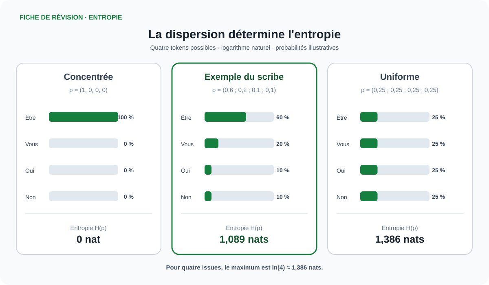

<!--
LLM-LAB-PAGE-MAP v1
id: "fr/entropy"
summary: "Définit l’entropie de la distribution du prochain token comme mesure de dispersion prédictive avant l’observation de la cible, puis la distingue de la surprise du token observé, de la vraisemblance d’une séquence et de l’entropie croisée."
scope: "Mesure l’incertitude d’une distribution prédictive à contexte fixé. La compression est une application complémentaire."
purpose: "Comparer l’entropie de deux distributions sur le même vocabulaire et distinguer cette moyenne de la surprise du token observé."
suggested_route:
  previous: "fr/probabilites"
  next: "fr/vraisemblance"
hierarchy:
  parents: ["fr/probabilites"]
  children: ["fr/cross-entropy"]
related: ["fr/vraisemblance", "fr/entropy-exercises"]
revision_support:
  status: integrated_sufficient
  evidence:
    - anchor: revision-summary
      note: "Le rappel et six questions corrigées couvrent la distribution conditionnelle au contexte, l'entropie et le surprisal, l'effet de la température, la calibration empirique et les conventions de comparaison."
tags: ["type:concept-lesson", "destination:understand", "topic:entropy", "level:core", "language:fr", "status:published"]
-->



::: {.chapter-lead}
Au premier tour du scribe, « Vous » reçoit 60 %. Comment résumer la répartition des probabilités entre tous les candidats ? L’**entropie** mesure la dispersion de la [distribution issue des logits](probabilites.qmd) pour ce préfixe, avant de choisir ou d’observer un token. La vérité de la réponse et la fiabilité du modèle demandent une évaluation distincte.
:::

::: {.callout-tip title="L'idée à retenir en une minute" #revision-summary}
- **Entropie prédictive :** $H(p)=-\sum_v p(v)\log p(v)$ résume la dispersion de toute la distribution du prochain token pour un préfixe donné.
- **Surprise observée :** $-\log p(x_t\mid x_{<t})$ concerne le token effectivement observé ; ce n'est pas l'entropie de la distribution.
- **Bornes :** pour un vocabulaire fini de taille $V$, $0\leq H(p)\leq\log V$ nats (logarithme naturel).
- **Interprétation :** faible entropie ne signifie ni vérité ni calibration ; tokenizer, contexte et température influencent la quantité mesurée.

**Question rapide :** pouvez-vous distinguer l'incertitude avant observation de la surprise après observation d'une cible ?
:::

:::: {.pipeline-stepper .meta-flow .meta-flow--branch role="group" aria-label="Carte des notions liées à la distribution prédictive"}
::: {.meta-flow__source}
<strong>Distribution prédictive</strong>p(token suivant | contexte)
:::
::: {.meta-flow__relation}
Deux questions différentes selon que le token est observé ou non
:::
::: {.meta-flow__comparison}
::: {.meta-flow__comparison-item .meta-flow__branch--active}
<strong>Avant observation · Entropie H(p)</strong><small>Dispersion moyenne de toute la distribution : incertitude prédictive</small>
:::
::: {.meta-flow__comparison-item}
<strong>Après observation · Surprise −log p(y)</strong><small>Score du token effectivement observé ; voir la [vraisemblance](vraisemblance.qmd)</small>
:::
:::
::: {.meta-flow__result}
<strong>Avec une distribution cible q : entropie croisée H(q, p)</strong> · [Comparer prédiction et cible](cross-entropy.qmd)
:::
::::

Pour le préfixe « C'est une bonne situation, ça, scribe ? », l'entropie décrit la dispersion de la distribution sur les tokens candidats au prochain pas. Elle ne mesure ni la vérité de la continuation ni la probabilité de toute la phrase à venir.

## Entropie de la distribution du prochain token

Pour un préfixe $x_{<t}$, le modèle produit une distribution catégorielle sur son vocabulaire :

$$
p_\theta(v\mid x_{<t}),\qquad v\in\mathcal V.
$$

Son entropie, avec le logarithme naturel, vaut (avec la convention $0\log 0=0$) :

$$
H_t=-\sum_{v\in\mathcal V}p_\theta(v\mid x_{<t})
\log p_\theta(v\mid x_{<t}).
$$

Une distribution concentrée sur quelques tokens a généralement une entropie plus faible qu'une distribution étalée. Pour un vocabulaire de taille $V$, l'entropie est comprise entre 0 et $\log V$ nats. Cette borne suppose une distribution discrète normalisée sur un vocabulaire fini.

L'entropie dépend du contexte et de la distribution effectivement considérée. Le même préfixe peut conduire à des distributions différentes selon le modèle, le tokenizer ou la température appliquée aux logits.

### Exemple numérique : la distribution du scribe

Reprenons le premier tour du scribe et sa distribution illustrative sur quatre tokens candidats :

| Token candidat | Probabilité |
|---|---:|
| « Vous » | 0,6 |
| « Je » | 0,2 |
| « Moi » | 0,1 |
| « Oui » | 0,1 |

Avec des logarithmes naturels, l'entropie vaut :

$$
\begin{aligned}
H(p)&=-\sum_v p(v)\ln p(v)\\
&=-(0{,}6\ln0{,}6+0{,}2\ln0{,}2
+2\times0{,}1\ln0{,}1)\\
&\approx 1{,}089\text{ nats}.
\end{aligned}
$$

Le maximum pour quatre issues est $\ln4\approx1{,}386$ nats : cette distribution atteint donc environ 79 % de ce maximum. Les valeurs sont illustratives ; elles servent à suivre le même exemple dans les pages sur la [vraisemblance](vraisemblance.qmd), l'[entropie croisée](cross-entropy.qmd) et les [gradients](gradients.qmd).

{fig-alt="Trois distributions sur quatre tokens. La distribution concentrée (100 %, 0 %, 0 %, 0 %) a une entropie de 0 nat. L'exemple du scribe (60 %, 20 %, 10 %, 10 %) a une entropie de 1,089 nat. La distribution uniforme (25 % chacun) atteint le maximum de 1,386 nats. Les barres montrent les probabilités ; l'entropie résume la dispersion de toute la distribution." fig-cap="À quatre issues, l'entropie augmente lorsque la distribution s'étale : 0 nat pour une issue certaine, 1,089 nats pour l'exemple et 1,386 nats pour l'uniforme." width=100%}

L'identité centrale est :

$$
H(p)=\mathbb E_{X\sim p}[-\ln p(X)].
$$

Autrement dit, l'entropie est la surprise **attendue** si l'issue est tirée selon $p$. Elle est une propriété de toute la distribution, pas la surprise d'un résultat particulier.

## Entropie prédictive et token observé : deux questions différentes

L'entropie $H(p)$ décrit la surprise attendue *avant* de connaître le token suivant. Une fois le token cible $x_t$ observé, sa surprise sous le modèle est :

$$
-\log p_\theta(x_t\mid x_{<t}).
$$

Cette quantité est la **surprise** du token observé. Dans le cas d'une cible one-hot, elle est aussi sa **contribution à la perte** et sa **log-vraisemblance négative** (NLL) : $-\ln p_\theta(x_t\mid x_{<t})$. Ces expressions désignent ici la même quantité, selon que l'on insiste sur son interprétation informationnelle, son rôle dans l'objectif ou son lien avec la vraisemblance.

Un modèle peut être très sûr de lui et se tromper : si $p=(0{,}99;0{,}01)$, son entropie est faible (environ $0{,}056$ nat), mais observer le second token produit une surprise de $-\ln0{,}01\approx4{,}605$ nats. À l'inverse, observer le premier token ne produit que $-\ln0{,}99\approx0{,}010$ nat. L'entropie est la moyenne de ces surprises possibles, pondérées par leurs probabilités.

La somme des NLL token par token donne la NLL de la séquence, selon la factorisation autorégressive présentée dans la page canonique [Vraisemblance](vraisemblance.qmd).

[Suivre un cas où le token choisi diffère de la cible observée](cross-entropy.qmd#chosen-token-vs-target).

## Entropie, température et génération

La température $\tau>0$ transforme les logits $z$ en une distribution :

$$
p_i^{(\tau)}=\operatorname{softmax}(z/\tau)_i.
$$

Une température plus faible tend à concentrer la distribution ; une température plus élevée tend à l'aplatir. Pour $\tau>0$, l'ordre des logits et l'argmax restent inchangés, mais les probabilités et donc l'entropie changent. L'entropie de la distribution après température ne doit pas être présentée comme une mesure de l'incertitude calibrée du modèle sans évaluation empirique.

## Ce que l'entropie ne permet pas de conclure

- Une entropie faible ne garantit pas que le token choisi soit correct : le modèle peut être très confiant et se tromper.
- Une entropie élevée ne signifie pas que la sortie est fausse ; plusieurs continuations peuvent être plausibles.
- Les probabilités normalisées ne garantissent pas la calibration.
- La **perplexité** est l'exponentielle de la NLL moyenne par token (ou $e^{\bar\ell}$ si la moyenne est en nats). Elle résume la performance probabiliste sur un corpus ; elle dépend du tokenizer et du protocole d'évaluation.
- Si les données suivent une distribution réelle $q$ et que le modèle prédit $p$, la surprise moyenne sous les données est la cross-entropy $H(q,p)=\mathbb E_{X\sim q}[-\ln p(X)]$. Elle n'est pas automatiquement l'entropie de la source $H(q)$ : l'égalité vaut lorsque $p=q$ (et, plus généralement, l'écart est la divergence KL $D_{KL}(q\|p)$).

::: {.self-check}
## Vérifier sa compréhension

[Exercices dédiés](exercises/entropy.qmd).

1. Une entropie faible garantit-elle que le token le plus probable est correct ?
2. En quoi l'entropie diffère-t-elle de la surprise du token observé ?
3. Pourquoi faut-il documenter le tokenizer pour comparer des perplexités ?
4. Pourquoi peut-on obtenir des valeurs d'entropie différentes avec le même modèle selon le contexte ?
5. Que change une température plus élevée, et que ne permet-elle pas de conclure ?
6. Une faible entropie garantit-elle que les prédictions sont bien calibrées ?

Afficher les réponses

1. Non. L'entropie décrit la dispersion de la distribution, pas la correction factuelle.
2. L'entropie est l'espérance de la surprise sous $p$ ; la surprise observée est la valeur $-\ln p(x_t)$ pour la cible effectivement rencontrée.
3. Les tokenizers segmentent différemment le texte, ce qui change les unités et le nombre de positions évaluées.
4. L'entropie porte sur $p(\cdot\mid contexte)$ : un contexte différent peut produire une distribution différente, donc une dispersion différente.
5. La température redimensionne les logits avant le softmax et tend à aplatir la distribution lorsqu'elle augmente. Elle ne met pas à jour les paramètres et ne prouve ni vérité ni calibration.
6. Non. La calibration compare les confiances annoncées aux fréquences observées sur un ensemble de prédictions ; une distribution concentrée peut rester souvent erronée.

:::

Reprenez la [boucle de génération du scribe](generation.qmd#la-boucle-sur-un-exemple). Quand le décodage glouton choisit « Vous », ce token rejoint le préfixe et le modèle calcule une nouvelle distribution pour le deuxième tour.



::: {.language-switch}
[Français](entropy.qmd) · [English](../en/entropy.qmd)
:::

  Ressources complémentaires
  Expérimenter, approfondir et s'exercer sur les notions de cette leçon.

### Exercices

Les questions et exercices de cette leçon sont regroupés sur sa [page d’exercices dédiée](exercises/entropy.qmd).

### Pour poursuivre

- [Probabilités et softmax](probabilites.qmd) — comment les logits deviennent une distribution conditionnelle.
- [Vraisemblance](vraisemblance.qmd) — probabilité d'un token observé et d'une séquence.
- [Entropie croisée et divergence KL](cross-entropy.qmd) — objectif probabiliste utilisé pour entraîner le modèle.
- [Loss](loss.qmd) — décalage des cibles, masques et réduction de la perte.

:::: {.callout-note collapse="true" title="Approfondissement — prédiction, compression et V-information"}

## Les LLM sont-ils des algorithmes de compression ?

**Réponse courte : pas exactement.** Un LLM apprend à prédire le prochain token. Cette capacité peut servir à compresser une séquence *si on lui associe un véritable codeur entropique*. Mais générer du texte n'est pas décompresser le corpus d'entraînement.

### 1. Prédire donne une mesure de la quantité d'information

Pour le contexte déjà observé, le modèle attribue une probabilité au prochain token :

$$
p(x_t\mid x_{<t}).
$$

Après observation du token, sa surprise — ou *surprisal* — en bits vaut :

$$
I(x_t\mid x_{<t})=-\log_2 p(x_t\mid x_{<t}).
$$

Si le modèle attribue une probabilité de $1/2$, le token coûte idéalement 1 bit ; s'il lui attribue $1/8$, il coûte 3 bits. **Plus le token est prévisible, moins son codage idéal demande de bits.** La somme de ces surprises donne la longueur idéale associée à la séquence :

$$
L(x_{1:T})\approx-\sum_{t=1}^{T}\log_2 p(x_t\mid x_{<t}).
$$

### 2. Mais il faut un codeur et un décodeur

Les probabilités ne sont pas, à elles seules, un fichier compressé. Un codeur entropique (par exemple un codeur arithmétique) transforme ces probabilités en un flux de bits. Le décodeur utilise exactement le même modèle, le même tokenizer et les mêmes conventions pour retrouver les tokens.

Sans ce protocole partagé, le fait qu'un LLM puisse continuer un texte ne signifie pas qu'il peut reconstruire exactement le texte original à partir d'une représentation plus courte.

### 3. Ce que cela ne veut pas dire

- Les poids du LLM ne sont pas une archive littérale du corpus d'entraînement.
- Générer une continuation plausible n'est pas retrouver un exemple exact du corpus.
- Une bonne prédiction ne garantit pas une compression nette une fois comptés le modèle, le tokenizer et les métadonnées.
- Une compression **du modèle** (quantification, pruning, distillation) réduit le coût de stockage ou d'exécution du réseau : c'est une autre question. Voir la [synthèse sur la compression des modèles](https://github.com/JM-Brun/llm-lab/blob/main/docs/source-syntheses/model-compression-2026-11.md).

### Approfondissement — V-information : ce qu'un observateur peut exploiter

L'information mutuelle de Shannon décrit une dépendance dans la distribution jointe, sans limiter les capacités du calculateur. Xu et al. (ICLR 2020) définissent une quantité relative à une famille explicite de prédicteurs \\(\\mathcal V\\) :

\$
I_{\\mathcal V}(X\\to Y)=H_{\\mathcal V}(Y\\mid\\varnothing)-H_{\\mathcal V}(Y\\mid X).
\$

Elle mesure le gain de prédictibilité obtenu grâce à l'entrée, pour cette famille et cette perte. Une famille trop limitée peut ne pas exploiter une structure pourtant présente. La quantité peut être directionnelle ; elle ne remplace pas l'information mutuelle de Shannon et ne signifie pas que le calcul crée de l'information de Shannon.

**Exemple XOR :** deux bits déterminent parfaitement leur XOR (1 bit d'information mutuelle), mais un prédicteur constant ne gagne rien à observer les bits. Un prédicteur qui sait représenter leur interaction exploite presque toute cette information. Voir l'[expérience reproductible](https://github.com/JM-Brun/llm-lab/blob/main/experiments/information-theory-llm/README.fr.md) et le [papier primaire](https://openreview.net/forum?id=r1eBeyHFDH).

### À retenir

**Compression prédictive :** le modèle fournit des probabilités ; un codeur peut les exploiter pour représenter les données en moins de bits.

**Compression du modèle :** on réduit la taille ou le coût du réseau lui-même.

**Génération :** le modèle échantillonne ou choisit un prochain token ; ce n'est pas, à elle seule, une opération de décodage sans perte.

Pour manipuler ces idées, lancez l'[expérience reproductible de compression prédictive](https://github.com/JM-Brun/llm-lab/blob/main/experiments/predictive-compression/README.fr.md). Pour comparer entropie marginale, entropie conditionnelle et compression zlib, utilisez aussi l'[expérience sur les séquences](https://github.com/JM-Brun/llm-lab/blob/main/experiments/sequence-compression/README.fr.md).

::::

### Références

- Claude E. Shannon (1948), [*A Mathematical Theory of Communication*](https://people.math.harvard.edu/~ctm/home/text/others/shannon/entropy/entropy.pdf) — fondement de l'entropie informationnelle.
- Cover & Thomas, [*Elements of Information Theory*](https://onlinelibrary.wiley.com/doi/book/10.1002/047174882X) — entropie et codage.
- [3Blue1Brown — Reinventing Entropy](https://www.youtube.com/watch?v=l6DKRf-fAAM) — intuition visuelle complémentaire.

[**Fiche de révision — Compression et LLM**](compression-revision.qmd) : retrouver en une page la relation entre probabilités conditionnelles, longueur de code, compression du modèle et mémoire d'exécution.

