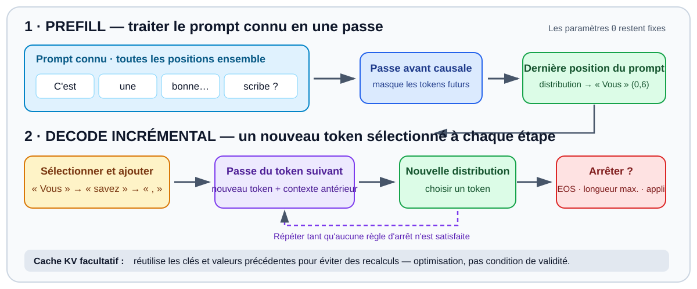

<!--
LLM-LAB-PAGE-MAP v1
id: "fr/generation"
summary: "Présente la génération comme une boucle autorégressive : contexte, prédiction du prochain token, sélection, réinjection et arrêt. Situe le prefill, le decode incrémental et les stratégies de sélection, puis distingue l’inférence du scoring et de l’apprentissage."
scope: "Déroule une génération libre, du traitement du prompt au critère d’arrêt. La latence et l’ordonnancement relèvent de l’approfondissement."
purpose: "Suivre le choix du premier token au prefill, puis la réinjection des tokens choisis jusqu’à l’arrêt."
suggested_route:
  previous: null
  next: "fr/in-context-learning"
hierarchy:
  parents: ["fr/llm-overview"]
  children: []
related: ["fr/text-data", "fr/transformer", "fr/logits", "fr/probabilites", "fr/context-engineering", "fr/build-path", "fr/decoding-strategies", "fr/gpt-generation-walkthrough", "fr/training-examples", "fr/generation-exercises"]
revision_support:
  status: integrated_sufficient
  evidence:
    - anchor: revision-summary
      note: "Le récapitulatif couvre le calcul, la sélection, la réinjection du token et les paramètres fixes ; les questions Practice et les exercices approfondissent l'échantillonnage, le prefill/decode et le KV cache."
tags: ["type:concept-lesson", "destination:understand", "topic:inference-generation", "level:core", "language:fr", "status:published"]
-->



::: {.chapter-lead}
Reprenons le premier tour de la prédiction : après « C'est une bonne situation, ça, scribe ? », le modèle donne 0,6 à « Vous », 0,2 à « Je ». Un tableau de probabilités n'est pas encore une réponse. Comment passe-t-on de l'un à l'autre ?

En répétant quatre gestes : prédire, sélectionner, réinjecter, puis continuer ou s'arrêter. Cette boucle est la **génération autorégressive**. Pendant qu'elle tourne, les paramètres du modèle ne changent pas : produire une réponse n'est pas apprendre.
:::

Le préfixe fourni est « C'est une bonne situation, ça, scribe ? ». La continuation illustrative suivie ici est « Vous savez, moi je ne crois pas qu'il y ait de bonne ou de mauvaise situation… ». Les probabilités ci-dessous sont fictives et ne prétendent pas reproduire la sortie d'un modèle.

::: {.callout-tip title="L'idée à retenir en une minute" #revision-summary}
- **Le modèle calcule, une règle choisit.** Le modèle fournit une distribution sur le prochain token. Une règle de décodage, extérieure au réseau, en tire un seul token.
- **Le token choisi devient du contexte.** Il est ajouté au texte, et le modèle recalcule une distribution pour la position suivante.
- **Rien n'est appris en route.** Les paramètres sont les mêmes au premier et au dernier token.

**Depuis le panorama**, suivez [les trois tours de l’exemple](#la-boucle-sur-un-exemple) avant d’étudier le calcul. Après les [probabilités de sortie](probabilites.qmd), reprenez la même trace pour revoir le calcul en notation et distinguer le *prefill* du prompt, le *decode* itératif et la règle de sélection.
:::

## La boucle sur un exemple {#la-boucle-sur-un-exemple}

Suivons trois tours de boucle. Les probabilités sont fictives, comme dans le panorama, et la règle de décodage est la plus simple : prendre le token le plus probable.

```{=html}
<ol class="list-group list-group-numbered mb-3" data-generation-trace role="list">
  <li class="list-group-item d-flex gap-2">
    <div>
      <p class="mb-1"><strong>Contexte</strong> <span data-generation-prefix>C'est une bonne situation, ça, scribe ?</span></p>
      <p class="mb-1"><strong>Distribution (extrait)</strong> <span data-generation-distribution>« Vous » 0,6 · « Je » 0,2 · « Moi » 0,1 · « Oui » 0,1</span></p>
      <p class="mb-0"><strong>Token choisi</strong> <span data-generation-choice>« Vous »</span></p>
    </div>
  </li>
  <li class="list-group-item d-flex gap-2">
    <div>
      <p class="mb-1"><strong>Contexte</strong> <span data-generation-prefix>C'est une bonne situation, ça, scribe ? <mark class="next-token-explorer__added">Vous</mark></span></p>
      <p class="mb-1"><strong>Distribution (extrait)</strong> <span data-generation-distribution>« savez » 0,5 · « êtes » 0,3 · « voyez » 0,2</span></p>
      <p class="mb-0"><strong>Token choisi</strong> <span data-generation-choice>« savez »</span></p>
    </div>
  </li>
  <li class="list-group-item d-flex gap-2">
    <div>
      <p class="mb-1"><strong>Contexte</strong> <span data-generation-prefix>C'est une bonne situation, ça, scribe ? Vous <mark class="next-token-explorer__added">savez</mark></span></p>
      <p class="mb-1"><strong>Distribution (extrait)</strong> <span data-generation-distribution>« , » 0,8 · « que » 0,1 · « : » 0,1</span></p>
      <p class="mb-0"><strong>Token choisi</strong> <span data-generation-choice>« , »</span></p>
    </div>
  </li>
</ol>
```

Dans cette trace simplifiée, les unités affichées sont traitées comme des tokens. Une segmentation réelle dépend du tokenizer choisi ; la trace ne prétend pas reproduire celle d'un tokenizer particulier.

Chaque tour enchaîne les mêmes gestes.

1. **Prédire.** Le modèle lit tout le contexte et calcule une distribution sur le prochain token.
2. **Sélectionner.** La règle de décodage en retient un.
3. **Réinjecter.** Ce token est ajouté au contexte. Au tour 2, « Vous » fait partie de ce que le modèle lit, au même titre que la question.
4. **Continuer ou s'arrêter.** La boucle s'arrête sur un critère explicite : un token spécial de fin de séquence (EOS), une longueur maximale, ou une règle fixée par l'application. L'arrêt est une règle, pas le signe que le modèle aurait « fini de réfléchir ».

Deux conséquences découlent de cette mécanique.

**Un choix engage la suite.** Si l'échantillonnage avait donné « Je » au tour 1, le contexte du tour 2 se terminerait par « Je ». Le modèle calculerait la distribution suivante à partir de ce nouveau contexte. La suite pourrait alors changer.

**Les paramètres du modèle restent identiques d'un tour à l'autre : la génération ne les met pas à jour.** Le contexte, lui, s'allonge avec le token choisi. Une implémentation optimisée peut aussi réutiliser des calculs précédents au moyen d'un cache KV, expliqué plus loin ; ce cache accélère l'inférence, mais ne constitue ni un apprentissage ni une modification des paramètres.

[Tracer une boucle de génération jusqu'à EOS](exercises-generation.qmd#ex-generation-autoregressive-loop).

## Une étape, en notation

Notons le contexte courant, c'est-à-dire les tokens du prompt et ceux déjà générés :

$$
c_t = (x_1, \ldots, x_{t-1}).
$$

Chaque $x_i$ désigne le **token** à la position $i$, pas son identifiant numérique. En pratique, le tokenizer associe ce token à un ID entier, qui sélectionne son vecteur dans la table d'embeddings ; les équations notent les tokens pour rester lisibles.

Le modèle effectue une **passe avant** (*forward pass*) à paramètres $\theta$ fixes. Il produit un vecteur de logits pour chaque position du contexte ; la génération utilise celui de la dernière position, noté $z_t$. La softmax en fait une distribution conditionnelle :

$$
p_\theta(\cdot \mid c_t) = \operatorname{softmax}(z_t).
$$

Pour un token candidat $v$, $p_\theta(v \mid c_t)$ est la probabilité qu'il soit le prochain token sachant le contexte. Ces probabilités portent sur les tokens du vocabulaire, pour la position suivante uniquement, et leur somme vaut 1. Au tour 1 de l'exemple, $p_\theta(\text{« Vous »} \mid c_t) = 0{,}6$.

Une règle de **décodage** sélectionne ensuite un token :

$$
x_t = \operatorname{Dec}\!\left(p_\theta(\cdot \mid c_t)\right),
$$

et le contexte s'allonge :

$$
c_{t+1} = (x_1, \ldots, x_{t-1}, x_t).
$$

Trois mots désignent ainsi trois échelles : la **passe avant** est le calcul du réseau, du contexte à la distribution ; le **décodage** est la règle qui tire un token de cette distribution ; la **génération** est la boucle entière, critère d'arrêt compris. Certaines bibliothèques emploient *décodage* dans un sens plus large ; ici, il désigne seulement la sélection du token et les traitements qui la préparent.

Le calcul de la distribution lui-même occupe les étapes intermédiaires du parcours : [le Transformer](transformer.qmd) produit les états, [les logits](logits.qmd) en sont la projection, [la softmax](probabilites.qmd) les normalise.

## Comment le prochain token est-il choisi ? {#comment-le-prochain-token-est-il-choisi}

La distribution du tour 1 ne désigne pas une sortie unique. C'est la règle de décodage qui tranche.

**Sélection gloutonne** (*greedy decoding*). On prend le token le plus probable (*argmax*) : « Vous », à chaque exécution. Le résultat est reproductible si le calcul est déterministe. Ce choix local n'optimise pas la phrase entière et peut conduire à des répétitions.

**Échantillonnage** (*sampling*). On tire le token au hasard selon la distribution : « Vous » sort en moyenne six fois sur dix, « Je » deux fois sur dix. Deux exécutions peuvent donc produire deux textes différents. Fixer la graine du générateur aléatoire, avec un calcul déterministe, rend le tirage reproductible.

[Calculer une softmax et comparer sélection gloutonne et échantillonnage](exercises-generation.qmd#ex-generation-distribution-selection).

**Température.** Avant le tirage, on peut resserrer ou étaler la distribution en divisant les logits par un nombre $\tau > 0$.

| Suite | $\tau = 0{,}5$ | $\tau = 1$ | $\tau = 2$ |
|---|---|---|---|
| « Vous » | 0,86 | 0,60 | 0,42 |
| « Je » | 0,10 | 0,20 | 0,24 |
| « Moi » | 0,02 | 0,10 | 0,17 |
| « Oui » | 0,02 | 0,10 | 0,17 |

Une température basse concentre la probabilité sur le token de tête ; une température élevée laisse plus de place aux autres. L'ordre des candidats ne change pas. Quand $\tau$ tend vers zéro, l'échantillonnage rejoint la sélection gloutonne, hors égalités et effets numériques. La température agit sur la distribution utilisée pour le tirage, pas sur les paramètres du modèle, et ne rend une réponse ni plus vraie ni meilleure. Son calcul et ses effets sont approfondis dans les [stratégies de décodage](decoding-strategies.qmd#temperature).

Les filtres **top-k** et **top-p** écartent les candidats les moins probables avant le tirage ; la recherche par faisceau (*beam search*) et le décodage contrastif suivent d'autres logiques. La boucle de base se comprend sans eux ; leurs compromis sont comparés dans les [stratégies de décodage](decoding-strategies.qmd), et une [introduction de Nishanthan K](https://dev.to/nishanthan-k/core-elements-of-large-language-models-llms-tokens-context-windows-temperature-and-sampling-2m45) en donne un premier aperçu.

::: {.callout-warning title="Idées reçues"}
- **« Le modèle choisit toujours le meilleur token. »** Le modèle ne choisit pas : il fournit une distribution. Avec l'échantillonnage, « Je » peut sortir alors que « Vous » est plus probable.
- **« Une probabilité élevée garantit un token correct. »** La distribution reflète des régularités apprises, pas l'état du monde. Un modèle peut donner 0,6 à une suite fausse.
- **« Les répétitions sont un bug. »** Elles peuvent venir de la règle de décodage, la sélection gloutonne en particulier, sans erreur de programme.
:::

## Du prompt aux tokens suivants : prefill et decode

Un système d'inférence ne traite pas le prompt comme il traite les tokens qu'il génère.

- **Prefill.** Le préfixe est connu d'avance. Une seule passe avant traite toutes ses positions ensemble, sous la contrainte du masque causal ; la distribution obtenue à la dernière position sert à choisir le premier token généré.
- **Decode incrémental.** Ensuite, les tokens arrivent un par un. À chaque étape, le modèle calcule la distribution suivante à partir du contexte augmenté du dernier token choisi.
- **Cache KV.** L'attention calcule, pour chaque position, des vecteurs appelés clés et valeurs ([requêtes, clés et valeurs](queries-keys-values.qmd)). Ceux du préfixe ne changent plus une fois calculés ; une implémentation optimisée les conserve au lieu de tout recalculer à chaque tour. C'est un gain de temps, pas une condition de correction : sans cache, le résultat est le même, aux effets numériques près.

*Decode* nomme donc une phase d'exécution, celle qui suit le prefill ; *décodage* nomme la règle de sélection. Les deux mots se ressemblent et ne désignent pas la même chose.

Le prefill et le *teacher forcing* ont une similarité limitée : dans les deux cas, le modèle reçoit des tokens déjà connus et le masque causal empêche chaque position de voir le futur. Mais les termes ne décrivent pas la même chose. Le *prefill* est une phase d'exécution à l'inférence : le prompt fourni est traité pour produire la distribution du premier token généré et, si le cache KV est activé, initialiser ce cache. Le *teacher forcing* est une stratégie de conditionnement utilisée notamment à l'entraînement : les tokens de référence du corpus servent d'entrées, tandis que les logits à chaque position sont comparés aux cibles décalées. En génération libre, au contraire, chaque token sélectionné est réinjecté ; il peut donc différer du token de référence. Le même conditionnement sur un préfixe observé peut aussi servir à scorer une continuation, à paramètres fixes ([exemples d'entraînement](training-examples.qmd)).

Le programme de référence du projet applique cette boucle sans cache KV ; la [visite guidée du code de génération](gpt-generation-walkthrough.qmd) montre comment il traite le prompt et recalcule la passe avant à partir du contexte courant.

<div class="pipeline-stepper" role="group" aria-label="Boucle de génération autorégressive">
  <a class="step-item" href="text-data.qmd">Prompt tokenisé</a>
  <span class="step-arrow" aria-hidden="true">→</span>
  <span class="step-item">Prefill : traitement du prompt</span>
  <span class="step-arrow" aria-hidden="true">→</span>
  <a class="step-item" href="probabilites.qmd">Distribution du prochain token</a>
  <span class="step-arrow" aria-hidden="true">→</span>
  <span class="step-item">Sélection et ajout au contexte</span>
  <span class="step-arrow" aria-hidden="true">→</span>
  <span class="step-item active">Decode incrémental</span>
  <span class="step-arrow" aria-hidden="true">→</span>
  <span class="step-item">Nouvelle distribution</span>
  <span class="step-arrow" aria-hidden="true">→</span>
  <span class="step-item">Arrêt : EOS ou limite</span>
  <span class="meta-flow__loop" aria-label="La sélection et le decode se répètent tant que le critère d’arrêt n’est pas atteint">↺ Sélectionner, ajouter au contexte et recommencer le decode</span>
</div>

<figure id="fig-generation-prefill-decode">
  <picture>
    <source media="(max-width: 600px)" srcset="../images/generation-prefill-decode-fr-mobile.svg">
    
  </picture>
  <figcaption>Le prefill traite le prompt connu ; le decode incrémental l’allonge avec un token sélectionné à chaque étape. Le cache KV est une optimisation facultative, pas une condition de validité de la génération. Les probabilités de l’exemple sont illustratives.</figcaption>
</figure>

::: {.callout-note title="Approfondissement facultatif : latence et optimisations d'inférence" collapse="true" data-reading-time="exclude"}

### Pourquoi l'inférence semble-t-elle parfois lente ?

La latence visible dépend de deux phases différentes. Deux métriques permettent de les distinguer :

- **TTFT (*time to first token*)** : délai entre la réception de la requête et le premier token généré. Il inclut généralement la file d'attente, la préparation de l'entrée et le *prefill* ; il dépend donc fortement de la longueur du prompt tokenisé.
- **ITL (*inter-token latency*)** : délai entre deux tokens générés successivement, après le premier. Il caractérise surtout le *decode* incrémental et conditionne la fluidité du streaming. On rapporte souvent une moyenne ou des percentiles, car les délais peuvent varier d'un token à l'autre.

Un prompt plus long tend à augmenter le travail de *prefill* et donc le TTFT ; une réponse plus longue demande davantage d'étapes de *decode* et augmente la durée totale. Ce sont des tendances, pas des lois absolues : mise en file d'attente, préfixes déjà mis en cache, taille de batch, matériel et kernels peuvent changer le résultat.

Le **KV cache** conserve, pour chaque couche et chaque position passée, les clés (*K*) et valeurs (*V*) déjà calculées. Il évite de recalculer l'attention sur tout le préfixe à chaque nouveau token, au prix d'une mémoire qui augmente avec la longueur du contexte et le nombre de séquences simultanées. Le dimensionnement dépend notamment du nombre de couches, de positions, de séquences et de têtes K/V ; la [formule de mémoire](llm-computational-complexity.qmd#kv-cache-memory) est détaillée dans l'approfondissement sur la complexité. Le *Grouped-Query Attention* réduit le nombre de têtes K/V et donc la mémoire du cache.

Le *prefill* est souvent limité par la capacité de calcul, tandis que le *decode* peut devenir limité par la bande passante mémoire, car chaque étape lit le cache accumulé pour produire peu de nouveaux tokens. Ce diagnostic dépend toutefois du matériel, du batch, de la longueur du contexte et des kernels : il faut mesurer plutôt que supposer.

### Servir plusieurs requêtes : ordonnancement et réutilisation du cache

La boucle autorégressive décrit **une séquence**. Un serveur doit en gérer plusieurs, avec des prompts et des longueurs de sortie différents.

- **TPOT (*time per output token*)** : moyenne du délai entre les tokens de sortie, hors premier token. Pour une requête qui produit $N_{out}>1$ tokens, on peut l'estimer par $\operatorname{TPOT}=\frac{\operatorname{E2E}-\operatorname{TTFT}}{N_{out}-1}$.
  L'**ITL** est l'intervalle individuel entre deux tokens successifs. Pour une requête, la moyenne de ses ITL correspond au TPOT ; les agrégations sur plusieurs requêtes peuvent différer selon leur pondération.
- **Continuous batching** (*in-flight batching*) : le serveur ajuste le groupe de séquences à chaque itération de decode. Lorsqu'une séquence termine, elle libère sa place ; une nouvelle requête peut entrer sans attendre la fin des autres. Chaque séquence reste autorégressive : c'est l'ordonnancement du lot qui change, pas la règle de prédiction.
- **Prefix caching** : deux requêtes peuvent réutiliser le cache KV d'un préfixe commun si leur préfixe de tokens est exactement identique et si l'entrée de cache est encore disponible sur un worker compatible. Une ressemblance sémantique ou des mots communs ne suffisent pas ; une différence de sérialisation ou de tokenisation peut casser le partage. Ce n'est pas un cache de réponses.
- **Chunked prefill** : un long prompt est traité par morceaux, entre lesquels le serveur peut faire avancer des séquences déjà en decode. Cela limite les blocages imposés aux requêtes actives, mais peut augmenter le TTFT et ajouter du surcoût d'ordonnancement.

Ces techniques répondent à des problèmes différents : le continuous batching améliore l'occupation et le partage du GPU entre requêtes ; le prefix caching évite de recalculer un préfixe strictement commun ; le chunked prefill arbitre entre l'arrivée d'un long prompt et la fluidité du decode déjà en cours. Elles ne changent pas, à elles seules, les probabilités conditionnelles du modèle.

Pour les détails de mise en œuvre et les compromis de déploiement, voir le [guide sur le batching statique, dynamique et continu](https://handbook.modular.com/inference-optimization/static-dynamic-continuous-batching/), le [prefix caching](https://handbook.modular.com/inference-optimization/prefix-caching/) et les [métriques d'inférence](https://handbook.modular.com/llm-inference-basics/llm-inference-metrics/).

Une optimisation avancée, le **speculative decoding**, fait proposer plusieurs tokens par un modèle brouillon, puis les fait vérifier par le modèle cible. Un préfixe proposé peut être accepté en bloc ; à la première divergence, la procédure reprend selon une règle conçue pour préserver la distribution du modèle cible. Le gain dépend du coût de vérification et du taux d'acceptation : ce n'est pas automatiquement plus rapide. Cette technique est un approfondissement, pas une étape nécessaire pour comprendre la boucle de base.

Le schéma de [Brij Pandey sur le chemin d'inférence](https://www.linkedin.com/posts/brijpandeyji_you-ask-llm-a-question-it-pauses-then-share-7525787285829804032-YNEl) fournit une vue d'ensemble utile de ces phases et de ces diagnostics. Il est cité comme ressource externe ; sa figure n'est pas reproduite ici.

:::

## Ce que la génération ne fait pas

**Elle ne corrige pas le modèle.** Aucun gradient n'est calculé, aucun poids n'est mis à jour. Générer davantage de tokens n'améliore pas un modèle mal entraîné ; c'est le rôle de l'[apprentissage](loss.qmd), qui compare les prédictions à des cibles connues puis modifie les paramètres.

**Elle ne voit que le contexte fourni.** Le modèle traite au plus une fenêtre de taille maximale. Ce budget couvre tous les tokens transmis, instructions, historique, messages d'outils, prompt et éventuels tokens multimodaux, ainsi que les tokens générés. La capacité annoncée n'est donc pas entièrement disponible pour la réponse : l'application peut réserver une longueur de sortie, tronquer ou sélectionner l'historique. Une information absente du contexte transmis n'influence plus directement la prédiction, et une fenêtre plus grande ne garantit pas que chaque élément sera utilisé correctement.

**Elle ne se souvient pas d'une génération à l'autre.** Si une application semble retenir une conversation, c'est qu'elle en réinjecte l'historique dans le contexte, ou qu'elle le conserve hors du modèle. Les poids, eux, n'ont rien enregistré. La [conception et gestion du contexte](context-engineering.qmd) explique comment l'application sélectionne, résume et actualise ces informations.

**Elle ne crée pas la qualité.** La boucle tourne aussi bien avec un modèle non entraîné ; ses sorties n'ont alors aucun intérêt. La mécanique de génération et la qualité acquise par apprentissage sont deux questions séparées.

**Elle ne valide pas son résultat.** Une réponse fluide, ou même une requête SQL syntaxiquement valide et exécutable, ne garantit pas qu'elle répond à la bonne question métier. Le schéma, les définitions utilisées (le traitement des remboursements et des paiements échoués, par exemple), les hypothèses et les résultats se vérifient avant toute décision.




::: {.language-switch}
[Français](generation.qmd) · [English](../en/generation.qmd)
:::

## Exercices

[Vérifier sa compréhension de la leçon](exercises/generation.qmd).

<details class="learning-resources">
<summary>
  <span class="learning-resources__title">Ressources complémentaires</span>
  <span class="learning-resources__description">Expérimenter, approfondir et s'exercer sur les notions de cette leçon.</span>
</summary>
<div class="learning-resources__content" markdown="1">

### Ressources d'implémentation complémentaires

- [Hugging Face — Derrière le pipeline](https://huggingface.co/learn/llm-course/en/chapter2/2) : suivre les étapes qui relient l'API de haut niveau aux composants du modèle.
- [Hugging Face — Déploiement et inférence optimisée](https://huggingface.co/learn/llm-course/en/chapter2/7) : prolongement pratique sur l'exécution des modèles.


</div>
</details>
