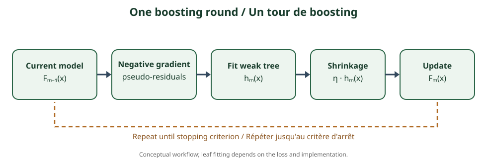

<!--
LLM-LAB-PAGE-MAP v1
id: "fr/gradient-boosting"
scope: "Explique le boosting additif et les arbres ajustés aux pseudo-résidus issus du gradient négatif de la loss."
purpose: "Tracer une itération et interpréter loss, pseudo-résidus, learning rate et contrôles du surapprentissage."
suggested_route:
  previous: "fr/decision-trees"
  next: "fr/xgboost"
hierarchy:
  parents: []
  children: ["fr/xgboost", "fr/lightgbm", "fr/catboost"]
related: ["fr/bias-variance"]
tags: ["type:concept-lesson", "destination:deepen", "topic:gradient-boosting", "level:applied", "language:fr", "status:published"]
-->
::: {.chapter-lead}
Le Gradient Boosting construit un prédicteur additif par étapes. Chaque nouvel arbre réduit une partie de l'erreur restante dans l'ensemble courant. Ce n'est ni une moyenne d'arbres indépendants, ni un empilement d'arbres profonds.
:::
## De l'arbre à l'ensemble

Un arbre partitionne l'espace des variables en régions et attribue une prédiction à chaque feuille. Plusieurs arbres limités peuvent représenter ensemble une fonction plus riche :

\[
F_M(x)=F_0(x)+\sum_{m=1}^{M}\eta\,\rho_m h_m(x),
\]

où $h_m$ est le nouvel arbre, (
ho_m) ajuste la contribution de ses feuilles et $\eta$ est le taux d'apprentissage.

## Pourquoi « gradient » ?

Pour une loss différentiable $L(y,F(x))$, l'étape $m$ calcule le gradient négatif par rapport à la prédiction courante :

\[
r_{im}=-\left[
\frac{\partial L(y_i,F(x_i))}{\partial F(x_i)}
\right]_{F=F_{m-1}}.
\]

Ces valeurs sont les **pseudo-résidus**. Avec l'erreur quadratique, ils sont proportionnels aux résidus $y_i-F_{m-1}(x_i)$. Avec d'autres losses, ils ne sont pas nécessairement la différence cible-prédiction.

## Une itération

1. Initialiser $F_0$ par une constante minimisant la loss.
2. Calculer les pseudo-résidus du modèle courant.
3. Ajuster un arbre à ces pseudo-résidus.
4. Ajuster la contribution de ses feuilles selon la loss.
5. Ajouter l'arbre avec un taux d'apprentissage contrôlé.
6. Répéter en surveillant la validation et les critères d'arrêt.

L'arbre suivant ne reconstruit pas toute la cible : il cherche une correction structurée des erreurs actuelles.

{fig-alt="Schéma de la boucle : modèle courant, gradient négatif, arbre correctif, shrinkage, mise à jour et répétition."}

## Boosting contre bagging

| Bagging (forêt aléatoire) | Boosting |
|---|---|
| Arbres entraînés indépendamment | Chaque étape dépend de l'ensemble courant |
| Moyenne ou vote | Somme de contributions successives |
| Réduit souvent la variance | Réduit progressivement la loss |
| Arbres parallélisables | Étapes de boosting séquentielles |

Le nombre d'arbres, le learning rate, la profondeur, le sous-échantillonnage et l'early stopping contrôlent des aspects différents. Une contribution faible demande souvent davantage d'arbres. Aucun réglage n'est universel.

XGBoost formalise un objectif régularisé et une approximation de second ordre ; LightGBM utilise notamment des histogrammes et une croissance leaf-wise ; CatBoost traite spécifiquement les variables catégorielles. Voir [XGBoost](xgboost.qmd), [LightGBM](lightgbm.qmd) et [CatBoost](catboost.qmd).

::: {.self-check}
## Vérifier sa compréhension
1. Pourquoi les pseudo-résidus ne sont-ils pas toujours les résidus bruts ?

Afficher la réponse
Ils sont le gradient négatif de la loss par rapport à la prédiction ; cette quantité ne coïncide avec le résidu que pour certaines losses.

2. Quelle différence sépare bagging et boosting ?

Afficher la réponse
Le bagging agrège des modèles indépendants ; le boosting construit des corrections séquentielles dépendantes du modèle courant.

3. Pourquoi un learning rate plus faible peut-il sous-ajuster à nombre d'arbres constant ?

Afficher la réponse
Chaque arbre apporte une correction plus petite ; le nombre d'étapes peut devenir insuffisant.

:::
## Comparer les implémentations

| Dimension | XGBoost | LightGBM | CatBoost |
|---|---|---|---|
| Objectif / construction | Approximation de Taylor d'ordre deux, régularisation explicite | Histogrammes, croissance leaf-wise, GOSS/EFB | Ordered boosting et statistiques catégorielles ordonnées |
| Croissance typique | Level-wise / profondeur contrôlée selon configuration | Leaf-wise best-first | Arbres symétriques par défaut |
| Données catégorielles | Support dépendant de la version et de la configuration | Support natif avec contraintes de représentation | Traitement catégoriel au cœur de l'algorithme |
| Point de vigilance | Régularisation et coût de recherche | Contrôle du nombre de feuilles et du surapprentissage | Protocole d'encodage, permutations et coût de calcul |

Ce tableau résume des choix caractéristiques, pas des règles absolues ni des garanties de performance. Les versions, paramètres, objectifs et matériels modifient les comportements. Le bon choix se fait par validation sur le problème réel, avec une baseline et un budget comparables.

## Références
- [Friedman (2001), Greedy Function Approximation: A Gradient Boosting Machine](https://doi.org/10.1214/aos/1013203451).
- [AiEdge — The Gradient Boosted Algorithm Explained!](https://newsletter.theaiedge.io/p/the-gradient-boosted-algorithm-explained).
- [AiEdge — GBM vs XGBoost vs LightGBM vs CatBoost](https://newsletter.theaiedge.io/p/gbm-vs-xgboost-vs-lightgbm-vs-catboost).
::: {.language-switch}
[Français](gradient-boosting.qmd) · [English](../en/gradient-boosting.qmd)
:::
