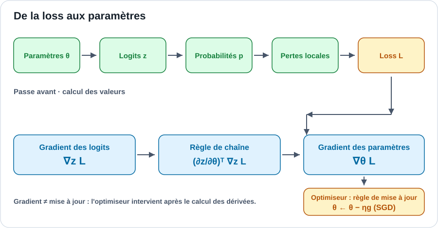

<!--
LLM-LAB-PAGE-MAP v1
id: "fr/gradients"
summary: "Relie la loss aux gradients par la rétropropagation et la règle de chaîne, puis explique comment ces dérivées guident les mises à jour des paramètres."
scope: "Propage la sensibilité locale de la perte, à travers les logits, jusqu’aux paramètres. Situe la mise à jour du côté de l’optimiseur."
purpose: "Suivre une dérivée à travers le graphe du calcul et calculer un pas de descente simple à partir d’un gradient donné."
suggested_route:
  previous: "fr/loss"
  next: "fr/training-loop"
hierarchy:
  parents: []
  children: []
related: ["fr/loss", "fr/training-loop", "fr/gradients-exercises"]
revision_support:
  status: integrated_sufficient
  evidence:
    - anchor: revision-summary
      note: "Le rappel distingue l'objectif, sa variation locale et la rétropropagation par règle de chaîne ; le cours relie gradients des logits, paramètres et mises à jour. Trois questions corrigées couvrent la dérivée de cross-entropie, le contrôle numérique et le choix du pas."
tags: ["type:concept-lesson", "destination:understand", "topic:gradients", "level:core", "language:fr", "status:published"]
-->


::: {.chapter-lead}
Le gradient $\nabla_\theta\mathcal{L}$ rassemble les dérivées partielles de l'objectif par rapport aux paramètres appris. Il indique comment la perte varie localement quand les paramètres changent ; il ne garantit pas, à lui seul, une amélioration globale.
:::

::: {.callout-tip title="L'idée à retenir en une minute" #revision-summary}
La loss indique **ce qui doit être amélioré** ; le gradient indique **comment elle varie quand les paramètres changent**. La rétropropagation applique la règle de chaîne pour transporter cette information depuis la sortie jusqu'aux paramètres.

**Première lecture :** suivez le chemin loss → dérivée par rapport aux logits → dérivées par rapport aux paramètres → mise à jour. Le gradient décrit une variation locale : il ne garantit pas qu'un pas quelconque réduira la loss.

La qualité du calcul du gradient reste distincte de la généralisation du modèle.
:::

  <a class="step-item" href="loss.qmd">1. Loss</a>
  →
  2. Rétropropagation
  →
  3. Gradients
  →
  4. Mise à jour des paramètres

Pour chaque token cible de la continuation, on calcule d’abord comment la perte locale varie avec chacun de ses logits. Si l’on pouvait appliquer directement un pas de descente sur ces logits, il augmenterait le score du token cible relativement aux autres. Dans le réseau, la règle de chaîne donne les dérivées par rapport aux paramètres dont dépendent les logits. L’optimiseur utilise ensuite ces dérivées pour modifier les paramètres.

## Gradient par rapport aux logits

Pour une cible one-hot $y$, posons $p=\operatorname{softmax}(z)$. Pour la cross-entropie non pondérée calculée à partir de cette distribution :

$$
\frac{\partial\ell}{\partial z_i}=p_i-\mathbb{1}[i=y].
$$

Pour une cible one-hot, les composantes de ce gradient somment à zéro : $\sum_i(p_i-\mathbb{1}[i=y])=1-1=0$. C'est cohérent avec l'invariance de la softmax à l'ajout d'une même constante à tous les logits.

### Exemple numérique : le gradient pour une cible {#exemple-numérique-de-la-loss-aux-poids-de-sortie}

La [loss du batch](loss.qmd) agrège les pertes des cibles valides. Isolons ici la première cible pour calculer comment sa perte varie avec les logits.

Reprenons la distribution du premier tour, $p=(0{,}6;0{,}2;0{,}1;0{,}1)$, avec « Vous » comme cible, représentée par le vecteur $y=(1;0;0;0)$. Le gradient par rapport aux logits est :

$$
g_z=p-y=(-0{,}4;\,0{,}2;\,0{,}1;\,0{,}1).
$$

::: {.callout-note collapse="true" title="Gradient de la moyenne sur les positions valides"}

À chaque position, $p_{b,t}=\operatorname{softmax}(z_{b,t})$. Cette formule donne la dérivée de la perte **pour une seule position**. Pour la moyenne non pondérée sur l'ensemble $\mathcal{M}$ des positions cibles valides définie dans [Loss](loss.qmd), le gradient par logit devient :

$$
\frac{\partial\mathcal{L}}{\partial z_{b,t,i}}=
\begin{cases}
\frac{1}{|\mathcal{M}|}\left(p_{b,t,i}-\mathbb{1}[i=y_{b,t}]\right) & (b,t)\in\mathcal{M},\\
0 & (b,t)\notin\mathcal{M}.
\end{cases}
$$

Le facteur $1/|\mathcal{M}|$ vient de la moyenne ; les positions ignorées ont une dérivée nulle par rapport à leurs logits dans cet objectif. Une somme, une pondération ou une autre réduction change le facteur correspondant. La formule locale résulte de la combinaison softmax + cross-entropie ; elle ne signifie pas que les paramètres du réseau sont directement les logits, qui dépendent des paramètres via de nombreuses opérations différentiables.

**Une dérivée nulle ne coupe pas nécessairement tout le graphe (approfondissement)**

Une dérivée nulle par rapport aux logits d'une position ignorée signifie que ces logits ne sont pas directement supervisés par ce terme de perte. Si la représentation de cette position intervient néanmoins dans le calcul d'un logit valide — par exemple comme clé ou valeur autorisée dans l'attention — la perte valide peut encore propager un gradient à travers cette dépendance. Il faut donc examiner le graphe de calcul et les masques d'attention, pas seulement le masque de perte.
:::

## Règle de chaîne

Si les logits dépendent des paramètres $z=z(\theta)$, alors :

$$
\nabla_\theta\mathcal{L}
=\left(\frac{\partial z}{\partial\theta}\right)^\top
\nabla_z\mathcal{L}.
$$

Ici, $z$ représente l'ensemble des logits concernés par l'objectif (par exemple, tous les logits des positions valides du batch), et non un seul score scalaire. On peut voir ces logits comme un vecteur obtenu en aplatissant le tenseur ; la formule ci-dessus utilise alors le jacobien correspondant. La rétropropagation applique le jacobien transposé au gradient par rapport aux logits sans construire le jacobien complet.

Dans un réseau profond, la rétropropagation applique efficacement cette règle de chaîne à travers le graphe de calcul. Les dimensions doivent être cohérentes : les dérivées sont des vecteurs ou tenseurs de même forme que les variables différentiées.

<figure id="fig-gradient-backpropagation">
  <picture>
    <source media="(max-width: 600px)" srcset="../images/gradients-fr-mobile.svg">
    
  </picture>
  <figcaption>La passe avant calcule les valeurs ; la rétropropagation transporte les dérivées en sens inverse à travers le graphe. Le gradient des paramètres est ensuite utilisé par l’optimiseur : calculer un gradient et mettre à jour les poids sont deux opérations distinctes.</figcaption>
</figure>

## Du gradient à la mise à jour

Le gradient décrit la sensibilité locale de la loss ; il ne définit pas à lui seul la règle de mise à jour. L'optimiseur transforme le gradient en mise à jour et le taux d'apprentissage en règle la taille. La règle SGD et les choix d'optimiseur sont traités dans la [boucle d'entraînement](training-loop.qmd).

::: {.callout-tip #running-example-sgd title="Recalculer la prédiction après un pas de SGD"}

Reprenez la [matrice de sortie de l’exemple des logits](logits.qmd#running-example-output-projection) et son état $h=(1;-1)^\top$. Sur cette seule cible « Vous », appliquez un pas de SGD de taux $\eta=0{,}1$ aux poids $W$ de cette tête sans biais. Le préfixe, $h$ et les autres paramètres restent fixes. Quel nouveau score obtient « Vous » ? Quelle est sa nouvelle probabilité après normalisation sur les quatre candidats ?

Afficher le calcul

Le gradient des poids est le produit extérieur $g_z h^\top$. Les nouveaux poids valent $W'=W-\eta g_z h^\top$. Pour le même état, le nouveau vecteur de scores est :

$$
z'=W'h=z-\eta\lVert h\rVert^2 g_z
=(\ln 6+0{,}08;\ \ln 2-0{,}04;\ -0{,}02;\ -0{,}02).
$$

Le score de « Vous » augmente de $0{,}08$. Une nouvelle softmax donne $p'(\text{Vous})\approx0{,}626$, contre $0{,}600$ avant la mise à jour. Ce calcul montre l’effet sur **la cible utilisée pour ce pas**.

:::

Calculez [deux mises à jour à perte égale](exercises/gradients.qmd#ex-score-to-parameter-update) et comparez la prédiction suivante.

Dans la [boucle d’entraînement](training-loop.qmd#rejouer-un-pas-sur-le-premier-token), cette nouvelle prédiction provient de la passe avant qui suit la mise à jour.

La [mesure de validation](training-loop.qmd#loss-dentraînement-et-loss-de-validation) utilise des données réservées pour estimer le comportement sur de nouveaux exemples.

::: {.callout-note collapse="true" title="Autre exemple facultatif : calculer chacune des variations de poids"}
Considérons une dernière projection affine jouet $z=Wh+b$, avec un état d'entrée $h=(1;2)^\top$ et une matrice $W$ de quatre lignes (une par token) et deux colonnes. Par la règle de chaîne :

$$
\frac{\partial\ell}{\partial W}=g_z h^\top
=\begin{pmatrix}
-0{,}4&-0{,}8\\
0{,}2&0{,}4\\
0{,}1&0{,}2\\
0{,}1&0{,}2
\end{pmatrix}.
$$

Avec un pas SGD illustratif $\eta=0{,}1$, la variation des poids est $\Delta W=-\eta\,\partial\ell/\partial W$ : la première ligne augmente de $(0{,}04;0{,}08)$ et les trois autres diminuent respectivement de $(0{,}02;0{,}04)$, $(0{,}01;0{,}02)$ et $(0{,}01;0{,}02)$. Ce calcul montre comment le signal de la cible atteint les poids de la projection finale. Dans un Transformer complet, $h$ dépend lui-même des paramètres des couches précédentes : la rétropropagation continue alors à travers ces couches. Les valeurs de $h$, de $W$ et le taux d'apprentissage sont choisis pour illustrer la règle, pas extraits d'un entraînement.
:::

::: {.callout-note collapse="true" title="La descente de gradient n'est pas la méthode de Newton"}
Les deux méthodes utilisent des dérivées, mais pas les mêmes informations. **La descente de gradient** utilise la dérivée première (le gradient) pour choisir une direction ; **la méthode de Newton** exploite aussi la courbure, représentée en plusieurs dimensions par la matrice hessienne, pour orienter et dimensionner le pas. L'entraînement des réseaux neuronaux emploie couramment des gradients stochastiques ou calculés par batch, avec des optimiseurs comme Adam ou AdamW — et non une mise à jour de Newton simplement simplifiée. Ces méthodes sont apparentées, mais l'une n'est pas simplement l'autre à laquelle on aurait retiré un terme.
:::

::: {.callout-note collapse="true" title="Vérification numérique des gradients (approfondissement)"}
Pour une coordonnée $\theta_i$ :

$$
g_i^{\mathrm{num}}=
\frac{\mathcal{L}(\theta_i+\epsilon)-\mathcal{L}(\theta_i-\epsilon)}
{2\epsilon}.
$$

Comparer ce résultat au gradient analytique avec des tolérances absolue et relative. La vérification doit être faite en précision suffisante, sur une fonction déterministe et avec un $\epsilon$ adapté à l'échelle des paramètres. Trop petit, il amplifie les erreurs d'arrondi ; trop grand, il approxime mal la dérivée locale. PyTorch indique que les réglages par défaut de `gradcheck` sont conçus pour des entrées en double précision ; une précision inférieure peut provoquer un échec. Le contrôle peut aussi échouer aux points non différentiables ou avec des tenseurs dont plusieurs indices partagent la même mémoire. Un échec doit donc être interprété à la lumière de ces conditions, et non comme une preuve immédiate que la dérivée analytique est fausse.
:::

::: {.callout-warning title="Idées reçues"}
- **« Un gradient nul signifie que le modèle est optimal. »** Il peut signaler un point stationnaire, une saturation, un chemin de gradient rompu ou une erreur d'implémentation.
- **« Les gradients prouvent une relation causale dans les données. »** Ils décrivent la sensibilité de l'objectif du modèle à ses paramètres, pas une causalité du monde réel.
- **« Une différence finie qui passe prouve tout le backward pass. »** Elle vérifie un cas, une fonction, une précision et une configuration ; elle ne remplace pas les tests de formes, de cas limites et d'intégration.
:::



::: {.language-switch}
[Français](gradients.qmd) · [English](../en/gradients.qmd)
:::

## Exercices

[Autres exercices sur les gradients](exercises/gradients.qmd).

  Ressources complémentaires
  Expérimenter, approfondir et s'exercer sur les notions de cette leçon.

### Pour approfondir

- [PyTorch — Mécanismes d'autograd](https://docs.pytorch.org/docs/stable/notes/autograd.html) : explique la différentiation automatique en mode inverse et le graphe de calcul.
- [PyTorch — `gradcheck`](https://docs.pytorch.org/docs/stable/generated/torch.autograd.gradcheck.gradcheck.html) : documente la vérification numérique des gradients analytiques par différences finies.

