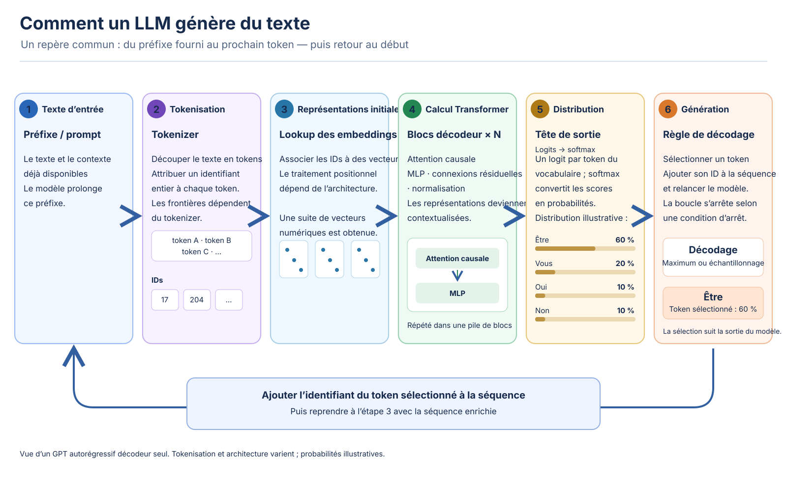

<!--
LLM-LAB-PAGE-MAP v1
id: "fr/llm-overview"
summary: "Donne une première représentation mentale d’un LLM : prédiction conditionnelle du prochain token, usages distincts, architecture, apprentissage, provenance de l’information et transfert."
scope: "Situe le modèle de langage, ses paramètres et son contexte. Introduit les trois usages de la prédiction avec un exemple de génération en boîte noire."
purpose: "Suivre deux tours de génération à paramètres fixes et distinguer générer un token, scorer une cible observée et apprendre."
suggested_route:
  previous: "fr/index"
  next: "fr/language-representation"
hierarchy:
  parents: ["fr/index"]
  children: ["fr/transformer", "fr/transformer-architectures", "fr/generation", "fr/build-path", "fr/language-modeling-math", "fr/mathematical-foundations", "fr/llm-limits", "fr/llm-computational-complexity"]
covered_stages: [orientation, text-input, representations, computation, prediction, inference, context-use, scoring, training]
related: ["fr/transformer-history", "fr/scaling-laws", "fr/llm-evolution", "fr/entropy", "fr/compression-revision", "fr/in-context-learning", "fr/context-engineering", "fr/rag-memory-boundaries", "fr/document-retrieval", "fr/post-training", "fr/llm-overview-exercises", "fr/glossary"]
revision_support:
  status: integrated_sufficient
  evidence:
    - anchor: revision-summary
      note: "Le récapitulatif présente la distribution du prochain token et distingue génération, scoring et apprentissage ; les questions de compréhension et les exercices sont regroupés dans la [page d'exercices dédiée](exercises/llm-overview.qmd), qui complète le récapitulatif sans dupliquer le parcours principal."
tags: ["type:system-overview", "destination:understand", "topic:llm-overview", "level:overview", "language:fr", "status:published"]
-->



::: {.chapter-lead}
« C'est une bonne situation, ça, scribe ? » Une question courte peut appeler une réponse beaucoup plus longue. Posez-la à un assistant conversationnel : lui aussi enchaîne. Comment un programme produit-il une suite à partir d'une question ?

La réponse se construit un token après l'autre. À partir du texte déjà écrit, le **modèle de langage** calcule des probabilités pour le prochain token. Une règle de décodage sélectionne un token, qui rejoint le texte avant le calcul suivant. Un modèle de langage entraîné à grande échelle est un **grand modèle de langage** (*large language model*, LLM).

Le préfixe est « C'est une bonne situation, ça, scribe ? ». Pour suivre le mécanisme, prenons une continuation illustrative commençant par « Vous savez, moi je ne crois pas qu'il y ait de bonne ou de mauvaise situation… ». Cette association sert de fil rouge pédagogique, pas de transcription d'une génération réelle. Les valeurs numériques qui suivent sont fictives. Le LLM est le modèle qu’interroge [l’assistant conversationnel](#model-to-conversational-system). Le panorama commence par suivre le calcul du modèle.
:::

::: {.callout-tip title="L'idée à retenir" #revision-summary}
Un modèle estime une distribution du prochain token. Elle sert à générer, scorer ou entraîner : trois usages distincts, pas les étapes d'une même exécution.
:::

::: {.callout-note .learning-outcomes}
**Durée indicative : 8–10 minutes.**

**À la fin de cette page, vous saurez :**
- suivre deux tours de prédiction et de réinjection avec des paramètres fixes ;
- expliquer le rôle du préfixe, de la distribution du prochain token et des paramètres ;
- distinguer les trois usages de cette distribution : génération, scoring d'une cible observée et apprentissage.

Les sections sur le transfert, l'information externe et les systèmes conversationnels élargissent ensuite le panorama. Pour poursuivre le parcours, retenez d'abord le mécanisme de prédiction et la distinction entre ses trois usages.
:::

## Ce que le modèle prédit {#what-model-predicts}

Le texte « C'est une bonne situation, ça, scribe ? » est le **préfixe** : la partie déjà fournie au modèle. La **continuation** est ce qui vient ensuite. À partir du préfixe, le modèle calcule une distribution de probabilités pour le token suivant. Imaginons le résultat suivant :

| Suite possible (un mot pour simplifier) | Probabilité |
|---|---:|
| « Vous » | 0,6 |
| « Je » | 0,2 |
| « Moi » | 0,1 |
| « Oui » | 0,1 |

Ces valeurs sont fictives. Dans un vrai tokenizer, un token peut être un fragment de mot ; le même exemple numérique est repris dans plusieurs pages pour permettre des calculs à la main.

C'est une **distribution conditionnelle** : les probabilités sont calculées en tenant compte du préfixe et leur somme vaut 1. Si la règle de décodage choisit « Vous », ce token est ajouté au contexte ; le modèle recalcule alors une nouvelle distribution, désormais conditionnée par le préfixe enrichi.

Au tour 2, la question suivie de « Vous » donne une nouvelle distribution illustrative. « savez » reçoit 0,5, « êtes » 0,3 et « voyez » 0,2. Si la règle choisit « savez », le contexte contient désormais « Vous savez ». Les paramètres sont les mêmes aux deux tours.

Trois termes suffisent :

- **Token :** unité manipulée par le modèle, pas nécessairement un mot ([tokenisation](text-data.qmd)).
- **Contexte :** tokens fournis et tokens déjà produits.
- **Paramètres :** nombres appris, fixes pendant l'inférence ordinaire.

Une suite probable n'est pas nécessairement vraie : bien prédire ne prouve pas une compréhension humaine ([limites](llm-limits.qmd)).

## Du texte à la distribution {#text-to-distribution}



Si la règle retient « Je » au premier tour, qu'est-ce qui change au deuxième ?

Le nouveau préfixe se termine par « Je ». Le modèle recalcule la distribution à partir de ce préfixe, avec les mêmes paramètres. Les probabilités du tableau du deuxième tour correspondent au préfixe qui se termine par « Vous ».

### Aperçu du calcul à l'intérieur d'un GPT

<figure id="fig-gpt-generation-process">
  <picture>
    <source media="(max-width: 600px)" srcset="../images/llm-generation-process-fr-mobile.svg">
    
  </picture>
  <figcaption>Le token sélectionné est ajouté à la séquence ; le calcul reprend avec le contexte enrichi. Les probabilités montrées servent d’exemple et ne sont pas des mesures d’un modèle réel.</figcaption>
</figure>

Un GPT autorégressif transforme le texte en tokens, leurs identifiants en représentations numériques, puis traite ces représentations dans les blocs Transformer. La tête de sortie produit des logits, convertis en probabilités ; une règle de décodage sélectionne ensuite un token, qui est ajouté au contexte avant le calcul suivant. La sélection n'est pas une opération interne à l'attention : elle intervient après le calcul de la distribution.

La figure décrit **une computation**, pas un ordre de lecture. Le parcours Understand canonique est présenté dans la [carte d'apprentissage](learning-map.qmd). Pour approfondir chaque mécanisme : [texte et tokenisation](text-data.qmd), [embeddings](embedding-space.qmd), [Transformer](transformer.qmd), [logits et probabilités](probabilites.qmd), puis [génération](generation.qmd).

## Un calcul, trois usages {#one-computation-three-uses}

Une distribution calculée peut servir à produire une suite, à scorer une suite connue ou à entraîner le modèle.

<!-- Desktop: three-column view; mobile: stacked view for readable labels. -->
{.d-none .d-md-block #fig-llm-shared-prediction-uses fig-alt="Le contexte passe dans le modèle, qui produit des logits puis une distribution de probabilités. Cette distribution sert à choisir un token en génération, à mesurer la probabilité d'un token observé en scoring, ou à calculer une loss et mettre à jour les paramètres pendant l'apprentissage."}

{.d-md-none fig-alt="Version mobile du schéma : le contexte traverse le modèle, produit des logits puis des probabilités. Trois blocs présentent ensuite la génération, le scoring et l’apprentissage."}

- **Générer :** traiter d'abord le prompt (*prefill*), puis choisir un token, l'ajouter au contexte et recommencer pendant le décodage (*decode*) ([génération](generation.qmd)).
- **Scorer :** à chaque position, conditionner le calcul sur le préfixe observé et lire la probabilité du token cible pour calculer la **vraisemblance** de la séquence ; aucun token n'est sélectionné et les paramètres restent fixes ([vraisemblance](vraisemblance.qmd)).
- **Apprendre :** calculer une **loss** et des **gradients** pour mettre à jour les paramètres ; le *teacher forcing* fournit au modèle les tokens précédents observés comme contexte ([loss](loss.qmd), [gradients](gradients.qmd), [exemples](training-examples.qmd)).

Pour une probabilité de 0,6, la surprise vaut $-\ln(0{,}6)\approx 0{,}511$ nat. L'[entropie](entropy.qmd) est la surprise moyenne attendue. Le scoring mesure la vraisemblance d'une cible ou d'une suite. L'évaluation compare des résultats sur des exemples tenus à l'écart de l'entraînement. Seul l'apprentissage modifie les paramètres.

La vraisemblance d'une séquence est le produit des probabilités conditionnelles de ses tokens ([formalisation mathématique](language-modeling-math.qmd)). [Refaire le calcul sur une continuation observée](exercises/vraisemblance.qmd#ex-overview-likelihood-transfer).

## LLM, Transformer, GPT : trois notions {#llm-transformer-gpt}

**LLM** désigne un modèle de langage entraîné à grande échelle, pas une architecture particulière. Aucun seuil universel de paramètres ne suffit à définir la catégorie : les données et le calcul d'entraînement comptent aussi ([lois d'échelle](scaling-laws.qmd)).

**Transformer** désigne une famille d'architectures. Elle comprend plusieurs configurations :

::: {.responsive-card-table}
| Famille | Fonctionnement général | Exemple |
|---|---|---|
| **Encodeur seul** | Construit des représentations contextualisées de l'entrée ; souvent utilisé pour comprendre ou classer | [BERT](https://arxiv.org/abs/1810.04805) |
| **Encodeur-décodeur** | Produit une sortie conditionnée par une entrée, notamment pour les tâches séquence-à-séquence | [Transformer original](https://arxiv.org/abs/1706.03762), [T5](https://jmlr.org/papers/v21/20-074.html) |
| **Décodeur seul** | Traite un contexte causal et prédit les tokens suivants | [GPT-3](https://arxiv.org/abs/2005.14165) |
:::

**GPT** (*Generative Pre-trained Transformer*) désigne une famille de Transformers décodeur seul pré-entraînés à prédire le prochain token. LLM Lab étudie un petit GPT de ce type, car son calcul peut être suivi et programmé de bout en bout ([comparaison des architectures](transformer-architectures.qmd), [parcours Build](build-path.qmd)). C'est un choix pédagogique : tous les LLM ne sont pas des GPT. Pour les termes et leurs définitions, voir le [glossaire des LLM et des Transformers](glossary.qmd).

## Architecture, apprentissage, utilisation {#architecture-learning-use}

Pour décrire un modèle, séparons trois questions :

::: {.responsive-card-table}
| Dimension | Question | Exemples |
|---|---|---|
| **Architecture** | Comment le réseau transforme-t-il l'information ? | Encodeur seul, encodeur-décodeur, décodeur seul |
| **Apprentissage** | Comment les paramètres sont-ils obtenus ou adaptés ? | Pré-entraînement, fine-tuning, SFT, optimisation par préférences |
| **Utilisation** | Que fait-on du modèle, paramètres fixés ? | Génération, classification, scoring, ICL, RAG, outils |
:::

Le **pré-entraînement** apprend des régularités à partir de grands corpus. Pour un GPT, les tokens du texte servent de cibles : cet apprentissage est généralement *auto-supervisé*. Le modèle obtenu avant adaptation est souvent appelé *base model*. Un **modèle de fondation** (*foundation model*) est une notion plus large : un modèle entraîné à grande échelle sur des données générales et adaptable à de nombreuses tâches, parfois au-delà du langage ([Bommasani et al., 2021](https://crfm.stanford.edu/report)). Le post-entraînement peut ensuite adapter le comportement ou les paramètres, mais il n'est pas obligatoire ([post-entraînement](post-training.qmd)).

[Questions et exercices associés au panorama](exercises/llm-overview.qmd).

::: {.callout-note collapse="true" title="Élargir le panorama : transfert et applications"}

## Pourquoi la prédiction peut-elle soutenir des tâches variées ? {#transformers-changed}

Le pré-entraînement ne lui enseigne pas explicitement chaque tâche qu'il pourra ensuite réaliser. En parcourant de grands corpus, le modèle apprend des régularités de langue, des relations entre éléments et des représentations qui peuvent être réutilisées lorsque la tâche est formulée dans l'entrée, lorsque des exemples sont fournis ou lorsque les paramètres sont adaptés. C'est le **transfert d'apprentissage** : un objectif général peut soutenir des tâches qui n'étaient pas des objectifs explicites d'entraînement. Ce transfert dépend toutefois des données, de la tâche et de l'évaluation ; il n'est ni universel ni automatique ([évolution des LLM](llm-evolution.qmd), [émergence](emergence.qmd), [limites](llm-limits.qmd)).

Une lecture informationnelle rapproche parfois cette prédiction de la **compression prédictive** : le modèle ajuste des probabilités pour mieux anticiper les suites. Mais une distribution ne décompresse pas, à elle seule, une séquence : un codage exact exige un codeur et un décodeur compatibles. Cette perspective ne constitue pas, à elle seule, une théorie complète de l'intelligence. Pour comprendre ce que mesure l'entropie, consultez la [leçon dédiée](entropy.qmd) ; pour distinguer compression prédictive, compression du modèle et mémoire d'exécution, consultez la [fiche de révision sur la compression](compression-revision.qmd). Pour les jalons historiques et les compromis du Transformer, voir [son histoire](transformer-history.qmd).

## Où se trouve l'information ? {#information-residence}

Une réponse peut mobiliser des informations qui ne sont pas conservées au même endroit. Il faut distinguer leur **stockage**, leur **accès** et leur **exploitation**.

::: {.responsive-card-table}
| Emplacement | Exemples | Comment cela peut influencer la réponse |
|---|---|---|
| **Paramètres appris** | Régularités et représentations acquises au pré-entraînement ou au post-entraînement | Ils participent au calcul, mais ne constituent pas une base documentaire consultable |
| **Contexte actif** | Instructions, messages, exemples, documents et résultats d'outils effectivement transmis | Le modèle conditionne sa prédiction sur ce contenu, qui peut changer d'une requête à l'autre |
| **Sources externes** | Documents, bases et index mobilisés par un système RAG ou un outil | L'information n'influence la réponse que si elle est retrouvée puis rendue accessible au modèle |
| **État d'exécution** | Cache KV calculé pendant l'inférence | Il évite certains recalculs et accélère le décodage ; ce n'est ni un apprentissage ni une mémoire documentaire |
:::

Le **RAG** recherche des informations externes et peut les ajouter au contexte ; la recherche seule ne suffit pas. Un document peut être stocké, indexé ou récupéré sans être transmis. L'[ingénierie du contexte](context-engineering.qmd) organise la sélection et la structuration de l'entrée ; [RAG et mémoire](rag-memory-boundaries.qmd) suit le cycle de l'information ; [récupération documentaire](document-retrieval.qmd) détaille les méthodes de recherche et de classement. L'**ICL** décrit ce que le modèle fait avec des exemples présents dans le contexte ([ICL](in-context-learning.qmd)).

## Du modèle au système conversationnel {#model-to-conversational-system}

Un assistant est un **système construit autour d'un modèle**. L'application formate les messages, gère le contexte et coordonne les outils. Les rôles system, user et assistant décrivent les messages, pas les couches du Transformer. Une demande d'outil produite par le modèle n'est pas exécutée : l'application valide, appelle l'outil puis transmet le résultat. La mémoire persistante relève aussi de l'application ([évolution des LLM](llm-evolution.qmd#tool-using-systems), [Build](build-path.qmd)).

## Choisir une approche {#choosing-an-approach}

[Comparer le rôle du contexte et des paramètres dans le plan de révision](review-path.qmd#compare-prediction-uses).

Selon la tâche, on peut utiliser un modèle généraliste tel quel, lui fournir du contexte et des documents externes, adapter ses paramètres ou lui faire mobiliser des outils. Ces approches peuvent se combiner. Le choix dépend de critères mesurés : qualité, robustesse, fraîcheur des informations, coût, latence, confidentialité, provenance et maintenance. Quelques prompts réussis ne constituent pas une évaluation ([post-entraînement](post-training.qmd), [RAG et mémoire](rag-memory-boundaries.qmd)).

- **Histoire et architecture :** [histoire des Transformers](transformer-history.qmd) et [comparaison des architectures](transformer-architectures.qmd).
- **Calcul et apprentissage :** [génération](generation.qmd), [fondements mathématiques](mathematical-foundations.qmd) et [post-entraînement](post-training.qmd).
- **Contexte et information externe :** [ingénierie du contexte](context-engineering.qmd), [RAG et mémoire](rag-memory-boundaries.qmd) et [récupération documentaire](document-retrieval.qmd).
- **Compression et information :** [entropie](entropy.qmd) et [fiche de révision sur compression et LLM](compression-revision.qmd).
- **Voir une vue d'ensemble de bout en bout :** [Andrej Karpathy — Deep Dive into LLMs like ChatGPT](https://www.youtube.com/watch?v=7xTGNNLPyMI) (2025, vidéo en anglais, environ 3 h 31) ; une ressource d'orientation, pas un substitut aux leçons détaillées.

:::





::: {.language-switch}
**Langue :** [Français](llm-overview.qmd) · [English](../en/llm-overview.qmd)
:::
