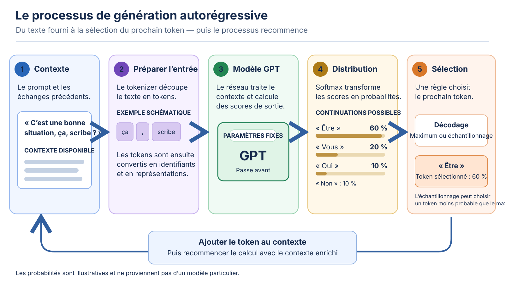

<!--
LLM-LAB-PAGE-MAP v1
id: "fr/llm-overview"
scope: "Situe les LLM modernes dans l’IA, l’apprentissage automatique et le TAL ; définit modèle de langage, modèle génératif, LLM, GPT et Transformer ; distingue architecture, apprentissage des poids et utilisation ; oriente vers les pages dédiées sans détailler la boucle de génération ni les mécanismes internes."
purpose: "À l’issue de cette page, le lecteur doit pouvoir situer les LLM, distinguer les principaux termes et les trois dimensions architecture/apprentissage/utilisation, et choisir la page spécialisée pertinente pour comprendre le calcul Transformer ou l’inférence autorégressive."
suggested_route:
  previous: "fr/index"
  next: "fr/generation"
hierarchy:
  parents: ["fr/index"]
  children: ["fr/transformer", "fr/transformer-architectures", "fr/generation", "fr/build-path", "fr/language-modeling-math", "fr/mathematical-foundations", "fr/llm-limits", "fr/llm-computational-complexity"]
related: ["fr/transformer-history"]
tags: ["type:system-overview", "destination:understand", "topic:llm-overview", "level:overview", "language:fr", "status:published"]
-->

::: {.chapter-lead}
Un **modèle de langage** estime la plausibilité de séquences de texte à partir d’un contexte. Dans un GPT, cette capacité sert notamment à estimer quel token pourrait suivre le texte déjà fourni. Un **modèle génératif** peut produire de nouveaux échantillons à partir d'une distribution apprise ; il peut être conditionné par une entrée. Un **LLM** (*large language model*) est un modèle de langage entraîné à grande échelle : il n'existe pas de seuil universel de paramètres qui sépare mécaniquement les « petits » modèles des LLM. La [taille n’est qu’une dimension de l’échelle](scaling-laws.qmd). La catégorie LLM ne présuppose pas une architecture particulière.

:::

::: {.callout-note .learning-outcomes collapse="true" title="Objectifs d’apprentissage"}
À l’issue de cette page, vous pourrez :
- expliquer intuitivement pourquoi un modèle doit comparer plusieurs continuations possibles ;
- distinguer modèle de langage, modèle génératif, LLM, GPT et Transformer ;
- expliquer comment les notions de modèle de langage, GPT et Transformer s'articulent ;
- identifier la page de référence pour approfondir le calcul du réseau ou la génération.
:::

## 1. Le problème : continuer un texte à partir d'un contexte

À partir d'un préfixe tel que « Le rapport indique que la concentration », le modèle doit estimer quels tokens pourraient suivre. Il n'existe pas nécessairement une unique suite correcte : plusieurs continuations peuvent être grammaticales et cohérentes, tout en différant par leur sens, leur précision ou leur pertinence.

Ce problème de modélisation du langage consiste à attribuer une plausibilité à des séquences conditionnellement au contexte. Pour un GPT autorégressif, la factorisation probabiliste de cette estimation est présentée dans la [formalisation mathématique du langage](language-modeling-math.qmd). La manière dont un modèle entraîné transforme cette estimation en texte, token après token, relève du cours dédié à la [génération](generation.qmd).

Le modèle apprend des régularités statistiques des données ; cet objectif ne lui fournit pas, à lui seul, un mécanisme de vérification de la vérité.

### Pourquoi ce problème est-il difficile ?

- **Ambiguïté et dépendances longues :** le sens d'un token dépend souvent de mots éloignés, de la syntaxe, du discours et de connaissances implicites.
- **Espace combinatoire :** le nombre de séquences possibles croît très rapidement avec leur longueur ; le modèle doit généraliser au-delà des exemples exacts vus pendant l'entraînement.
- **Données hétérogènes :** les corpus mélangent styles, domaines, niveaux de qualité, langues et contradictions ; leurs régularités ne sont pas toutes pertinentes pour une tâche donnée.
- **Compromis de calcul :** augmenter la capacité du modèle ne suffit pas. La qualité et la diversité des données, l'objectif d'entraînement, l'allocation du calcul et l'évaluation propre à la tâche comptent également ; l'échelle seule ne garantit pas une capacité fiable.


## 2. Comment un GPT traite ce problème

**GPT** (*Generative Pre-trained Transformer*) désigne une famille de modèles génératifs pré-entraînés fondés sur l'architecture Transformer. Dans l'usage courant, les GPT classiques sont des Transformers **décodeur seul**, entraînés à prédire le prochain token. GPT et Transformer ne sont donc pas synonymes : Transformer désigne une famille d'architectures ; GPT désigne une famille de modèles qui en utilise une configuration particulière.

Les LLM modernes sont généralement des modèles d'apprentissage profond au sein de l'intelligence artificielle et de l'apprentissage automatique. Le TAL est un domaine, pas une architecture. Les systèmes antérieurs reposaient souvent sur des règles, des caractéristiques conçues à la main ou des modèles statistiques/neuronaux spécialisés par tâche. Les LLM apprennent des régularités réutilisables à partir de corpus étendus et peuvent être adaptés à plusieurs tâches, mais nécessitent toujours une évaluation propre à chaque tâche.

LLM Lab utilise de petits modèles inspectables pour expliquer les mécanismes, pas pour reproduire les capacités des modèles de production. Un modèle de référence non entraîné est censé produire un texte incohérent.

## 3. Où se situe la génération dans le système ?

Le schéma donne une **carte d'ensemble**, pas une nouvelle explication de chaque opération. Il situe la préparation du texte, le calcul du réseau et la sélection du prochain token ; les mécanismes correspondants sont développés dans leurs pages de référence.

{#fig-gpt-generation-process fig-alt="Vue d'ensemble : le contexte est préparé, traité par le modèle, puis prolongé par le token sélectionné. La boucle se répète."}

*Figure — Vue d'ensemble conceptuelle. Les pourcentages de continuations sont illustratifs ; ils ne correspondent pas à la sortie mesurée d’un modèle particulier.*

- **Préparer le texte :** voir [texte et données](text-data.qmd) et [stratégies de tokenisation](tokenization-strategies.qmd).
- **Calculer une passe avant :** voir [GPT et Transformer](transformer.qmd), puis les pages sur les [embeddings](embedding-space.qmd), l'[information positionnelle](positional-encoding.qmd) et l'[attention](queries-keys-values.qmd).
- **Produire une continuation :** voir la page de référence sur la [génération autorégressive](generation.qmd), qui explique la distribution du prochain token, le décodage, l'ajout au contexte et l'arrêt.

Les optimisations comme le **cache KV** réduisent certains calculs répétés sans changer l'objectif de prédiction ; leur coût en mémoire et en calcul est traité dans l'[approfondissement sur la complexité des LLM](llm-computational-complexity.qmd).

## 4. Trois dimensions à ne pas confondre

Pour décrire un LLM, trois questions indépendantes doivent être posées. Elles se répondent ensemble, mais ne désignent ni les mêmes objets ni les mêmes opérations.

| Dimension | Question | Ce qu’elle décrit | Exemples |
|---|---|---|---|
| **Architecture** | Comment l’information circule-t-elle dans le modèle ? | Les opérations et connexions qui définissent le calcul effectué | Encodeur seul, encodeur-décodeur, décodeur seul ; voir [la comparaison des architectures Transformer](transformer-architectures.qmd) |
| **Apprentissage des poids** | Comment les paramètres ont-ils été obtenus ou modifiés ? | Les objectifs et procédures qui apprennent ou ajustent les paramètres | Pré-entraînement, fine-tuning/SFT, optimisation des préférences |
| **Inférence et utilisation** | Que fait-on du modèle une fois ses paramètres fixés ? | Le calcul d’une sortie à partir d’une entrée, éventuellement dans un système avec recherche ou outils | Classification, score, génération autorégressive ; prompt et RAG conditionnent le contexte sans modifier les poids |

La génération autorégressive relève de l’inférence. L’entraînement relève de l’apprentissage. Un même modèle peut changer d’usage sans changer d’architecture : c’est ce que détaillent les sections suivantes.

## 5. De l’apprentissage à l’inférence

Trois repères permettent de situer ce qui arrive aux paramètres d’un modèle, de son apprentissage à son utilisation. Ce schéma n’est pas un **cycle de vie complet** : il ne représente ni la constitution des jeux de données, ni l’évaluation, le déploiement ou la maintenance du système.

```{mermaid}
flowchart LR
  P["1. Pré-entraînement<br/>Apprendre à partir d’un corpus"] --> A["2. Adaptation facultative<br/>Ajuster les paramètres"]
  P -. "sans adaptation" .-> I
  A --> I["3. Inférence<br/>Calculer une sortie<br/>avec des paramètres fixes"]
```

1. **[Pré-entraînement (*pretraining*)](build-path.qmd).** Le modèle apprend à partir d’un corpus selon un objectif — pour un GPT, la prédiction du prochain token. L’apprentissage est dit *auto-supervisé* : les cibles sont construites à partir des données elles-mêmes, sans étiquettes humaines. Il produit un modèle pré-entraîné, souvent appelé *base model*. Le terme *foundation model* désigne plus largement un modèle conçu pour être réutilisé et adapté à de nombreuses tâches ; les deux expressions ne sont pas strictement synonymes.
2. **[Adaptation facultative des poids](build-path.qmd).** Après le pré-entraînement, on peut mettre à jour les paramètres : fine-tuning pour une tâche (par exemple la classification), SFT sur des exemples instruction-réponse, ou optimisation par préférences. Cette étape n’est pas obligatoire : un modèle pré-entraîné peut être utilisé directement.

3. **[Inférence](generation.qmd).** On utilise les paramètres obtenus pour traiter une entrée et calculer une sortie. Pour un modèle autorégressif, l’inférence suit la boucle de génération décrite dans [la page dédiée](generation.qmd). Le prompt et, éventuellement, des documents récupérés par un système RAG fournissent du contexte ; ils ne constituent pas une phase supplémentaire de l’apprentissage et ne modifient pas les poids du modèle.

L’adaptation est donc une branche facultative entre le pré-entraînement et l’utilisation, et non une étape obligatoire. Le RAG relève de la composition du contexte à l’inférence : il n’est ni une phase d’apprentissage ni une étape du cycle de vie du modèle. L’évaluation, quant à elle, intervient à plusieurs moments ; le jeu de test doit rester tenu à l’écart jusqu’à l’évaluation finale, faute de quoi cette évaluation serait biaisée.

## 6. À quoi servent ces modèles ?

Les usages courants comprennent la génération et la reformulation de texte, le résumé, la traduction, l’extraction structurée, la classification, l’assistance à la programmation et les interfaces de question-réponse.

La réutilisation d’un modèle généraliste est intéressante lorsqu’une même base peut couvrir plusieurs tâches ou lorsque les exemples d’une tâche sont limités. Pour des connaissances qui changent fréquemment, récupérer des documents à jour (RAG) est souvent plus adapté que modifier les paramètres ; pour un format, un domaine ou un comportement spécifique, une adaptation peut devenir pertinente. Le choix s’évalue sur la tâche réelle : qualité, erreurs, robustesse, coût, latence, confidentialité, provenance des données et maintenance — une démonstration convaincante sur quelques prompts n’est pas une évaluation.

::: {.self-check}

[Exercices et mises en pratique](exercises.qmd).

Essayez de répondre avant d’ouvrir les raisonnements. L’objectif est de manipuler le modèle mental, pas de mémoriser des étiquettes.

1. Le fine-tuning d'un GPT modifie-t-il nécessairement sa famille d'architecture ? Distinguez la mise à jour des paramètres d'une éventuelle modification de la structure du modèle.

<details>
<summary>Afficher le raisonnement</summary>

Non. Le fine-tuning désigne d'abord une procédure d'adaptation des paramètres. Selon la méthode, on peut aussi ajouter des modules (par exemple des adaptateurs ou une tête de classification) : il faut donc distinguer la famille du modèle de la structure complète du système adapté.

</details>

2. Une application doit répondre à partir d’une documentation qui change chaque jour. Comparez l’ajout d’une recherche documentaire (RAG) à un fine-tuning : lequel peut exploiter les nouveaux documents sans réentraîner les poids ?

<details>
<summary>Afficher le raisonnement</summary>

Le RAG peut récupérer les documents à l’inférence et les fournir dans le contexte ; les poids du modèle ne changent pas. Un fine-tuning modifie les poids à partir d’exemples d’entraînement et nécessite une nouvelle procédure d’adaptation pour intégrer les changements. Le RAG ne garantit toutefois ni la pertinence des documents récupérés ni la fidélité de la réponse.

</details>

:::

::: {.callout-note collapse="true" title="Une distinction à garder en tête"}

La prédiction du prochain token ne garantit ni la vérité des sorties ni une compréhension humaine du monde. Ces questions, ainsi que les limites des affirmations sur les capacités émergentes, sont examinées dans [Ce que la prédiction du prochain token ne prouve pas](llm-limits.qmd).

:::

::: {.language-switch}
**Langue :** [Français](llm-overview.qmd) · [English](../en/llm-overview.qmd)
:::
