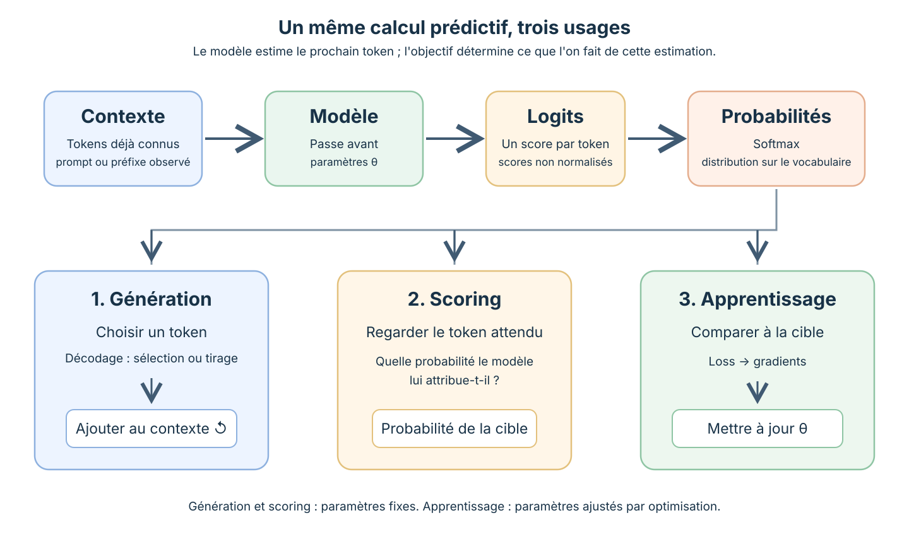
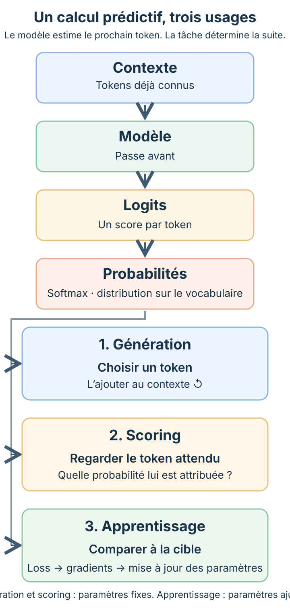

<!--
LLM-LAB-PAGE-MAP v1
id: "fr/llm-overview"
summary: "Donne une première représentation mentale d’un LLM : prédiction conditionnelle du prochain token, usages distincts, architecture, apprentissage, provenance de l’information et transfert."
scope: "Présente les repères nécessaires pour comprendre un LLM sans remplacer les pages propriétaires sur la génération, l’apprentissage, le contexte, la récupération documentaire, l’histoire ou l’évaluation."
purpose: "Expliquer ce que prédit un LLM, comment une distribution est utilisée, où se trouve l’information et pourquoi un objectif général peut soutenir plusieurs tâches."
suggested_route:
  previous: "fr/index"
  next: "fr/generation"
hierarchy:
  parents: ["fr/index"]
  children: ["fr/transformer", "fr/transformer-architectures", "fr/generation", "fr/build-path", "fr/language-modeling-math", "fr/mathematical-foundations", "fr/llm-limits", "fr/llm-computational-complexity"]
covered_stages: [orientation, text-input, representations, computation, prediction, inference, context-use, scoring, training]
related: ["fr/transformer-history", "fr/scaling-laws", "fr/llm-evolution", "fr/entropy", "fr/compression-revision", "fr/in-context-learning", "fr/context-engineering", "fr/rag-memory-boundaries", "fr/document-retrieval", "fr/post-training", "fr/llm-limits", "fr/llm-overview-exercises"]
tags: ["type:system-overview", "destination:understand", "topic:llm-overview", "level:overview", "language:fr", "status:published"]
-->



::: {.chapter-lead}
« C'est une bonne situation, ça, scribe ? » Une question courte peut appeler une réponse beaucoup plus longue. Posez-la à un assistant conversationnel : lui aussi enchaîne. Comment un programme produit-il une suite à partir d'une question ?

Il ne rédige pas sa réponse d'un seul bloc. À partir du texte déjà écrit, il estime ce qui pourrait venir ensuite, choisit un élément, puis recommence. Un programme qui prolonge ainsi un texte est un **modèle de langage**. Entraîné à grande échelle, c'est un **grand modèle de langage** (*large language model*, LLM).

Le préfixe est « C'est une bonne situation, ça, scribe ? » ; la continuation commence par « Vous savez, moi je ne crois pas qu'il y ait de bonne ou de mauvaise situation… ». Les valeurs numériques qui suivent sont fictives. L'assistant est une application ; le LLM est le modèle qu'elle interroge : seul ce dernier est étudié ici.
:::

::: {.callout-tip title="L'idée à retenir"}
Un modèle de langage estime le prochain token à partir du contexte. Cette même distribution peut servir à **générer une suite**, à **mesurer si une suite observée était attendue** ou à **entraîner le modèle**. Ces usages sont distincts : ils ne forment pas les étapes d'une même exécution.
:::

::: {.callout-note .learning-outcomes}
**Durée indicative : 8–10 minutes.**

**À la fin de cette page, vous saurez :**
- expliquer la prédiction du prochain token et pourquoi une suite probable n'est pas nécessairement vraie ;
- distinguer architecture, apprentissage des paramètres et utilisation du modèle ;
- différencier génération, scoring et apprentissage ;
- repérer où l'information est conservée, récupérée, transmise et exploitée ;
- expliquer pourquoi un objectif général peut soutenir plusieurs tâches, sans garantir leur réussite.
:::

## Ce que le modèle prédit {#what-model-predicts}

Le texte « C'est une bonne situation, ça, scribe ? » est le **préfixe** : la partie déjà fournie au modèle. La **continuation** est ce qui vient ensuite. À partir du préfixe, le modèle calcule une distribution de probabilités pour le token suivant. Imaginons le résultat suivant :

| Suite possible (un mot pour simplifier) | Probabilité |
|---|---:|
| « Vous » | 0,6 |
| « Je » | 0,2 |
| « Moi » | 0,1 |
| « Oui » | 0,1 |

[Refaire le calcul sur une continuation observée](exercises/vraisemblance.qmd#ex-overview-likelihood-transfer).

Ces valeurs sont fictives et ne proviennent pas d'un modèle entraîné. Le vocabulaire réel contient souvent des dizaines de milliers de tokens ; une ligne du tableau ne correspond donc pas nécessairement à un mot entier. Les valeurs sont reprises dans plusieurs pages pour que les calculs puissent être refaits à la main.

C'est une **distribution conditionnelle** : les probabilités sont calculées en tenant compte du préfixe et leur somme vaut 1. Si la règle de décodage choisit « Vous », ce token est ajouté au contexte ; le modèle recalcule alors une nouvelle distribution, désormais conditionnée par le préfixe enrichi.

Trois termes suffisent :

- **Token :** l'unité manipulée par le modèle. Ce n'est pas nécessairement un mot ; le tokenizer découpe le texte et associe un identifiant à chaque unité ([du texte aux tokens](text-data.qmd)).
- **Contexte :** les tokens disponibles pour prédire le suivant : le texte fourni, puis les tokens déjà produits.
- **Paramètres :** les nombres appris pendant l'entraînement, notamment les poids et biais. Ils restent fixes pendant l'inférence ordinaire.

La probabilité d'une phrase s'obtient en multipliant les probabilités conditionnelles de ses tokens successifs ([formalisation mathématique du langage](language-modeling-math.qmd)). Mais une suite probable n'est pas nécessairement vraie : la probabilité attribuée à « Vous » ne dit rien de la situation réelle d'un scribe. Bien prédire ne prouve pas non plus une compréhension humaine du monde ([limites de l'objectif d'entraînement](llm-limits.qmd)).

## Du texte à la distribution {#text-to-distribution}



{#fig-gpt-generation-process fig-alt="Un GPT autorégressif traite le préfixe : texte, tokens et identifiants, embeddings et information de position, blocs Transformer répétés, logits convertis en probabilités, puis sélection d’un token ajouté au préfixe. Le calcul recommence avec le contexte enrichi. Les probabilités sont fictives."}

Un GPT autorégressif transforme le texte en tokens, leurs identifiants en représentations numériques, puis traite ces représentations dans les blocs Transformer. La tête de sortie produit des logits, convertis en probabilités ; une règle de décodage sélectionne ensuite un token, qui est ajouté au contexte avant le calcul suivant. La sélection n'est pas une opération interne à l'attention : elle intervient après le calcul de la distribution.

La figure décrit **une computation**, pas un ordre de lecture. Le parcours Understand canonique est présenté dans la [carte d'apprentissage](learning-map.qmd). Pour approfondir chaque mécanisme : [texte et tokenisation](text-data.qmd), [embeddings](embedding-space.qmd), [Transformer](transformer.qmd), [logits et probabilités](probabilites.qmd), puis [génération](generation.qmd).

## Un calcul, trois usages {#one-computation-three-uses}

Une fois la distribution calculée, trois questions différentes peuvent se poser : veut-on produire une suite, mesurer à quel point une suite connue était attendue, ou améliorer le modèle à partir d'une suite attendue ?

<!-- Desktop: three-column view; mobile: stacked view for readable labels. -->
{.d-none .d-md-block #fig-llm-shared-prediction-uses fig-alt="Le contexte passe dans le modèle, qui produit des logits puis une distribution de probabilités. Cette distribution sert à choisir un token en génération, à mesurer la probabilité d'un token observé en scoring, ou à calculer une loss et mettre à jour les paramètres pendant l'apprentissage."}

{.d-md-none fig-alt="Version mobile du schéma : le contexte traverse le modèle, produit des logits puis des probabilités. Trois blocs présentent ensuite la génération, le scoring et l’apprentissage."}

- **Générer :** la suite est inconnue. Une règle choisit un token, l'ajoute au contexte et le calcul recommence. Le traitement initial du prompt est le *prefill* ; la production token par token est le *decode* ([génération](generation.qmd)).
- **Attribuer un score :** la suite est connue. On lit la probabilité donnée à chaque token observé ; leur produit est la **vraisemblance** de la séquence ([vraisemblance](vraisemblance.qmd)).
- **Apprendre :** la suite attendue est connue et l'on veut modifier les paramètres. La **loss** mesure l'écart à la cible ; les **gradients** indiquent comment ajuster les paramètres ([loss](loss.qmd), [gradients](gradients.qmd)). Le *teacher forcing* construit le contexte avec les tokens réels du texte ([exemples d'entraînement](training-examples.qmd)).

Pour le token observé de probabilité 0,6, la surprise vaut \( -\ln(0,6)\approx0,51 \) nat ; l'[entropie](entropy.qmd) mesure la surprise moyenne avant de connaître le token. Les détails mathématiques sont dans les pages liées. **Scorer n'est pas évaluer :** le scoring attribue une probabilité à une suite donnée ; l'évaluation compare des résultats sur un ensemble d'exemples défini et tenu à l'écart de l'entraînement.

Générer et scorer laissent les paramètres intacts ; seul l'apprentissage les modifie. Les trois usages partagent le même calcul, mais ne s'enchaînent pas dans une même exécution.

## LLM, Transformer, GPT : trois notions {#llm-transformer-gpt}

**LLM** désigne un modèle de langage entraîné à grande échelle, pas une architecture particulière. Aucun seuil universel de paramètres ne suffit à définir la catégorie : les données et le calcul d'entraînement comptent aussi ([lois d'échelle](scaling-laws.qmd)).

**Transformer** désigne une famille d'architectures. Elle comprend plusieurs configurations :

| Famille | Fonctionnement général | Exemple |
|---|---|---|
| **Encodeur seul** | Construit des représentations contextualisées de l'entrée ; souvent utilisé pour comprendre ou classer | [BERT](https://arxiv.org/abs/1810.04805) |
| **Encodeur-décodeur** | Produit une sortie conditionnée par une entrée, notamment pour les tâches séquence-à-séquence | [Transformer original](https://arxiv.org/abs/1706.03762), [T5](https://jmlr.org/papers/v21/20-074.html) |
| **Décodeur seul** | Traite un contexte causal et prédit les tokens suivants | [GPT-3](https://arxiv.org/abs/2005.14165) |

**GPT** (*Generative Pre-trained Transformer*) désigne une famille de Transformers décodeur seul pré-entraînés à prédire le prochain token. LLM Lab étudie un petit GPT de ce type, car son calcul peut être suivi et programmé de bout en bout ([comparaison des architectures](transformer-architectures.qmd), [parcours Build](build-path.qmd)). C'est un choix pédagogique : tous les LLM ne sont pas des GPT.

## Architecture, apprentissage, utilisation {#architecture-learning-use}

Pour décrire un modèle, séparons trois questions :

| Dimension | Question | Exemples |
|---|---|---|
| **Architecture** | Comment le réseau transforme-t-il l'information ? | Encodeur seul, encodeur-décodeur, décodeur seul |
| **Apprentissage** | Comment les paramètres sont-ils obtenus ou adaptés ? | Pré-entraînement, fine-tuning, SFT, optimisation par préférences |
| **Utilisation** | Que fait-on du modèle, paramètres fixés ? | Génération, classification, scoring, ICL, RAG, outils |

Le **pré-entraînement** apprend des régularités à partir de grands corpus. Pour un GPT, les tokens du texte servent de cibles : cet apprentissage est généralement *auto-supervisé*. Le modèle obtenu avant adaptation est souvent appelé *base model*. Un **modèle de fondation** (*foundation model*) est une notion plus large : un modèle entraîné à grande échelle sur des données générales et adaptable à de nombreuses tâches, parfois au-delà du langage ([Bommasani et al., 2021](https://crfm.stanford.edu/report)). Le post-entraînement peut ensuite adapter le comportement ou les paramètres, mais il n'est pas obligatoire ([post-entraînement](post-training.qmd)).

## Où se trouve l'information ? {#information-residence}

Une réponse peut mobiliser des informations qui ne sont pas conservées au même endroit. Il faut distinguer leur **stockage**, leur **accès** et leur **exploitation**.

| Emplacement | Exemples | Comment cela peut influencer la réponse |
|---|---|---|
| **Paramètres appris** | Régularités et représentations acquises au pré-entraînement ou au post-entraînement | Ils participent au calcul, mais ne constituent pas une base documentaire consultable |
| **Contexte actif** | Instructions, messages, exemples, documents et résultats d'outils effectivement transmis | Le modèle conditionne sa prédiction sur ce contenu, qui peut changer d'une requête à l'autre |
| **Sources externes** | Documents, bases et index mobilisés par un système RAG ou un outil | L'information n'influence la réponse que si elle est retrouvée puis rendue accessible au modèle |
| **État d'exécution** | Cache KV calculé pendant l'inférence | Il évite certains recalculs et accélère le décodage ; ce n'est ni un apprentissage ni une mémoire documentaire |

Le **RAG** recherche des informations externes et peut les ajouter au contexte ; la recherche seule ne suffit pas. Un document peut être stocké, indexé ou récupéré sans être transmis. L'[ingénierie du contexte](context-engineering.qmd) organise la sélection et la structuration de l'entrée ; [RAG et mémoire](rag-memory-boundaries.qmd) suit le cycle de l'information ; [récupération documentaire](document-retrieval.qmd) détaille les méthodes de recherche et de classement. L'**ICL** décrit ce que le modèle fait avec des exemples présents dans le contexte ([ICL](in-context-learning.qmd)).

## Pourquoi la prédiction peut-elle soutenir des tâches variées ? {#transformers-changed}

Le pré-entraînement ne lui enseigne pas explicitement chaque tâche qu'il pourra ensuite réaliser. En parcourant de grands corpus, le modèle apprend des régularités de langue, des relations entre éléments et des représentations qui peuvent être réutilisées lorsque la tâche est formulée dans l'entrée, lorsque des exemples sont fournis ou lorsque les paramètres sont adaptés. C'est le **transfert d'apprentissage** : un objectif général peut soutenir des tâches qui n'étaient pas des objectifs explicites d'entraînement. Ce transfert dépend toutefois des données, de la tâche et de l'évaluation ; il n'est ni universel ni automatique ([évolution des LLM](llm-evolution.qmd), [émergence](emergence.qmd), [limites](llm-limits.qmd)).

Une lecture informationnelle rapproche parfois cette prédiction de la **compression prédictive** : le modèle ajuste des probabilités pour mieux anticiper les suites. Mais une distribution ne décompresse pas, à elle seule, une séquence : un codage exact exige un codeur et un décodeur compatibles. Cette perspective n'est pas une théorie complète de l'intelligence ([entropie et compression](entropy.qmd#les-llm-sont-ils-des-algorithmes-de-compression), [fiche de révision](compression-revision.qmd)). Pour les jalons historiques et les compromis du Transformer, voir [son histoire](transformer-history.qmd).

## Choisir une approche {#choosing-an-approach}

Selon la tâche, on peut utiliser un modèle généraliste tel quel, lui fournir du contexte et des documents externes, adapter ses paramètres ou lui faire mobiliser des outils. Ces approches peuvent se combiner. Le choix dépend de critères mesurés : qualité, robustesse, fraîcheur des informations, coût, latence, confidentialité, provenance et maintenance. Quelques prompts réussis ne constituent pas une évaluation ([post-entraînement](post-training.qmd), [RAG et mémoire](rag-memory-boundaries.qmd)).

## Du modèle au système conversationnel {#model-to-conversational-system}

Un assistant conversationnel est un **système construit autour d'un modèle**. L'application formate les messages, gère le contexte et peut coordonner des outils externes. Les rôles system, user et assistant appartiennent au format des messages, pas aux couches du Transformer. Une demande d'outil produite par le modèle n'est pas encore exécutée : l'application doit vérifier les arguments et les permissions, appeler l'outil puis transmettre son résultat. Une mémoire persistante exige également un stockage et une orchestration côté application ([évolution des LLM](llm-evolution.qmd#tool-using-systems), [parcours Build](build-path.qmd)).

::: {.callout-tip title="Pour approfondir"}
- **Histoire et architecture :** [histoire des Transformers](transformer-history.qmd) et [comparaison des architectures](transformer-architectures.qmd).
- **Calcul et apprentissage :** [génération](generation.qmd), [fondements mathématiques](mathematical-foundations.qmd) et [post-entraînement](post-training.qmd).
- **Contexte et information externe :** [ingénierie du contexte](context-engineering.qmd), [RAG et mémoire](rag-memory-boundaries.qmd) et [récupération documentaire](document-retrieval.qmd).
- **Compression et information :** [entropie](entropy.qmd) et [fiche de révision sur compression et LLM](compression-revision.qmd).
- **Voir une vue d'ensemble de bout en bout :** [Andrej Karpathy — Deep Dive into LLMs like ChatGPT](https://www.youtube.com/watch?v=7xTGNNLPyMI) (2025, vidéo en anglais, environ 3 h 31) ; une ressource d'orientation, pas un substitut aux leçons détaillées.
:::

::: {.self-check}
## Vérifier sa compréhension

Exercices associés : [page d'exercices du panorama](exercises/llm-overview.qmd).

<!-- self-check-coverage: enforced -->
<!-- self-check-covers: what-model-predicts -->
1. **Une suite probable est-elle nécessairement vraie ?** Le modèle attribue 0,6 à « Vous ». Que prouve cette probabilité ?

Afficher la réponse

Elle donne une probabilité conditionnelle dans cet exemple ; elle ne prouve pas que la continuation est vraie.

<!-- self-check-covers: text-to-distribution -->
2. **Que se passe-t-il après la sélection d'un token ?**

Afficher la réponse

Le token est ajouté au contexte ; le modèle recalcule une distribution avec les mêmes paramètres.

<!-- self-check-covers: one-computation-three-uses -->
3. **Générer, scorer et apprendre sont-ils la même opération ?**

Afficher la réponse

Non : génération et scoring laissent les paramètres fixes ; l'apprentissage les met à jour.

<!-- self-check-covers: llm-transformer-gpt -->
4. **Tout LLM est-il un GPT ?**

Afficher la réponse

Non : LLM décrit une catégorie de modèles, Transformer une famille d'architectures et GPT une famille de Transformers décodeur seul.

<!-- self-check-covers: architecture-learning-use -->
5. **Un fine-tuning change-t-il nécessairement l'architecture ?**

Afficher la réponse

Non : il adapte principalement les paramètres ; l'architecture et la méthode d'apprentissage sont deux dimensions distinctes.

<!-- self-check-covers: information-residence -->
6. **Une information récupérée par RAG est-elle devenue une connaissance des paramètres ?**

Afficher la réponse

Non : elle reste externe et doit être transmise au contexte ou rendue accessible par un outil.

<!-- self-check-covers: transformers-changed -->
7. **Le Transformer rend-il la génération autorégressive parallèle ?**

Afficher la réponse

Non : les positions peuvent être traitées en parallèle pendant l'entraînement, mais les nouveaux tokens sont générés successivement.

<!-- self-check-covers: choosing-an-approach -->
8. **Une documentation change chaque jour. Faut-il réentraîner le modèle ?**

Afficher le raisonnement

Pas nécessairement : un RAG peut récupérer une source actualisée sans modifier les paramètres, à condition de mesurer la qualité de la récupération et des réponses.

<!-- self-check-covers: model-to-conversational-system -->
9. **Un message contient une demande d'outil. L'outil a-t-il déjà été exécuté ?**

Afficher la réponse

Non : l'application doit valider, exécuter l'outil et renvoyer son résultat.

:::





::: {.language-switch}
**Langue :** [Français](llm-overview.qmd) · [English](../en/llm-overview.qmd)
:::
