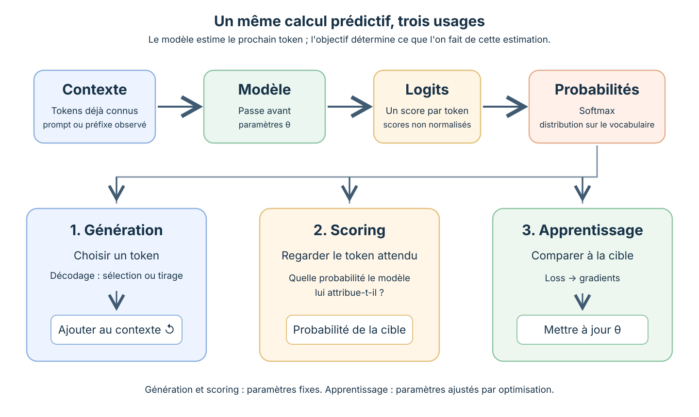
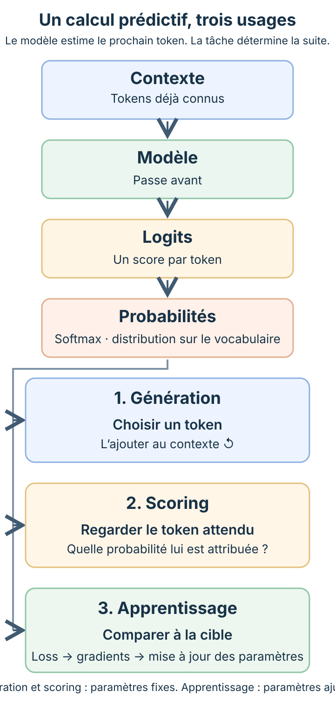

<!--
LLM-LAB-PAGE-MAP v1
id: "fr/llm-overview"
summary: "Donne une vue d’ensemble d’un LLM : prédiction du prochain token, transformation du contexte, puis usages distincts en génération, scoring et apprentissage. Oriente vers les pages qui détaillent chaque mécanisme."
scope: "Définit les LLM et GPT, illustre la prédiction du prochain token et distingue architecture, apprentissage des paramètres et utilisation. Oriente vers les pages canoniques sans détailler leurs mécanismes."
purpose: "Donner au lecteur une première représentation mentale d’un LLM : ce qu’il prédit, comment il transforme un contexte en distribution de tokens et comment cette distribution est utilisée en génération, scoring et apprentissage."
suggested_route:
  previous: "fr/index"
  next: "fr/generation"
hierarchy:
  parents: ["fr/index"]
  children: ["fr/transformer", "fr/transformer-architectures", "fr/generation", "fr/build-path", "fr/language-modeling-math", "fr/mathematical-foundations", "fr/llm-limits", "fr/llm-computational-complexity"]
covered_stages: [orientation, text-input, representations, computation, prediction, inference, scoring, training]
related: ["fr/transformer-history", "fr/scaling-laws", "fr/llm-overview-exercises"]
tags: ["type:system-overview", "destination:understand", "topic:llm-overview", "level:overview", "language:fr", "status:published"]
-->





::: {.chapter-lead}
« C'est une bonne situation, ça, scribe ? » Dans *Astérix et Obélix : Mission Cléopâtre*, la question de Panoramix lance le scribe Otis dans une longue tirade. Posez la même question à un assistant conversationnel : lui aussi enchaîne. Comment un programme produit-il une suite à partir d'une question ?

Il ne rédige pas sa réponse d'un seul bloc. Il estime, pour chaque suite possible, la probabilité qu'elle vienne après le texte déjà écrit, en retient une, puis recommence. Un programme qui attribue ainsi des probabilités aux suites d'un texte est un **modèle de langage**. Entraîné à grande échelle, c'est un **grand modèle de langage** (*large language model*, LLM).
:::

::: {.callout-note title="Fil rouge : le scribe"}
**Le préfixe** est la question de Panoramix : « C'est une bonne situation, ça, scribe ? » C'est le texte fourni au modèle. **La continuation** est ce qui vient ensuite. Dans le film, Otis commence par « Vous savez, moi je ne crois pas qu'il y ait de bonne ou de mauvaise situation... ».

La réplique du film sert d'accroche. Pour les calculs, le parcours utilise une continuation originale, écrite pour LLM Lab : « Être scribe, c'est relier des histoires. » Otis est un personnage, l'assistant une application, et le LLM le modèle que cette application interroge : seul ce dernier est étudié ici.
:::

::: {.callout-tip title="L'idée à retenir en une minute"}
- **Ce que le modèle calcule :** à partir d'un contexte, une probabilité pour chaque token qui pourrait suivre. Un token après l'autre, avec des paramètres qui ne changent pas pendant l'utilisation.
- **Un calcul, trois usages :** générer (choisir un token et l'ajouter au contexte), mesurer la vraisemblance (lire la probabilité donnée à un token déjà connu), apprendre (comparer la prédiction au token attendu et corriger les paramètres).
- **Trois mots à distinguer :** un **LLM** est un modèle de langage entraîné à grande échelle ; le **Transformer** est une famille d'architectures ; un **GPT** est un Transformer d'un type précis, pré-entraîné à prédire le prochain token.
:::

::: {.callout-note title="Une page transversale"}
Ce panorama présente plusieurs dimensions complémentaires d’un LLM, et non une étape unique du parcours. Il donne des repères sur **l’entrée et les représentations** ([texte et tokens](text-data.qmd), [embeddings](embedding-space.qmd)), **le calcul et la prédiction** ([Transformer](transformer.qmd), [distribution de probabilités](probabilites.qmd)), puis **les usages de cette prédiction** ([génération](generation.qmd), [scoring](vraisemblance.qmd) et [apprentissage](loss.qmd)). Aucun de ces thèmes n’est donc désigné ici comme l’étape courante.
:::

## Ce que le modèle prédit

Donnons au modèle le préfixe « C'est une bonne situation, ça, scribe ? ». Il ne produit pas directement un mot : il attribue un score à chaque unité de son vocabulaire, puis convertit ces scores en probabilités. Pour ce contexte, on peut imaginer le résultat suivant.

| Suite possible | Probabilité |
|---|---|
| « Être » | 0,6 |
| « Vous » | 0,2 |
| « Oui » | 0,1 |
| « Non » | 0,1 |

Ces valeurs sont fictives : elles ne proviennent pas d'un modèle entraîné, et un vocabulaire réel compte des dizaines de milliers d'entrées, pas quatre. Le parcours les réutilise d'une page à l'autre pour que chaque calcul puisse être refait à la main.

Ce tableau est une **distribution conditionnelle** : elle dépend du contexte. Les quatre probabilités se partagent un total de 1 (soit 100 %). Ajoutez « Être » à la suite de la question et recalculez : les candidats ne sont plus les mêmes, et « scribe » passe en tête.

Trois termes suffisent pour lire la suite du parcours.

- **Token.** L'unité que le modèle manipule. Ce n'est pas nécessairement un mot : « situation » peut être découpé en plusieurs morceaux, une virgule est un token. Le programme qui découpe le texte et numérote les tokens est le *tokenizer* ; [Du texte aux tokens](text-data.qmd) décrit ce découpage.
- **Contexte.** Les tokens dont le modèle dispose pour prédire le suivant : le texte fourni, puis, pendant une génération, les tokens déjà produits.
- **Paramètres.** Les nombres appris pendant l'entraînement, poids et biais notamment, qui déterminent le calcul. Ils sont fixes pendant l'inférence ordinaire, c'est-à-dire quand on utilise le modèle.

Le modèle prédit un token à la fois. La probabilité d'une phrase entière s'obtient en multipliant les probabilités de ses tokens successifs, chacune étant conditionnée par ce qui précède ; la [formalisation mathématique du langage](language-modeling-math.qmd) établit ce résultat.

Une suite probable n'est pas une suite vraie. Que « Être » soit probable après la question ne dit rien de la situation réelle d'un scribe, et bien prédire n'établit pas une compréhension humaine du monde. [Objectif d'entraînement : garanties et limites](llm-limits.qmd) précise ce que la prédiction du prochain token garantit et ce qu'il faut mesurer séparément.

## Du texte à la distribution

{#fig-gpt-generation-process fig-alt="Le préfixe « C'est une bonne situation, ça, scribe ? » est tokenisé, traité par un modèle à paramètres fixes, puis converti en distribution : Être 0,6, Vous 0,2, Oui 0,1, Non 0,1, affichés en pourcentages. Une règle de décodage sélectionne « Être », qui est ajouté au contexte. Les probabilités sont fictives."}

La figure se lit de gauche à droite.

1. **Le texte devient une suite de tokens**, puis une suite de nombres.
2. **Le réseau transforme ces nombres**, à paramètres fixes, en un score par token du vocabulaire. Ces scores sont les **logits**.
3. **La fonction softmax convertit les logits en probabilités** : c'est la distribution du tableau ci-dessus.
4. **Une règle de décodage choisit un token**, ici « Être ». Il rejoint le contexte et le calcul recommence.

Les étapes 1 à 3 forment le calcul du modèle ; le parcours les ouvre une à une, de [l'entrée](text-data.qmd) au [réseau](transformer.qmd) puis à la [distribution](probabilites.qmd). L'étape 4 n'appartient pas au réseau : c'est une décision prise à partir de sa sortie. La page suivante, [Générer du texte](generation.qmd), suit cette boucle sur notre exemple.

## Un calcul, trois usages

Une fois la distribution calculée, tout dépend de la question posée. **Pour une première lecture, retenez seulement les trois usages** : produire une suite, mesurer la vraisemblance d'une suite connue ou apprendre à partir d'une suite attendue. Les termes *prefill*, *decode*, *loss*, *gradients* et *teacher forcing* précisent les mécanismes ; vous pourrez les approfondir dans les pages liées sans devoir tous les mémoriser maintenant.

<!-- Desktop: three-column view; mobile: stacked view for readable labels. -->
{.d-none .d-md-block #fig-llm-shared-prediction-uses fig-alt="Le contexte passe dans le modèle, qui produit des logits puis une distribution de probabilités sur le prochain token. Cette distribution sert à choisir un token en génération, à mesurer la probabilité d'un token observé en scoring, ou à calculer une loss et mettre à jour les paramètres pendant l'apprentissage."}

{.d-md-none fig-alt="Version mobile du schéma : le contexte traverse le modèle, produit des logits puis des probabilités. Trois blocs présentent ensuite la génération, le scoring et l’apprentissage."}

- **Générer.** On ne connaît pas la suite. Une règle choisit un token dans la distribution, l'ajoute au contexte, et le calcul recommence. Le traitement initial du prompt s'appelle le *prefill* ; la production des tokens un par un, le *decode*.
- **Scorer.** On connaît la suite : notre continuation commence par « Être ». On lit la probabilité que le modèle lui donnait, 0,6. Répétée sur chaque token d'un texte, cette lecture mesure à quel point le modèle s'attendait à ce texte ; c'est la [vraisemblance](vraisemblance.qmd).
- **Apprendre.** On connaît aussi la suite, et l'on veut que le modèle s'y attende davantage la prochaine fois. L'écart entre la prédiction et le token attendu est résumé par un nombre, la [perte](loss.qmd) (*loss*) ; les [gradients](gradients.qmd) indiquent comment modifier chaque paramètre pour la réduire. Pendant cet apprentissage, le contexte est toujours construit avec les tokens réels du texte, jamais avec ceux que le modèle aurait produits : c'est le *teacher forcing*, détaillé dans les [exemples d'entraînement](training-examples.qmd).

Générer et scorer laissent les paramètres intacts ; seul l'apprentissage les modifie. Les trois usages partagent le même calcul, mais ne s'enchaînent pas dans une même exécution.

Scorer n'est pas encore évaluer. Le scoring donne des probabilités pour un texte. Une évaluation compare ces résultats, ou d'autres mesures, sur un ensemble d'exemples défini à l'avance et tenu à l'écart de l'entraînement jusqu'au bilan final.

## LLM, Transformer, GPT : trois mots, trois notions

**LLM** décrit une échelle, pas une construction. Aucun seuil de paramètres ne définit à lui seul la catégorie : la taille des corpus et le budget de calcul comptent autant ([lois d'échelle](scaling-laws.qmd) ; [Zhao et al., 2023](https://arxiv.org/abs/2303.18223) ; [Hoffmann et al., 2022](https://proceedings.neurips.cc/paper_files/paper/2022/hash/c1e2faff6f588870935f114ebe04a3e5-Abstract.html)). Le terme ne dit rien de l'architecture ni de l'objectif d'entraînement.

**Transformer** désigne une famille d'architectures de réseaux de neurones. L'article fondateur décrit un modèle encodeur-décodeur ([Vaswani et al., 2017](https://arxiv.org/abs/1706.03762)) ; deux autres configurations en dérivent.

| Famille | Fonctionnement général | Exemple |
|---|---|---|
| **Encodeur seul** | Construit des représentations contextualisées de l'entrée ; souvent utilisé pour des tâches de compréhension ou de classification | [BERT](https://arxiv.org/abs/1810.04805) |
| **Encodeur-décodeur** | Produit une sortie conditionnée par une entrée ; adapté notamment aux tâches séquence-à-séquence | [Transformer original](https://arxiv.org/abs/1706.03762), [T5](https://jmlr.org/papers/v21/20-074.html) |
| **Décodeur seul** | Traite un contexte causal et prédit les tokens suivants | [GPT-3](https://arxiv.org/abs/2005.14165) |

**GPT** (*Generative Pre-trained Transformer*) désigne une famille de Transformers **décodeur seul**, pré-entraînés à prédire le prochain token. C'est le type de modèle qui prolonge la question de Panoramix : il lit ce qui précède et prédit ce qui suit. Ce que chaque famille peut lire, et pour quelle tâche, fait l'objet de la [comparaison des architectures Transformer](transformer-architectures.qmd).

LLM Lab étudie un petit GPT décodeur seul, parce que son calcul peut être suivi et programmé de bout en bout ; le [parcours Build](build-path.qmd) le construit pas à pas. C'est un choix pédagogique : ses dimensions ne reproduisent pas un système de production, et tous les LLM ne sont pas des GPT.

## Architecture, apprentissage, utilisation

Décrire un modèle, c'est répondre à trois questions indépendantes.

| Dimension | Question | Exemples |
|---|---|---|
| **Architecture** | Comment le réseau transforme-t-il l'information ? | Encodeur seul, encodeur-décodeur, décodeur seul |
| **Apprentissage** | Comment les paramètres sont-ils obtenus ou adaptés ? | Pré-entraînement, fine-tuning, SFT, optimisation par préférences |
| **Utilisation** | Que fait-on du modèle, paramètres fixés ? | Génération, classification, scoring, [apprentissage en contexte](in-context-learning.qmd), recherche documentaire (RAG) |

**Apprentissage.** Le **pré-entraînement** d'un GPT lui apprend à prédire le prochain token sur un grand corpus. Il est auto-supervisé : les réponses attendues sont les tokens du texte lui-même, sans annotation. Ce que le modèle peut apprendre dépend donc de la qualité et de la diversité de ce corpus. Le résultat est souvent appelé *base model*. Une **adaptation** peut suivre, sans être obligatoire : fine-tuning pour une tâche, *supervised fine-tuning* (SFT) sur des paires instruction-réponse, optimisation par préférences.

Un **modèle de fondation** (*foundation model*) est une catégorie plus large que le *base model* : un modèle entraîné sur des données générales à grande échelle et adaptable à de nombreuses tâches, y compris hors du langage ([Bommasani et al., 2021](https://crfm.stanford.edu/report)).

**Utilisation.** À l'inférence, les paramètres ne bougent pas. Tout ce qui change la réponse passe par le contexte : le **prompt** (le texte fourni), les exemples qu'on y place, ou les documents qu'un système de **génération augmentée par récupération** (*retrieval-augmented generation*, RAG) va chercher et y insère.

## Choisir une approche

Les LLM servent notamment à générer ou reformuler du texte, résumer, traduire, extraire des informations, classer, assister la programmation et répondre à des questions.

Pour une tâche donnée, trois options se présentent : utiliser un modèle généraliste tel quel, lui fournir des documents par RAG, ou adapter ses paramètres.

- **Le modèle tel quel** convient quand il couvre déjà la tâche ou quand les exemples étiquetés sont rares.
- **Le RAG** apporte des informations récentes sans réentraînement, à condition que son corpus ou son index soit tenu à jour ([Lewis et al., 2020](https://arxiv.org/abs/2005.11401)).
- **L'adaptation** se justifie pour un format, un domaine ou un comportement que le contexte ne suffit pas à obtenir.

Le choix se fait sur des critères mesurés : qualité, erreurs, robustesse, coût, latence, confidentialité, provenance des données, maintenance. Quelques prompts réussis ne constituent pas une évaluation.

::: {.callout-tip title="Pour approfondir"}
- **Voir le modèle en configuration :** [visite guidée de la configuration d'un GPT](gpt-config-walkthrough.qmd).
- **Revoir les outils mathématiques :** [fondements mathématiques](mathematical-foundations.qmd).
- **Comparer les méthodes de découpage du texte :** [stratégies de tokenisation](tokenization-strategies.qmd).
- **Suivre une implémentation :** [visite guidée du bloc Transformer](transformer-block-walkthrough.qmd).
:::

::: {.self-check}
## Vérifier sa compréhension

Exercices associés : [page d'exercices du panorama](exercises/llm-overview.qmd).

1. Après la question de Panoramix, le modèle donne 0,6 à « Être ». Une fois « Être » ajouté au contexte, il donne à ce même token une probabilité bien plus faible. Les paramètres ont-ils changé entre les deux calculs ?

Afficher la réponse

Non. Les paramètres sont fixes pendant l'inférence. La distribution est conditionnelle : c'est le contexte qui a changé, donc le résultat du calcul.

2. Le fine-tuning change-t-il nécessairement l'architecture ?

Afficher la réponse

Non : il modifie d'abord les paramètres. Certaines méthodes ajoutent aussi des modules ; il faut alors distinguer la famille du modèle de la structure complète du système adapté.

3. Une documentation change chaque jour. Faut-il réentraîner le modèle ?

Afficher le raisonnement

Pas nécessairement. Un système RAG récupère les documents récents à l'inférence sans modifier les poids ; un fine-tuning quotidien serait coûteux et toujours en retard d'une version. Le RAG ne garantit toutefois ni la pertinence des documents récupérés ni la fidélité de la réponse à ces documents : les deux se mesurent.

:::



  <a class="route-nav-card" href="generation.qmd">
    Étape suivante →
    Générer du texte
  </a>

::: {.language-switch}
**Langue :** [Français](llm-overview.qmd) · [English](../en/llm-overview.qmd)
:::

<!-- Incremental Quarto render smoke test; no visible page change. -->
