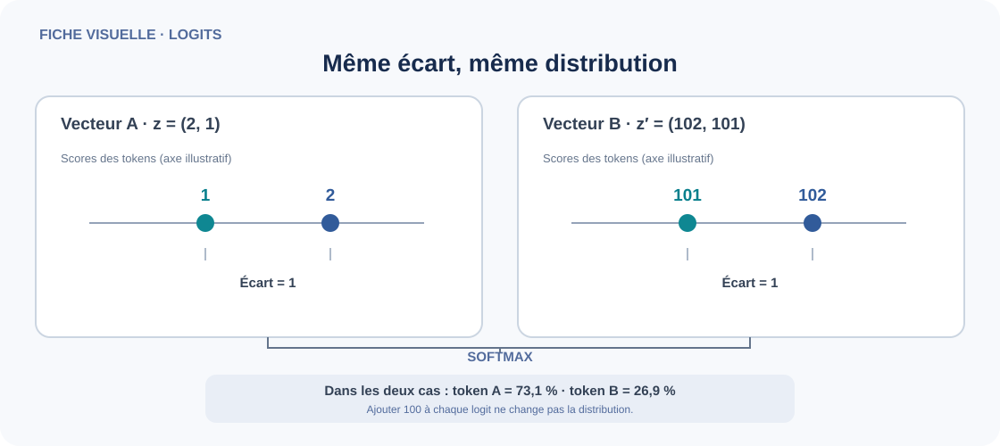

<!--
LLM-LAB-PAGE-MAP v1
id: "fr/logits"
summary: "Présente les logits comme les scores non normalisés produits pour les tokens du vocabulaire à la sortie du réseau, juste avant leur transformation en distribution."
scope: "Explique comment la tête de sortie projette un état final en scores indexés par le vocabulaire."
purpose: "Identifier la forme et les axes des logits, puis lire le classement des candidats à une position."
suggested_route:
  previous: "fr/causal-masking"
  next: "fr/probabilites"
hierarchy:
  parents: ["fr/transformer"]
  children: ["fr/probabilites"]
related: ["fr/causal-masking", "fr/generation", "fr/logits-exercises"]
revision_support:
  status: integrated_sufficient
  evidence:
    - anchor: revision-summary
      note: "Le rappel sépare score, probabilité et vérité ; le cours explique la dimension V, le classement, l'invariance par décalage commun et la projection de sortie. Les exercices vérifient ces points et font comparer les axes du softmax d’attention et de sortie."
tags: ["type:concept-lesson", "destination:understand", "topic:logits", "level:core", "language:fr", "status:published"]
-->



::: {.chapter-lead}
Un **logit** est un score réel associé à une classe ou à un token du vocabulaire, avant sa conversion en probabilité. Dans un LLM, la dernière projection produit généralement un vecteur $z\in\mathbb{R}^{V}$ à chaque position où le modèle doit prédire un token.
:::

La page précédente a montré comment le masque causal limite les positions accessibles dans l'attention. Dans le GPT du projet, les états issus du dernier bloc passent par une normalisation finale. La tête de sortie projette ensuite chaque état normalisé vers ce vecteur de scores.

::: {.callout-note .learning-outcomes collapse="true" title="Objectifs d’apprentissage"}
À l’issue de cette page, vous pourrez :
- interpréter un vecteur de logits et expliquer pourquoi ses valeurs ne sont pas des probabilités ;
- distinguer le classement des candidats par score de la distribution conditionnelle utilisée pour la génération ;
- identifier la dimension du vecteur en fonction de la taille du vocabulaire.
:::

::: {.callout-tip title="L'idée à retenir en une minute" #revision-summary}
Les **logits sont des scores, pas des probabilités**. À une position, le modèle produit un score par token du vocabulaire. Le score le plus élevé désigne le candidat classé premier ; il ne fournit pas, à lui seul, une probabilité ni une mesure de vérité.

**Première lecture :** suivez le passage « représentation du Transformer → projection de sortie → vecteur de $V$ logits ». La page suivante explique comment ces scores deviennent une distribution conditionnelle.
:::

  <a class="step-item" href="transformer.qmd">1. État final</a>
  →
  2. Projection vocabulaire
  →
  3. Logits
  →
  <a class="step-item" href="probabilites.qmd">4. Probabilités</a>

## Du dernier état aux quatre scores {#running-example-output-projection}

Après le traitement de « C'est une bonne situation, ça, scribe ? », la tête de sortie lit l'état final du **dernier token du préfixe**. Elle lui associe un score par token du vocabulaire pour prédire la position suivante.

Prenons un état fictif $h=(1,-1)$ et un vocabulaire jouet de quatre tokens. La matrice de sortie a quatre lignes et deux colonnes. Dans cet exemple sans biais, le score $z_i$ est le produit scalaire de la ligne $w_i$ par $h$. Multipliez les coordonnées terme à terme, puis additionnez les produits.

::: {.table-responsive}

<table class="table d-table">
<thead>
<tr><th scope="col" class="px-1 px-sm-2">Token</th><th scope="col" class="px-1 px-sm-2">Ligne $w_i$</th><th scope="col" class="px-1 px-sm-2">Score $z_i$</th></tr>
</thead>
<tbody>
<tr><th scope="row" class="px-1 px-sm-2">« Vous »</th><td class="px-1 px-sm-2">$(\ln 3,-\ln 2)$</td><td class="px-1 px-sm-2">$\ln 6$</td></tr>
<tr><th scope="row" class="px-1 px-sm-2">« Je »</th><td class="px-1 px-sm-2">$(\ln 2,0)$</td><td class="px-1 px-sm-2">$\ln 2$</td></tr>
<tr><th scope="row" class="px-1 px-sm-2">« Moi »</th><td class="px-1 px-sm-2">$(1,1)$</td><td class="px-1 px-sm-2">$0$</td></tr>
<tr><th scope="row" class="px-1 px-sm-2">« Oui »</th><td class="px-1 px-sm-2">$(-1,-1)$</td><td class="px-1 px-sm-2">$0$</td></tr>
</tbody>
</table>

:::

Pour « Vous », le calcul donne $\ln 3-(-\ln 2)=\ln 6$. « Moi » et « Oui » obtiennent le même score pour cet état avec deux lignes différentes.

Le [calcul sur ces quatre candidats](probabilites.qmd#running-example-next-token) reprend les mêmes scores pour obtenir la distribution du premier tour.

## Définition et dimensions

Pour une position donnée, on note le vecteur des scores :
$$
z=(z_1,\ldots,z_V)\in\mathbb{R}^{V},
$$
où $V$ est la taille du vocabulaire. Chaque composante $z_i$ est associée à l'identifiant du token $i$. Les logits peuvent être négatifs ou positifs ; ils ne sont pas contraints à l'intervalle $[0,1]$ et leur somme n'a pas à valoir un.

Pour un lot de séquences, la tête de sortie peut produire un tenseur de forme $(B,T,V)$ : $B$ séquences, $T$ positions et $V$ scores par position. En génération autorégressive, on exploite généralement les scores de la position courante pour choisir le token suivant.

Pour relier l’axe des positions à l’axe du vocabulaire, [comparez deux cibles observées sous un même préfixe](exercises/contextualized-representations.qmd#ex-contextualization-causal-boundary). Identifiez la ligne de logits commune, puis la colonne utilisée dans chaque cas.

## Ce que les logits permettent de lire

- **Le classement local :** dans un même vecteur, le plus grand logit désigne le candidat de score maximal (l'argmax).
- **Les écarts :** les différences entre scores décrivent leur séparation relative dans ce vecteur.
- **Pas une confiance absolue :** la valeur brute d'un logit dépend de l'échelle et du décalage des scores. Elle ne se lit pas comme un pourcentage et ne suffit pas à établir la confiance ou la vérité d'une sortie.

<figure id="fig-logits-common-shift">
  <picture>
    <source media="(max-width: 600px)" srcset="../images/logits-common-shift-fr-mobile.svg">
    
  </picture>
  <figcaption>La softmax est invariante à l’ajout d’une même constante à tous les logits : ce sont les écarts qui comptent, pas leur niveau absolu.</figcaption>
</figure>

### Le niveau zéro des logits est arbitraire

Considérez deux vecteurs : $z=(2,1)$ et $z'=(102,101)$. Leurs scores sont très différents en valeur absolue, mais le second s'obtient en ajoutant 100 à chaque composante. La softmax donne exactement la même distribution pour les deux vecteurs : le décalage commun s'annule entre le numérateur et le dénominateur. **Ce sont les écarts entre logits qui déterminent les rapports de probabilités, pas leur niveau absolu.**

Plus généralement, si $p=\operatorname{softmax}(z)$, alors $\log p_i=z_i-\log\sum_j e^{z_j}$ et donc :

$$
\log\frac{p_i}{p_j}=z_i-z_j.
$$

L'écart entre deux logits est exactement le log-rapport des probabilités correspondantes.

En revanche, multiplier tous les logits par un facteur positif peut modifier la concentration de la distribution, même si le classement des candidats reste identique. La température exploite précisément cette propriété ; la page [Probabilités de sortie](probabilites.qmd) en détaille l'effet.

La conversion en distribution de probabilité est une opération distincte. Elle est traitée dans [Probabilités de sortie](probabilites.qmd), page de référence pour la softmax, la température et l'interprétation de la distribution.



::: {.language-switch}
[Français](logits.qmd) · [English](../en/logits.qmd)
:::

## Exercices

[Comparez les deux axes du softmax](exercises/logits.qmd#ex-attention-vocabulary-softmax) ou parcourez les [autres exercices](exercises/logits.qmd).

:::: {.supplementary-resources}

  Ressources complémentaires
  Expérimenter, approfondir et s'exercer sur les notions de cette leçon.

::: {.learning-resources__content}

### Dans un LLM

La représentation cachée finale est projetée vers un vecteur de dimension $V$, généralement au moyen d'une couche linéaire de sortie. Pendant l'entraînement, les logits peuvent être transmis directement à une fonction de perte telle que la [cross-entropie](cross-entropy.qmd) : il n'est pas nécessaire de calculer préalablement une softmax explicite lorsque la fonction de perte intègre cette opération de manière numériquement stable.

La documentation [PyTorch — CrossEntropyLoss](https://docs.pytorch.org/docs/stable/generated/torch.nn.CrossEntropyLoss.html) précise que l'entrée attendue correspond à des logits non normalisés.

:::

::::
