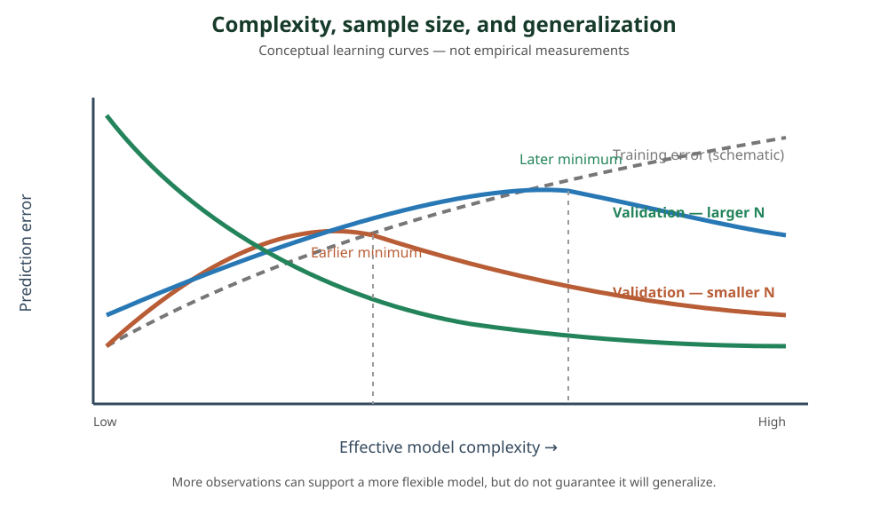

<!--
LLM-LAB-PAGE-MAP v1
id: "fr/model-capacity-data-regimes"
scope: "Relie la capacité effective d'un modèle, la dimension des variables, la taille de l'échantillon, le bruit et les risques de sous-ajustement et surapprentissage."
purpose: "Interpréter avec prudence les régimes N/M, les degrés de liberté effectifs et les courbes d'apprentissage pour choisir et régulariser un modèle."
suggested_route:
  previous: "fr/bias-variance"
  next: "fr/decision-trees"
hierarchy:
  parents: ["fr/bias-variance"]
  children: []
related: ["fr/decision-trees", "fr/gradient-boosting", "fr/xgboost"]
tags: ["type:concept-lesson", "destination:deepen", "topic:model-capacity-data-regimes", "level:applied", "language:fr", "status:published"]
-->
::: {.chapter-lead}
La taille d'un jeu de données ne suffit pas à déterminer quel modèle convient. Il faut la mettre en relation avec la dimension des variables, la capacité effective du modèle, la structure du signal, le bruit et la dépendance entre observations. Le rapport $N/M$ est un repère de départ, pas une loi de sélection.
:::
## Trois quantités à distinguer

- $N$ : nombre d'observations effectivement indépendantes ou suffisamment informatives.
- $M$ : nombre de variables candidates après encodage ; il peut être très différent du nombre de variables métier.
- **Capacité effective** : quantité de complexité que l'apprentissage peut réellement mobiliser compte tenu de l'architecture, des contraintes, de la régularisation et des données.

La difficulté dépend aussi du rapport signal/bruit, de la redondance entre variables, de la sparsité du signal, de la cardinalité des catégories, des valeurs manquantes et du décalage entre entraînement et déploiement. Deux jeux ayant les mêmes $N$ et $M$ peuvent donc présenter des difficultés très différentes.

## Le rapport entre observations et variables

### Quand $N$ est petit devant $M$

Le problème est sous-déterminé ou faiblement contraint : de nombreux modèles peuvent expliquer les observations d'entraînement. Les risques sont la sélection de variables fortuite, les coefficients instables et la découverte de motifs qui ne se répètent pas.

Une régression linéaire non régularisée ne peut pas identifier de manière unique tous les coefficients lorsque la matrice de conception manque de rang. Une pénalisation L1 peut favoriser une solution parcimonieuse ; L2 stabilise les coefficients. Ni l'une ni l'autre ne crée de l'information absente : le choix dépend du signal, de la corrélation des variables et du protocole de validation.

Un arbre peut ignorer de nombreuses variables et ne conserver que les séparations retenues. Cela ne le rend pas automatiquement sûr lorsque $N \ll M$ : tester beaucoup de variables et de seuils crée un effet de sélection multiple, et un arbre peut trouver des séparations accidentelles. La profondeur, le gain minimal, la taille minimale des feuilles, l'élagage et la validation restent déterminants.

### Quand $N$ est grand devant $M$

On dispose généralement de davantage d'information pour estimer les relations, et des modèles plus flexibles deviennent envisageables. Mais $N \gg M$ ne garantit ni un signal exploitable ni l'absence de surapprentissage : un faible rapport signal/bruit, une forte dépendance temporelle ou une dérive de distribution peuvent maintenir le problème difficile.

Les modèles flexibles — arbres, forêts, boosting, réseaux — peuvent exploiter les interactions et les non-linéarités que les modèles linéaires ne représentent pas directement. Leur capacité doit toutefois être confrontée à une validation représentative du déploiement.

## Degrés de liberté : une notion utile, pas une formule universelle

Les degrés de liberté cherchent à quantifier la flexibilité effective d'un estimateur. Pour une régression linéaire ordinaire de rang $r$, les degrés de liberté du modèle ajusté sont liés à $r$, donc au plus à $\min(N,M)$ dans le cas usuel. Pour une régression ridge, on utilise souvent les degrés de liberté effectifs $\operatorname{tr}(S_\lambda)$, où $S_\lambda$ est la matrice qui transforme les observations en valeurs ajustées.

Pour les arbres, la profondeur, le nombre de feuilles, les tailles de feuilles et les contraintes de séparation décrivent des aspects de la capacité, mais ne se résument pas à une loi générale $O(N)$. Deux arbres ayant le même nombre de feuilles peuvent avoir des comportements différents selon la géométrie des régions, les variables utilisées et la distribution des observations.

**Précaution sur les notations asymptotiques :** écrire « complexité $O(N)$ » sans préciser l'objet compté, la famille de modèles, les hypothèses et l'algorithme est insuffisant. Il faut distinguer degrés de liberté statistiques, nombre de paramètres, coût mémoire et complexité temporelle d'entraînement.

## Familles de modèles et capacité effective

| Famille | Source de capacité / complexité | Tendance utile à connaître | Limite à ne pas oublier |
|---|---|---|---|
| Régression linéaire | Rang de la matrice de conception ; degrés de liberté effectifs sous pénalisation | Classe fonctionnelle contrainte, souvent stable | Biais si la relation est non linéaire ou si les interactions manquent |
| Naive Bayes | Nombre de paramètres des distributions conditionnelles ; dépend du nombre de classes et du codage | Peut estimer des modèles simples avec peu de données | L'hypothèse de factorisation conditionnelle limite la représentation des dépendances entre variables |
| Arbre de décision | Nombre de feuilles, profondeur, seuils testés et contraintes | Peut sélectionner des variables et représenter des interactions | La recherche parmi beaucoup de splits peut surajuster, même si peu de variables figurent dans l'arbre final |
| Forêt aléatoire | Capacité des arbres, nombre de variables candidates et corrélation entre arbres | La moyenne stabilise souvent des arbres instables | Des arbres trop corrélés réduisent le bénéfice ; trop de randomisation affaiblit les arbres |
| Gradient Boosting | Nombre d'étapes, profondeur/feuilles, learning rate et régularisation | Les corrections successives peuvent réduire le biais de représentation | L'ajout d'étapes peut finir par ajuster le bruit ; validation et early stopping restent essentiels |

Le nombre de paramètres ou de degrés de liberté n'est pas directement comparable entre ces familles. Les hypothèses du modèle et le protocole d'apprentissage comptent autant que le décompte brut.

## La taille des données déplace le compromis

{fig-alt="Schéma qualitatif : l'erreur d'entraînement diminue avec la complexité ; l'erreur de validation atteint un minimum, situé plus à droite avec davantage de données. Ce n'est pas une loi empirique universelle."}

À capacité fixée, davantage d'observations indépendantes tendent à stabiliser l'estimation. Cela peut rendre utilisable un modèle plus flexible : le minimum de validation peut se déplacer vers une complexité supérieure. Mais le déplacement n'est pas garanti et dépend de la qualité des nouvelles données, du bruit, de la distribution et de la façon dont la complexité est mesurée.

Lire les courbes :

- **Sous-ajustement** : erreurs d'entraînement et de validation toutes deux élevées ; augmenter la capacité ou améliorer les variables peut aider.
- **Zone de généralisation** : la validation s'améliore puis atteint un minimum.
- **Surapprentissage** : l'erreur d'entraînement continue de baisser alors que la validation remonte.
- **Données supplémentaires** : elles peuvent réduire l'instabilité et retarder le surapprentissage, sans corriger une fuite, une mauvaise cible ou un décalage de distribution.

## Repères de choix, à confirmer par validation

| Situation observée | Première hypothèse à tester | Ce qu'il faut surveiller |
|---|---|---|
| Petit $N$, grand $M$ | Baseline simple, régularisation forte, sélection parcimonieuse ou modèle peu profond | Variance des scores entre partitions, stabilité des variables retenues |
| $N$ modéré, interactions plausibles | Arbres contraints, forêt aléatoire, boosting régularisé | Écart entraînement-validation, profondeur, feuilles, calibration |
| Grand $N$, données tabulaires hétérogènes | Comparer GBM, XGBoost, LightGBM et CatBoost | Temps total, mémoire, qualité hors échantillon, dérive |
| Très faible signal/bruit | Baseline robuste et modèle simple | Gain réel sur la baseline et incertitude des estimations |

Ce tableau ne classe pas les algorithmes. Il propose des hypothèses de départ à tester dans un protocole comparable.

## Pourquoi les ensembles changent le compromis

Une forêt aléatoire moyenne des arbres construits avec de l'aléa sur les observations et/ou les variables. L'agrégation réduit souvent la variance, mais le gain dépend de deux propriétés : la qualité individuelle des arbres et leur corrélation. Des arbres très corrélés apportent moins d'information nouvelle ; une randomisation trop forte peut au contraire affaiblir chaque arbre. Breiman formalise précisément ce compromis entre force et corrélation.

Ajouter des arbres à une forêt aléatoire standard réduit généralement le bruit Monte-Carlo de l'agrégation et l'erreur converge vers une limite ; cela ne signifie pas que toute modification de la profondeur, des variables ou du protocole est sans risque de surapprentissage.

Le boosting suit une autre logique : chaque arbre dépend du modèle courant et corrige une partie de la loss. La diversité vient de cette construction séquentielle, pas d'une moyenne de modèles indépendants. Ajouter des itérations peut d'abord améliorer la généralisation puis finir par ajuster du bruit ; le learning rate, la profondeur, les pénalités et l'early stopping sont donc importants.

Voir [arbres de décision](decision-trees.qmd), [Gradient Boosting](gradient-boosting.qmd), [XGBoost](xgboost.qmd), [LightGBM](lightgbm.qmd) et [CatBoost](catboost.qmd).

::: {.self-check}
## Vérifier sa compréhension
1. Si $N \ll M$, un arbre évite-t-il nécessairement le surapprentissage parce qu'il sélectionne quelques variables ?

Afficher la réponse
Non. La recherche parmi de nombreuses variables et de nombreux seuils peut trouver des séparations fortuites. Il faut contrôler la capacité et mesurer la stabilité hors échantillon.

2. Pourquoi le rapport $N/M$ ne suffit-il pas à caractériser la difficulté ?

Afficher la réponse
Le bruit, la redondance, la sparsité du signal, les dépendances entre observations, la cardinalité et le décalage de distribution changent la quantité d'information utile.

3. Pourquoi davantage de données peut-il rendre un modèle plus flexible exploitable ?

Afficher la réponse
À signal et distribution comparables, davantage d'observations informatives peut réduire l'incertitude d'estimation et stabiliser des structures plus complexes. Ce n'est pas garanti si les données supplémentaires sont bruitées ou décalées.

4. Pourquoi ajouter des arbres à une forêt n'est-il pas équivalent à approfondir les arbres ?

Afficher la réponse
Le nombre d'arbres améliore l'approximation de l'agrégation ; la profondeur modifie la complexité et l'instabilité des prédicteurs individuels.

:::
## Références

- Hastie, Tibshirani & Friedman, [The Elements of Statistical Learning](https://hastie.su.domains/ElemStatLearn/), chapitres 2, 7, 8 et 15.
- Breiman (2001), [Random Forests](https://www.stat.berkeley.edu/~breiman/randomforest2001.pdf), notamment les sections sur la convergence, la force et la corrélation.
- Damien Benveniste, [GBM vs XGBoost vs LightGBM vs CatBoost](https://newsletter.theaiedge.io/p/gbm-vs-xgboost-vs-lightgbm-vs-catboost), introduction publique sur les régimes $N/M$ et la capacité des modèles.
- [The AiEdge — The Gradient Boosted Algorithm Explained!](https://newsletter.theaiedge.io/p/the-gradient-boosted-algorithm-explained), schéma public du cycle d'apprentissage additif.
::: {.language-switch}
[Français](model-capacity-data-regimes.qmd) · [English](../en/model-capacity-data-regimes.qmd)
:::
