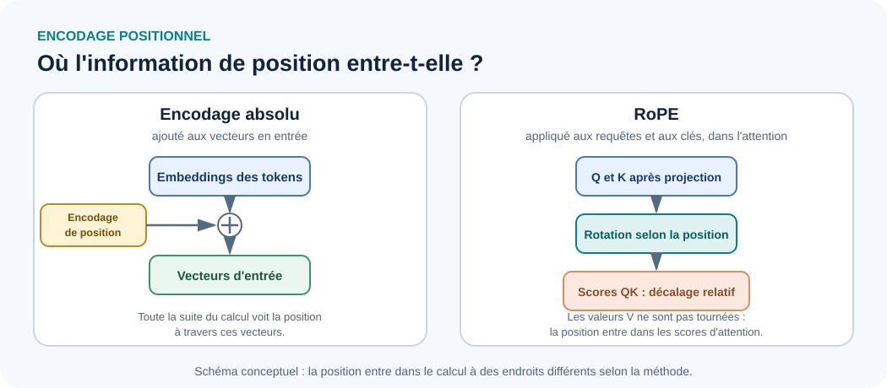

<!--
LLM-LAB-PAGE-MAP v1
id: "fr/positional-encoding"
summary: "Explique comment l’information positionnelle permet au Transformer de tenir compte de l’ordre des tokens, et situe les principales familles de mécanismes dans le calcul."
scope: "Explique où l’ordre des tokens intervient, avec un signal absolu à l’entrée et un signal relatif dans la comparaison en attention."
purpose: "Prédire ce qui change quand on permute deux tokens et situer l’information de position dans les mécanismes présentés."
suggested_route:
  previous: "fr/embedding-space"
  next: "fr/contextualized-representations"
hierarchy:
  parents: ["fr/embedding-space"]
  children: ["fr/contextualized-representations", "fr/rope", "fr/sinusoidal-positional-encoding"]
related: ["fr/transformer", "fr/positional-encoding-exercises"]
revision_support:
  status: integrated_sufficient
  evidence:
    - anchor: revision-summary
      note: "Le récapitulatif distingue addition, mécanismes relatifs et visibilité causale. La comparaison de B au milieu vérifie la différence entre lookup, attention de contenu et masque ; l’exercice avec B en dernier contrôle la portée de ce résultat."
tags: ["type:concept-lesson", "destination:understand", "topic:positional-encoding", "level:core", "language:fr", "status:published"]
-->


::: {.chapter-lead}
Un Transformer doit disposer d'un signal d'ordre pour distinguer, par exemple, « le chat poursuit le chien » de « le chien poursuit le chat ». Cette page présente les mécanismes positionnels et les distingue du masque causal ; la dérivation détaillée de RoPE est réservée à un [approfondissement avancé](rope.qmd). Pour les encodages sinusoïdaux du Transformer original, consultez l'[approfondissement dédié](sinusoidal-positional-encoding.qmd).
:::

## Pourquoi ajouter une information de position ?

Les deux occurrences de `chat` aux positions 0 et 3 lisent le même vecteur dans la [table de plongements](embedding-space.qmd). Pour tenir compte de leur rang, le modèle a besoin d’un signal d’ordre. Permuter « le chat poursuit le chien » peut changer qui poursuit qui.

Le masque causal, lorsqu'il est utilisé, indique quelles positions peuvent être consultées (`j ≤ i`). Les mécanismes positionnels peuvent en plus représenter une position absolue ou un décalage relatif. Ces signaux sont complémentaires, pas interchangeables.

Dans le préfixe « C'est une bonne situation, ça, scribe ? », l'ordre des tokens fait partie de l'entrée. Lorsque la génération ajoute « Vous savez, moi… », les nouveaux tokens occupent à leur tour de nouvelles positions dans la séquence.

### Suivre B quand l’ordre change {#position-permutation}

Considérons deux séquences déjà tokenisées, \`ABC\` et \`CBA\`. Le token B garde le même ID et le même rang au milieu. On échange les occurrences dans la séquence en conservant les IDs du vocabulaire. Comparons la sortie de B dans trois calculs, à paramètres fixes.

| Calcul | Résultat pour B |
|---|---|
| Lecture de la table de plongements | B lit le même vecteur, puisque son ID est le même. |
| Une couche d’auto-attention de contenu, sans mécanisme positionnel ni masque | B consulte les mêmes trois tokens. L’échange d’A et de C réordonne les contributions sans changer leur agrégation pour B. |
| La même couche avec le seul masque causal | B voit \`AB\` dans un cas et \`CB\` dans l’autre. Le résultat peut changer, car les tokens visibles ont changé. |

Dans le deuxième cas, permuter les entrées permute les sorties de la même façon. C’est l’**équivariance par permutation**. Le masque causal brise cette symétrie en faisant dépendre la visibilité du rang. Une requête à la position $t$ peut consulter les positions $s \le t$. Les encodages explicites peuvent aussi fournir une position ou un décalage.

## Deux familles et plusieurs mécanismes

Un encodage **absolu additif** utilise le rang du token. Un mécanisme **relatif** rend l’attention sensible à l’écart entre deux rangs. Avant de comparer les positions, l’attention calcule des requêtes (Q), des clés (K) et des valeurs (V) à partir des états. Une requête est comparée aux clés pour déterminer les poids, qui servent ensuite à combiner les valeurs.

| Mécanisme | Où agit la position |
|---|---|
| Encodage absolu additif | Ajoute un vecteur à l’embedding avant le premier bloc. Le Transformer d’origine utilisait des vecteurs sinusoïdaux ; d’autres modèles les apprennent. |
| [RoPE](rope.qmd) | Fait tourner Q et K après projection selon leurs rangs respectifs. À Q et K avant rotation fixés, leur produit scalaire dépend du **décalage relatif**. La rotation ne s’applique pas directement à V. |
| Biais relatif | Ajoute aux scores d’attention, avant le softmax, un terme fondé sur le décalage. D’autres variantes utilisent des représentations relatives. |

Le masque causal détermine quelles clés peuvent contribuer, indépendamment du mécanisme positionnel. Voir les leçons sur les [projections Q/K/V](queries-keys-values.qmd) et le [masque causal](causal-masking.qmd) pour distinguer ces opérations.

::: {.callout-note collapse="true" title="Comparer les deux points d’insertion sur le schéma"}

{fig-alt="Un encodage absolu est ajouté aux embeddings en entrée, avant toute projection. RoPE applique des rotations aux requêtes et aux clés après leurs projections, avant le produit QK, si bien que les scores d'attention portent l'information de position." width=100%}

:::

::: {.callout-note title="Un signal calculable ne garantit pas l'extrapolation"}
La formule sinusoïdale peut être calculée pour des indices de position arbitrairement grands. Cela ne garantit pas qu'un modèle entraîné sur des séquences plus courtes saura utiliser correctement ces positions inédites. De même, RoPE ne garantit pas à lui seul un contexte long fiable : le comportement dépend notamment des fréquences, des éventuelles méthodes de mise à l'échelle, de la longueur d'entraînement et des données. **Pouvoir représenter une position n'est pas la même chose que généraliser à cette position.** Les approfondissements sur les [encodages sinusoïdaux](sinusoidal-positional-encoding.qmd) et [RoPE](rope.qmd) détaillent ces limites.
:::

Pour comprendre la dépendance au décalage relatif et les conventions de rotation, voir l'[approfondissement avancé sur RoPE](rope.qmd). Les questions et exercices corrigés sont regroupés sur la [page de pratique dédiée](exercises/positional-encoding.qmd).

## Idées reçues

- **« L'attention sait naturellement quel token vient en premier. »** L'attention fondée sur le contenu ne porte pas cet ordre à elle seule ; un mécanisme positionnel ou une contrainte structurelle, comme le masque causal, doit le fournir.

::: {.callout-tip title="L'idée à retenir en une minute" #revision-summary}
- **Pourquoi :** les embeddings de contenu seuls ne disent pas où se trouve un token. Sans signal positionnel ni contrainte d'ordre, l'auto-attention est équivariante par permutation.
- **Où :** les encodages absolus sont ajoutés aux représentations d'entrée ; les mécanismes relatifs agissent dans l'attention ; **RoPE** fait tourner les requêtes et les clés après projection.
- **À ne pas confondre :** le masque causal limite les positions visibles (pas de futur), mais ne remplace pas un mécanisme qui représente les positions ou leurs décalages.
:::

## Où se situe cette étape dans le parcours ?

Le [lookup dans l'espace des plongements](embedding-space.qmd) associe chaque identifiant à un vecteur initial indépendant de la position ; cette page explique pourquoi et comment l'ordre est ensuite pris en compte. Les [représentations contextualisées](contextualized-representations.qmd), prochaine étape du parcours, décrivent comment les blocs Transformer transforment ces états initiaux en états dépendants du contexte. Pour approfondir : la page [RoPE](rope.qmd) détaille le mécanisme rotatif relatif, et le [masque causal](causal-masking.qmd) présente une contrainte structurelle distincte : il détermine les positions visibles par chaque requête.



::: {.language-switch}
**Langue :** [Français](positional-encoding.qmd) · [English](../en/positional-encoding.qmd)
:::

:::: {.supplementary-resources}

  Ressources complémentaires
  Expérimenter, approfondir et s'exercer sur les notions de cette leçon.

::: {.learning-resources__content}

### Exercices

Les questions et exercices de cette leçon sont regroupés sur sa [page d’exercices dédiée](exercises/positional-encoding.qmd).

### Pourquoi l’auto-attention seule ne suffit-elle pas ?

Pour une auto-attention fondée uniquement sur le contenu, sans biais positionnel ni masque dépendant de l’ordre, permuter les lignes de l’entrée permute les lignes de sortie de la même façon. Si $P$ est une matrice de permutation, alors :

$$
\operatorname{Attention}(PX)=P\,\operatorname{Attention}(X).
$$

On peut le vérifier en posant $S=QK^\top/\sqrt{d_k}$ et $A=\operatorname{softmax}(S)$, avec un softmax appliqué ligne par ligne. Pour l’entrée permutée, $Q'=PQ$, $K'=PK$ et $V'=PV$. Ainsi, $A'=\operatorname{softmax}(PSP^\top)=PAP^\top$, puis $A'V'=PAP^\top PV=PAV$.

Le calcul est **équivariant par permutation** : il réordonne ses sorties avec ses entrées. Il ne fournit donc pas, à lui seul, un repère permettant de distinguer les positions dans la séquence.

Cette propriété suppose l’absence de signal positionnel et de contrainte dépendant de l’ordre. Un masque causal fixe introduit justement une contrainte structurelle d’ordre ; il ne faut pas confondre ce rôle avec celui d’un encodage positionnel explicite.

### Approfondissement facultatif — géométrie des encodages sinusoïdaux

Dans l’encodage sinusoïdal original, chaque paire de coordonnées utilise une fréquence propre. En posant $\omega_i=10000^{-2i/d}$, la paire associée à l’indice $i$ s’écrit :

$$
p_i(t)=
\begin{bmatrix}
\sin(\omega_i t)\\
\cos(\omega_i t)
\end{bmatrix}.
$$

Pour un décalage fixé $k$, les identités trigonométriques donnent :

$$
p_i(t+k)=
\begin{bmatrix}
\cos(\omega_i k) & \sin(\omega_i k)\\
-\sin(\omega_i k) & \cos(\omega_i k)
\end{bmatrix}
p_i(t).
$$

Le décalage $k$ correspond donc à une rotation fixe **pour une paire et une fréquence données**. Par exemple, avec $d=2$, la seule paire a $\omega_0=1$ : $p_0(0)=[0,1]^\top$ et $p_0(1)=[\sin(1),\cos(1)]^\top\approx[0.8415,0.5403]^\top$.

Dans cette construction, $P$ est ajouté aux embeddings à l’entrée, $X_0=E[\text{token IDs}]+P$. Ce n’est pas RoPE : RoPE applique des rotations aux projections $Q$ et $K$ après leur calcul, avant les scores d’attention. La propriété géométrique ci-dessus rend les décalages accessibles à une transformation linéaire ; elle ne garantit pas qu’une tête apprendra effectivement une règle telle que « regarder trois tokens en arrière ».

### Références

- [Vaswani et al. (2017), Attention Is All You Need](https://arxiv.org/abs/1706.03762) — encodages positionnels sinusoïdaux.
- [Su et al. (2021), RoFormer: Enhanced Transformer with Rotary Position Embedding](https://arxiv.org/abs/2104.09864) — article original sur RoPE.
- [Hugging Face Transformers — documentation](https://huggingface.co/docs/transformers/) — détails d'implémentation selon les architectures.
- [Jay Joshi, *The Mathematics of a Transformer… Part 1*](https://medium.com/@jayjj6272/the-mathematics-of-a-transformer-explained-with-numbers-you-can-check-by-hand-with-geometric-96b5873c95be) — ressource pédagogique complémentaire sur la lecture géométrique des embeddings et des encodages sinusoïdaux ; les calculs présentés ici ont été vérifiés indépendamment.

:::

::::
