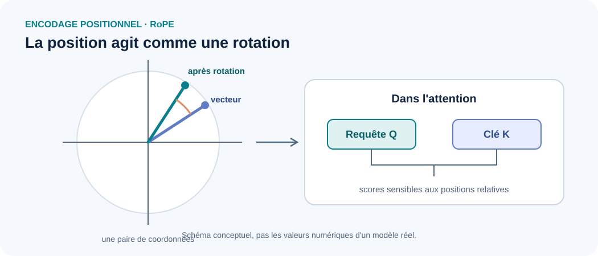

::: {.chapter-lead}
L'attention compare des représentations de tokens, mais elle ne connaît pas spontanément leur ordre. Un mécanisme positionnel apporte cette information : il permet au modèle de distinguer, par exemple, « le chat poursuit le chien » de « le chien poursuit le chat ». Les Transformers utilisent plusieurs approches ; **RoPE** (*Rotary Position Embedding*) encode la position en faisant tourner des paires de coordonnées des requêtes et des clés.
:::

## Pourquoi ajouter une information de position ?

Sans information positionnelle, l'auto-attention standard ne dispose pas à elle seule d'un signal explicite indiquant si un token apparaît avant ou après un autre. L'ordre compte ; il doit donc intervenir dans les représentations ou dans le calcul de l'attention.

{fig-alt="RoPE applique des rotations dépendant de la position aux paires de coordonnées des requêtes et des clés. Les angles dépendent de la position et de la fréquence de chaque paire." width=100%}

Le dessin représente une seule paire de coordonnées. En pratique, RoPE agit sur plusieurs paires avec des fréquences différentes. La figure illustre l'opération géométrique, pas les valeurs numériques d'un modèle réel.

## Trois familles à distinguer

- **Encodage absolu ajouté au vecteur :** on ajoute à la représentation du token un vecteur associé à sa position. Le Transformer original utilisait des encodages sinusoïdaux ; d'autres modèles apprennent leurs embeddings positionnels.
- **Encodage ou biais relatif :** le calcul utilise explicitement la distance ou le décalage entre deux positions.
- **RoPE :** des rotations dépendant de la position sont appliquées aux requêtes et aux clés. Le produit scalaire qui sert au score d'attention porte ainsi une information sur la relation entre les positions.

Ces approches injectent l'information positionnelle à des endroits différents et n'ont pas exactement les mêmes propriétés.

## L'intuition mathématique de RoPE

Pour une paire de coordonnées $(x_1,x_2)$, une rotation d'angle $\theta$ s'écrit :

$$
R(\theta)=
\begin{pmatrix}
\cos\theta & -\sin\theta\\
\sin\theta & \cos\theta
\end{pmatrix},
\qquad
x'=R(\theta)x.
$

Pour voir pourquoi une information relative apparaît, considérons une paire de coordonnées et une fréquence fixées. Si $q$ et $k$ sont les composantes d'une requête et d'une clé avant rotation, leurs versions aux positions $m$ et $n$ sont $q_m=R(m\theta)q$ et $k_n=R(n\theta)k$. Comme une rotation vérifie $R(\alpha)^\top=R(-\alpha)$ et $R(\alpha)R(\beta)=R(\alpha+\beta)$, on obtient :

$
q_m^\top k_n
= q^\top R(m\theta)^\top R(n\theta)k
= q^\top R((n-m)\theta)k.
$

Le score dépend donc du décalage $n-m$ pour cette paire et cette fréquence, plutôt que des positions absolues prises séparément. Dans RoPE, ce raisonnement s'applique paire par paire, avec une fréquence propre à chaque paire.

Dans une tête d'attention, les rotations sont appliquées à $Q$ et $K$ avant le calcul de $QK^\top$. Les valeurs $V$ ne sont pas directement tournées par la version standard de RoPE.

## Ce que RoPE apporte — et ce qu'il ne garantit pas

RoPE fournit une manière structurée d'introduire la position dans l'attention. Elle est utilisée dans de nombreux LLM modernes. Mais sa présence ne garantit pas, à elle seule, une extrapolation fiable vers des séquences beaucoup plus longues que celles vues pendant l'entraînement.

Le comportement à grande longueur dépend aussi de la base de fréquences, de la longueur d'entraînement, des méthodes éventuelles de mise à l'échelle, de l'attention et des données. Il faut identifier la variante exacte avant de comparer deux modèles.

## Idées reçues

- **« L'attention sait naturellement quel token vient en premier. »** L'ordre doit être fourni par un mécanisme positionnel ou une structure équivalente.
- **« RoPE ajoute simplement un vecteur de position aux embeddings. »** Non : dans sa forme courante, RoPE fait tourner des paires de coordonnées des requêtes et des clés.
- **« RoPE garantit les longues fenêtres de contexte. »** Non : les performances au-delà de la longueur d'entraînement dépendent de plusieurs choix et doivent être évaluées.
- **« RoPE tourne aussi les valeurs $V$. »** Dans la version standard, l'opération agit sur $Q$ et $K$, puis l'attention agrège les valeurs selon les poids calculés.

## Comment vérifier une implémentation

Vérifier les dimensions, l'ordre des paires de coordonnées, les positions utilisées, la précision numérique et le comportement sur plusieurs longueurs. Une erreur d'indexation peut produire des tenseurs de forme correcte tout en encodant les mauvaises positions. Les tests doivent comparer les résultats à une référence connue et contrôler les scores d'attention.

Cette page décrit le mécanisme sans ajouter d'implémentation avant que les concepts et les tests nécessaires soient acquis.

## Pour poursuivre

- [Tenseurs](tensors.qmd) : axes et formes des requêtes et des clés.
- [Requêtes, clés et valeurs](queries-keys-values.qmd) : place de Q, K et V dans l'attention.
- [Attention à produit scalaire mise à l'échelle](scaled-dot-product-attention.qmd) : scores et softmax.
- [Espace des embeddings](embedding-space.qmd) : vecteur initial et représentation contextualisée.

## Vidéo complémentaire

- [Vidéo fournie pour approfondir ce sujet](https://www.youtube.com/watch?v=fqsxg3aJ1XE) — lien transmis, mais titre et contenu non vérifiés indépendamment.

## Références

- [Vaswani et al. (2017), Attention Is All You Need](https://arxiv.org/abs/1706.03762) — encodages positionnels sinusoïdaux.
- [Su et al. (2021), RoFormer: Enhanced Transformer with Rotary Position Embedding](https://arxiv.org/abs/2104.09864) — article original sur RoPE.
- [Hugging Face Transformers — documentation](https://huggingface.co/docs/transformers/) — détails d'implémentation selon les architectures.

::: {.language-switch}
**Langue :** [Français](positional-encoding.qmd) · [English](../en/positional-encoding.qmd)
:::
