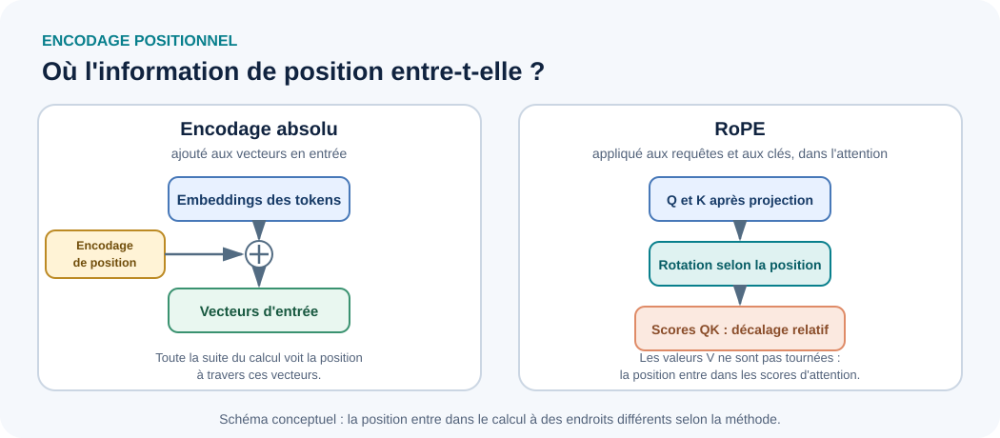

<!--
LLM-LAB-PAGE-MAP v1
id: "fr/positional-encoding"
scope: "Présente pourquoi un Transformer a besoin d’information positionnelle et compare les grandes familles de mécanismes à un niveau conceptuel ; la géométrie, la dérivation et les variantes de RoPE sont réservées à la page d’approfondissement."
purpose: "Le lecteur doit pouvoir expliquer pourquoi un Transformer a besoin d’information positionnelle, distinguer plusieurs façons de l’introduire et décrire à quel endroit du calcul elles interviennent."
suggested_route:
  previous: "fr/embedding-space"
  next: "fr/contextualized-representations"
hierarchy:
  parents: ["fr/embedding-space", "fr/transformer"]
  children: ["fr/contextualized-representations", "fr/rope"]
related: []
tags: ["type:concept-lesson", "destination:understand", "topic:positional-encoding", "level:core", "language:fr", "status:published"]
-->

::: {.chapter-lead}
L'attention compare des représentations de tokens, mais elle ne connaît pas spontanément leur ordre. Un mécanisme positionnel apporte cette information : il permet au modèle de distinguer, par exemple, « le chat poursuit le chien » de « le chien poursuit le chat ». Cette page présente les grandes familles de mécanismes à un niveau conceptuel ; les propriétés géométriques et la dérivation de RoPE sont réservées à un [approfondissement avancé](rope.qmd).
:::

## Pourquoi ajouter une information de position ?

Sans information positionnelle, l'auto-attention standard ne dispose pas à elle seule d'un signal explicite indiquant si un token apparaît avant ou après un autre. L'ordre compte ; il doit donc intervenir dans les représentations ou dans le calcul de l'attention.

{fig-alt="Un encodage absolu est ajouté aux embeddings en entrée, avant toute projection. RoPE applique des rotations aux requêtes et aux clés après leurs projections, avant le produit QK, si bien que les scores d'attention portent l'information de position." width=100%}

## Trois familles à distinguer

- **Encodage absolu ajouté au vecteur :** on ajoute à la représentation du token (son vecteur de plongement) un vecteur associé à sa position. Le Transformer original utilisait des encodages sinusoïdaux ; d'autres modèles apprennent leurs embeddings positionnels.
- **Encodage ou biais relatif :** le calcul utilise explicitement la distance ou le décalage entre deux positions.
- **RoPE :** des rotations dépendant de la position sont appliquées aux requêtes et aux clés avant le calcul des scores d'attention. Cette approche introduit l'information positionnelle à l'intérieur du mécanisme d'attention.

Ces approches injectent l'information positionnelle à des endroits différents et n'ont pas exactement les mêmes propriétés. Il suffit ici de retenir leur rôle et leur emplacement général dans le calcul. Pour comprendre la dépendance au décalage relatif, les conventions de rotation et les limites à longue séquence, voir l'[approfondissement avancé sur RoPE](rope.qmd).

## Idées reçues

- **« L'attention sait naturellement quel token vient en premier. »** L'ordre doit être fourni par un mécanisme positionnel ou une structure équivalente.

## Références

- [Vaswani et al. (2017), Attention Is All You Need](https://arxiv.org/abs/1706.03762) — encodages positionnels sinusoïdaux.
- [Su et al. (2021), RoFormer: Enhanced Transformer with Rotary Position Embedding](https://arxiv.org/abs/2104.09864) — article original sur RoPE.
- [Hugging Face Transformers — documentation](https://huggingface.co/docs/transformers/) — détails d'implémentation selon les architectures.

::: {.language-switch}
**Langue :** [Français](positional-encoding.qmd) · [English](../en/positional-encoding.qmd)
:::
